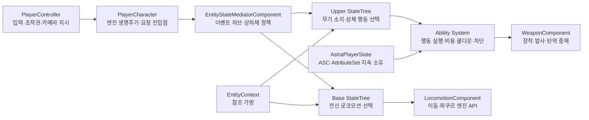

# 00_프로젝트 개요

이 Wiki는 프로젝트의 현재 구조, 개발 규칙, 검증된 결정과 작업 순서를 관리합니다. 기존 `Project Wiki_Ver2.docx`의 내용을 Unreal Engine 5.8 구현에 맞게 분리·정리했으며, 오래된 Unity 규칙은 [[Unity 레거시 설계 규칙|레거시 부록]]으로 이동했습니다.

## 업무 영역

- [[01_일정 관리]]
- [[02_게임 기획]]
- [[03_시스템 설계]]
- [[04_아트 및 애니메이션]]
- [[05_오디오]]
- [[06_레벨 디자인]]
- [[07_QA_테스트]]
- [[08_기술 위키_공통 가이드]]
- [[09_릴리즈_패치노트]]
- [[10_아카이브]]

## 현재 요약

| 영역 | 현재 상태 | 다음 핵심 작업 |
|---|---|---|
| 프로젝트 초기화 | 완료 | 새 컴포넌트 추가 시 검증 순서 유지 |
| 기본 로코모션 | 완료 | 회귀 테스트 유지 |
| Hanging / Mantle | 완료 | 접촉부 미세 보정은 애니메이션 단계에서 처리 |
| Vault | 기능 구현, 시각 품질 보류 | 전용 애니메이션 확보 후 교체 |
| 무기 장착·수납 | 완료 | 무기별 Anim Layer 확장 |
| 권총 발사 | 단발 발사 경로 완료 | 반동, Muzzle VFX, Sound Concurrency |
| 권총 재장전 | 기본 경로 완료 | 빈 탄창 자동 전환과 취소 경로 회귀 테스트 |
| 상체 조준 | Pitch·왼손 IK 기반 완료 | 허리/팔 관통 보정, Hold/Toggle·Zoom |
| GAS 전환 | Fire·Reload 완료, Aim 대기 | StatusModel 책임 축소 및 AbilitySet 이관 |
| NPC / Soul-Link | 설계 단계 | 플레이어 전투 기반 안정화 후 착수 |

## 핵심 문서

| 문서 | 내용 |
|---|---|
| [[시스템 아키텍처|01. 아키텍처]] | 객체 계층, 데이터 소유권, 초기화 |
| [[개발 규칙|02. 개발 규칙]] | Blueprint/C++ 경계, 변경·검증 규칙 |
| [[StateTree와 GAS|03. StateTree와 GAS]] | Base/Upper 분리, Mediator, GAS 역할 |
| [[로코모션과 파쿠르|04. 로코모션]] | 이동, Hanging, Mantle, Vault |
| [[무기 시스템|05. 무기 시스템]] | DataAsset, Model, Component, Projectile |
| [[애니메이션과 조준|06. 애니메이션과 조준]] | UpperBody, Aim Offset, IK, 카메라 |
| [[로드맵|07. 로드맵]] | 완료 상태와 우선순위 |
| [[Editor 작업 절차|08. 에디터 절차]] | 반복 작업의 정확한 순서 |
| [[남은 이슈|09. 남은 이슈]] | 미해결 문제, 임시 처리, 검증 대기 항목 |

## 최상위 데이터 흐름

## 문서 갱신 규칙

- 기능 완료 시: 해당 Wiki의 상태와 `07-Roadmap.md`를 갱신합니다.
- 일일 종료 시: `Reports/Daily/YYYY/YYYY-MM-DD.md`를 작성합니다.
- 중요한 설계 변경 시: 변경 이유, 대안, 영향을 함께 기록합니다.
- 구현과 문서가 충돌하면 코드를 확인해 현재 사실을 먼저 기록하고, 설계 목표는 별도 항목으로 분리합니다.
