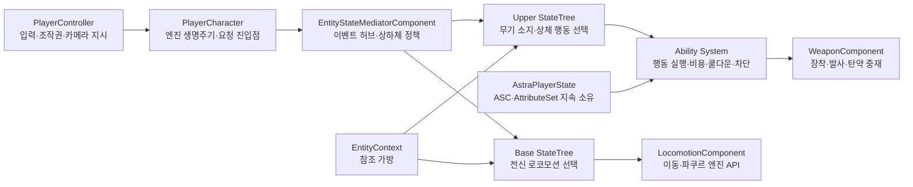

# 00_프로젝트 개요

이 Wiki는 프로젝트의 현재 구조, 개발 규칙, 검증된 결정과 작업 순서를 관리합니다. 기존 `Project Wiki_Ver2.docx`의 내용을 Unreal Engine 5.8 구현에 맞게 분리·정리했으며, 오래된 Unity 규칙은 [레거시 부록](../10_%EC%95%84%EC%B9%B4%EC%9D%B4%EB%B8%8C/Unity%20%EB%A0%88%EA%B1%B0%EC%8B%9C%20%EC%84%A4%EA%B3%84%20%EA%B7%9C%EC%B9%99.md)으로 이동했습니다.

## 업무 영역

- [01_일정 관리](../01_%EC%9D%BC%EC%A0%95%20%EA%B4%80%EB%A6%AC/01_%EC%9D%BC%EC%A0%95%20%EA%B4%80%EB%A6%AC.md)
- [02_게임 기획](../02_%EA%B2%8C%EC%9E%84%20%EA%B8%B0%ED%9A%8D/02_%EA%B2%8C%EC%9E%84%20%EA%B8%B0%ED%9A%8D.md)
- [03_시스템 설계](../03_%EC%8B%9C%EC%8A%A4%ED%85%9C%20%EC%84%A4%EA%B3%84/03_%EC%8B%9C%EC%8A%A4%ED%85%9C%20%EC%84%A4%EA%B3%84.md)
- [04_아트 및 애니메이션](../04_%EC%95%84%ED%8A%B8%20%EB%B0%8F%20%EC%95%A0%EB%8B%88%EB%A9%94%EC%9D%B4%EC%85%98/04_%EC%95%84%ED%8A%B8%20%EB%B0%8F%20%EC%95%A0%EB%8B%88%EB%A9%94%EC%9D%B4%EC%85%98.md)
- [05_오디오](../05_%EC%98%A4%EB%94%94%EC%98%A4/05_%EC%98%A4%EB%94%94%EC%98%A4.md)
- [06_레벨 디자인](../06_%EB%A0%88%EB%B2%A8%20%EB%94%94%EC%9E%90%EC%9D%B8/06_%EB%A0%88%EB%B2%A8%20%EB%94%94%EC%9E%90%EC%9D%B8.md)
- [07_QA_테스트](../07_QA_%ED%85%8C%EC%8A%A4%ED%8A%B8/07_QA_%ED%85%8C%EC%8A%A4%ED%8A%B8.md)
- [08_기술 위키_공통 가이드](../08_%EA%B8%B0%EC%88%A0%20%EC%9C%84%ED%82%A4_%EA%B3%B5%ED%86%B5%20%EA%B0%80%EC%9D%B4%EB%93%9C/08_%EA%B8%B0%EC%88%A0%20%EC%9C%84%ED%82%A4_%EA%B3%B5%ED%86%B5%20%EA%B0%80%EC%9D%B4%EB%93%9C.md)
- [09_릴리즈_패치노트](../09_%EB%A6%B4%EB%A6%AC%EC%A6%88_%ED%8C%A8%EC%B9%98%EB%85%B8%ED%8A%B8/09_%EB%A6%B4%EB%A6%AC%EC%A6%88_%ED%8C%A8%EC%B9%98%EB%85%B8%ED%8A%B8.md)
- [10_아카이브](../10_%EC%95%84%EC%B9%B4%EC%9D%B4%EB%B8%8C/10_%EC%95%84%EC%B9%B4%EC%9D%B4%EB%B8%8C.md)

## 현재 요약

| 영역 | 현재 상태 | 다음 핵심 작업 |
|---|---|---|
| 프로젝트 초기화 | 완료 | 새 컴포넌트 추가 시 검증 순서 유지 |
| 기본 로코모션 | 완료 | 회귀 테스트 유지 |
| Hanging / Mantle | 완료 | 접촉부 미세 보정은 애니메이션 단계에서 처리 |
| Vault | 기능 구현, 시각 품질 보류 | 전용 애니메이션 확보 후 교체 |
| 무기 장착·수납 | 완료 | 무기별 Anim Layer 확장 |
| 권총 발사 | 단발 발사 경로 완료 | 반동, Muzzle VFX, Sound Concurrency |
| 권총 재장전 | 기본 경로 완료 | 빈 탄창 자동 전환과 취소 경로 회귀 테스트 |
| 상체 조준 | Pitch·왼손 IK 기반 완료 | 허리/팔 관통 보정, Hold/Toggle·Zoom |
| GAS 전환 | Fire·Reload 완료, Aim 대기 | StatusModel 책임 축소 및 AbilitySet 이관 |
| NPC / Soul-Link | 설계 단계 | 플레이어 전투 기반 안정화 후 착수 |

## 핵심 문서

| 문서 | 내용 |
|---|---|
| [01. 아키텍처](../03_%EC%8B%9C%EC%8A%A4%ED%85%9C%20%EC%84%A4%EA%B3%84/%EC%8B%9C%EC%8A%A4%ED%85%9C%20%EC%95%84%ED%82%A4%ED%85%8D%EC%B2%98.md) | 객체 계층, 데이터 소유권, 초기화 |
| [02. 개발 규칙](../03_%EC%8B%9C%EC%8A%A4%ED%85%9C%20%EC%84%A4%EA%B3%84/%EA%B0%9C%EB%B0%9C%20%EA%B7%9C%EC%B9%99.md) | Blueprint/C++ 경계, 변경·검증 규칙 |
| [03. StateTree와 GAS](../03_%EC%8B%9C%EC%8A%A4%ED%85%9C%20%EC%84%A4%EA%B3%84/StateTree%EC%99%80%20GAS.md) | Base/Upper 분리, Mediator, GAS 역할 |
| [04. 로코모션](../03_%EC%8B%9C%EC%8A%A4%ED%85%9C%20%EC%84%A4%EA%B3%84/%EB%A1%9C%EC%BD%94%EB%AA%A8%EC%85%98%EA%B3%BC%20%ED%8C%8C%EC%BF%A0%EB%A5%B4.md) | 이동, Hanging, Mantle, Vault |
| [05. 무기 시스템](../03_%EC%8B%9C%EC%8A%A4%ED%85%9C%20%EC%84%A4%EA%B3%84/%EB%AC%B4%EA%B8%B0%20%EC%8B%9C%EC%8A%A4%ED%85%9C.md) | DataAsset, Model, Component, Projectile |
| [06. 장비와 인벤토리](../03_%EC%8B%9C%EC%8A%A4%ED%85%9C%20%EC%84%A4%EA%B3%84/%EC%9E%A5%EB%B9%84%EC%99%80%20%EC%9D%B8%EB%B2%A4%ED%86%A0%EB%A6%AC.md) | ItemModel, Equipment, Capacity, 탄약 Reservation |
| [07. 애니메이션과 조준](../04_%EC%95%84%ED%8A%B8%20%EB%B0%8F%20%EC%95%A0%EB%8B%88%EB%A9%94%EC%9D%B4%EC%85%98/%EC%95%A0%EB%8B%88%EB%A9%94%EC%9D%B4%EC%85%98%EA%B3%BC%20%EC%A1%B0%EC%A4%80.md) | UpperBody, Aim Offset, IK, 카메라 |
| [08. 로드맵](../01_%EC%9D%BC%EC%A0%95%20%EA%B4%80%EB%A6%AC/%EB%A1%9C%EB%93%9C%EB%A7%B5.md) | 완료 상태와 우선순위 |
| [09. 에디터 절차](../08_%EA%B8%B0%EC%88%A0%20%EC%9C%84%ED%82%A4_%EA%B3%B5%ED%86%B5%20%EA%B0%80%EC%9D%B4%EB%93%9C/Editor%20%EC%9E%91%EC%97%85%20%EC%A0%88%EC%B0%A8.md) | 반복 작업의 정확한 순서 |
| [10. 남은 이슈](../01_%EC%9D%BC%EC%A0%95%20%EA%B4%80%EB%A6%AC/%EB%82%A8%EC%9D%80%20%EC%9D%B4%EC%8A%88.md) | 미해결 문제, 임시 처리, 검증 대기 항목 |

## 최상위 데이터 흐름

## 문서 갱신 규칙

- 기능 완료 시: 해당 Wiki의 상태와 `07-Roadmap.md`를 갱신합니다.
- 일일 종료 시: `Reports/Daily/YYYY/YYYY-MM-DD.md`를 작성합니다.
- 중요한 설계 변경 시: 변경 이유, 대안, 영향을 함께 기록합니다.
- 구현과 문서가 충돌하면 코드를 확인해 현재 사실을 먼저 기록하고, 설계 목표는 별도 항목으로 분리합니다.
