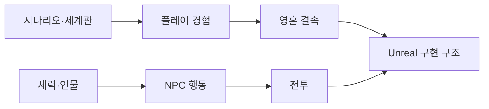

# 프로젝트 목표

아스트라: 영혼결속의 프로젝트 문서 허브입니다.

## 핵심 콘셉트

- 장르: Unreal Engine 5.8 기반 TPS
- 무대: 영혼 에너지가 고갈되어 가는 행성 아말테아
- 핵심 능력: 아스트라와 영혼을 동기화하는 영혼 결속
- 장기 목표: 생존, 추방자 지원, 방주 재건, 발카의 지배 시스템 해체

## 기획 문서

- [시나리오 구조](../02_%EA%B2%8C%EC%9E%84%20%EA%B8%B0%ED%9A%8D/%EC%8B%9C%EB%82%98%EB%A6%AC%EC%98%A4/%EC%8B%9C%EB%82%98%EB%A6%AC%EC%98%A4%20%EA%B5%AC%EC%A1%B0.md)
- [세계관과 설정](../02_%EA%B2%8C%EC%9E%84%20%EA%B8%B0%ED%9A%8D/%EC%84%B8%EA%B3%84%EA%B4%80/%EC%84%B8%EA%B3%84%EA%B4%80%EA%B3%BC%20%EC%84%A4%EC%A0%95.md)
- [주요 인물](../02_%EA%B2%8C%EC%9E%84%20%EA%B8%B0%ED%9A%8D/%EC%BA%90%EB%A6%AD%ED%84%B0/%EC%A3%BC%EC%9A%94%20%EC%9D%B8%EB%AC%BC.md)
- [NPC 행동](../02_%EA%B2%8C%EC%9E%84%20%EA%B8%B0%ED%9A%8D/%EC%8B%9C%EC%8A%A4%ED%85%9C%20%EA%B8%B0%ED%9A%8D/NPC%20%ED%96%89%EB%8F%99.md)
- [NPC 전투 성향](../02_%EA%B2%8C%EC%9E%84%20%EA%B8%B0%ED%9A%8D/%EC%8B%9C%EC%8A%A4%ED%85%9C%20%EA%B8%B0%ED%9A%8D/NPC%20%EC%A0%84%ED%88%AC%20%EC%84%B1%ED%96%A5.md)
- [팩션 관계](../02_%EA%B2%8C%EC%9E%84%20%EA%B8%B0%ED%9A%8D/%EC%8B%9C%EC%8A%A4%ED%85%9C%20%EA%B8%B0%ED%9A%8D/%ED%8C%A9%EC%85%98%20%EA%B4%80%EA%B3%84.md)
- [영혼 결속](../02_%EA%B2%8C%EC%9E%84%20%EA%B8%B0%ED%9A%8D/%EC%8B%9C%EC%8A%A4%ED%85%9C%20%EA%B8%B0%ED%9A%8D/%EC%98%81%ED%98%BC%20%EA%B2%B0%EC%86%8D.md)
- [생존 시스템](../02_%EA%B2%8C%EC%9E%84%20%EA%B8%B0%ED%9A%8D/%EC%8B%9C%EC%8A%A4%ED%85%9C%20%EA%B8%B0%ED%9A%8D/%EC%83%9D%EC%A1%B4%20%EC%8B%9C%EC%8A%A4%ED%85%9C.md)

## 구현 문서

- [시스템 아키텍처](../03_%EC%8B%9C%EC%8A%A4%ED%85%9C%20%EC%84%A4%EA%B3%84/%EC%8B%9C%EC%8A%A4%ED%85%9C%20%EC%95%84%ED%82%A4%ED%85%8D%EC%B2%98.md)
- [StateTree와 GAS](../03_%EC%8B%9C%EC%8A%A4%ED%85%9C%20%EC%84%A4%EA%B3%84/StateTree%EC%99%80%20GAS.md)
- [로코모션과 파쿠르](../03_%EC%8B%9C%EC%8A%A4%ED%85%9C%20%EC%84%A4%EA%B3%84/%EC%9D%B4%EB%8F%99%EA%B3%BC%20%ED%8C%8C%EC%BF%A0%EB%A5%B4.md)
- [무기 시스템](../03_%EC%8B%9C%EC%8A%A4%ED%85%9C%20%EC%84%A4%EA%B3%84/%EB%AC%B4%EA%B8%B0.md)
- [애니메이션과 조준](../04_%EC%95%84%ED%8A%B8%20%EB%B0%8F%20%EC%95%A0%EB%8B%88%EB%A9%94%EC%9D%B4%EC%85%98/%EC%95%A0%EB%8B%88%EB%A9%94%EC%9D%B4%EC%85%98%20%EC%84%A4%EA%B3%84/%EB%AC%B4%EA%B8%B0.md)
- [Open Issues](../01_%EC%9D%BC%EC%A0%95%20%EA%B4%80%EB%A6%AC/%EB%82%A8%EC%9D%80%20%EC%9D%B4%EC%8A%88.md)

## 문서 상태 규칙

- `확정`: 구현 또는 반복 확인을 통해 기준이 된 내용
- `기획`: Excel 기획안에 명시되었으나 구현 확인 전인 내용
- `검토 중`: 대안 또는 의문표가 남아 있는 내용
- `미정`: 자료에 값이 명시되지 않은 내용
- 설계 의도는 기존 Wiki, 일일 리포트, 기획 Excel 또는 대화에 근거가 있을 때만 작성합니다.

---

## 상위 페이지

- [00_프로젝트 개요](00_%ED%94%84%EB%A1%9C%EC%A0%9D%ED%8A%B8%20%EA%B0%9C%EC%9A%94.md)

## 관련

- [01_일정 관리](../01_%EC%9D%BC%EC%A0%95%20%EA%B4%80%EB%A6%AC/01_%EC%9D%BC%EC%A0%95%20%EA%B4%80%EB%A6%AC.md)
- [02_게임 기획](../02_%EA%B2%8C%EC%9E%84%20%EA%B8%B0%ED%9A%8D/02_%EA%B2%8C%EC%9E%84%20%EA%B8%B0%ED%9A%8D.md)
- [03_시스템 설계](../03_%EC%8B%9C%EC%8A%A4%ED%85%9C%20%EC%84%A4%EA%B3%84/03_%EC%8B%9C%EC%8A%A4%ED%85%9C%20%EC%84%A4%EA%B3%84.md)
