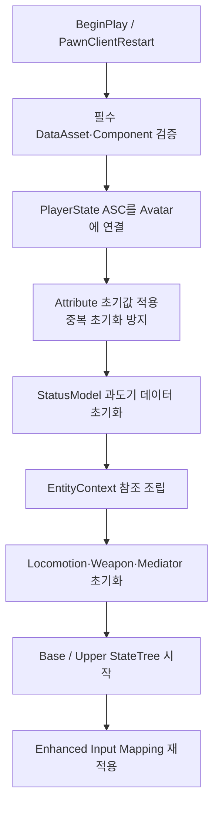

# 시스템 아키텍처

## 1. 적용 원칙

현재 프로젝트는 Unity 시절의 Pure DI 계층을 그대로 재현하지 않습니다. Unreal의 Actor, Component, PlayerState, StateTree, Gameplay Ability System 생명주기에 맞추되 다음 철학은 유지합니다.

- 데이터 주도 설계: 정적 정의와 런타임 인스턴스 데이터를 분리합니다.
- 중재자 패턴: 하위 컴포넌트끼리 직접 결합하지 않고 엔티티 정책은 Mediator가 라우팅합니다.
- 단일 소유권: 하나의 사실을 여러 시스템이 동시에 수정하지 않습니다.
- 이벤트 주도: 상태 간 요청은 GameplayTag 기반 StateTree Event와 EventBus를 사용합니다.
- Context는 참조 가방: 판단과 실행 로직을 넣지 않습니다.

## 2. 현재 계층

| 계층 | Unreal 타입 | 책임 |
|---|---|---|
| 레벨 규칙 | GameMode / GameInstance / Subsystem | 레벨·게임 규칙과 전역 서비스. 현재 별도 Installer/Director 계층은 만들지 않습니다. |
| 입력·조작권 | PlayerController | Enhanced Input 처리, Pawn 소유권 변경, 카메라/조작 주체 관리. Soul-Link 빙의 시 핵심 전환 지점입니다. |
| 플레이어 지속 상태 | `AAstraPlayerState` | ASC와 플레이어 AttributeSet 소유. Pawn이 교체되어도 쿨다운과 자원을 유지합니다. |
| 엔티티 셸 | `APlayerCharacter` | 컴포넌트 조립, Unreal 생명주기 진입점, 입력 요청 전달, 카메라 표현. 도메인 세부 계산은 위임합니다. |
| 엔티티 중재 | `UEntityStateMediatorComponent` | Base/Upper StateTree, Health, ASC 사이의 이벤트 라우팅과 충돌 정책을 담당합니다. |
| 상태 선택 | `UStateTreeComponent` | 조건을 평가하고 상태를 선택하며 Task를 실행합니다. |
| 실행 | `UEntityLocomotionComponent`, `UWeaponComponent` 등 | CharacterMovement, Motion Warping, 무기 장착·발사 등 실제 엔진 API를 호출합니다. |
| 참조 묶음 | `UEntityContext` | StatusModel, Locomotion, Weapon, ASC, Health, Mediator, EventBus 참조를 보관합니다. |
| 런타임 데이터 | ASC/AttributeSet, WeaponModel, 현행 StatusModel | 스탯·자원·탄약·입력 의도와 실행 상태를 각 소유자가 관리합니다. |
| 정적 데이터 | Primary DataAsset | 캐릭터·무기·발사체 튜닝값과 에셋 참조를 보관합니다. |
| 표현 | AnimBP, Montage, Aim Offset, Control Rig | 게임플레이 사실을 읽어 시각화합니다. 상태의 최종 소유자가 되지 않습니다. |

## 3. 객체별 소유권

### AstraPlayerState

플레이어의 Ability System을 소유합니다.

- `UAbilitySystemComponent`
- `UEntityAttributeSet`
- `UPlayerAttributeSet`
- Pawn 교체 후에도 유지해야 하는 자원과 쿨다운

현재 싱글 플레이가 목표여도 PlayerState를 사용하는 이유는 서버 구현 때문만이 아니라 **Avatar 교체와 지속 상태의 분리** 때문입니다. 향후 빙의 시 PlayerController가 다른 Pawn을 조작해도 Owner인 PlayerState의 ASC와 쿨다운은 유지할 수 있습니다.

### PlayerCharacter

- 로코모션, 무기, StateTree, Mediator 등 엔티티 컴포넌트를 소유·초기화합니다.
- 입력을 직접 실행 로직으로 바꾸지 않고 요청으로 전달합니다.
- ASC의 Avatar로 등록됩니다.
- 무기 소지 여부에 따라 회전 방식과 카메라 표현을 갱신합니다.

PlayerCharacter는 이벤트 허브의 세부 정책을 직접 소유하지 않습니다. 상·하체 간 상태 충돌은 `EntityStateMediatorComponent`가 담당합니다.

### EntityStateMediatorComponent

현재 구현된 핵심 정책은 다음과 같습니다.

| 원인 | 결과 |
|---|---|
| 상체 Fire 또는 Aim 진입 | Base StateTree에 Sprint 취소 명령 |
| Base Sprint 진입 | 상체 행동 취소 및 강제 Holster |
| Base Airborne 진입 | 상체 행동 취소 및 강제 Holster |
| Base Traversal 진입 | 상체 행동 취소 및 강제 Holster |
| 피해 발생 | 상체 행동 취소, 하체 HitReaction 요청 |
| 사망 시작 | 상체 취소·비활성화, 하체 Death 요청, 모든 Ability 취소 |

Mediator는 StateTree의 현재 상태를 직접 쓰지 않습니다. `SendStateTreeEvent`로 명령을 보내며 Condition이 전이 가능 여부를 결정합니다.

### EntityContext

`UEntityContext`는 다음 참조만 보관합니다.

- StatusModel
- LocomotionComponent
- WeaponComponent
- AbilitySystemComponent
- HealthComponent
- StateMediator
- StateEventBus

StateTree Condition/Task는 가능하면 `Actor + EntityContext`만 바인딩하고 Context에서 필요한 컴포넌트를 조회합니다. 단, Context가 초기화되기 전에 StateTree가 시작되면 `None` 오류가 나므로 초기화 순서를 지켜야 합니다.

## 4. StatusModel과 GAS 전환

현행 코드에는 `EntityStatusModel`과 `PlayerStatusModel`이 남아 있습니다. 하지만 장기 소유권은 다음과 같이 정리합니다.

| 데이터 | 목표 소유자 |
|---|---|
| 체력, 방어력, 이동 속도 | Entity AttributeSet |
| 스태미나, 영혼 에너지 | Player AttributeSet |
| 사망, 기절, 조준, 공격, 재장전 등 공유 상태 | ASC GameplayTag |
| Ability 비용·쿨다운 | GameplayEffect / ASC |
| 현재 탄창과 개별 무기 강화값 | WeaponModel |
| 상태 선택과 흐름 | StateTree |
| 짧은 입력 의도 | PlayerController 또는 해당 요청 버퍼 |

StateTree는 영구 스탯 저장소가 아닙니다. Condition이 읽을 사실은 Attribute/Tag/Component가 소유하며, StateTree는 그 사실을 이용해 실행 상태를 선택합니다.

StatusModel은 현재 로코모션과 기존 Blueprint 연결을 유지하기 위한 과도기 계층입니다. 한 번에 제거하지 않고 Attribute/Tag로 옮긴 항목부터 책임을 삭제합니다.

## 5. 초기화 생명주기

초기화 함수는 중복 호출에 안전해야 합니다. `PawnClientRestart`에서는 Mapping Context를 제거한 뒤 다시 추가하여 재소유 이후에도 입력이 한 번만 적용되도록 합니다.

## 6. 향후 NPC와 Soul-Link 적용

- 일반 NPC는 자신의 ASC와 AttributeSet을 Pawn 또는 NPC 전용 지속 객체가 소유합니다.
- 빙의형 Soul-Link는 PlayerController가 NPC Pawn을 Possess합니다.
- 플레이어의 고유 자원과 Soul-Link 쿨다운은 AstraPlayerState ASC에 유지합니다.
- 빙의 대상의 일반 공격은 대상 NPC의 AbilitySet과 Avatar 컴포넌트를 사용합니다.
- 변신 중에는 무기 사용을 차단합니다.
- 변신 해제 후에도 PlayerState ASC에 있는 Soul-Link 스킬 쿨다운은 유지합니다.
