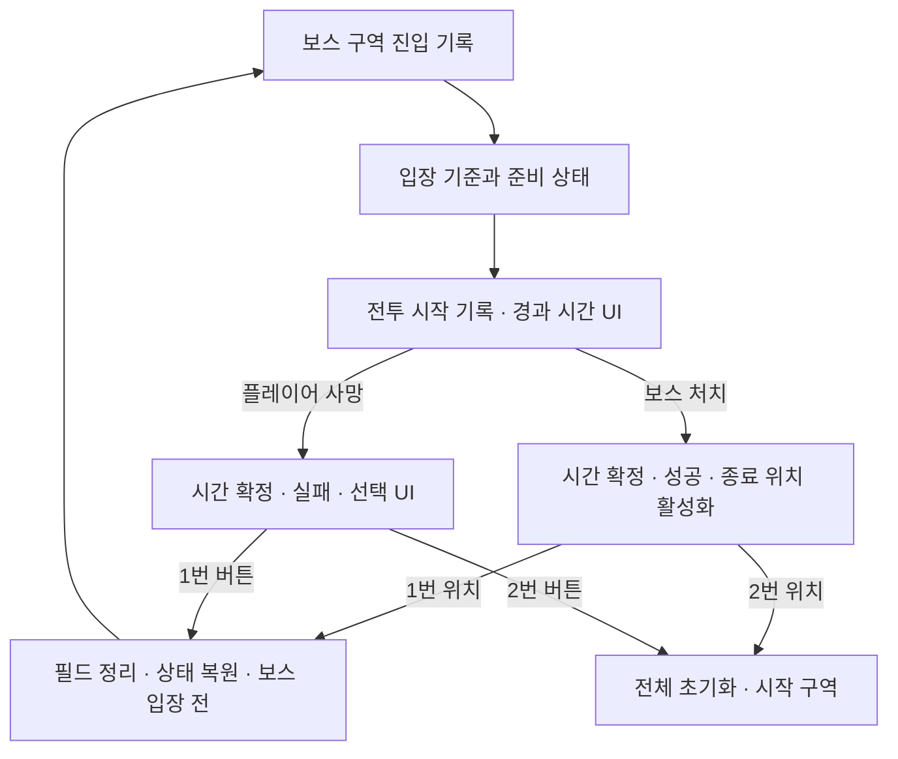

# 2026년 12월 프로토타입 제작 계획

> 작성 기준: 2026-10-14 사용자 논의와 현재 문서·C++ 확인
> 준비 현황 갱신: 2026-10-16 사용자 확정 사항 반영. 아래 최신 현황이 기존 확보 계획·일정의 진행 상태보다 우선
> 작업 진행 갱신: 2026-10-21 추적·재장전 완료, 사망 전이 해결·우선권 상향 사용자 확인. 애니메이션 수정 후 다수 증상 해소로 PT-00-3 사용자 패스. 다음은 PT-00-5 공통 Entity 기반 아스트라·보스 기본 제작 → 인카운터 설계 제안. 세부 사망 포즈 미확인 범위는 후속 QA로 분리 — [현재 작업 상태와 구조](현재%20작업%20상태.md)
> 상태: 제작 계획. 기능 구현·Editor 연결·실행 검증의 완료 기록과 구분
> 제작 순서 변경 — 2026-10-25 사용자 지정: **보스 → 아스트라**. 보스 소환기·전멸기에 공통 스킬 실행 기반을 먼저 적용하며 영혼 결속은 아스트라 제작 시 구현. 아래 기존 PT 순서·날짜 배분과 다를 경우 이 지정을 우선. 날짜·주별 시간은 아직 재산정하지 않음 — [스킬 진행 순서](../03_시스템%20설계/스킬.md#구현-전-확정할-항목과-진행-순서)
> 대상: Windows 싱글, 팀 내부 재미검증
> 인력: 개발자 1명, 주당 약 30시간. C++·Blueprint·에셋 연결·빌드·테스트를 포함한 전체 작업 시간
> 일정 기준: 2026-12-11 테스트 가능한 빌드 완성, 2026-12-15 최종 목표. 12월 15일은 ‘12월 중순’의 계획 기준일

## 최신 준비 현황 — 2026-10-16

| 항목 | 확정 상태 | 남은 연결·확인 |
|---|---|---|
| Lyra·라이플 | 사용자: Lyra 클립 적용과 라이플 준비 완료 | 본 확인에서 추가 빌드·PIE 수행 없음. 무기 교체·시선·전신 사망의 세부 완료 여부는 별도 기록 |
| 보스 동작 | 전멸기: Murdock `ShotGun_Loop`. 소환기: Revenent `Idle`. 일반 공격: 기존 Rifle 동작 재사용 후보 | Sci_Fi_Character_08과 Skeleton 호환성·리타게팅 확인. 클립별 발동 시점 연결 |
| 아스트라 | 사망 애니메이션 불필요 | 체력·피해·회차 정리 규칙은 유지. 사망 애니메이션 제외를 무적 또는 사망 불가 정책으로 해석하지 않음 |
| 좀비 | 이동·공격 애니메이션 확보, 사망은 기존 인간형 애니메이션 재사용 | 로컬 `anim_Zombie_Run_A`, `anim_Zombie_Attack_D` 확인. 대상 모델과 연결·공격 판정 시점 확인 |
| VFX | 준비된 익스플로전 이펙트 사용 | 기능별 효과 연결·반경·수명 정리. 실드·회복·Trail·위험 경고의 세부 표현 완료로 확대 기록하지 않음 |
| 사운드 | 이번 프로토타입 고려 대상에서 제외 | 필수 확보·완료 조건에서 제외 |
| 보스 구성 | 투기장 안에서 행동. 2026-10-24 사용자 추격 추가 요청으로 과거 추적하지 않음 계획 변경. 큰 인간형은 후보이며 비인간형 가능성도 유지 | 현재 AstraNPCCharacter 기반 보스의 Brain Chase→Base ChaseWalk 이동 연결 확인. Patrol·인식 시 발사 정상 사용자 확인. 공통 Entity 기능 재사용 |
| AnimBP 초기화 | BP_PlayerCharacter·BP_NPCCharacter가 각각 수행(사용자 확인) | AnimBP 자체 InitializeAnimation의 빈 실행 핀을 연결 오류로 취급하지 않으며 기존 외부 초기화 유지 |
| 착수 | 사용자: PT-00-2부터 작업. 아스트라·보스를 먼저 만든 뒤 보스 인카운터 설계 | Lyra 적용·라이플 준비 완료는 유지하고 무기별 포즈 전환·총기 시퀀스 잔여부터 진행. 인카운터 C++ 착수안은 후속으로 보류 |

- 재확인: `Content/CharacterAnimationSample/Murdock/ShotGun_Loop.uasset`와 `Content/CharacterAnimationSample/Revenent/Idle.uasset` 파일 존재. 앞선 빈 폴더 확인 기록 대체
- 패키지 참조 문자열: 두 클립에는 `/Game/Astra/Entity/Humanoid/Meshes/SK_Mannequin`, SF 캐릭터 `Full_01` 메시에는 `/Game/Sci_Fi_Character_08/Demo/Mesh/UE4_Mannequin_Skeleton` 확인. 참조 경로가 다르므로 호환 설정·리타게팅 필요 여부를 Editor에서 확인. 문자열 확인만으로 Skeleton 호환·재생 성공을 증명하지 않음
- 현재 순서: PT-00-3 패스·해결된 사망 경로 유지 → PT-00-5 공통 Entity 기능을 활용한 아스트라·보스 기본 제작 → 보스 인카운터 설계·PT-01. 보스의 일반 NPC 상속은 미확정. 아래 기존 날짜·시간 배분은 과거 계획, 최신 사용자 지정 우선 적용

## 1. 검증 목표와 범위

### 보스 일반 공격 후속 확정 — 2026-10-24

- 보스 무기: 탄약 소모·재장전 없는 충전식 유탄
- 표현 순서: 머즐에 탄 생성 → 전기 구체처럼 크기 성장 → 발사
- 탄착 경고 생성 시점: 실제 발사 순간. 충전 시작부터 표시하지 않음
- 발사 속도 고정, 거리에 따라 비행시간 변화. 일정 비행시간으로 맞추는 속도 자동 보정 없음
- 먼 거리에서 회피 시간 증가, 보스에 지나치게 근접하면 짧은 비행시간으로 사망 위험 증가. 근접 위험은 기획 의도
- 발사 순간 확정한 착탄 위치를 궤적·경고의 공통 기준으로 사용. 발사 후 플레이어 이동에 경고 위치 추종 없음
- Pawn·지형 접촉 시 해당 위치에서 즉시 폭발. 조기 충돌 시 예정 지면 경고 정리
- 보스는 항상 100% 충전 후 자동 발사, 완충 피해 BaseDamage ×1.5 적용. 이전 BaseDamage 유지 안 대체. 플레이어는 해제 시 20% 이하 미발사·부분 ×1·완충 ×1.5
- 공통 충전 규칙과 무기별 성장/무기 이펙트 연출 분리. 범용 무기 고유 능력 시스템은 프로토타입 범위에 추가하지 않음. 충전 시간·성장 크기·전기 구체 에셋·최종 속도/높이/수명 튜닝 수치는 사용자 지정
- 기존 무소모 발사·포물선·지면 조준에 충전 실행·성장·경고 수명 C++ 연결 추가. DA·머티리얼 연결과 이번 변경의 빌드·플레이 확인 전 — [현재 실행 범위](../03_시스템%20설계/무기.md#충전-유탄탄착-경고-변경안--2026-10-24)

### 기획 의도

- 총격으로 소울 에너지 확보
- 공유 에너지를 방어·공격·회복에 배분하는 판단 검증
- 유탄 회피, 좀비 정리, 전멸기 방어를 수행하며 보스 공격 지속
- 좀비 처치 후 탄약 상자까지 이동·접촉하는 동안에도 공격 압박 유지. 보스 전투에서 플레이어가 위기를 강하게 체감하도록 조정
- 보스 전투 목표 시간 약 2~3분. 피해·수급·소환·탄약 수치로 조정
- 기존 메시·애니메이션·VFX 활용. 프로토타입용 두 필드 구성·리타게팅·연결은 이번 제작 범위. 최종 외형과 본격적인 시나리오·레벨·아트 제작은 후속

### 확정 범위

| 대상         | 내용                                                                           |
| ---------- | ---------------------------------------------------------------------------- |
| 플레이 흐름     | 권총으로 시작 → 시작 구역에서 라이플 획득 → 보스 구역 진입 → 보스 처치                                  |
| 미션 1       | 시작 구역 돌파와 보스 구역 이동, 라이플 획득                                                   |
| 미션 2       | 보스 처치                                                                        |
| 플레이어 무기    | 권총·라이플. 라이플 모델·애니메이션 확보, 사격 연결·무기별 자세/모션 전환은 선행 제작. 총기 시퀀스·머리 시선·전신 사망 포즈 처리 |
| 보스 일반 공격   | 지속적인 포물선 유탄, 착탄 위험 영역 경고와 회피                                                 |
| 보스 특수 공격   | 일반 공격 사이에 무작위 소환·전멸기 사용                                                      |
| 좀비         | 보스 주변 소환, 플레이어 접근, 근접 공격. 공격형 아스트라로 빠르게 처리하지 않으면 누적되는 압박                     |
| 탄약         | 좀비 처치 시 탄약 상자 드롭, 플레이어 몸 접촉으로 예비 탄약 획득. 처치 즉시 원격 지급 없음                       |
| 필드 연결      | 동일 맵에 일반 구역·보스 구역 구성. 보스 입장 시 별도 로딩 없음                                       |
| 아스트라       | 방어형·공격형·회복형 3종, 게임 시작부터 동행. 수동적인 추종·기술 실행, 체력 유지                             |
| 적 타겟 판정    | 아스트라를 직접 공격 타겟에서 제외                                                          |
| 아스트라 광역 피해 | 일반 광역 피해 감소. 전멸기에는 영향을 받으며 플레이어 실드로 보호                                       |
| 기술 사용      | 플레이어가 결정. 별도 쿨다운 없음. 같은 기술 사용 중 재사용 불가, 다른 아스트라 기술은 동시 사용 가능                 |
| 방어형        | 일정 시간 모든 아군의 받는 피해 무효화, 각 캐릭터에 투명 구체 표현                                      |
| 공격형        | 광역 피해·좀비 처치. 이 기술로 소울 에너지 회복 없음                                              |
| 회복형        | 모든 파티원에게 지속 회복                                                               |
| 소울 에너지     | 플레이어가 소유. 보스에 유효한 총기 피해를 주면 회복, 시간 경과로 자연 회복                                 |
| 수급 제외      | 벽·사망한 적·좀비, 현재 공격형 아스트라 기술                                                   |
| 무기별 수급     | 권총·라이플의 시간당 에너지 수급률이 거의 같도록 조정                                               |
| 전멸기        | 보스 필드의 넓은 범위에 약 2초 반복 폭격. 실드가 없으면 약 1초 내 사망하는 강도                             |
| 전멸기 피해     | 최대 체력 비례 피해. 1회 피해 판정으로 제한했던 이전 안 대체                                         |
| 전멸기 예고     | 빨간 큰 원으로 범위 표시, 작은 원 확대 후 폭격 시작                                              |
| 회피         | 이동만으로 폭격 범위 이탈 불가. 회피 무적으로 전체 폭격 생존 불가                                       |
| 표현 개선      | 탄 Trail, 유탄 궤적·착탄 경고, 전멸기 예고, 실드·광역 공격·회복 효과                                 |
| 전투 시간      | 보스 진입·전투 시작 시점 기록, 전투 경과 시간을 UI에 표시                                          |

### 제외·보류

- 플레이어 근접 무기, 제작·상점, 허기·갈증
- 감시카메라·수풀 잠입
- 아스트라 직접 조종·변신·자율 일반 공격·자율 타겟 선택
- 별도 에너지 회복형 기술 제작. 향후 회복형 기술의 수급 정책은 확장 가능하도록 유지
- 고유 보스 메시·전용 애니메이션 제작, 대규모 맵·컷신·대화 시스템
- 영구 저장과 본격적인 던전·레벨 전환 시스템
- 이미 완료된 TPS·총기 NPC 기반의 재제작, 이번 흐름과 무관한 구조 정리

플레이어 근접 무기 제외와 좀비 근접 공격 제작은 별도 범위

## 2. 기존 기능과 추가 작업

| 구분 | 현재 근거 | 이번 작업 |
|---|---|---|
| TPS·총기 NPC 기반 | 사용자 기본 작업·추적·재장전 완료 확인, PT-00-3 패스 지정 | 재제작과 구분. 머리 시선·NPC 순찰 자세는 현재 선행 작업에서 제외 |
| 체력·피해·회복 | EntityHealthComponent와 AttributeSet | 파티 회복, 실드, 전멸기 비례 피해, 재시작 상태 복원 연결 |
| 소울 에너지 | PlayerState 소유, 소비·자연 회복 기반 | 보스 명중 회복, 무기별 수급, 기술별 사용 제한 연결 |
| 장비·월드 아이템 | Inventory·Gear·ItemTransfer·WorldItem 기반. 접촉 획득 구현 존재 | 라이플 획득·장착, 좀비 탄약 상자 드롭·접촉 획득·회차 정리 연결 |
| 발사체 | ProjectileActor·Factory·Pool | 유탄과 Trail 표현·수명 정리 |
| Trail 데이터 | AmmunitionDataAsset의 TrailVFX 항목 | 발사체 활성화·비활성화 시 표현 연결 |
| 기존 HUD | 체력·스태미나·소울 에너지·탄약 표시 계약 | 보스 체력, 3종 기술 사용 상태, 전투 시간, 미션·종료·사망 UI 추가 |
| 보스·좀비·아스트라 | 새 프로토타입 역할 | 패턴·근접 공격·추종·3종 기술 제작 |
| 전투 회차·재시작 | 이번에 추가하는 플레이 규칙 | 진입·시작·성공·사망·정리·재시작의 공통 생명주기 |

위 내용은 문서·소스와 사용자 확인 기준. 이 문서 작성 중 UE 빌드·Blueprint Compile·PIE 수행 없음

### 리소스·애니메이션·필드 제작 목록

| 대상      | 사용자 제시 작업                                 | 함께 포함할 연결 작업                                                                           |
| ------- | ----------------------------------------- | -------------------------------------------------------------------------------------- |
| 플레이어    | Lyra 클립·라이플 준비, 재장전 완료. 애니메이션 수정 후 다수 증상 해소로 PT-00-3 패스 | 신규 시선 작업 없음. 총기·사망의 개별 미확인 범위는 후속 QA로 분리 |
| 좀비      | 기존 인간형 에셋, 근접 공격·사망 애니메이션                 | 접근·공격 거리·공격 시점 판정·동일 공격 중 중복 피격 방지·사망 시 공격 중단. 기존 NPC 및 근접 판정의 활용 범위 확인                |
| 보스      | 전멸기 Murdock `ShotGun_Loop`, 소환 Revenent `Idle`, 일반 공격 기존 Rifle 후보 | Sci_Fi_Character_08과 리타게팅 확인, 이동 속도와 애니메이션 일치, 공격 발동 시점 연결, 사망 표현과 종료 처리. 사망·재시작 시 진행 중 패턴 중단 |
| 유탄      | Fab 총기 모델 활용한 발사기, 유탄, 착탄 범위 UI, 폭발 VFX   | 발사 소켓·발사 시점, 포물선·충돌·기폭·광역 피해, 경고 영역과 실제 반경 일치, 수명·재시작 정리                               |
| 일반 탄    | Fab 표현 활용, 탄 교체와 Trail                    | 기존 명중·충돌 계약 유지. Pool 재사용 시 이전 Trail 잔존 방지                                              |
| 아스트라 3종 | 확보된 모델·애니메이션 활용. 사망 애니메이션 불필요 | 사용할 모델·역할·클립 확정. 추종·대기·기술·피격 상태 연결, 시야·몸 충돌·통로 방해 확인 |
| 보스 필드   | 콜로세움 형태의 최소 전투 필드                         | 이동 공간·충돌·NavMesh·보스/좀비 생성 위치·파티 대기 위치·입장문·전투 중 이탈 차단                                   |
| 일반 필드   | 시작 구역과 라이플 획득 구간                          | 최소 경로·기존 NPC 전투·라이플 배치·보스 입장 발판·목표 안내                                                  |
| 발판·UI   | 입장 발판 1개, 클리어 후 보스/전체 재시작 발판 각 1개, 사망 UI  | 전투 상태별 활성화·중복 요청 방지·성공 시 출구 접근 보장·버튼 선택 후 게임 입력 복구                                     |
| 전투 안내   | 기존 HUD와 임시 UI 활용. 사운드는 이번 범위 제외 | 보스 체력·전투 시간·3종 기술 사용/사용 불가 상태·탄약 획득 안내 |
| 탄약 상자   | 좀비 처치 위치에서 드롭·플레이어 접촉 획득                  | 지면 배치·식별 가능한 임시 표현·중복 드롭 방지·아스트라 획득 제외·남은 상자 회차 정리. 수용 가능한 수량만 획득하는 기존 Inventory 계약 확인 |

- 리소스 확보는 후보 탐색뿐 아니라 가져오기·리타게팅·소켓·Montage·실제 판정 연결 시간을 포함
- Lyra 클립 적용·라이플 준비 완료(2026-10-16 사용자 확인). 새 애니메이션 제작 없음. 머리 시선·전신 사망 등의 세부 잔여는 별도 확인
- 아스트라는 확보 리소스에서 모델·역할·사용 클립을 정리. 사망 애니메이션은 준비 대상 제외
- 보스 이동은 제자리 애니메이션과 코드 이동 또는 Root Motion 중 한 방식으로 정렬. 세부 방식 미정
- 좀비 근접 판정은 기존 소스의 거리/Trace/Notify 활용 가능성 확인. 기존 근접 캐릭터 전체를 그대로 복제하는 범위와 구분

### 좀비 탄약 상자·접촉 획득 확정

- 사용자 확정 흐름: 좀비 실제 사망 → 탄약 상자 1회 드롭 → 플레이어 접촉 → 예비 탄약 추가 → 획득 표시
- 공격형 아스트라로 처치해도 상자 드롭. 처치 즉시 자동 지급 제안 대체
- 몸 접촉 획득, 별도 상호작용 버튼 입력 없음. 탄창 자동 충전과 구분하며 기존 재장전 유지
- 획득 주체는 플레이어. 아스트라 접촉으로 상자가 사라지거나 지급되지 않도록 확인
- 전투 종료·필드 정리·재시작으로 제거한 좀비는 보상 드롭 제외. 실제 사망 1회당 드롭 1회
- 좀비 사망 위치 부근의 접근 가능한 지면에 상자 배치. 벽·문·바닥 아래·플레이 불가 영역 드롭 방지
- 기존 WorldItem의 접촉 획득·부분 획득·Pool 재사용 기반 활용. 현재 NPC 사망 상자 생성 경로와 회차 정리 연동은 추가 작업
- 일반 구역의 기존 상자·상호작용 정책 적용 범위는 별도 유지. 보스 소환 좀비의 접촉 보급부터 적용
- 탄약 종류·수량·보유 한도·상자 식별 표현은 미정. 두 무기의 실제 탄약 정의와 Inventory 수용 가능 여부 확인
- 상자를 향한 이동 중 유탄·좀비의 공격 압박, 회수 후 보스 공격 재개 가능 여부 검증. 총기로 좀비를 직접 정리하는 것이 광역 기술보다 유리해지는지도 확인
- 첫 소환까지 필요한 초기 탄약·에너지와 소환 간격 검증. 탄약 고갈로 보스 명중 수급이 끊긴 상황에서 자연 회복과 공격형 기술로 복귀 가능한지, 실패 상태인지 구분

## 3. 전투 시간과 재시작

### 보스 입장·필드 구성

- 확정 사항: 보스 전투 시작 시 문 닫힘, 전투 구역 이탈 불가. 시작 구역에서 입장 발판 접근으로 보스 구역 이동
- 확정 사항: 동일 맵의 일반 구역·보스 구역, 입장 트리거와 문으로 구성. 보스 구역 진입을 위한 맵 로딩 없음
- 세부 입장 이동 방식은 일반 통로 또는 동일 맵 내 위치 이동 중 미정. 문 닫기와 파티 동반 조건은 공통
- 입장 시 플레이어와 아스트라 3종의 안전한 위치 확보. 추종이 늦어 문 밖에 남거나 플레이어와 겹치는 경우 처리
- 준비 완료 뒤 문 닫기·실제 전투 시작·타이머 시작. 진입 시점은 별도 기록
- 보스 처치 후 전투 위험 정리와 두 재시작 발판 활성화. 잠긴 필드에서 발판까지 이동 가능하도록 구성
- 향후 인스턴스 이전을 고려해 보스 필드·스포너·입장/재시작 위치·회차 생성 객체의 참조를 구역 단위로 구성
- 일반 구역의 특정 레벨 Blueprint나 전체 Actor 검색에 보스 전투 진행을 의존시키지 않는 방향. 별도 인스턴스 로딩 시스템 제작은 후속

### 타이머 기록·표시

- 보스 구역 진입 시점 기록
- 실제 전투 시작 시점 별도 기록. 시작 이벤트와 전투 시작 간 지연이 있어도 구분
- UI 주 표시: `현재 전투 시간 - 전투 시작 시점`의 경과 시간
- 전투 시작 전 대기 표시, 시작 후 `분:초` 표시를 기본 계획으로 사용
- 보스 처치 또는 플레이어 사망 시 종료 시점·소요 시간 확정
- 종료 지점 이동과 사망 UI 선택 대기 시간은 전투 시간에서 제외
- 다음 전투 시작 시 0부터 재측정, 이전 회차의 성공·실패·소요 시간은 테스트 기록으로 보관
- 시간 계산·전투 상태의 소유자는 공통 전투 회차 처리. UI는 값을 표시
- 게임 일시정지 시간의 포함 여부와 세부 UI 형식은 미정

### 사용자 확정 재시작 선택

| 상황 | 선택 | 결과 |
|---|---|---|
| 보스 처치 후 | 1번 위치 진입 | 보스 입장 전에서 재시작 |
| 보스 처치 후 | 2번 위치 진입 | 시작 구역부터 전체 재시작 |
| 플레이어 사망 후 | UI 1번 버튼 | 보스 입장 전에서 재시작 |
| 플레이어 사망 후 | UI 2번 버튼 | 전체 재시작 |

위치 트리거와 UI 버튼이 같은 두 재시작 처리를 요청하는 구성

### 구현 계획

- 보스 재시작: 동일 맵의 보스 전투 상태 정리·새 보스 생성·플레이어와 파티 이동·기준 상태 복원
- 전체 재시작: 현재 맵 재로딩과 초기 미션·권총 시작 구성
- 위 구현 방식은 제작 계획안. 사용자 확정 사항은 두 재시작 선택의 결과
- 보스 입장 기준 무기·탄약·아군 체력·소울 에너지의 복원 값은 미정. 비교 가능한 기준값 사용 권장
- 종료 확정 후 폭격·소환·기술 효과의 진행 중단, 재시작 후 이전 회차의 피해·탄약·이벤트 잔존 방지
- 체력 수치 외 사망 상태·무적·진행 중 기술·몽타주·타이머·AI 기억·탄약 Reservation 함께 복원
- PlayerState의 소울 에너지·인벤토리는 Pawn 교체만으로 초기화되지 않는 현재 구조 고려



## 4. 제작 순서와 완료 조건

### 선행 순서 확정

- 사용할 에셋 확보와 라이플·무기별 애니메이션 전환·총기 시퀀스·시선·전신 사망 표현 완료 후 나머지 프로토타입 기능 제작
- 사용자 진행 보고(2026-10-16): Lyra 클립 적용·라이플 준비 완료. 보스 발사·소환·전멸기 모션 선정과 좀비 이동·공격 확보 완료
- 남은 준비 확인: Murdock `ShotGun_Loop`·Revenent `Idle` → Sci_Fi_Character_08 리타게팅, 사용할 모델·클립·효과의 연결 확인. 추가 에셋 탐색을 기본 선행 작업으로 두지 않음
- 현재의 무기·체력·재장전 기반은 활용. Lyra를 참고한 총기 표현·행동 연결은 별도 선행 개선 작업
- 기존의 회차·시간 기반 우선 착수안과 Lyra 적용을 11월 말로 미뤘던 순서 대체

각 작업은 C++·Editor 연결·동작 확인을 합친 단위. 계획 식별자는 이 문서 내부 작업 번호

|  순서 | 식별자     | 제작 묶음                                                        | 선행            | 완료 조건                                                                |
| --: | ------- | ------------------------------------------------------------ | ------------- | -------------------------------------------------------------------- |
|   1 | PT-00-1 | 사용할 에셋 확보·임포트·필요 에셋 선별                                       | 보유 에셋·외부 리소스  | Lyra·보스·아스트라·좀비·총기·탄/Trail·필수 VFX의 사용 후보와 UE 사용 가능 여부 확인             |
|   2 | PT-00-2 | Lyra 적용·라이플 구현/사격 모션·무기별 애니메이션 전환·총기 시퀀스                     | PT-00-1       | 권총↔라이플 교체 시 자세·모션 변경, 라이플 실제 사격·재장전·복귀와 부자연스러운 전환 해소                 |
|  패스 | PT-00-3 | 플레이어 머리 시선·NPC 총기 순찰 자세 수정                                   | 사용자 패스(10/21) | 애니메이션 수정 후 다수 증상 해소. 현재 선행 작업에서 제외                                   |
|   4 | PT-00-4 | 플레이어/NPC 전신 사망 애니메이션·생존 상체 포즈 잔존 수정                          | PT-00-2~3     | 권총·라이플을 든 상태와 비무장 상태에서 전신 사망 포즈 정상                                   |
|  선행 | PT-00-5 | 공통 기능을 활용한 아스트라·보스 기본 제작(10/16 사용자 지정 선행 작업)                 | PT-00-2~4     | 캐릭터 구성·모델·기본 동작·보스 모션 호환 확인. 보스는 추적 없는 전용 구성 검토. 완성 전투 패턴·회차 시스템과 구분 |
|   5 | PT-01   | 보스 인카운터 설계·최소 보스 필드/NavMesh·회차·시간 UI·플레이어 사망·재시작 기반·초기 실행 빌드 | PT-00-5       | 제작한 아스트라·보스 기준 진입·성공·사망·재도전·시간 측정 확인                                 |
|   6 | PT-02   | 보스 명중 에너지·무기별 수급·아스트라 3종 추종/체력·공통 기술 사용                      | PT-01         | 수급 대상 구분, 같은 기술 중복 차단, 다른 기술 사용 허용, 시야 방해·타겟 제외 확인                   |
|   7 | PT-03   | 보스 애니메이션 연결·발사기·유탄/폭발·착탄 경고·실드·전멸기                           | PT-02         | 예고와 판정 일치, 유탄 회피·아군 실드 보호 확인                                         |
|   8 | PT-04   | 좀비 근접/사망·소환·공격형 광역 기술·탄약 상자 드롭/접촉 획득                         | PT-02~03      | 좀비 압박·공격기 처치·회수 중 위기, 수급 제외와 중복 드롭 방지 확인                             |
|   9 | PT-05   | 파티 지속 회복·아스트라 표현·무작위 특수 패턴·보스 사망·에너지 통합                      | PT-03~04      | 공유 에너지 선택과 2~3분 보스전 검증                                               |
|  10 | PT-06   | 일반 필드·미션·라이플·입장 발판/문·종료 발판·사망 UI·완전한 재시작                     | PT-01~05      | 시작부터 파티 동행·라이플 획득·보스 처치·두 종류 재시작 연결                                  |
|  11 | PT-07   | 탄/Trail·전투 표현·HUD·밸런스 수정                                     | PT-03~06      | 경고와 판정 일치, Trail 정리, 수급과 기술 선택 검증                                    |
|  12 | PT-08   | 전체 회귀·재시작 반복·최종 패키징·문제 수정                                    | PT-01~07      | Windows 실행 빌드에서 전체 흐름 반복 확인                                          |

### 에셋 확보 완료 기준

- Lyra: 클립 적용 완료(10/16 사용자 확인)
- 보스: 전멸기 Murdock `ShotGun_Loop`, 소환 Revenent `Idle` 사용 확정. 일반 공격은 기존 Rifle 동작 후보. Sci_Fi_Character_08과 Skeleton 호환성·리타게팅 확인 필요. 이동·Idle·사망 표현은 연결 시 확인
- 아스트라: 확보된 모델·애니메이션의 역할·클립 연결 확인. 사망 애니메이션 불필요
- 좀비: 이동·근접 공격 확보, 기존 인간형 사망 클립 재사용. 대상 모델과 연결 확인
- 라이플: 준비 완료(10/16 사용자 확인). 추가 확보 대상으로 두지 않음
- 총기·탄·VFX: 준비된 익스플로전 이펙트 사용. 유탄발사기·일반 탄/Trail·실드·광역 공격·회복은 기능별 연결 시 실제 사용할 표현 확인. 사운드 제외
- 완성 외형이 아닌 임시 표현 사용 가능. 각 기능에 쓸 리소스와 누락 여부가 확인된 상태를 완료 기준으로 사용
- 외부 에셋 검색·선정·임포트는 사용자 진행. 경로·에셋명·호환성은 실제 확인 전 미정

### 총기 시퀀스·시선 선행 작업

#### PT-00-2 첫 확인 결과 — 2026-10-16

- 사용자 제공 그래프 확인 후 [무기 애니메이션 — 소켓·포즈 연결](../04_아트%20및%20애니메이션/애니메이션%20설계/무기.md#소켓과-무기별-보정) 작성. 권총 수납은 기존 오른쪽 허벅지, 라이플은 등 뒤. 꺼내기 모션 없이 `EquipMontage=None` 사용. Editor 연결·Compile·PIE는 미수행
- 대상 AnimBP 파일: `Content/Astra/Entity/Humanoid/Animations/Unarmed/ABP_Unarmed.uasset`
- 패키지 문자열에서 Pistol Idle·Pistol AimOffset 참조 확인. Rifle 포즈 선택 노드나 현재 핀 연결·실행 경로의 부재까지 확정한 근거는 아님
- `UWeaponComponent.GetEquippedWeaponData()`는 BlueprintPure로 공개. 반환 DataAsset의 `WeaponType`은 BlueprintReadOnly이며 `Pistol`·`AssaultRifle` 구분 가능
- `WeaponDataAsset.WeaponAnimLayerClass` 선언 존재. Source 전체 검색에서 `LinkAnimClassLayers`·`UnlinkAnimClassLayers` 호출과 이 필드의 사용 미확인
- Fire·Reload Handler는 활성 WeaponDataAsset의 Montage를 조회해 재생. 새 라이플 발사 시스템보다 무기별 포즈·AimOffset 선택과 Montage 데이터 연결을 먼저 확인
- 사용자 제공 AnimGraph 확인: Pistol Idle → 단일 UpperBody Slot → Pistol AimOffset → Bool 선택 → Layered Blend Per Bone → WeaponAimPose → Visual Correction. 기존 Main States 유지, 무기별 Idle·AimOffset 선택을 추가하는 1차 연결안 작성
- 확인 순서: 권총 → 라이플 → 권총 → 비무장, 이어 발사·재장전·조준·이동 후 복귀. 실패 시 이전 무기 포즈·AimOffset 잔존 여부, 취소/교체 시 진행 중 Montage와 기본 포즈 복귀 확인
- 현재 C++ 변경 없음. AnimBP·DataAsset 연결 작업은 사용자 수행. Linked Anim Layer 추가가 필요하면 인터페이스·Montage 평가 경로·해제 순서를 포함해 별도 변경안으로 확정

- 사용자 보고: 총기를 들고 사격 후 일부 과정 부자연스러움. 정확한 전환 구간·원인은 미확인
- Lyra의 총기 행동 흐름과 새로 가져온 클립을 기준으로 현재 포즈·Montage·블렌드·상태 복귀 구간 비교
- 확인 구간: 총기 대기↔조준, 발사 시작/반복/종료, 조준 해제, 재장전, 수납, 이동·회피 후 총기 자세 복귀
- 자동 수납 여부·대기 시간·상태 전환 규칙 변경은 미정. Lyra와 유사하다는 이유만으로 기존 게임 규칙 전체를 복사하지 않음
- 플레이어 시선 목표 확정: 머리가 카메라 방향의 조준점을 따라감
- 2026-10-21 갱신: 이번 애니메이션 수정 후 다수 증상 해소로 PT-00-3 사용자 패스. 아래 시선 목표·점검 항목은 기존 계획 보존, 현재 착수·선행 통과 조건에서 제외
- NPC 사용자 보고: 총기를 들고 순찰하면 바닥을 보는 증상
- NPC 순찰 시 중립 포즈·조준 보정 입력·머리 보정 적용 조건 확인. 플레이어 카메라 의존과 NPC 시선 기준 구분
- 머리 시선과 총기/팔 조준 보정의 적용 범위 구분. 머리 보정 때문에 손·총열 방향이 틀어지는지 확인
- 정확한 머리 회전 범위·보간 값·NPC 전투 시선 기준은 미정
- 이슈 연결: ANIM-007(Draw/상체 블렌드), ANIM-008(Aim Offset/Visual Correction), ANIM-009(Fire 팔 회전)은 점검 후보. 현재 증상의 확정 원인으로 기록하지 않음
- 총기 통과 조건: 권총·라이플에서 이동·조준·반복 발사·재장전·회피 후 자세 정상. 플레이어 시선 추종·NPC 순찰 자세 신규 작업은 PT-00-3 패스 적용
- 재장전 탄약 확정·발사 판정과 애니메이션 동기화 계약도 회귀 확인

### 라이플 구현·무기 교체 애니메이션

- 사용자 확정(2026-10-16): Lyra 클립 적용·라이플 준비 완료. 아래 항목은 세부 연결·회귀 확인 기준이며 전체를 미완료로 다시 분류하지 않음
- 작업: 라이플 WeaponDataAsset의 모델·Muzzle/손/수납 소켓·탄약 정의·발사/재장전 설정 확인, 받은 클립의 Montage·포즈 연결
- 교체 범위: 권총↔라이플의 대기·조준·발사·재장전·수납/복귀 표현. 사용할 클립·Aim Offset·손 보정은 실제 에셋 확인
- 현재 C++: WeaponDataAsset의 FireMontage/ReloadMontage를 활성 무기별로 조회·재생. Gear→PlayerCharacter→WeaponComponent의 활성 무기 변경 경로 존재
- 현재 C++: WeaponAnimLayerClass 정의 존재. 네이티브 Source에서 해당 필드의 사용·Link/Unlink 호출 미확인. Blueprint 연결·실행 동작은 미검증
- 무기별 포즈 선택 또는 Animation Layer 연결 방식은 현재 AnimBP 구조 확인 후 결정. 라이플 전용 발사체·별도 발사 시스템을 자동으로 추가하는 범위와 구분
- 교체 중 이전 무기의 진행 중 발사/재장전·몽타주·조준 보정 정리, 새 무기 데이터와 포즈의 동기화 확인
- 실패·비무장·사망 분기에서 이전 무기의 상체 포즈가 남지 않도록 검증
- 완료 조건: 권총→라이플→권총 반복 교체 후 모델·포즈·발사/재장전 모션·탄약 표시 일치
- 완료 조건: 라이플 정상 사격·재장전, 발사/재장전 도중 교체 시 잔여 발사·잘못된 탄약 확정·이전 포즈 잔존 없음

### 플레이어·NPC 사망 애니메이션 개선

- 사용자 보고: 사망 시 상체는 생존 자세로 서 있고 하체만 쓰러짐. 원인 미확인
- 개선 목표: 사망이 생존 총기 포즈·Aim Offset·머리 시선·손 IK보다 우선하는 전신 사망 출력
- 현재 C++: Health의 사망 상태/이벤트, Mediator의 Upper CancelAction/Disable·Lower Death·Ability 취소 존재
- 현재 C++: NPC는 별도 DeathMontage와 종료 Delegate로 전리품/Destroy 처리. 현재 Slot·AnimBP 레이어 출력과 순서는 Editor 확인 필요
- 점검: 실제 사망 상태 진입, 상체 총기 포즈 활성 조건·블렌드 가중치, 전신 사망 Slot/출력 위치, 생존 조준·시선·IK 적용 조건
- 점검: 생존 행동 취소와 사망 Ability/몽타주 시작·중단 순서. Disable 명령 전송을 상체 포즈 해제 완료로 간주하지 않음
- 정상 경로: 사망 확정 → 생존 행동/보정 정리 → 전신 사망 표현 → NPC 전리품/정리 또는 플레이어 종료 UI 연결
- 실패·취소 경로: 사망 클립 누락·재생 실패·중단 시 상체 생존 포즈와 공격이 재활성화되지 않도록 종료 처리 확인
- 재시작 경로: 사망 표시/자세를 생존 상태로 복원. 실제 사망 상태·체력 복구는 PT-01 재시작 기능에서 연결
- 완료 조건: 플레이어/NPC 모두 권총·라이플·비무장 상태에서 전신 사망 표현 정상
- 완료 조건: 발사·재장전·조준·이동 중 사망해도 상체 잔존·사망 후 발사·몽타주 중복·전리품 중복 없음
- 캐릭터 전신 사망 표현 개선과 사망 UI·보스 회차 종료·완전한 재시작 제작은 별도 작업 범위

### 착수 체크리스트

실제 제작·연결 완료를 뜻하지 않는 작업 목록. 완료 확인 전 체크하지 않음

- [x] Lyra 클립 적용 완료(10/16 사용자 확인)
- [x] 보스 전멸기·소환 모션 선정: Murdock `ShotGun_Loop`·Revenent `Idle`. 일반 공격은 기존 Rifle 후보(10/16)
- [x] Murdock·Revenent 원본 파일과 Skeleton 참조 경로 확인(패키지 문자열 기준)
- [ ] Sci_Fi_Character_08과 Skeleton 호환 설정·리타게팅·재생 확인
- [ ] 아스트라 모델·애니메이션 확보·임포트
- [x] 좀비 이동·공격 확보, 사망은 기존 인간형 클립 재사용(10/16 사용자 확인)
- [x] 준비된 익스플로전 이펙트 사용 확정(10/16)
- [ ] 총기·탄/Trail·실드·회복·위험 경고의 기능별 표현 연결 확인
- [x] 라이플 준비 완료(10/16 사용자 확인)
- [ ] 권총/라이플 총기 시퀀스·무기 교체의 세부 잔여 확인
- PT-00-3: 사용자 패스(10/21). 애니메이션 수정 후 다수 증상 해소, 추가 시선 작업 없음
- [ ] 플레이어/NPC 전신 사망·상체 생존 포즈 잔존 수정
- [ ] 공통 Entity 기능을 활용한 아스트라·보스 기본 제작. 보스는 추적 없는 전용 구성 검토. 이후 보스 인카운터 설계
- [ ] 선행 통과 후 최소 보스 필드·NavMesh·입장문·생성 위치 구성
- [ ] 회차·시간·플레이어 사망·두 재시작 기반
- [ ] 보스 명중 수급·아스트라 추종/체력·기술 공통 사용
- [ ] 유탄·실드·전멸기
- [ ] 좀비·소환·광역 공격·탄약 상자 접촉 획득
- [ ] 지속 회복·무작위 패턴·보스전 통합
- [ ] 일반 구역·미션·입장/종료 발판·최종 재시작 연결
- [ ] 표현·HUD·밸런스·실행 빌드 검증(사운드 제외)

### 현재 착수와 후속 범위

- 현재 지정(2026-10-25): 보스 → 아스트라. 보스 스킬 공통 실행 기반·소환기·전멸기 우선, 영혼 결속은 아스트라 제작 시 구현. 아래 과거 PT-01 초안은 별도 인카운터 작업 시 재검토
- Lyra 적용·라이플 준비는 완료 유지. 별도 머리 시선·NPC 순찰 자세 작업 없음. 무기별 세부 사망 포즈의 미확인 범위는 후속 QA로 분리
- 아스트라·보스 기본 제작 후 인카운터 설계. 보스는 일반 NPC 추적 행동·AnimBP 상속을 필수로 두지 않고 전용 구성 검토. 아래 PT-01 C++ 초안은 기본 제작 후 재검토
- 구체적인 총기 시퀀스 변경은 현재 에셋·AnimBP·StateTree 연결과 재현 구간을 확인한 뒤 제시
- Blueprint·애니메이션·에셋 연결은 사용자 수행. C++ 변경이 필요하면 변경안·영향 확인 후 기존 절차 적용

### 선행 작업 이후의 C++ 변경안: 보스 전투 회차·시간 기반

상태(2026-10-16): 후속 참고 초안. PT-00-2~4와 아스트라·보스 제작 이후 보스 인카운터를 설계할 때 재검토. 현재 C++ 착수·승인 요청 대상에서 제외. 아래 클래스·노드는 미구현

| 대상 | 변경안 | 영향 |
|---|---|---|
| `Source/Astra_SoulLink/Encounter/BossEncounterComponent.h` | 전투 상태·시간 조회·시작/취소/정리 API, 상태/시간 이벤트 선언 | 보스 구역 Actor Blueprint에 추가할 공통 회차 컴포넌트 |
| `Source/Astra_SoulLink/Encounter/BossEncounterComponent.cpp` | 진입·실제 시작·종료 시점 기록, 중복 시작 방지, 사망 이벤트 구독/해제, 표시용 Timer 정리 | 기존 Health 공개 API·사망 이벤트 활용. Health 수치와 Pawn 복구는 이 컴포넌트가 직접 변경하지 않음 |
| `BP_BossEncounterRoot` 및 임시 시간 Widget | 사용자 생성·연결. 구역 Actor가 컴포넌트·입장 위치·보스/스포너 참조 보유 | 맵별 배치 참조로 구성. 시작 구역 Level Blueprint에 전투 시간 계산 로직 배치 없음 |

계획 API와 책임

- `PrepareEncounter(Player, Boss)`: 유효한 서로 다른 생존 Entity와 Health 초기화 확인, 진입 시점 기록·사망 이벤트 구독. 진행 중 재준비 거부
- `StartEncounter()`: 준비 상태·참여자 생존 재확인, 실제 전투 시작 시점 기록·시간 갱신 시작. 중복 시작 거부
- `CancelEncounter()`: 준비/전투 중 취소 기록·시간 정지·Timer/Delegate 정리. 필드 정리 전 취소 경로
- `ClearEncounter()`: 진행 중이 아닌 회차의 참조·시간 초기화. 실제 Pawn·인벤토리·보스 재생성 완료와 구분
- 조회: 상태, 진입 시점, 시작 시점, 종료 시점, 경과 시간
- 이벤트: `OnEncounterStateChanged`, `OnEncounterTimeChanged`. Widget은 이벤트를 받아 표시
- 전투 중 보스 사망: 성공·시간 확정. 전투 중 플레이어 사망: 실패·시간 확정
- 비전투 준비 상태 사망·참여자 소실: 준비 취소. EndPlay에서도 Timer·Delegate 해제
- 상태 계획: 대기 → 준비 → 전투 → 성공/실패. 준비/전투 중 취소 분기
- 표시 갱신 간격은 명명된 설정 항목. 매 프레임 Component Tick 추가 없음

계획 연결 순서

```text
입장 준비 요청
→ PrepareEncounter(Player, Boss)
├─ 실패 → 문/전투 상태 유지·실패 원인 확인
└─ 성공 → 플레이어·아스트라 입장 위치 확인
   → 문 닫기 → StartEncounter()
   ├─ 실패 → 준비 취소·문/입장 상태 복구
   └─ 성공 → 보스 패턴 시작 요청
      → OnEncounterTimeChanged → 임시 Widget의 시간 표시
      → 보스 사망 / 플레이어 사망
         → 성공 / 실패 상태·시간 확정
         → 보스/좀비/효과 중단 요청·종료 발판 또는 사망 UI
취소/필드 정리 → CancelEncounter → 다음 회차 준비 전 ClearEncounter
맵 종료 → EndPlay → Timer·Delegate 정리
```

- 첫 C++ 묶음 검증: 준비/시작 중복·시작 전 경과 0·종료 후 시간 정지·취소 후 이벤트 잔존 없음
- 후속 PT-01 범위: 플레이어 실제 사망 표현·입력 복구, 보스 재시작 기준 상태 복원, 전체 재시작 연결
- 이번 변경안만으로 재시작·유탄·아스트라·탄약 드롭 구현 완료를 기록하지 않음

## 5. 일정과 시간 배분

### 계산 기준

- 기준일 2026-10-14, 주당 약 30시간
- 10/14~10/16 부분 주 18시간 + 10/19~12/11의 8개 전체 주 240시간 = 계획 예산 258시간
- 에셋 확보·라이플/무기 전환·총기 시퀀스·시선·전신 사망 표현 선행 작업 48시간, 나머지 기능·연결·튜닝 150시간, 마지막 검증·수정·패키징 60시간 배정
- 시간은 목표에 맞춘 배정 예산. 확정 작업량 추정치나 실제 사용 시간과 구분
- 12/14~12/15는 여유 구간. 추가 가용 시간 미확정, 필수 기능 개발을 배정하지 않음
- 사용 에셋 확보와 라이플·무기별 모션·총기·시선·전신 사망 통과 전 보스 기능 제작을 시작하지 않음
- 라이플 구현·무기 전환·사망 포즈 개선 추가 후 선행 48시간 내 완료 가능 여부 재산정 필요. 실제 소요 시간 미확인
- 아래 날짜는 목표. 에셋 호환성·사격 전환 원인 확인 후 재산정, 선행 작업 지연을 다음 단계 동시 착수로 보완하지 않음

| 기간 | 배정 | 작업 | 주말 목표 |
|---|---:|---|---|
| 10/14~10/16 | 18시간 | PT-00-1. Lyra → 보스 → 아스트라 → 나머지 필수 리소스 확보·임포트·선별 | 사용할 에셋 목록·누락·호환성 확인 |
| 10/19~10/23 | 30시간 | PT-00-2~4. Lyra·라이플·무기 교체·총기 시퀀스·머리 시선·NPC 순찰·전신 사망 | 라이플 사격·무기별 모션·시선·플레이어/NPC 전신 사망 통과 |
| 10/26~10/30 | 30시간 | PT-01~02. 최소 필드·회차/시간·사망/재시작 기반·에너지·아스트라 공통 처리 | 시험용 보스 반복 테스트 기반, 수급·추종·기술 사용 제한 |
| 11/2~11/6 | 30시간 | PT-03. 보스 애니메이션·유탄/경고/폭발·실드·전멸기 | 유탄 회피·전멸기 실드 대응 |
| 11/9~11/13 | 30시간 | PT-04. 좀비 근접/사망·소환·광역 공격·탄약 상자/접촉 획득 | 좀비 정리와 회수 이동 중 압박 |
| 11/16~11/20 | 30시간 | PT-05, PT-06 시작. 회복·무작위 패턴·보스 사망·일반 구역 연결 | 전체 보스전 반복, 시작 구역·입장 경로 최소 연결 |
| 11/23~11/27 | 30시간 | PT-06 완료, PT-07. 미션/두 재시작·탄/Trail·HUD·밸런스 | 전체 플레이 연결·11/27 기능 추가 종료 |
| 11/30~12/4 | 30시간 | PT-08. 전체·재시작·정리 검증 | 상태 잔존·중복 생성·진행 불가 문제 수정 |
| 12/7~12/11 | 30시간 | PT-08. 최종 패키징·반복 검증·버그 수정 | 내부 테스트 빌드와 알려진 문제 정리 |
| 12/14~12/15 | 여유 | 최종 필요한 수정·빌드 확인 | 12/15 목표 빌드 |

### 주요 기준일과 재산정

- **10/16 목표:** 사용할 에셋 확보·선별·호환성 확인
- **10/23 목표:** 라이플 사격·무기별 모션·총기 시퀀스·시선·플레이어/NPC 전신 사망 통과
- **10/30 목표:** 반복 검증 기반·에너지·아스트라 공통 처리
- **11/6 목표:** 유탄·실드·전멸기 대응 테스트
- **11/20 목표:** 공유 에너지·3종 기술·좀비·탄약 회수를 포함한 보스 전투
- **11/27 목표:** 미션·두 재시작을 포함한 전체 플레이, 기능 추가 종료
- **12/11 목표:** 내부 테스트 빌드
- **12/15:** 최종 목표
- 선행 48시간 배정으로 이후 기능 제작은 150시간에 집중. 실제 투입량 확인 전 기존 일정 달성 가능으로 단정하지 않음
- 10/23 선행 통과 목표가 밀리면 보스 범위·시작 구역 분량·일정 재산정. 마지막 검증 60시간을 자동으로 기능 개발에 전환하지 않음

## 6. 첫 구현 전에 정리할 튜닝·미결정 사항

새 플레이 방향을 다시 정하는 질문과 구분. 아래 값은 해당 작업 착수 전에 설정 항목으로 노출하고, 수치는 플레이로 조정

| 항목 | 현재 상태 | 적용 시점 |
|---|---|---|
| 라이플·무기별 모션 | Lyra 클립 적용·라이플 준비 완료(10/16 사용자 확인). 세부 포즈 전환 잔여는 별도 확인 | PT-00-2 |
| 총기 시퀀스·머리 시선 | 총기 개별 잔여와 구분. PT-00-3 시선 작업은 애니메이션 수정 후 다수 증상 해소로 사용자 패스 | PT-00-2, PT-00-3 패스 |
| 사망 애니메이션 | 상체 생존 포즈·하체 사망 분리 증상 개선 확정. 원인·구체 출력 연결 미확인 | PT-00-4 |
| 보스 애니메이션 연결 | Murdock `ShotGun_Loop` 전멸기·Revenent `Idle` 소환기 확정. 일반 공격 기존 Rifle 후보. Sci_Fi_Character_08과 리타게팅 확인 필요. 아스트라 사망 애니메이션 제외 | PT-00-5 |
| 보스 입장 방식 | 동일 맵 두 구역·별도 진입 로딩 없음 확정. 통로 진입/동일 맵 내 위치 이동 세부 방식 미정 | PT-01, PT-06 |
| 좀비 탄약 획득 | 상자 드롭·플레이어 접촉 획득 확정. 수량·탄종·식별 표현 미정 | PT-04 |
| 전멸기 피해 간격·비율 | 최대 체력 비례 확정. 0.2초/20%, 0.1초/20%는 사용자 제시 후보. 최종 간격·계수 미정 | PT-03 |
| 전멸기 예고 시간·최초 피해 시점 | 빨간 두 원 예고 확정. 시간·시작 즉시 피해 여부 미정 | PT-03 |
| 실드 시간·비용·발동 지연 | 전체 아군 피해 무효·구체 표현 확정. 값 미정 | PT-02~03 |
| 유탄 주기·속도·착탄/폭발 시간·피해·반경 | 포물선과 위험 영역 경고 확정. 값 미정 | PT-03 |
| 특수 패턴 선택 확률·간격·겹침·연속 선택 | 무작위 사용 확정. 제한 정책 미정 | PT-05 |
| 공격기·회복기 비용·기간·피해·회복량 | 역할과 파티 회복 확정. 값 미정 | PT-04~05 |
| 동일 기술 사용 중의 정의 | 재사용 차단 확정. 시전과 효과 지속 구간의 세부 종료 기준 미정 | PT-02 |
| 기술과 사격·재장전·회피의 동시 실행 | 다른 아스트라 기술 사용 허용 확정. 기본 행동과의 입력·취소 규칙 미정 | PT-02~03 |
| 자연 회복량·지연·무기별 명중 회복량 | 두 수급 방식과 권총/라이플 시간당 수급 균형 확정. 값 미정 | PT-02 |
| 아스트라 광역 피해 감소·추종 거리·체력 | 방향 확정. 값 미정. 플레이어보다 먼저 낙오해 관리 부담이 생기는지 검증 | PT-02~05 |
| 아스트라 전투 중 부활 | 미정. 별도 부활 기능 제작을 기본 일정에 포함하지 않음 | PT-02 이전 범위 판단 |
| 좀비 수량·소환 주기·접근/공격 속도·탄약 보상 | 역할과 보급 출처 확정. 값 미정 | PT-04~05 |
| 재도전 복원 값·기준 기록 시점 | 보스 입장 전/전체 재시작 선택 확정. 정확한 복원 값 미정 | PT-01, PT-06 |

12월 프로토타입 기본 범위는 현재 방어·공격·회복 3종. 향후 에너지 회복 기술을 추가할 수 있도록 기술별 수급 허용 정책 구분

## 7. 검증과 일정 조정

### 전투 기록

- 회차별 성공·실패와 소요 시간
- 보스 총기 명중으로 얻은 에너지, 자연 회복량, 기술별 소비량
- 전멸기 실패 원인: 에너지 부족·입력/발동 지연·실드 조기 종료·판정 문제
- 좀비 누적 수량·광역 처치·탄약 획득과 전투 종료 시 잔량
- 탄약 상자 생성·회수 수량, 회수 중 피해·회수 이동 시간·회수 포기 원인
- 아스트라의 선행 사망·시야 방해·추종 문제
- 같은 조건에서 권총·라이플의 재장전 포함 시간당 에너지 수급률
- 무작위 패턴 기록. 수치 비교 테스트에서 같은 조건을 재현할 수 있는 수단은 검증용 계획안

### 통과 조건

- 에너지 수급 제외 대상과 현재 공격기에서 충전이 발생하지 않음
- 유탄 경고·폭격 예고·실드/회복 표현과 실제 판정 일치
- 같은 기술의 중복 사용 차단과 다른 기술의 동시 사용 정상
- 실드 반복 유지가 전투 선택을 모두 대체하는지 확인하고 비용·시간 조정
- 정상 총격으로 필요한 자원을 확보할 기회, 좀비 압박과 무작위 패턴의 실패 원인 구분
- 보스 처치·플레이어 사망·종료 선택 후 이전 회차의 피해·이벤트·아이템 누적 없음
- 좀비 사망 1회당 상자 드롭 1회, 아스트라 처치도 드롭. 필드 정리·중복 사망 알림으로 보상 발생 없음
- 플레이어 접촉 전 탄약 증가 없음, 접촉 시 수용 가능한 수량만 획득. 아스트라 접촉 획득·재사용 상자 이전 내용 잔존 없음
- 상자 회수 경로를 선택하며 공격 압박 체감. 상자 배치 오류·식별 불가·Inventory 수용 불가로 회수가 막힌 상황과 구분
- 보스 입장 시 아스트라 3종 동반, 문 밖 잔류·시야 방해·통로 막힘 없음
- 선행 기준: 라이플 사격·재장전·권총↔라이플 모션 변경·총기 전환. 플레이어 머리 시선·NPC 순찰 자세 신규 작업은 PT-00-3 사용자 패스로 제외
- 선행 통과: 플레이어/NPC 전신 사망·상체 생존 포즈 제거·행동 중 사망·실패/중단 경로 정상
- 이후 전투 연결 뒤 조준·발사·재장전·회피·근접 판정·사망 전환 회귀 정상
- 다음 시도의 장비·탄약 Reservation·아군 체력·소울 에너지·사용 상태 정상
- 실제 전투 시작~종료 시간 표시, 출구 이동·사망 선택 대기 시간 제외
- 실행 빌드에서 전체 미션과 성공/실패의 두 재시작 경로 반복 확인

### 일정 조정 원칙

- 각 묶음 종료 때 실제 투입 시간과 남은 작업 재산정
- 에셋 확보·총기/시선 선행 통과가 지연되면 후속 범위·시간 재배분
- 11/6 보스 대응 또는 11/20 통합 기준 지연 시 후속 범위·시간 재배분
- 축소 순서: 외형·연출 디테일 → 시작 구역 분량·안내 연출 → 임시 UI 장식
- 핵심 3종 기술·보스 패턴·자원 순환·재시작·시간 측정의 생략은 사용자와 범위 재논의
- 11/27 이후 신규 기능 추가 보류, 남은 시간은 플레이를 막는 문제와 검증에 사용
- 마지막 60시간을 처음부터 추가 콘텐츠 예산으로 사용하지 않음

## 8. 작업 경계

- 이 문서는 제작 순서·일정·확정 사양의 정리
- C++ 수정 전 해당 묶음의 변경안과 영향 범위 검토·사용자 승인
- Blueprint·StateTree·AnimBP·Montage·DataAsset 연결과 빌드·플레이 확인은 사용자 수행
- Codex는 C++ 작업과 정확한 Editor 연결 안내·문서 정리 지원
- 이미 있는 Wiki·전체 로드맵·미완료 이슈의 내용을 이 문서 때문에 일괄 대체하지 않음
- 문서 수정은 로컬 작업. 커밋·푸시는 사용자 수행

## 관련 문서

- [일정 관리](01_일정%20관리.md)
- [로드맵](로드맵.md)
- [남은 이슈](남은%20이슈.md)
- [작업 규칙](../99_작업%20규칙/99_작업%20규칙.md)
- [무기](../03_시스템%20설계/무기.md)
- [NPC 행동](../03_시스템%20설계/NPC%20행동.md)
- [NPC 전투 성향](../03_시스템%20설계/NPC%20전투%20성향.md)
- [영혼 결속 기획](../02_게임%20기획/시스템%20기획/영혼%20결속.md)
- [영혼 결속 설계](../03_시스템%20설계/영혼%20결속.md)
- [장비와 인벤토리](../03_시스템%20설계/장비와%20인벤토리.md)
- [QA](../07_QA_테스트/07_QA_테스트.md)
