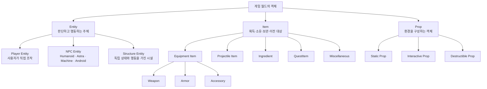

# 게임 객체 분류



## 설계 의도

게임 객체를 현재 상태나 개별 기능이 아니라 정체성과 책임으로 분류한다. `Entity`, `Item`, `Prop`을 최상위 기준으로 사용하고, 상호작용·피해·상점 같은 기능은 여러 분류에 조합할 수 있는 Capability로 다룬다. 이 기준을 기획 용어, 시스템 책임과 콘텐츠 폴더 구조에 공통 적용한다.

## 최상위 분류

### Entity

고유한 게임플레이 상태를 가지며, 상황이나 명령을 해석하여 행동의 주체로 작동하는 객체다.

| 하위 분류 | 정의 | 예시 |
|---|---|---|
| Player Entity | 사용자가 직접 조작하는 Entity | 플레이어 캐릭터 |
| NPC Entity | 사용자가 직접 조작하지 않는 Entity | Humanoid, Astra, Machine, Android |
| Structure Entity | 지속되는 독립 상태와 행동을 가진 시설형 Entity | 상점 시설, 터렛, 생산 시설, 기지 |

시설물이 인벤토리·소유권·생산·전투·AI처럼 독립적인 상태와 행동을 가지면 Structure Entity로 분류한다.

### Item

플레이어 또는 다른 Entity가 획득·소유·보관·이전할 수 있는 객체다.

- Equipment: 슬롯에 장착해 기능이나 능력치를 제공하는 Item
  - Weapon
  - Armor
  - Accessory
- Projectile
- Ingredient
- QuestItem
- Miscellaneous

Projectile은 맥락에 따라 구분한다. 소유·보관되는 탄약이나 투사체는 Projectile Item, 발사 후 월드에서 이동·충돌하는 객체는 Projectile Actor, 정적 정의는 Projectile Data다.

| 종류 | 정의 |
|---|---|
| Equipment | 슬롯에 장착하여 지속적으로 사용하는 Item |
| Projectile | 발사체 슬롯에 장착하거나 발사에 사용하는 Item |
| Ingredient | 다른 Item의 제작·수리·강화에 재료로 사용하는 것이 주목적인 Item |
| QuestItem | 임무 진행과 조건 판정을 위해 소유하는 것이 주목적인 Item |
| Miscellaneous | 다른 종류에 명확히 속하지 않는 일반 Item |

폴더는 아이템의 **대표적인 종류** 하나로 결정한다. 아이템이 어떻게 사용되거나 어떤 시스템에 참여하는지는 중복 가능한 속성으로 분리한다.

### Item 종류와 속성

`Consumable`은 아이템 종류가 아니라 사용 과정에서 수량이나 내구도가 소비되는지를 나타내는 속성이다. 따라서 `Item/Consumable` 폴더를 만들지 않는다.

`Crafting`도 독립적인 아이템 종류가 아니다. 제작 시스템과의 관계를 다음 두 의미로 구분한다.

- `Craftable`: 제작을 통해 생성할 수 있음
- `Crafting Ingredient`: 다른 것을 제작할 때 재료로 사용할 수 있음 (`Item.Crafting.Ingredient`)

권장 속성 체계:

```text
Item.Usage.Equipable
Item.Usage.Consumable
Item.Usage.Projectile

Item.Crafting.Craftable
Item.Crafting.Ingredient
Item.Crafting.RepairIngredient
Item.Crafting.UpgradeIngredient

Item.Property.Stackable
Item.Property.Tradeable
Item.Property.Droppable
Item.Property.Unique
Item.Property.Quest
```

`Ingredient` 폴더에는 재료로 사용하는 것이 대표 정체성인 Item을 둔다. 다른 종류의 Item이 부가적으로 제작 재료가 될 수 있다면 원래 종류의 폴더에 유지하고 `Item.Crafting.Ingredient` 속성을 부여한다.

| 사례 | 대표 종류 | 추가 속성 |
|---|---|---|
| 제작 가능한 총기 | Equipment/Weapon | Craftable, Tradeable, Droppable |
| 일반 탄환 | Projectile | Equipable, Consumable, Craftable, Stackable |
| 다른 탄환의 재료로도 쓰는 특수 탄환 | Projectile | Consumable, Craftable, Crafting.Ingredient |
| 철광석 | Ingredient | Crafting.Ingredient, Stackable, Tradeable |
| 퀘스트 전용 열쇠 | QuestItem | Quest, Unique |

Unreal 렌더링 에셋인 `Material`과 혼동되므로 게임 내 제작 재료 종류에 `Material`이라는 폴더명은 사용하지 않는다.

### Prop

월드 환경을 구성하지만 독립적인 행동 주체는 아닌 객체다.

- Static Prop
- Interactive Prop
- Destructible Prop

피해를 받거나 상호작용할 수 있다는 이유만으로 Entity가 되지는 않는다. 정해진 입력에 정해진 반응만 수행하고 독립적으로 판단하지 않는다면 Prop으로 유지한다.

## Capability

Capability는 객체의 정체성이 아니라 조합 가능한 기능이다. 다음 용어를 최상위 객체 분류나 폴더로 사용하지 않는다.

- Controllable
- Interactable
- Damageable
- Destructible
- Shop
- Container
- Combatant
- Movable
- Producing

| 사례 | 분류와 Capability |
|---|---|
| 상인 NPC | NPC Entity + Interactable + Shop |
| 자동 상점 시설 | Structure Entity + Interactable + Shop |
| 단순 자판기 | Interactive Prop + Shop |
| 터렛 | Structure Entity + Combatant + Damageable |
| 보관 상자 | Interactive Prop + Container |
| 총기 | Equipment Item + Weapon |

## Entity 행동과 Weapon Item의 책임

무기를 사용하는 행동은 Entity가 소유하고, 사용되는 무기의 내부 상태와 결과는 Weapon Item이 소유한다.

| Entity가 소유 | Weapon Item이 소유 |
|---|---|
| 행동 가능 여부 | 무기 종류와 정적 데이터 |
| 입력·AI 명령 해석 | 현재 탄창과 예비 탄약 연계 상태 |
| 조준·발사·재장전 행동 | 탄창 크기와 탄약 증감 결과 |
| 상·하체 행동 StateTree | 발사 간격과 발사 방식 |
| GA 활성화·취소 | 피해·사거리·탄속 |
| 행동 충돌 정책 | 반동·탄 퍼짐 |
| 행동 애니메이션 | Muzzle, Projectile, 과열·고장·내구도 |

`GA_WeaponAim`, `GA_WeaponFire`, `GA_WeaponReload`이라는 이름은 Weapon Item이 Ability를 소유한다는 뜻이 아니다. **Entity가 Weapon Item을 사용하는 행동**을 뜻한다.

재장전은 양쪽 책임이 만나는 대표 사례다.

- Entity: Reload 행동 진입, 애니메이션, 이동·다른 행동 제한, 탄약 이전 요청
- Weapon Item: 현재 탄약, 최대 탄창, 실제 탄약 반영 결과

공용 여부는 “AI 인간형이 같은 Ability를 받아 정상 사용할 수 있는가?”로 판단한다.

- 가능함: Humanoid Entity 공용 행동
- 플레이어 입력이나 카메라에 의존함: Player Entity 전용 행동

현재 `UAstraWeaponGameplayAbilityBase`에는 플레이어 카메라 FOV 의존성이 있으므로 완전한 Humanoid 공용 기반으로 보지 않는다. NPC와 공유하려면 카메라 정책을 분리하거나 인터페이스 경계로 격리한 뒤 승격한다.

## 콘텐츠 구조 기준

```text
Astra/
├─ Entity/
│  ├─ Common/
│  ├─ Humanoid/
│  │  ├─ Abilities/
│  │  │  ├─ Locomotion/
│  │  │  └─ Combat/
│  │  ├─ StateTrees/
│  │  │  ├─ Locomotion/
│  │  │  └─ Actions/
│  │  ├─ Animations/
│  │  ├─ AnimationBlueprints/
│  │  ├─ Meshes/
│  │  ├─ Skeletons/
│  │  └─ Rigs/
│  ├─ Player/
│  │  ├─ Blueprints/
│  │  ├─ Data/
│  │  └─ Abilities/
│  ├─ NPC/
│  └─ Structure/
├─ Item/
│  ├─ Equipment/
│  │  └─ Weapon/
│  │     ├─ Common/
│  │     ├─ Blueprints/
│  │     ├─ Data/
│  │     ├─ Meshes/
│  │     ├─ Effects/
│  │     ├─ Audio/
│  │     ├─ Pistol/
│  │     └─ Rifle/
│  ├─ Projectile/
│  ├─ Ingredient/
│  ├─ QuestItem/
│  └─ Miscellaneous/
└─ Prop/
```

`Input`과 `Levels`는 객체 종류가 아니라 별도의 시스템·콘텐츠 폴더다. 인간형 공용 애니메이션과 StateTree는 Player나 Weapon 아래가 아니라 `Entity/Humanoid`에 둔다. Epic 템플릿 원본은 Mannequins에 보존하고, Astra에서 재사용할 복사본만 Humanoid 영역으로 옮긴다.

에셋 폴더는 실제 재사용이 확인될 때 세분화한다. 이동은 Unreal Content Browser에서 수행하고 Redirector 정리와 Reference Viewer 검증을 거친다.

---

## 상위 페이지

- [[02_게임 기획]]

## 관련

- [[NPC 행동]]
- [[시스템 아키텍처]]
- [[StateTree와 GAS]]
- [[무기 시스템]]
- [[애니메이션과 조준]]
