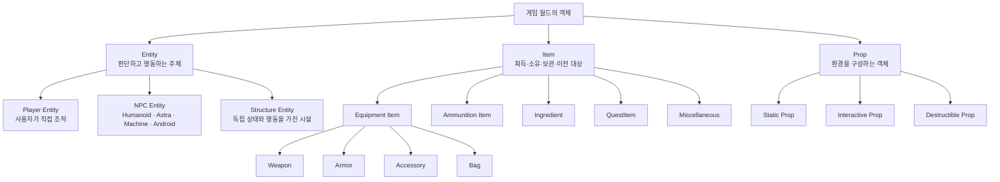

# 게임 객체 분류

## 기획 의도

객체 정체성과 조합 가능한 기능을 분리

## 최상위 분류

| 분류 | 정의 | 상세 |
|---|---|---|
| Entity | 판단하고 행동하는 주체 | [Entity](%EA%B0%9D%EC%B2%B4%20%EA%B8%B0%ED%9A%8D/Entity.md) |
| Item | 획득·소유·보관·이전 대상 | [Item](%EA%B0%9D%EC%B2%B4%20%EA%B8%B0%ED%9A%8D/Item.md) |
| Prop | 환경을 구성하는 비행동 주체 | [Prop](%EA%B0%9D%EC%B2%B4%20%EA%B8%B0%ED%9A%8D/Prop.md) |

## 조합 가능한 기능

Capability는 객체의 정체성이 아니라 조합 가능한 기능

최상위 객체 분류와 구분

- Controllable
- Interactable
- Damageable
- Destructible
- Shop
- Container
- Combatant
- Movable
- Producing

| 사례 | 분류와 Capability |
|---|---|
| 상인 NPC | NPC Entity + Interactable + Shop |
| 자동 상점 시설 | Structure Entity + Interactable + Shop |
| 단순 자판기 | Interactive Prop + Shop |
| 터렛 | Structure Entity + Combatant + Damageable |
| 보관 상자 | Interactive Prop + Container |
| 총기 | Equipment Item + Weapon |

## 분류 기준

- 같은 기능을 가진 객체라도 독립 상태·행동 여부로 구분
- 플레이어 정의·행동: [플레이어](%EA%B0%9D%EC%B2%B4%20%EA%B8%B0%ED%9A%8D/%ED%94%8C%EB%A0%88%EC%9D%B4%EC%96%B4.md)
- 콘텐츠 폴더와 구현 책임: [게임 객체 분류](../03_%EC%8B%9C%EC%8A%A4%ED%85%9C%20%EC%84%A4%EA%B3%84/%EA%B2%8C%EC%9E%84%20%EA%B0%9D%EC%B2%B4%20%EB%B6%84%EB%A5%98.md)

## 문서 연결

- 기획: [게임 객체 분류](%EA%B2%8C%EC%9E%84%20%EA%B0%9D%EC%B2%B4%20%EB%B6%84%EB%A5%98.md)
- 시스템 설계: [게임 객체 분류](../03_%EC%8B%9C%EC%8A%A4%ED%85%9C%20%EC%84%A4%EA%B3%84/%EA%B2%8C%EC%9E%84%20%EA%B0%9D%EC%B2%B4%20%EB%B6%84%EB%A5%98.md)
- 애니메이션 설계: [게임 객체 분류](../04_%EC%95%84%ED%8A%B8%20%EB%B0%8F%20%EC%95%A0%EB%8B%88%EB%A9%94%EC%9D%B4%EC%85%98/%EC%95%A0%EB%8B%88%EB%A9%94%EC%9D%B4%EC%85%98%20%EC%84%A4%EA%B3%84/%EA%B2%8C%EC%9E%84%20%EA%B0%9D%EC%B2%B4%20%EB%B6%84%EB%A5%98.md)
