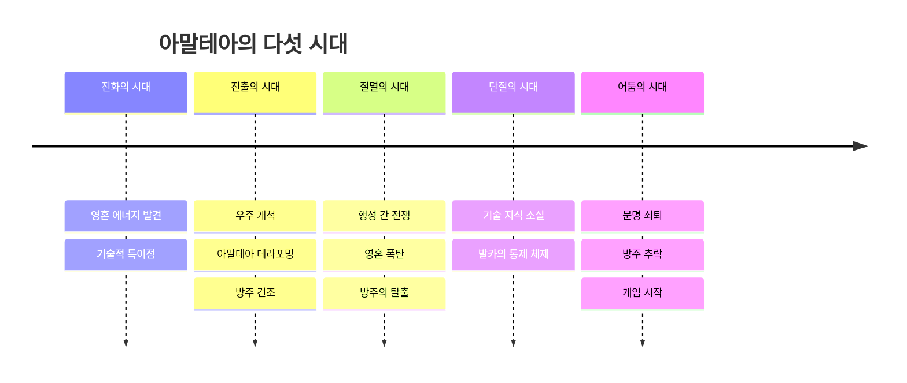

# 세계관과 설정

## 기획 의도

■ 포스트 아포칼립스 + 사이버 펑크의 느낌을 세계관에 녹여보고자 하였음
■ 영혼 에너지를 세계관의 자원, 감정의 결과, 전투·생존 시스템의 연결점으로 사용

## 상세 문서

- [시대별 상세](%EC%8B%9C%EB%8C%80%20%EC%84%A4%EC%A0%95.md)
- [설정 28개 상세](%EC%84%A4%EC%A0%95%20%EC%83%81%EC%84%B8.md)

- [참고 원본 엑셀](../../../%EC%9B%90%EB%B3%B8%20%EB%AC%B8%EC%84%9C/%EC%8B%9C%EB%82%98%EB%A6%AC%EC%98%A4.xlsx)

## 핵심 설정

- `영혼 에너지`: 모든 생명과 별에서 발생하는 에너지
- `아말테아`: 영혼 에너지가 풍부했으나 수확기와 발카의 통제로 쇠약해져가는 별
- `방주`: 고대 기술과 생존자를 보존하며, 긍정적 감정 기반 에너지 생성 및 증폭 기술을 가진 우주선
- `영혼 결속`: 주인공과 아스트라의 영혼을 동기화해 감정 공유, 대화, 능력 발현을 가능하게 하는 고대 기술
- `소울 하베스터`: 행성 중심에서 영혼 에너지를 추출하는 테라포밍 구조물로 아말테아의 에너지를 고갈시키는 주요 원인
- `영혼 폭탄`: 절멸의 시대를 상징하는 폭탄으로 에너지를 빨아들여 방출하고 에너지 포식자를 생성
- `아말테아의 파편`: 수확기가 저장하던 에너지와 옛 기록이 흩어진 매개체

## 사회와 세력

- `발카의 세력`: 도시 주민에게서 에너지와 노동력을 제공받고 도시의 인프라를 제공하는 통치 체제를 유지하고자 하는 세력
- `중심 도시`: 고대 인프라가 유지되는 아말테아의 지하 도시, 정식 명칭은 미정
- `추방자들의 안식처`: 도시에서 쫓겨난 사람들이 모인 지표면 마을
- `날개`: 추방자 중 발카에게 저항하는 조직
- `강탈자`: 자아를 제거당한 일부 추방자로, 지표면 인구와 물자를 통제
- `은둔자`: 에너지 부족과 추방을 피해 숨어 지내는 도시 주민

## 종족과 생명체

- 인간, 신체 일부 또는 전체를 바꾼 기계 인간, 안드로이드, 아스트라, 에너지 포식자 등
- 안드로이드는 영혼 에너지가 고갈되면 이성을 잃어 좀비화 될 수 있음
- 아스트라는 다양한 동·식물형 생명체로 별의 영혼 에너지로 생성되고 영혼 결속을 통해 잠재 능력을 발휘

---

## 상위 페이지

- [02_게임 기획](../02_%EA%B2%8C%EC%9E%84%20%EA%B8%B0%ED%9A%8D.md)

## 관련

- [시나리오 구조](../%EC%8B%9C%EB%82%98%EB%A6%AC%EC%98%A4/%EC%8B%9C%EB%82%98%EB%A6%AC%EC%98%A4%20%EA%B5%AC%EC%A1%B0.md)
- [주요 인물](../%EC%BA%90%EB%A6%AD%ED%84%B0/%EC%A3%BC%EC%9A%94%20%EC%9D%B8%EB%AC%BC.md)
- [팩션 관계](../%EC%8B%9C%EC%8A%A4%ED%85%9C%20%EA%B8%B0%ED%9A%8D/%ED%8C%A9%EC%85%98%20%EA%B4%80%EA%B3%84.md)

## 문서 연결

- 기획: [세계관과 설정](%EC%84%B8%EA%B3%84%EA%B4%80%EA%B3%BC%20%EC%84%A4%EC%A0%95.md)
- 시스템 설계: [세계관과 설정](../../03_%EC%8B%9C%EC%8A%A4%ED%85%9C%20%EC%84%A4%EA%B3%84/%EC%84%B8%EA%B3%84%EA%B4%80%EA%B3%BC%20%EC%84%A4%EC%A0%95.md)
- 애니메이션 설계: [세계관과 설정](../../04_%EC%95%84%ED%8A%B8%20%EB%B0%8F%20%EC%95%A0%EB%8B%88%EB%A9%94%EC%9D%B4%EC%85%98/%EC%95%A0%EB%8B%88%EB%A9%94%EC%9D%B4%EC%85%98%20%EC%84%A4%EA%B3%84/%EC%84%B8%EA%B3%84%EA%B4%80%EA%B3%BC%20%EC%84%A4%EC%A0%95.md)
