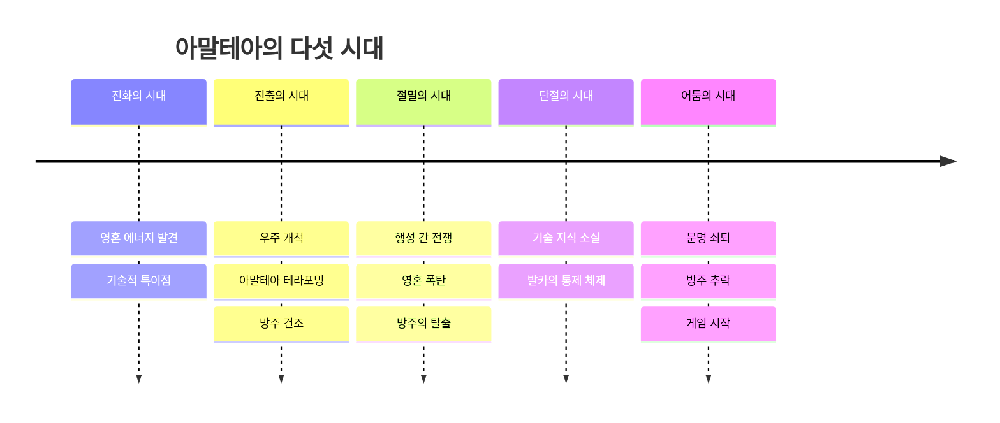

# 세계관과 설정

## 설계 의도

영혼 에너지를 세계관의 자원, 감정의 결과, 전투·생존 시스템의 연결점으로 사용한다. 발카는 행성을 지키려는 목적이 통제와 에너지 남용으로 뒤틀린 인물이며, 이 모순이 세계의 현재 상태를 만든다.

## 핵심 설정

- `영혼 에너지`: 생명과 감정에서 발생한다. 긍정적 감정은 생성, 부정적 감정은 소모와 연결된다.
- `아말테아`: 영혼 에너지가 풍부했으나 수확기와 발카의 통제로 쇠약해진 행성이다.
- `방주`: 고대 기술과 생존자를 보존하며, 긍정적 감정 기반 에너지 생성·증폭 기술을 가진 우주선이다.
- `영혼 결속`: 주인공과 아스트라의 영혼을 동기화해 감정 공유, 대화, 능력 발현을 가능하게 하는 고대 기술이다.
- `소울 하베스터`: 행성 중심 에너지를 추출하는 테라포밍 구조물이며 현재 고갈의 주요 원인이다.
- `영혼 폭탄`: 에너지를 빨아들여 방출하고 에너지 포식자를 남긴 절멸 시대의 병기다.
- `아말테아의 파편`: 수확기가 저장하던 에너지와 옛 기록이 흩어진 매개체다.

## 사회와 세력

- `발카의 세력`: 에너지 제공과 도시 인프라를 교환하는 통제 체제를 유지한다.
- `중심 도시`: 고대 인프라가 유지되는 수도. 정식 명칭은 미정이다.
- `추방자들의 안식처`: 도시에서 쫓겨난 사람들이 모인 지표면 마을이다.
- `날개`: 추방자 중 발카에게 저항하는 조직이다.
- `강탈자`: 자아를 제거당한 일부 추방자로, 지표면 인구와 물자를 통제한다.
- `은둔자`: 에너지 부족과 추방을 피해 숨어 지내는 도시 주민이다.

## 종족과 생명체

- 인간, 신체 일부 또는 전체를 바꾼 기계 인간, 안드로이드, 아스트라, 에너지 포식자가 존재한다.
- 안드로이드는 영혼 에너지가 고갈되면 이성을 잃고 기계 좀비화할 수 있다.
- 아스트라는 다양한 동·식물형 생명체이며 영혼 결속으로 잠재 능력을 발휘한다.

## 관련

- [[시나리오 구조]]
- [[주요 인물]]
- [[팩션 관계]]

