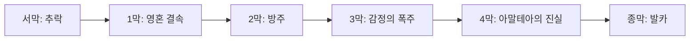

# 시나리오 구조

## 설계 의도

각 막의 스토리 목표와 플레이어 행동 동기를 정렬하고, 시퀀스마다 이야기 진행과 실제 플레이를 1:1로 연결해 튜토리얼이 강제로 느껴지지 않게 한다. AI벨라의 감정 획득을 장기 서사 축으로 사용한다.

## 전체 흐름

| 구간 | 핵심 목표 | 주요 플레이 경험 | 서사 축 |
|---|---|---|---|
| 서막 — 추락 | 영혼 에너지와 아말테아를 소개하고 생존 동기를 부여 | 스킵 가능한 컷신 | 방주가 미끼 신호와 반물질포에 의해 격추됨 |
| 1막 — 영혼 결속 | 기본 조작과 생존, 영혼 결속을 학습 | 이동·상호작용·전투·채집·제작·지도·첫 요새 | AI벨라가 기쁨·즐거움·분노를 학습 |
| 2막 — 방주 | 방주 재건과 심화 시스템 학습 | 자원 정제·기지 기능·아스트라 육성·파티 전투 | 발카의 존재와 욕망·증오를 전면화 |
| 3막 |  |  | AI벨라의 감정 폭주와 보스화 |
| 4막 |  |  | AI코르누와 아말테아의 진실 |
| 종막 |  |  | 발카와의 최종 대립 |

## 서막

1. `표류하는 방주`: 방주가 영혼 에너지 신호를 문명 재건 신호로 판단해 아말테아로 향한다.
2. `기습 공격`: 발카의 반물질포가 방주를 격추한다. 신호가 유인용 미끼였다는 복선을 둔다.
3. `추락`: 선체가 분리되고 주인공이 탄 구획이 행성 표면에 불시착한다.

## 1막 — 영혼 결속

1. `깨어남`: 이동, 카메라, 상호작용을 파괴된 방주 조사와 결합한다.
2. `관리자 복구`: AI벨라와 UI를 복구하고 외부 탐색 임무를 연다.
3. `아말테아로의 첫 발걸음`: 기계 좀비 전투로 기본 공격과 회피를 익힌다.
4. `아스트라와의 만남`: 카밀라 구출 과정에서 영혼 결속과 조작 전환을 각성한다.
5. `추방자들의 안식처`: 대화 시스템과 세계관 정보를 소개한다.
6. `약재 구하기`: 채집, 제약 제작, 인벤토리를 학습하고 AI벨라가 기쁨을 느낀다.
7. `배고프고 목마를 때`: 조리와 생존 수치를 학습하고 AI벨라가 즐거움을 느낀다.
8. `안식처의 불안 해결`: 강탈자 문제와 지도를 열고 AI벨라가 분노를 느낀다.
9. `아말테아의 파편`: 빠른 이동과 역사 기록을 해금한다.
10. `강탈자의 요새 진입`: 아스트라의 필드 능력으로 방어 장치를 우회한다.
11. `요새 습격`: 첫 주요 콘텐츠와 보스를 통해 발카와 지배 시스템을 드러낸다.
12. `안식처로 귀환`: 마을의 협력을 얻고 방주 재건으로 이어진다.

## 미정·후속 작성

- 시나리오 대사: 6월 이후 삽입 예정으로 기록됨
- 3막 이후의 막별 핵심 목표·세부 시퀀스: 
- 1막 음식 메뉴: 

---

## 상위 페이지

- [02_게임 기획](../02_%EA%B2%8C%EC%9E%84%20%EA%B8%B0%ED%9A%8D.md)

## 관련

- [세계관과 설정](../%EC%84%B8%EA%B3%84%EA%B4%80/%EC%84%B8%EA%B3%84%EA%B4%80%EA%B3%BC%20%EC%84%A4%EC%A0%95.md)
- [주요 인물](../%EC%BA%90%EB%A6%AD%ED%84%B0/%EC%A3%BC%EC%9A%94%20%EC%9D%B8%EB%AC%BC.md)
- [소울링크](../%EC%8B%9C%EC%8A%A4%ED%85%9C%20%EA%B8%B0%ED%9A%8D/%EC%86%8C%EC%9A%B8%EB%A7%81%ED%81%AC.md)
- [생존 시스템](../%EC%8B%9C%EC%8A%A4%ED%85%9C%20%EA%B8%B0%ED%9A%8D/%EC%83%9D%EC%A1%B4%20%EC%8B%9C%EC%8A%A4%ED%85%9C.md)

