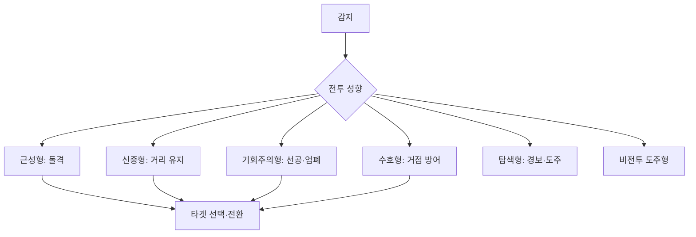

# NPC 전투 성향

## 설계 의도

NPC 클래스마다 별도 전투 로직을 만들지 않고, 감지·추적·경보·타겟 전환·거리 유지 값을 성향 데이터로 조합한다. 파티의 감지 주기를 분산해 모든 NPC가 동시에 판단하는 기계적인 인상을 줄인다.

## 성향 요약

| 성향 | 콘셉트 | 감지/추적 | 교전 방식 | 이탈 대응 |
|---|---|---|---|---|
| 근성형 | 돌격·난전 | 보통/넓음 | 사거리 안쪽까지 전진, 근접 시 빠르게 접근 | 마지막 위치 또는 추적 범위까지 직선 추적 |
| 신중형 | 거리 유지 | 중간/좁음 | 엄폐 후 공격, 원거리 사거리 약 50% 유지 | 마지막 위치 주시, 천천히 추적 여부 검토 |
| 기회주의형 | 선공 후 엄폐 | 넓음/보통 | 사격·재장전 시 엄폐, 낮은 체력 대상 우선 가능 | 회복 후 추적 |
| 수호형 | 거점·동료 방어 | 좁음/좁음 | 경보 전파 후 방어 구역에서 지원 | 대상 상실 시 즉시 복귀 |
| 탐색형 | 경보·도주 | 넓음/없음 | 공격하지 않고 경보 후 반대 방향 도주 | 마지막 위치 주시 |
| 비전투 도주형 | 생존 | 좁음/없음 | 공격하지 않고 경보 후 도주 | 추적하지 않음 |

## 공통 파티 규칙

- 기본 인원: 3~5체
- 감지 범위 안의 아군이 공격당하면 함께 공격한다.
- 타겟 감지 주기: 1~2초 사이 무작위
- 시야: 전방 145도
- 엄폐 판정: 타겟 시야에서 몸체 50% 이상이 가려짐

## 미정·검토 중

- 신중형의 추적 이동 속도와 정확한 추적 정책: 
- 체력 `낮음`의 기준값: 
- 사거리 50% 유지 규칙의 무기별 예외: 

---

## 상위 페이지

- [[02_게임 기획]]

## 관련

- [[NPC 행동]]
- [[팩션 관계]]

