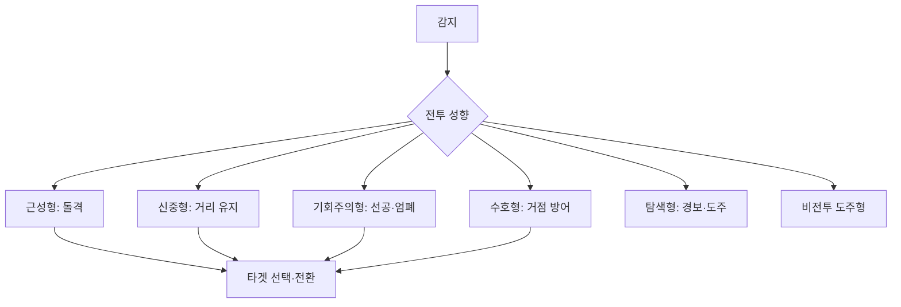

# NPC 전투 성향

## 기획 의도

감지 주기 분산으로 동시 판단의 기계적인 인상 완화

## 성향 요약

| 성향 | 콘셉트 | 감지/추적 | 교전 방식 | 이탈 대응 |
|---|---|---|---|---|
| 근성형 | 돌격·난전 | 보통/넓음 | 사거리 안쪽까지 전진, 근접 시 빠르게 접근 | 마지막 위치 또는 추적 범위까지 직선 추적 |
| 신중형 | 거리 유지 | 중간/좁음 | 엄폐 후 공격, 원거리 사거리 약 50% 유지 | 마지막 위치 주시, 천천히 추적 여부 검토 |
| 기회주의형 | 선공 후 엄폐 | 넓음/보통 | 사격·재장전 시 엄폐, 낮은 체력 대상 우선 가능 | 회복 후 추적 |
| 수호형 | 거점·동료 방어 | 좁음/좁음 | 경보 전파 후 방어 구역에서 지원 | 대상 상실 시 즉시 복귀 |
| 탐색형 | 경보·도주 | 넓음/없음 | 공격하지 않고 경보 후 반대 방향 도주 | 마지막 위치 주시 |
| 비전투 도주형 | 생존 | 좁음/없음 | 공격하지 않고 경보 후 도주 | 추적하지 않음 |

## 공통 파티 규칙

- 기본 인원: 3~5체
- 감지 범위 안의 아군이 공격당하면 함께 공격
- 타겟 감지 주기: 1~2초 사이 무작위
- 시야: 전방 145도
- 엄폐 판정: 타겟 시야에서 몸체 50% 이상이 가려짐

## 미정·검토 중

- 신중형의 추적 이동 속도와 정확한 추적 정책:
- 체력 `낮음`의 기준값:
- 사거리 50% 유지 규칙의 무기별 예외:

---

## 상위 페이지

- [02_게임 기획](../02_%EA%B2%8C%EC%9E%84%20%EA%B8%B0%ED%9A%8D.md)

## 관련

- [NPC 행동](NPC%20%ED%96%89%EB%8F%99.md)
- [팩션 관계](%ED%8C%A9%EC%85%98%20%EA%B4%80%EA%B3%84.md)

## 상세

- [NPC 전투 성향 상세](NPC%20%EC%A0%84%ED%88%AC%20%EC%84%B1%ED%96%A5%20%EC%83%81%EC%84%B8.md)

## 문서 연결

- 기획: [NPC 전투 성향](NPC%20%EC%A0%84%ED%88%AC%20%EC%84%B1%ED%96%A5.md)
- 시스템 설계: [NPC 전투 성향](../../03_%EC%8B%9C%EC%8A%A4%ED%85%9C%20%EC%84%A4%EA%B3%84/NPC%20%EC%A0%84%ED%88%AC%20%EC%84%B1%ED%96%A5.md)
- 애니메이션 설계: [NPC 전투 성향](../../04_%EC%95%84%ED%8A%B8%20%EB%B0%8F%20%EC%95%A0%EB%8B%88%EB%A9%94%EC%9D%B4%EC%85%98/%EC%95%A0%EB%8B%88%EB%A9%94%EC%9D%B4%EC%85%98%20%EC%84%A4%EA%B3%84/NPC%20%EC%A0%84%ED%88%AC%20%EC%84%B1%ED%96%A5.md)
