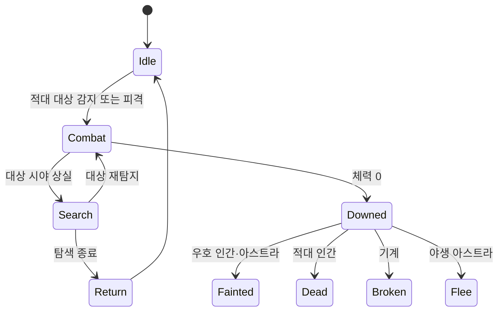

# NPC 행동

## 설계 의도

팩션, 엔티티 타입, 상태를 분리해 같은 행동 골격을 재사용하면서도 기절·사망·파손·도주처럼 대상별 결과가 다르게 보이게 한다. 전투 중 상호작용을 제한해 AI와 플레이어 행동의 우선순위를 명확히 한다.

## 공통 분류

| 관계/타입 | 평상시 | 전투 | 체력 0 | 상호작용 |
|---|---|---|---|---|
| 우호 Astra | 배회 또는 추종 | 타겟 공격 | 기절 | 소울링크·대화·교감, 회복·부활 |
| 우호 Human/Android | 작업·대화·순찰 | 무장 대응 또는 엄폐 도주 | 기절 | 대화·상점·퀘스트, 구출·응급처치 |
| 우호 Machine | 대기·장치 기능 | 적 요격·엄호 | 파손 | 조작·대화·상점, 부품/에너지 수리 |
| 적대 Astra | 배회·경계 | 돌진·스킬 | 포획 대기 후 도주 | 포획 가능 시간에만 상호작용 |
| 적대 Human/Android | 경계·순찰 | 엄폐·사격·투척 | 사망 | 루팅 |
| 적대 Machine | 절전·정찰 | 즉시 공격·조건부 자폭 | 파괴 | 전리품, 검토 중인 해킹·재조립 |
| Construction/Prop | 배치·가동 | — | 파괴 | 채집·장치 활성화·잔해 회수 |

## 플레이어 입력 기획

- 파티원 선택: 숫자 `1~3`
- 선택한 아스트라 소울링크: `Q`
- 일반 스킬: `X` 후보이나 우선 미사용
- 무기 교체: 마우스 휠 위/아래
- 패드 입력: 

## 검토 중

- 적대 기계 은신 해킹/암살
- 파괴된 기계의 재조립과 임시 전투 드론화
- 포획 성공·실패 모두 전리품 상자를 생성하는 규칙의 경제 밸런스

## 관련

- [[NPC 전투 성향]]
- [[팩션 관계]]
- [[소울링크]]
- [[StateTree와 GAS]]

