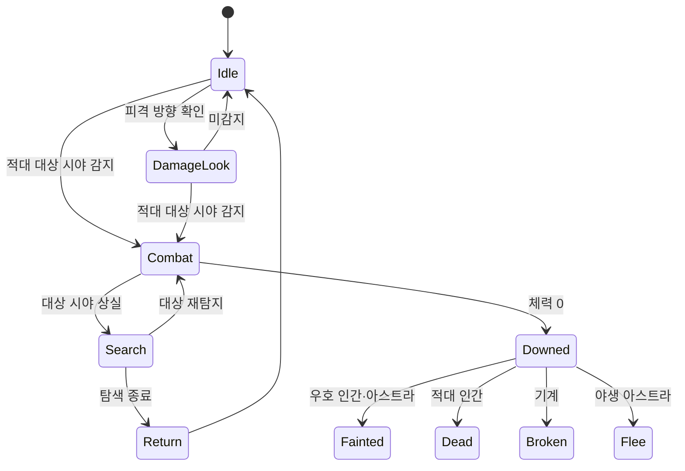

# NPC 행동

## 기획 의도

팩션·대상·상태에 따른 행동 결과 구분

전투 중 상호작용 제한

## 공통 분류

| 관계/타입 | 평상시 | 전투 | 체력 0 | 상호작용 |
|---|---|---|---|---|
| 우호 Astra | 배회 또는 추종 | 타겟 공격 | 기절 | 영혼 결속·대화·교감, 회복·부활 |
| 우호 Human/Android | 작업·대화·순찰 | 무장 대응 또는 엄폐 도주 | 기절 | 대화·상점·퀘스트, 구출·응급처치 |
| 우호 Machine | 대기·장치 기능 | 적 요격·엄호 | 파손 | 조작·대화·상점, 부품/에너지 수리 |
| 적대 Astra | 배회·경계 | 돌진·스킬 | 포획 대기 후 도주 | 포획 가능 시간에만 상호작용 |
| 적대 Human/Android | 경계·순찰 | 엄폐·사격·투척 | 사망 | 루팅 |
| 적대 Machine | 절전·정찰 | 즉시 공격·조건부 자폭 | 파괴 | 전리품, 검토 중인 해킹·재조립 |
| Structure Entity | 생산·상점·경계 등 독립 행동 | 교전 기능이 있으면 대응 | 파괴 또는 기능 정지 | 상점·생산·조작·수리 |
| Prop | 배치·정해진 반응 | — | Destructible이면 파괴 | 채집·장치 활성화·잔해 회수 |

Humanoid, Astra, Machine, Android는 NPC Entity의 하위 유형

시설물이 독립 상태와 행동을 가지면 Structure Entity, 정해진 상호작용이나 파괴 반응만 제공하면 Prop으로 분류

상점·상호작용·피해 가능 여부는 Entity/Prop을 결정하는 기준이 아니라 Capability다

## 1단계 적대 인간형 행동

2026-10-08 확정 규칙

### 평상시

- 무기 홀스터 수납
- 스폰 위치 중심의 지정 반경 안에서 무작위 순찰
- 이동 가능한 목적지 선택. 도착 후 지정 시간 대기
- 적 감지 시 순찰 중단 후 추적·공격

### 전투

- 무기 사거리 안에서 대상을 향해 몸 회전 후 사격
- 사격 간격은 기존 무기 설정 사용. 현재 사용자 지정 간격 1초
- 빈 탄창은 재장전 후 공격 재개
- 1단계 NPC의 예비 탄약 무제한. 탄창 탄수는 실제 소비
- 대상이 가려지거나 사라지면 사격 중단
- 마지막 확인 위치를 기억하고 지정 시간 대기 후 접근
- 이동 불가능한 위치는 도달 가능한 접근 지점까지 이동
- 도착 후 일정 시간 탐색·대기. 재발견 시 전투 재개. 미발견 시 Idle 복귀
- 대상 재발견 시에도 이미 시작한 발사 쿨다운 유지

### 피격 방향 확인

- 피격 순간의 공격자 방향으로 회전
- 시야로 적을 확인한 경우에만 추적·공격
- 피격 사실만으로 보이지 않는 공격자 위치 추적 금지
- 미감지 시 현재 두뇌 상태에 맞는 행동 복귀
- 회전·대기 수치:

## 플레이어 입력 기획

- 파티원 선택: 숫자 `1~3`
- 선택한 아스트라 영혼 결속: `Q`
- 일반 스킬: `X` 후보이나 우선 미사용
- 무기 교체: 마우스 휠 위/아래
- 패드 입력:

## 검토 중

- 적대 기계 은신 해킹/암살
- 파괴된 기계의 재조립과 임시 전투 드론화
- 포획 성공·실패 모두 전리품 상자를 생성하는 규칙의 경제 밸런스

---

## 상위 페이지

- [02_게임 기획](../02_%EA%B2%8C%EC%9E%84%20%EA%B8%B0%ED%9A%8D.md)

## 관련

- [NPC 전투 성향](NPC%20%EC%A0%84%ED%88%AC%20%EC%84%B1%ED%96%A5.md)
- [팩션 관계](%ED%8C%A9%EC%85%98%20%EA%B4%80%EA%B3%84.md)
- [영혼 결속](%EC%98%81%ED%98%BC%20%EA%B2%B0%EC%86%8D.md)
- [게임 객체 분류](../%EA%B2%8C%EC%9E%84%20%EA%B0%9D%EC%B2%B4%20%EB%B6%84%EB%A5%98.md)
- [StateTree와 GAS](../../03_%EC%8B%9C%EC%8A%A4%ED%85%9C%20%EC%84%A4%EA%B3%84/StateTree%EC%99%80%20GAS.md)

## 상세

- [NPC 행동 상세](NPC%20%ED%96%89%EB%8F%99%20%EC%83%81%EC%84%B8.md)
- [팩션별 행동 상세](%ED%8C%A9%EC%85%98%EB%B3%84%20%ED%96%89%EB%8F%99%20%EC%83%81%EC%84%B8.md)

## 문서 연결

- 기획: [NPC 행동](NPC%20%ED%96%89%EB%8F%99.md)
- 시스템 설계: [NPC 행동](../../03_%EC%8B%9C%EC%8A%A4%ED%85%9C%20%EC%84%A4%EA%B3%84/NPC%20%ED%96%89%EB%8F%99.md)
- 애니메이션 설계: [NPC 행동](../../04_%EC%95%84%ED%8A%B8%20%EB%B0%8F%20%EC%95%A0%EB%8B%88%EB%A9%94%EC%9D%B4%EC%85%98/%EC%95%A0%EB%8B%88%EB%A9%94%EC%9D%B4%EC%85%98%20%EC%84%A4%EA%B3%84/NPC%20%ED%96%89%EB%8F%99.md)
