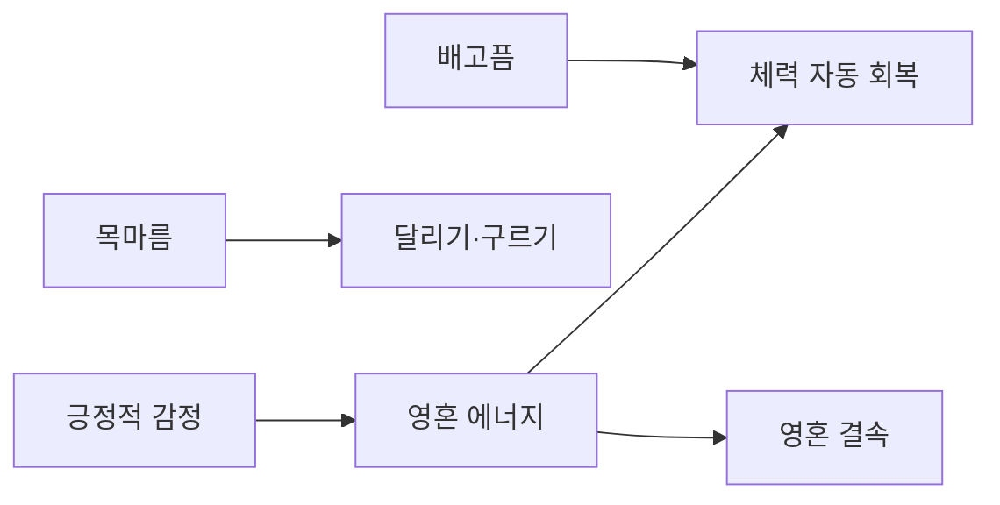

# 생존 시스템

## 설계 의도

생존 수치가 단순 감점 요소에 머물지 않고 체력 회복, 이동 행동, 영혼 결속 자원에 연결되게 한다. 1막에서 방주 에너지 시스템을 열기 전에는 기본 제작품으로 생존하게 한다.

## 규칙

| 시스템 | 30% 미만 | 30~69% | 70% 이상 |
|---|---|---|---|
| 배고픔 | 영혼 에너지 지속 감소 | 자동 체력 회복 없음 | 자동 체력 회복 |
| 목마름 | 달리기·구르기 불가 | 달리기 속도 상승 없음 | 달리기 속도 상승 |

- 영혼 에너지 비율은 최대 체력 비율과 연결하는 기획이 기록되어 있다.
- 영혼 에너지는 긍정적 감정에서 생성되고 부정적 감정에서 소모된다.

## 미정

- 배고픔·목마름 감소 속도: 
- 자동 체력 회복량과 주기: 
- 목마름 70% 이상 달리기 속도 상승량: 
- 영혼 에너지와 최대 체력의 정확한 환산 규칙: 

---

## 상위 페이지

- [02_게임 기획](../02_%EA%B2%8C%EC%9E%84%20%EA%B8%B0%ED%9A%8D.md)

## 관련

- [시나리오 구조](../%EC%8B%9C%EB%82%98%EB%A6%AC%EC%98%A4/%EC%8B%9C%EB%82%98%EB%A6%AC%EC%98%A4%20%EA%B5%AC%EC%A1%B0.md)
- [세계관과 설정](../%EC%84%B8%EA%B3%84%EA%B4%80/%EC%84%B8%EA%B3%84%EA%B4%80%EA%B3%BC%20%EC%84%A4%EC%A0%95.md)
- [소울링크](%EC%86%8C%EC%9A%B8%EB%A7%81%ED%81%AC.md)

