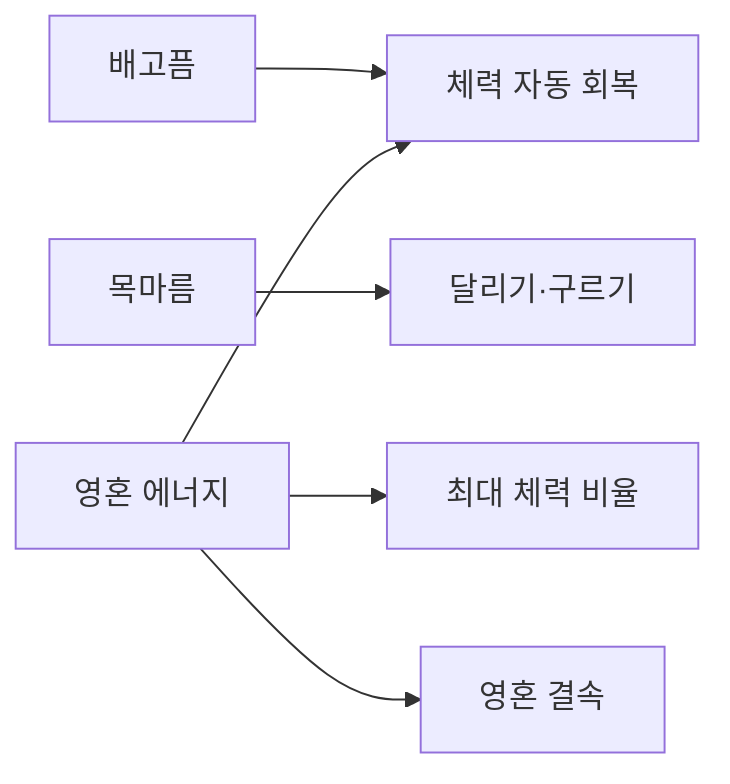

# 생존 시스템

## 기획 의도

생존 수치를 체력 회복·이동 행동·영혼 결속 자원과 연결

방주 에너지 시스템 개방 전 기본 제작품으로 생존

## 규칙

| 시스템 | 30% 미만 | 30~69% | 70% 이상 |
|---|---|---|---|
| 배고픔 | 영혼 에너지 지속 감소 | 자동 체력 회복 없음 | 자동 체력 회복 |
| 목마름 | 달리기·구르기 불가 | 달리기 속도 상승 없음 | 달리기 속도 상승 |

- 영혼 에너지 비율은 최대 체력 비율과 연결하는 기획이 기록되어 있음

## 미정

- 배고픔·목마름 감소 속도:
- 자동 체력 회복량과 주기:
- 목마름 70% 이상 달리기 속도 상승량:
- 영혼 에너지와 최대 체력의 정확한 환산 규칙:

---

## 상위 페이지

- [02_게임 기획](../02_%EA%B2%8C%EC%9E%84%20%EA%B8%B0%ED%9A%8D.md)

## 관련

- [시나리오 구조](../%EC%8B%9C%EB%82%98%EB%A6%AC%EC%98%A4/%EC%8B%9C%EB%82%98%EB%A6%AC%EC%98%A4%20%EA%B5%AC%EC%A1%B0.md)
- [세계관과 설정](../%EC%84%B8%EA%B3%84%EA%B4%80/%EC%84%B8%EA%B3%84%EA%B4%80%EA%B3%BC%20%EC%84%A4%EC%A0%95.md)
- [영혼 결속](%EC%98%81%ED%98%BC%20%EA%B2%B0%EC%86%8D.md)

## 상세

- [생존 원문](%EC%83%9D%EC%A1%B4%20%EC%9B%90%EB%AC%B8.md)

## 문서 연결

- 기획: [생존 시스템](%EC%83%9D%EC%A1%B4%20%EC%8B%9C%EC%8A%A4%ED%85%9C.md)
- 시스템 설계: [생존 시스템](../../03_%EC%8B%9C%EC%8A%A4%ED%85%9C%20%EC%84%A4%EA%B3%84/%EC%83%9D%EC%A1%B4%20%EC%8B%9C%EC%8A%A4%ED%85%9C.md)
- 애니메이션 설계: [생존 시스템](../../04_%EC%95%84%ED%8A%B8%20%EB%B0%8F%20%EC%95%A0%EB%8B%88%EB%A9%94%EC%9D%B4%EC%85%98/%EC%95%A0%EB%8B%88%EB%A9%94%EC%9D%B4%EC%85%98%20%EC%84%A4%EA%B3%84/%EC%83%9D%EC%A1%B4%20%EC%8B%9C%EC%8A%A4%ED%85%9C.md)
