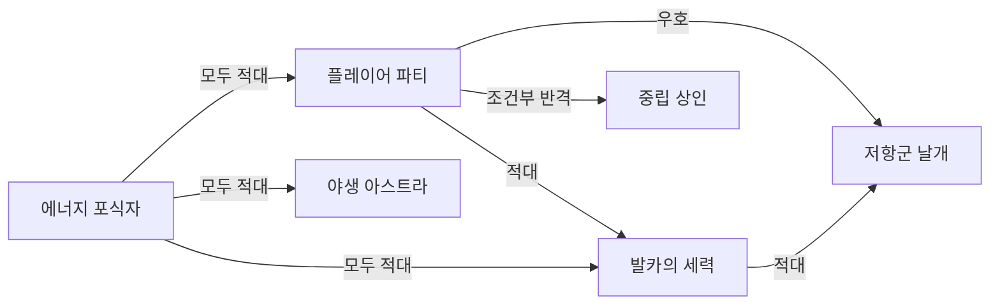

# 팩션 관계

## 설계 의도

관계는 `우호`, `적대`, `반격`, `도주` 네 반응으로 단순화하고, 공격 타겟 선정은 이 관계표를 먼저 통과하게 한다. 같은 세력명이라도 주체와 대상의 반응이 다를 수 있으므로 방향성을 가진 관계로 취급한다.

## 관계 의미

- `우호`: 공격 타겟이 되지 않는다.
- `적대`: 감지 범위 진입 시 선제 공격한다.
- `반격`: 선제 공격하지 않지만 피해를 받으면 반격한다.
- `도주`: 선제 공격하지 않으며 피해를 받으면 도주한다.

## 핵심 규칙

- 플레이어 파티와 저항군은 우호, 발카 세력과 선공형 야생 아스트라·에너지 포식자에게 적대적이다.
- 중립 상인은 대부분의 세력에 반격형이며, 구출 시 거래나 할인이 활성화될 수 있다.
- 일반 주민은 진영과 무관하게 직접 타겟팅하지 않으며 위험 시 도주하고 체력 0에서 기절한다.
- 비선공 아스트라는 공격받으면 무리 전체가 반격한다.
- 에너지 포식자는 팩션 구분 없이 모든 대상을 공격한다.

## 데이터 정합성 확인 필요

- 기존 매트릭스에서 `발카의 세력 → 마을 주민`이 아군으로 표기된 이유와 도시 주민/추방자 구분: 
- 동일 팩션 빈 셀의 기본 처리(우호/무시): 
- 플레이어 파티 → 플레이어 파티 값: 

---

## 상위 페이지

- [[02_게임 기획]]

## 관련

- [[세계관과 설정]]
- [[NPC 행동]]
- [[NPC 전투 성향]]

