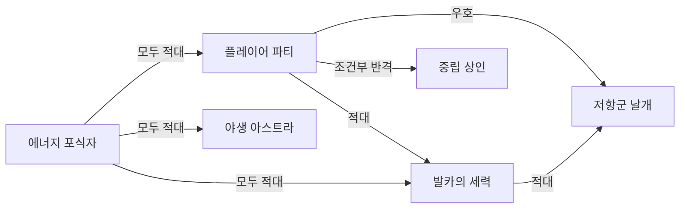

# 팩션 관계

## 기획 의도

주체와 대상에 따른 방향성 있는 관계 구분

## 관계 의미

- `우호`: 공격 타겟이 되지 않음
- `적대`: 감지 범위 진입 시 선제 공격
- `반격`: 선제 공격하지 않지만 피해를 받으면 반격
- `도주`: 선제 공격하지 않으며 피해를 받으면 도주

## 핵심 규칙

- 플레이어 파티와 저항군은 우호, 발카 세력과 선공형 야생 아스트라·에너지 포식자에게 적대적
- 중립 상인은 대부분의 세력에 반격형이며, 구출 시 거래나 할인이 활성화될 수 있음
- 일반 주민은 진영과 무관하게 직접 타겟팅하지 않으며 위험 시 도주하고 체력 0에서 기절
- 비선공 아스트라는 공격받으면 무리 전체가 반격
- 에너지 포식자는 팩션 구분 없이 모든 대상을 공격

## 데이터 정합성 확인 필요

- 기존 매트릭스에서 `발카의 세력 → 마을 주민`이 아군으로 표기된 이유와 도시 주민/추방자 구분:
- 동일 팩션 빈 셀의 기본 처리(우호/무시):
- 플레이어 파티 → 플레이어 파티 값:

---

## 상위 페이지

- [02_게임 기획](../02_%EA%B2%8C%EC%9E%84%20%EA%B8%B0%ED%9A%8D.md)

## 관련

- [세계관과 설정](../%EC%84%B8%EA%B3%84%EA%B4%80/%EC%84%B8%EA%B3%84%EA%B4%80%EA%B3%BC%20%EC%84%A4%EC%A0%95.md)
- [NPC 행동](NPC%20%ED%96%89%EB%8F%99.md)
- [NPC 전투 성향](NPC%20%EC%A0%84%ED%88%AC%20%EC%84%B1%ED%96%A5.md)

## 상세

- [팩션 관계 상세](%ED%8C%A9%EC%85%98%20%EA%B4%80%EA%B3%84%20%EC%83%81%EC%84%B8.md)

## 문서 연결

- 기획: [팩션 관계](%ED%8C%A9%EC%85%98%20%EA%B4%80%EA%B3%84.md)
- 시스템 설계: [팩션 관계](../../03_%EC%8B%9C%EC%8A%A4%ED%85%9C%20%EC%84%A4%EA%B3%84/%ED%8C%A9%EC%85%98%20%EA%B4%80%EA%B3%84.md)
- 애니메이션 설계: [팩션 관계](../../04_%EC%95%84%ED%8A%B8%20%EB%B0%8F%20%EC%95%A0%EB%8B%88%EB%A9%94%EC%9D%B4%EC%85%98/%EC%95%A0%EB%8B%88%EB%A9%94%EC%9D%B4%EC%85%98%20%EC%84%A4%EA%B3%84/%ED%8C%A9%EC%85%98%20%EA%B4%80%EA%B3%84.md)
