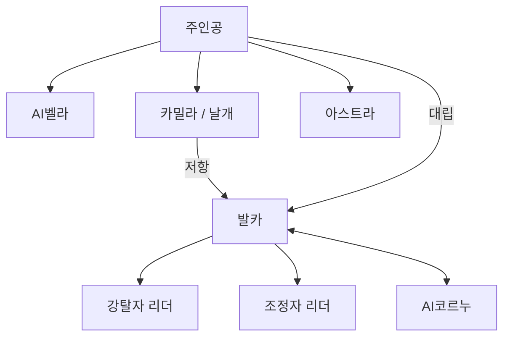

# 주요 인물

## 기획 의도

주요 인물의 목적과 세계관 갈등 연결

AI벨라의 감정 학습과 발카·코르누의 왜곡된 애정을 통해 영혼 에너지의 양면성 표현

## 상세 문서

- [인물 7명 상세](%EC%9D%B8%EB%AC%BC%20%EC%83%81%EC%84%B8.md)

- [참고 원본 엑셀](../../../%EC%9B%90%EB%B3%B8%20%EB%AC%B8%EC%84%9C/%EC%8B%9C%EB%82%98%EB%A6%AC%EC%98%A4.xlsx)

## 인물

| 인물 | 배경 | 목적 | 소속 | 성격·역할 |
|---|---|---|---|---|
| 주인공 | 전쟁을 피해 방주에 탑승한 생존자 | 아말테아에서 생존 | 방주 | 선량하고 타인의 어려움을 돕는 플레이어 캐릭터 |
| AI벨라 | 감정이 봉인된 방주 관리자 | 파괴된 방주 재건 | 방주 | 기계적 성격에서 감정을 학습하며 3막에 폭주, 이후 안드로이드 신체 획득 |
| 카밀라 | 저항조직 `날개`의 리더 | 마을 방어와 강탈자 격퇴 | 추방자들의 안식처 | 적극적·직선적, 1막 전개 담당 |
| 발카 | 지구에서 파견된 아말테아 집정관 | 철저한 통제로 행성을 보존 | 발카의 세력 | 오만하고 냉철함. 보호 목적이 독재와 에너지 남용으로 변질된 최종 보스 |
| AI코르누 | 아말테아 영혼 에너지로 만든 안드로이드 | 발카가 자신을 떠나지 못하게 함 | 발카의 세력 | 교활하고 기만적. 행성의 인격이자 발카의 집착을 강화 |
| 강탈자 리더 | 죽어가던 신체를 기계로 교체한 발카의 행동대장 | 지표면 통제 | 발카의 세력 | 충성스러운 1막 보스. 이름 미정 |
| 조정자 리더 | 발카의 시스템·안드로이드 설계자 | 지배 시스템 유지 | 발카의 세력 | 계산적·과시형 4막 보스. 이름 미정 |

## 미정

- 강탈자 리더 이름:
- 조정자 리더 이름:
- 주인공의 이름·외형 세부: 플레이어 설정 범위 확정 필요
- 각 인물의 말투:

---

## 상위 페이지

- [02_게임 기획](../02_%EA%B2%8C%EC%9E%84%20%EA%B8%B0%ED%9A%8D.md)

## 관련

- [시나리오 구조](../%EC%8B%9C%EB%82%98%EB%A6%AC%EC%98%A4/%EC%8B%9C%EB%82%98%EB%A6%AC%EC%98%A4%20%EA%B5%AC%EC%A1%B0.md)
- [세계관과 설정](../%EC%84%B8%EA%B3%84%EA%B4%80/%EC%84%B8%EA%B3%84%EA%B4%80%EA%B3%BC%20%EC%84%A4%EC%A0%95.md)
- [팩션 관계](../%EC%8B%9C%EC%8A%A4%ED%85%9C%20%EA%B8%B0%ED%9A%8D/%ED%8C%A9%EC%85%98%20%EA%B4%80%EA%B3%84.md)

## 문서 연결

- 기획: [주요 인물](%EC%A3%BC%EC%9A%94%20%EC%9D%B8%EB%AC%BC.md)
- 시스템 설계: [주요 인물](../../03_%EC%8B%9C%EC%8A%A4%ED%85%9C%20%EC%84%A4%EA%B3%84/%EC%A3%BC%EC%9A%94%20%EC%9D%B8%EB%AC%BC.md)
- 애니메이션 설계: [주요 인물](../../04_%EC%95%84%ED%8A%B8%20%EB%B0%8F%20%EC%95%A0%EB%8B%88%EB%A9%94%EC%9D%B4%EC%85%98/%EC%95%A0%EB%8B%88%EB%A9%94%EC%9D%B4%EC%85%98%20%EC%84%A4%EA%B3%84/%EC%A3%BC%EC%9A%94%20%EC%9D%B8%EB%AC%BC.md)
