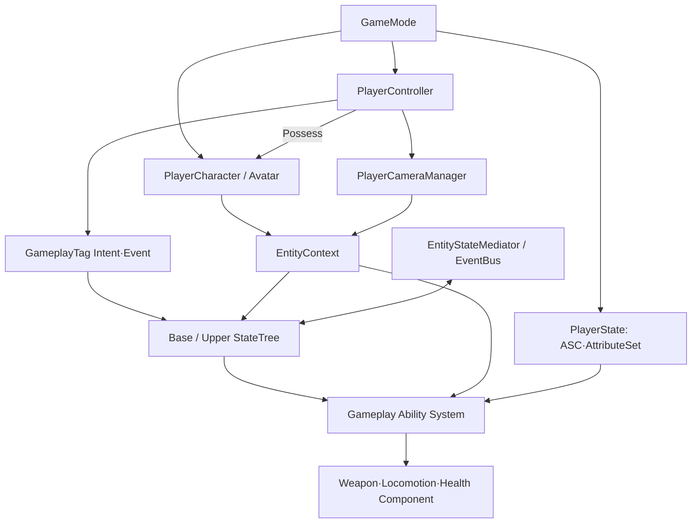

# 03_시스템 설계

Astra 프로젝트에 실제로 적용하는 프로그래밍 구조, 데이터 소유권과 시스템 간 실행 흐름을 관리합니다.

## 주요 설계 문서

- [작업 규칙](%EC%9E%91%EC%97%85%20%EA%B7%9C%EC%B9%99.md)
- [개발 규칙](%EA%B0%9C%EB%B0%9C%20%EA%B7%9C%EC%B9%99.md)
- [시스템 아키텍처](%EC%8B%9C%EC%8A%A4%ED%85%9C%20%EC%95%84%ED%82%A4%ED%85%8D%EC%B2%98.md)
- [게임 객체 분류](../02_%EA%B2%8C%EC%9E%84%20%EA%B8%B0%ED%9A%8D/%EA%B2%8C%EC%9E%84%20%EA%B0%9D%EC%B2%B4%20%EB%B6%84%EB%A5%98.md)
- [Entity](객체%20설계/Entity.md)
- [Player](객체%20설계/Player.md)
- [Item](객체%20설계/Item.md)
- [Prop](객체%20설계/Prop.md)
- [장비와 인벤토리](%EC%9E%A5%EB%B9%84%EC%99%80%20%EC%9D%B8%EB%B2%A4%ED%86%A0%EB%A6%AC.md)
- [StateTree와 GAS](StateTree%EC%99%80%20GAS.md)
- [로코모션과 파쿠르](%EB%A1%9C%EC%BD%94%EB%AA%A8%EC%85%98%EA%B3%BC%20%ED%8C%8C%EC%BF%A0%EB%A5%B4.md)
- [무기 시스템](%EB%AC%B4%EA%B8%B0%20%EC%8B%9C%EC%8A%A4%ED%85%9C.md)
- [무기 조준·반동·명중률](무기%20조준·반동·명중률.md)
- [ADR 목록](%EA%B2%B0%EC%A0%95%20%EA%B8%B0%EB%A1%9D/ADR%20%EB%AA%A9%EB%A1%9D.md)
- [PlayerCameraManager 참조 구성](../08_%EA%B8%B0%EC%88%A0%20%EC%9C%84%ED%82%A4_%EA%B3%B5%ED%86%B5%20%EA%B0%80%EC%9D%B4%EB%93%9C/Unreal/Gameplay%20Framework/PlayerCameraManager%20%EC%B0%B8%EC%A1%B0%20%EA%B5%AC%EC%84%B1.md)

---

## 상위 페이지

- [00_프로젝트 개요](../00_%ED%94%84%EB%A1%9C%EC%A0%9D%ED%8A%B8%20%EA%B0%9C%EC%9A%94/00_%ED%94%84%EB%A1%9C%EC%A0%9D%ED%8A%B8%20%EA%B0%9C%EC%9A%94.md)

## 관련 페이지

- [02_게임 기획](../02_%EA%B2%8C%EC%9E%84%20%EA%B8%B0%ED%9A%8D/02_%EA%B2%8C%EC%9E%84%20%EA%B8%B0%ED%9A%8D.md)
- [04_아트 및 애니메이션](../04_%EC%95%84%ED%8A%B8%20%EB%B0%8F%20%EC%95%A0%EB%8B%88%EB%A9%94%EC%9D%B4%EC%85%98/04_%EC%95%84%ED%8A%B8%20%EB%B0%8F%20%EC%95%A0%EB%8B%88%EB%A9%94%EC%9D%B4%EC%85%98.md)
- [07_QA_테스트](../07_QA_%ED%85%8C%EC%8A%A4%ED%8A%B8/07_QA_%ED%85%8C%EC%8A%A4%ED%8A%B8.md)
- [08_기술 위키_공통 가이드](../08_%EA%B8%B0%EC%88%A0%20%EC%9C%84%ED%82%A4_%EA%B3%B5%ED%86%B5%20%EA%B0%80%EC%9D%B4%EB%93%9C/08_%EA%B8%B0%EC%88%A0%20%EC%9C%84%ED%82%A4_%EA%B3%B5%ED%86%B5%20%EA%B0%80%EC%9D%B4%EB%93%9C.md)
