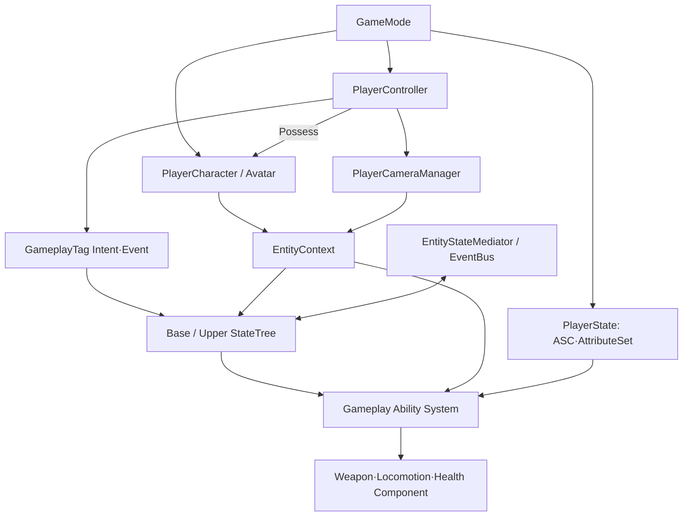

# 03_시스템 설계

Astra 프로젝트에 실제로 적용하는 프로그래밍 구조, 데이터 소유권과 시스템 간 실행 흐름을 관리합니다.

## 주요 설계 문서

- [[작업 규칙]]
- [[개발 규칙]]
- [[시스템 아키텍처]]
- [[게임 객체 분류]]
- [[StateTree와 GAS]]
- [[로코모션과 파쿠르]]
- [[무기 시스템]]
- [[ADR 목록]]
- [[PlayerCameraManager 참조 구성]]

---

## 상위 페이지

- [[00_프로젝트 개요]]

## 관련 페이지

- [[02_게임 기획]]
- [[04_아트 및 애니메이션]]
- [[07_QA_테스트]]
- [[08_기술 위키_공통 가이드]]
