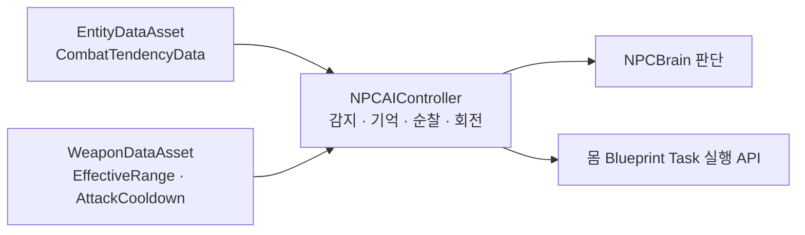

# NPC 전투 성향

## 설계 의도

감지·추적·경보·타겟 전환·거리 유지 값을 성향 데이터로 조합

같은 행동 골격(`AstraNPCAIController` + `EAIBrainState`)을 유지하면서 수치 조합만으로 개체 차이를 표현

## 상태

- 1단계(적대 인간형 1종) 성향 항목 확정: 2026-09-22
- 최종 갱신: 2026-10-08. 현재 FNPCCombatTendency 소스와 작업 대화 대조
- 성향 값의 구체 수치는 테스트 레벨 튜닝으로 결정 — 코드에 하드코딩하지 않음

## 성향 데이터

성향은 Entity의 제작 기본값이므로 `UEntityDataAsset`이 소유 (DataAsset 단일 소유 원칙)

- `bIsNPC`(Identity 카테고리)가 참인 DataAsset에만 성향 구조체 `FNPCCombatTendency`를 채움
- AIController가 성향을 읽어 감지·전이·사격 파라미터로 사용 — ASC에 투영하지 않음
- Capability 플래그(`bCanAttack` 등)와 별개: Capability는 행동 가능 여부(ASC Tag), 성향은 AI 행동 방식(Controller 전용)

`FNPCCombatTendency` 구현 필드. 코드 기본값과 게임플레이 확정 수치 구분

| 항목 | 설명 | 코드 기본값 |
|---|---|---|
| bInfiniteReserveAmmo | Inventory 없이 재장전 시 탄창 보충 | false |
| SightRadius | 시야 감지 거리 | 2000 |
| SightAngle | 시야각 | 90 |
| LoseSightRadius | 감지 유지 거리 | 2500 |
| LostTargetMoveDelay | 시야 상실 후 기억 위치로 출발 전 대기 | 0 |
| GiveUpTime | 기억 위치 접근 후 탐색·대기 시간 | 5 |
| MoveAcceptanceRadius | 기억 위치 접근 허용 거리 | 400 |
| ChaseRetryDelay | 이동 실패 재시도·가시 목적지 갱신 간격 | 0.5 |
| ChaseMaxRetries | 이동 실패 후 추가 재시도 횟수 | 3 |
| ChaseAttackRangeFraction | 가시 타겟 도착 반경의 사거리 대비 상한 | 0.2 |
| bEnableIdlePatrol | Idle 순찰 활성화 | false |
| PatrolRadius | 최초 Possess 위치 기준 순찰 반경 | 0 |
| PatrolWaitTime | 순찰 목적지 도착 후 대기 | 0 |
| PatrolAcceptanceRadius | 순찰 목적지 도착 허용 거리 | 50 |
| PatrolSelectionAttempts | 목적지 선택 시 경로 검사 횟수 | 5 |
| DamageLookWaitTime | 피격 방향 회전 후 확인 대기 | 0 |
| DamageLookRotationRate | 피격 방향 회전 속도, 도/초 | 360 |
| DamageLookToleranceYaw | 회전 완료 허용 각도 | 5 |

사격 시작 거리는 성향 데이터가 아니라 장착 무기의 `WeaponDataAsset.EffectiveRange`가 소유 — AIController의 `GetAttackRange`가 무기에서 조회

발사 간격은 `WeaponDataAsset.AttackCooldown` 사용. 현재 사용자 지정값 1초. Controller의 AttackRequestRetryDelay는 요청 재시도 간격

GiveUpTime은 기존 DA 필드 재사용. 동일 역할의 별도 탐색 대기 변수 추가 금지

후속 후보. 현재 FNPCCombatTendency 미구현

| 항목 | 설명 | 단계 |
|---|---|---|
| PreferredRange         | 유지하려는 선호 거리          | 후속         |
| Accuracy / SpreadBonus | 성향 기반 명중률 보정         | 후속 (P9 범위) |
| AlertRadius            | 경보 전파 범위             | 후속         |

## 감지·경보

- 감지는 `UAIPerceptionComponent`의 Sight 감지로 시작 — 1단계는 Sight만 사용
- 현재 감지 대상은 PlayerController가 조종하는 Pawn. 팩션 관계 판정은 후속
- 감지 성공 시 사거리·시야 조건으로 Attack 또는 Chase 전이
- 시야 상실 시 LostTargetMoveDelay 대기 후 마지막 확인 위치 접근
- 접근 후 GiveUpTime 탐색·대기. 미발견 시 기억 제거·Idle 복귀
- 피격 방향 저장만으로 적 감지·타겟 획득하지 않음
- 경보(주변 아군에게 적 위치 전파)는 1단계 제외 — 개체 단독 감지만

## 이동·엄폐

- 가시 타겟은 사거리까지 접근. 비가시 타겟은 기억 좌표의 도달 가능한 지점까지 접근
- Idle은 지정 반경의 도달 가능한 목적지 순찰. 경로 실패 시 간격을 둔 재선택
- 거리 유지·엄폐·측면 이동 등 전술 이동은 후속 단계 — EnvQuery 도입은 그 시점에 검토
- 이동 중 상체는 Player와 같은 Upper StateTree 규칙을 따름 (Sprint 중 발사 불가 등 기존 정책 재사용)

## 타겟 전환

- 1단계: 최초 감지한 타겟을 유지, 타겟 사망·소멸 시 재탐색
- 거리·위협도 기반 타겟 가중치와 전환 쿨다운은 후속 단계

## 문서 연결

- 기획: [NPC 전투 성향](../02_%EA%B2%8C%EC%9E%84%20%EA%B8%B0%ED%9A%8D/%EC%8B%9C%EC%8A%A4%ED%85%9C%20%EA%B8%B0%ED%9A%8D/NPC%20%EC%A0%84%ED%88%AC%20%EC%84%B1%ED%96%A5.md)
- 시스템 설계: [NPC 전투 성향](NPC%20%EC%A0%84%ED%88%AC%20%EC%84%B1%ED%96%A5.md)
- 애니메이션 설계: [NPC 전투 성향](../04_%EC%95%84%ED%8A%B8%20%EB%B0%8F%20%EC%95%A0%EB%8B%88%EB%A9%94%EC%9D%B4%EC%85%98/%EC%95%A0%EB%8B%88%EB%A9%94%EC%9D%B4%EC%85%98%20%EC%84%A4%EA%B3%84/NPC%20%EC%A0%84%ED%88%AC%20%EC%84%B1%ED%96%A5.md)

## 관련

- [NPC 행동](NPC%20%ED%96%89%EB%8F%99.md)
- [StateTree와 GAS](StateTree%EC%99%80%20GAS.md)
- [팩션 관계](%ED%8C%A9%EC%85%98%20%EA%B4%80%EA%B3%84.md)
