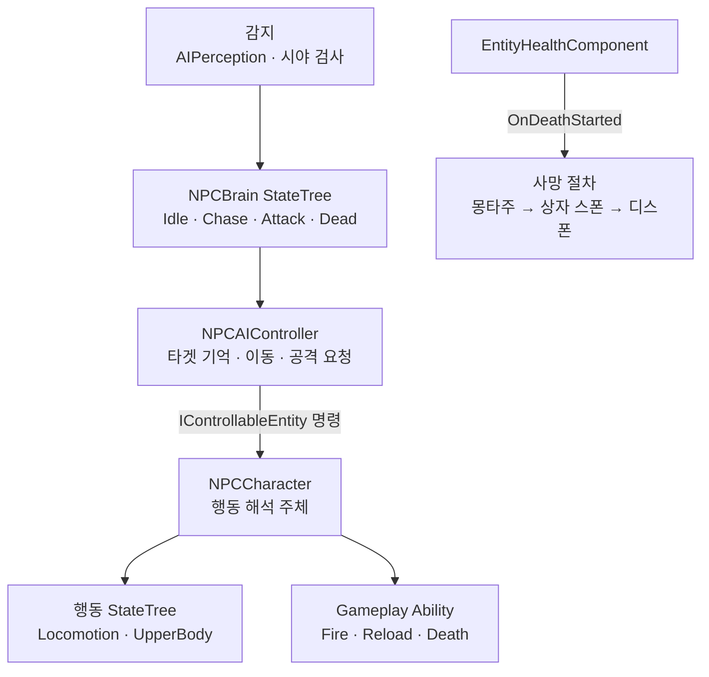

# NPC 행동

2026-10-28 참조 경계 반영: Character·공통 무기 실행부의 구체 AIController 조회 제거. 공통 전투 입력 Delegate와 Handler→Weapon Facade→Controller 요청 사건으로 연결, 피격/착지/사망은 Controller 구독. 기존 Source 13개·입력 계약 헤더 1개 변경, BP/StateTree/GA/DA 연결 변경 없음. 아래 과거 직접 호출 이력보다 [현재 아키텍처](시스템%20아키텍처.md#반영한-입력사건-수명)를 우선. 정적/수명 모델까지, 빌드·UHT·PIE 미수행.

2026-10-25 후속: 사용자 요청으로 추격/회전 이슈 추적 종료. 무장 전용 회전속도·비무장 캐시를 제거하고 Entity DA RotationSpeed→ASC→CharacterMovement→NPC FaceRotation으로 통일. 이동속도는 기존 DA BaseMoveSpeed→ASC→MaxWalkSpeed 경로 유지. ABP의 상하 조준/이동 포즈 수치는 게임플레이 회전속도와 구분한다. 다음 작업은 유탄 탄착 경고·바닥 폭발 효과 연결 후 보스 스킬. 이번 회전 통합의 빌드/PIE 미수행.



## 설계 의도

팩션·대상 유형·상태를 분리하여 행동 골격 재사용

NPC의 두뇌(상태 전이)와 몸(행동 실행)을 분리

- NPCBrain은 상태 전이·명령 시점 결정. AIController는 타겟 기억·PathFollowing·공격 요청 API 제공
- Pawn의 StateTree·GA는 Player와 동일한 행동 경로를 사용

## 상태

- 1단계(적대 인간형 1종) 구현 설계 확정: 2026-09-22
- 최종 갱신: 2026-10-21. 사용자 추적·재장전 완료, 사망 전이 해결·우선권 상향 확인
- 사격·재장전 및 재빌드 후 발사 정상 동작 사용자 확인
- 추적·재장전 사용자 완료 지정. 과거 사거리 이탈·Patrol 잔류 진단 종결
- 제공 트리에서 NPCBrain Idle Command·Base Patrol·DamageLook와 복귀 전이 배치 확인. 신규 생성 대기로 재분류하지 않음
- 이번 애니메이션 수정 후 다수 증상 해소로 PT-00-3 사용자 패스. 순찰·타겟 상실 시선 신규 작업은 현재 범위 제외
- 1단계 범위 외 항목(동료 AI, 포획, 해킹·재조립, 상호작용)은 기획만 존재

## 1단계 범위

| 항목  | 내용                                                         |
| --- | ---------------------------------------------------------- |
| 대상  | Enemy — Human (발카의 세력) 1종                                  |
| 무장  | 권총 (Player와 동일한 `GA_WeaponFire` 경로)                        |
| 탄약  | 예비 탄약 무제한 — 재장전 반복 가능                                      |
| 상태  | Idle(배회·경계) → Combat(사격·재장전) → Dead(몽타주 → 전리품 상자 스폰 → 디스폰) |
| 제외  | 루팅 상호작용, 엄폐·투척물 등 전술 AI, 팩토리·풀 스폰                          |

1단계 NPC는 레벨에 직접 배치하여 검증하고, 팩토리·풀 스폰은 검증 후 도입

## 평상시

`EAIBrainState.Idle`

- 두뇌 Idle의 `NPC Idle Command`가 PatrolStarted 발신. Idle 이탈 시 PatrolCompleted 발신
- NPCCharacter가 PatrolStarted를 받아 Lower의 Patrol 명령 전달. 수납 요청 없음
- Base Patrol의 Blueprint Task가 Controller의 순찰 API 호출
- 순찰 중심은 최초 Possess 위치. 같은 Pawn 재Possess·전투 후 Idle 복귀 시 중심 유지
- 지정 반경의 도달 가능한 NavMesh 목적지·완전 경로 선택. 도착 후 PatrolWaitTime 대기
- 순찰 비활성화 또는 반경 0이면 이동 없음
- 현재 적 판정은 Entity DA Faction의 Allies↔Enemy 관계와 생존 여부. PlayerController/AIController 종류로 진영을 추정하지 않음. [공통 진영 필터](#faction-기준-대상공격-필터--2026-10-26) 참조
- 시야 감지 후 공격 진입 거리 안이면 Attack. Idle/Chase의 진입 거리와 Attack의 이탈 거리는 아래 거리 완충 정책 사용
- Idle Task의 무기 활동 갱신으로 자동 수납 방지. 성향별 휴대 상태 선택은 현재 미구현
- Falling은 이동 실행 중단만 담당. 착지 후 Ground 준비 알림을 Mediator가 Controller로 중계, 현재 BrainState의 Patrol·Chase·Stop 명령 재발행
- Base 연결 절차: [NPC 연결·검증 — 착지 복구](../07_QA_테스트/NPC%20연결·검증.md#착지-후-현재-의도-복구)

## 전투

### 공격 거리 경계 완충 — 2026-10-25

- 사용자 승인: 무기 EffectiveRange는 최대 공격 유지/이탈 거리로 유지. NPC 성향 FNPCCombatTendency.AttackEnterRangeRatio 기본 0.85 추가
- Idle/Chase → Attack: 거리 ≤ EffectiveRange × AttackEnterRangeRatio. Attack 유지: 거리 ≤ EffectiveRange. 진입~이탈 사이에서는 기존 BrainState 유지
- 10000cm 무기·0.85 성향이면 8500cm 진입, 10000cm 초과 이탈. 비율 1은 이전 단일 거리 경계와 같으며 완충 구간 없음. 유효하지 않은 거리/비율은 0 거리로 반환하여 공격 조건 거부
- Controller.GetAttackTransitionRange/IsTargetInAttackRange가 공통 정책 소유. 기존 타겟 사거리 Condition은 이 조회에 위임, UpdateCombatAttack도 동일 조회 사용. 가시성·사선·방향 조건은 별도 유지
- RangeOverride=0 이하이면 무기 기준 사용. 양수면 해당 값이 전이 최대 거리 기준이고 동일 진입 비율 적용. 일반 운영은 기존대로 모든 전이 0 유지하여 Controller 실행부의 무기 기준과 일치
- 거리 이탈 시 Controller는 새 요청을 막고 일반 공격의 미소비/실행 요청을 취소하되 Combat Task 구독을 먼저 해제하지 않음. StateTree Exit가 실제 종료, 경계 재진입 찰나에 Attack 상태만 남고 실행이 꺼지는 경로 방지
- 기존 ChaseAttackRangeFraction/MoveAcceptanceRadius는 PathFollowing 도착 허용 반경이며 공격 진입 거리와 별개. 무기 EffectiveRange·투사체 속도/궤적·시야 감지 범위 변경 없음
- 진행 중 보스 충전은 기존 추격 전환 유지 예외 적용. 일반 NPC 이동·사격 병행 정책은 후속 유지. [DA·StateTree 연결 및 검증](../07_QA_테스트/NPC%20연결·검증.md#공격-거리-경계-완충-연결--2026-10-25)

`EAIBrainState.Chase` → `Attack`

- Chase: 공격 진입 거리까지 접근 후 `Attack` 전이. 진입 거리 초과~최대 사거리 이하는 현재 상태 유지
  - 두뇌는 `HandleControlCommand(ChaseStarted)` 발신. 몸의 Task가 Controller 이동 API 호출
  - Pawn은 Mediator를 거쳐 하체 트리에 `LocomotionCommand.Chase` 전달. Chase Blueprint Task는 Enter에서 `RequestChaseMove`, Tick에서 `UpdateChaseMove`, Exit에서 `CancelChaseMove` 호출. AIController가 PathFollowing 이동·재시도·도착 후 대기 관리
  - NPC는 입력 경로(`EntityLocomotionComponent.Move`)를 거치지 않으므로 `MaxWalkSpeed`는 초기화 완료 시점에 MoveSpeed 어트리뷰트 값으로 직접 설정
  - 추적 종료(타겟 기억 만료·가시 타겟의 공격 진입 거리 도달) 시 두뇌가 `ChaseCompleted` 발신. 시야 상실만으로 기억 위치 추적 종료하지 않음
- Attack: AIController가 `HandleControlCommand(AttackStarted)`를 발신
  - Pawn의 InputBuffer에 `Input.Attack`이 기록되고 Upper StateTree → `GA_WeaponFire`가 Player와 동일하게 동작
- 탄창 소진 시 `RequestWeaponReload` 경로로 재장전
  - NPC는 InventoryComponent를 소유하지 않으므로 **무제한 예비 탄약 정책**을 적용 (아래 탄약 정책 참조)
- 조준은 사용하지 않음 — `bCanAim = false`로 Capability 부여하지 않음
  - `GA_WeaponAim`과 카메라 FOV 경로는 1단계 NPC와 무관
- 가시 타겟과 마지막 확인 위치 기억을 분리. 일반 공격은 타겟 상실 시 중단 후 기억 위치 추적. 2026-10-25 충전 예외는 아래 규칙 적용

### 충전 중 추격과 기억 위치 발사 — 2026-10-25

- 사용자 확정: 충전 중 이동 허용, Attack→Chase에서도 진행 중인 충전 유지. 시야 상실 시 완충 후 마지막 확인 위치로 발사
- NPC Combat Attack Exit는 일반 상태 전환에서만 EndCombatAttack(true)로 충전 유지 허용. 단발·연사는 기존 취소. StateTree 완료/중단과 Root NPC Update Target Tracking Exit는 EndCombatAttack()으로 강제 취소
- Controller.CanContinueChargedAttack은 Attack/Chase·생존·타겟 기억·손 부착·실제 충전 Sequence 및 기존 행동 차단 Tag를 확인. Task 이탈 후 새 공격 요청/Upper 구독만 종료하고 충전 시간·준비 탄은 유지. 기존 Entity/Weapon 갱신이 충전을 진행, 별도 Tick/Timer 없음
- LoseTrackedTarget의 조준점 무효화와 UpdateCombatAttack의 사선/방향 변화 취소에서 진행 중인 충전만 제외. 신규 충전은 기존 가시 타겟·사거리·방향·사선 조건 필요
- NPCCharacter는 진행 중인 충전의 발사 재검사와 Aim을 저장 좌표로 처리. 유탄 바닥 조준은 저장된 중심 아래로 Trace하며, 숨은 타겟 위치·속도를 새로 읽지 않음. 직선 충전 총기의 타겟 이동 페널티는 마지막 관측 속도 상태 사용
- 재감지 시 저장 좌표 갱신, 발사 시 기존 Commit/Factory가 현재 머즐과 조준점을 고정해 궤적·착탄 경고 생성. 실제 투사체의 벽/지형 접촉은 기존대로 처리
- 기억 만료·Idle/전투 상태 이탈·사망·UnPossess·StateTree 종료는 보존된 충전도 취소. 충전이 종료되면 일반 NPC의 기존 정책으로 복귀
- 별도 이동 전술·횡이동 패턴·질주 정책은 추가하지 않음. 기존 Base ChaseWalk 경로 사용, 충전으로 걷기를 막는 Native 조건 없음. [StateTree 연결·검증](../07_QA_테스트/NPC%20연결·검증.md#충전-중-추격과-기억-위치-발사-연결--2026-10-25)

### 반복 공격과 몸 방향

- 두뇌 Attack에 지속 Task `NPC Combat Attack` 배치. 일회성 AttackStarted 반복 사용 대체
- Controller가 Ready·행동 종료·쿨다운·입력 소비 여부를 확인하고 다음 공격 요청
- NPCCharacter의 `FaceRotation`과 `IsFacingCombatTarget`으로 타겟 추종 회전·허용 Yaw 검사
- 방향 정렬 전 공격 요청 대기. 연발 중 허용 각도 이탈 시 발사 중단 후 재정렬
- 공격 허용: 몸 정면 Yaw·실제 손 부착·Muzzle 존재·총구→가시 타겟 사선 검사. 요청·몽타주 시작·Commit에서 재검사. Muzzle 로컬 축으로 몸 회전 보상 없음
- 사선 차단은 `NPC Has Clear Firing Line` Condition으로 기존 Chase 이동. Draw·무기 활동 유지, 경로 끝점 실패는 제한 재시도. 추적은 10/21 사용자 완료 확인
- 타겟 상실 시 과거 Aim Solution 삭제·시선 중립화. 공통 시각 보정 복구 후 자세 회복 확인, PT-00-3 사용자 패스 유지
- 쿨다운은 실제 발사 전 World 시각 검사·선점, 취소/Ready로 환급 없음. 회귀 원인·당시 로그는 연결 문서의 진단 기록으로 관리
- 연결·검증: [NPC 연결·검증 — 정렬과 사선](../07_QA_테스트/NPC%20연결·검증.md#몸-정렬과-총구-사선)
- Upper Attack Task는 Enter에서 GA 한 번 활성화. 실패 시 Task 실패
- Tick은 Attacking 태그 종료와 `DidLastFireSucceed` 확인. 매 Tick GA 재활성화 제외
- 공격 완료 후 Ready 복귀. `STT_WeaponReady`가 손 부착 성공 후 ReadyEntered 발행
- Ready Task 성공 경로는 Running 유지. 부착 실패만 FinishTask(false)
- Player·NPC의 EntityContext 기반 공통 STC·STT 재사용 가능. 에셋 폴더 위치만으로 분리하지 않음
- 비무장 공격 실행·애니메이션은 미구현. 무기 누락 시 경고·실패 처리

### 마지막 확인 위치 추적

```text
Visible → LostDelay → LastKnownMove → Searching → None
   ↑          재발견 시 어느 단계에서든 Visible 복귀
```

- NPCBrain Root의 `NPC Update Target Tracking`에서 기억·시간 갱신
- 가시 상태에서만 마지막 확인 좌표 갱신. 벽 가림·Actor 소멸 후 좌표 유지
- LostTargetMoveDelay 대기 후 기억 좌표 또는 도달 가능한 접근 지점 이동
- 경로 실패 시 ChaseRetryDelay와 ChaseMaxRetries로 제한 재시도
- 비가시 타겟 접근 완료 또는 재시도 소진 시 GiveUpTime 탐색·대기
- GiveUpTime 만료 후 기억 제거·Idle 복귀. 재발견 시 이전 요청·시간 정리
- Blueprint Chase Task: Enter=RequestChaseMove, Tick=UpdateChaseMove, Exit=CancelChaseMove
- Reached·Failed 반환값만으로 Task 즉시 완료하지 않음. Controller의 대기·복구 유지
- 두뇌 전이는 `NPC Has Target Memory` 기준. Attack→Idle은 Invert=true
- 공격 사거리 Condition은 거리와 HasVisibleTarget 동시 검사. 벽 가림 시 Chase

### 순찰·피격 방향 API

| Blueprint Task | Enter | Tick | Exit |
|---|---|---|---|
| Patrol | RequestIdlePatrol | UpdateIdlePatrol | CancelIdlePatrol |
| DamageLook | BeginDamageLook | UpdateDamageLook(DeltaTime) | EndDamageLook |

- 두뇌 Task만 C++ 노드 사용. 몸의 Chase·Patrol·DamageLook Task는 Blueprint 유지
- NPC Idle Command는 NPCBrain Idle에 배치. Pawn Context인 Base Idle에 배치 금지
- 몸 Task의 Controller는 Pawn.GetController 또는 Actor.GetAIController로 확보 후 Cast
- Actor·Pawn을 Controller로 직접 Cast하지 않음
- Controller 구성 실패는 오류 로그·Task 실패. 유효성 실패를 성공으로 종료하지 않음
- Patrol→ChaseWalk는 Chase 명령, Patrol→Idle은 CancelPatrol 명령
- 피격 경로는 Health→Mediator.OnDamageDirectionRequested→Controller 구독→RememberDamageDirection. NPCCharacter 중계 제거(2026-10-28)
- 2026-10-25 후속 분리: Mediator는 생존 중 피격 방향 사실을 항상 전달. `bCanInterruptActionsOnDamage=false`이면 Upper.CancelAction·Lower.HitReaction과 DamageLook 요청을 생략한다. 타겟 기억이 없는 보스는 유효한 공격자의 피격 순간 위치를 추적 단서로 기억하되 시야 감지 성공으로 처리하지 않는다. 이미 전투 중이면 현재 타겟·이동·충전 조준을 유지. 기본 true인 일반 NPC·Player는 기존 피격 반응 사용. 체력 피해·사망·명시적 취소 유지. [DA 설정·검증](../07_QA_테스트/NPC%20연결·검증.md#보스-일반-피격의-행동-중단-정책--2026-10-25)
- 체력 임계치에 따른 보스 기절과 전체 행동 정지는 후속 기획. 이번에 임계치·지속 시간·발동 로직을 추가하지 않음
- 경직·넉백·피격 몽타주·행동별 중단 조건의 전체 피격 반응 기획은 미정. 이 예외로 공통 피격 규칙을 확정하지 않음
- 피격 순간 위치를 저장하고 회전 중 공격자 실제 위치를 다시 조회하지 않음
- 방향 인지 함수에서 이동/공격을 직접 취소하지 않음. 일반 NPC의 이동·사격 중단은 실제 BeginDamageLook에서 실행, Mediator의 기존 Upper 취소 명령은 유지. 중단 비허용 보스의 첫 피격 단서는 타겟 기억을 만들지만 실제 시야 확보 전 새 공격을 허용하지 않음
- HitReaction 상태·Task는 2026-10-08 현재 미구성. 회전 완료 확인은 미기록

### NPC 탄약 정책

Player의 재장전은 InventoryComponent의 예비 탄약을 소비하지만 NPC는 인벤토리가 없음

- 성향 구조체(`FNPCCombatTendency`)의 `bInfiniteReserveAmmo`로 제어 — [NPC 전투 성향](NPC%20%EC%A0%84%ED%88%AC%20%EC%84%B1%ED%96%A5.md) 참조
- 재장전 실행 경로(`ReloadHandler`)가 Inventory 부재 시 이 플래그를 확인하여 탄창만 채우고 예비 소비를 생략
- 탄창 크기·발사 간격 등 수치는 기존처럼 WeaponDataAsset이 소유 — NPC 전용 수치 하드코딩 금지

## 기절·사망·파손·도주

1단계는 **사망(Dead)** 만 구현

- `EntityHealthComponent.OnDeathStarted`가 사망 절차의 유일한 시작점
- 2026-10-20 공통화: Health가 State.Dead·사망 사실 확정 → Mediator가 기존 Ability 취소·Death 명령 전달 → Base Death Task에서 사망 GA 한 번 활성화 요청
- 공통 GA가 EntityCharacter.BeginDeathPresentation 요청. Player·NPC 공통 몽타주 실행·완료·Destroy
- NPC는 공통 시작 훅에서 Brain·타겟 정리, 공통 제거 직전 훅에서 LootBoxClass 한 번 생성
- DeathMontage는 EntityCharacter의 Entity | Design Data | Death로 이동. 기존 NPC 속성 리다이렉트 추가
- 블렌드아웃 시작 시 GA 완료 알림 후 제거. 기본 포즈 복귀 대기 없음. 미지정·재생 실패·중단도 같은 종료 경로
- Base는 Death 상태를 제거 시점까지 유지. Mediator의 GA 직접 활성화·C++ 우회 실행 제거
- 사망 전이 문제 해결·우선권 상향 사용자 확인. Root Death는 Critical 유지, 같은 상태 전이 목록 순서와 구분. 공통 Task는 STT_EntityBase의 바인딩 재사용, 별도 캐스팅·ExitState 작업 없음. [공통 사망 연결](../07_QA_테스트/공통%20사망%20GA·몽타주·제거%20연결.md) 참조
- 시체는 잔존하지 않음
- 상자의 루팅 상호작용은 상호작용 시스템 구현 후 연결 — 1단계 상자는 스폰만 확인
- Fainted·Groggy·Flee·Broken은 Astra·Machine 유형 구현 시 설계

## 상호작용

- 1단계 적대 NPC는 기획대로 상호작용 불가
- 우호 NPC의 대화·상점·퀘스트와 사망 상자 루팅은 별도 상호작용 시스템 설계 후 구현

## 클래스 구성 (1단계)

| 클래스 | 책임 |
|---|---|
| `AstraNPCCharacter` (Character) | Entity ASC 소유(육체 귀속), HealthComponent·WeaponComponent 조립, `IControllableEntity` 구현, EntityContext 제공 |
| `AstraNPCAIController` | AIPerception, `EAIBrainState` 전이, 성향 데이터 조회, `HandleControlCommand` 명령 발신 |
| `UEntityDataAsset` 확장 | `bIsNPC` 식별 + 성향 구조체 소유 (아래 참조) |

### EntityDataAsset의 NPC 식별과 성향

`UEntityDataAsset`에 `bIsNPC`(Identity)와 성향 구조체를 추가하고, AIController는 `bIsNPC`가 참인 DataAsset에서 성향을 읽어 행동 파라미터로 사용

- Capability 플래그(`bCanAttack` 등)와 성향은 별개 개념
  - Capability: "그 행동을 **할 수 있는가**" — ASC에 Tag로 투영, StateTree/GA 전이 검사에 사용 (Player·NPC 공통)
  - 성향: "AI가 **어떻게** 행동하는가" — ASC에 투영하지 않고 AIController만 DataAsset에서 직접 조회
- Player용 DataAsset은 `bIsNPC = false`로 두고 성향 필드를 사용하지 않음
- 기존 `Faction`, `CombatTendency` 문자열 필드는 이 구조에 맞춰 enum·구조체로 정리

ASC 초기화는 기존 공통 경로 `UEntityAbilitySystemInitializer.InitializeEntityAttributes` + `ApplyInitialCapabilityTags` 사용

## StateTree 구성 — 두뇌와 몸

NPC의 StateTree는 두 층으로 나뉘며, 두 층은 직접 참조하지 않고 명령과 ASC Tag로만 연결

| 층 | 에셋 | Context | 역할 |
|---|---|---|---|
| 두뇌 | `ST_AIBrain` (신규, NPC 전용) | AstraNPCAIController | `EAIBrainState` 전이, 타겟 선정, 이동·공격 판단 |
| 몸 | `ST_NPCBaseState` · `ST_NPCUpperState` (NPC 전용) | AstraNPCCharacter | 로코모션·상체 행동 실행, GA 활성화 |

몸 트리는 처음에 Player와 동일 에셋 공유로 설계했으나, Context Actor 타입 차이로 Player 전용 STC/STT의 바인딩이 깨지는 문제가 있어 **트리 에셋은 Player·NPC 분리**로 확정 (2026-09-24)

- 공용 동작의 STT/STC 클래스는 `EntityBase` 계열(`AEntityCharacter`·`UEntityContext`만 참조)로 만들어 양쪽 트리에서 재사용 — 로직은 한 벌, 트리 구조만 두 벌
- Player 전용 기능(조준, Sprint 의도, 카메라)은 `PlayerBase` 계열 STC/STT로 격리하고 Player 트리에서만 사용
- `Has Buffered Entity Input`은 InputBuffer의 상태만 확인하므로 입력 출처(PlayerController·AIController)를 구분하지 않는 원칙은 동일하게 유지

### 두뇌 → 몸 (명령)

```text
ST_NPCBrain (두뇌)
  │  상태 전이 결과: 공격 판단
  ▼
IControllableEntity.HandleControlCommand(AttackStarted)
  │  Pawn이 InputBuffer에 Input.Attack 기록
  ▼
ST_NPCUpperState (몸, NPC 전용 트리·공통 Entity Task)
  │  STC: Input.Attack 확인 → Fire 전이
  ▼
STT: 입력 소비 → 상태 진입 게시 → Activate Ability By Tag
  ▼
GA_WeaponFire (Player와 동일 GA, 탄약·사망 재검사)
```

### 몸 → 두뇌 (상태 확인)

두뇌는 몸 트리에 묻지 않고 ASC GameplayTag로 확인

- 사격 중 여부: `State.Combat.Attacking`
- 사망 여부: `State.Dead` → 두뇌도 Dead로 전이하여 명령 발신 중단

몸 트리와 두뇌 트리는 각각 별도 StateTreeComponent에서 실행 — 몸 트리는 Pawn에, 두뇌 트리는 AIController에 구성

### Player 전용 참조 격리

- 카메라 참조는 `UPlayerContext`에 격리. NPC는 공통 UEntityContext 사용
- 카메라를 호출하는 코드(`GA_WeaponAim` 등)는 널 가드 필요 — 1단계 NPC는 `Capability.Combat.Aim` 미부여로 경로 차단
- Weapon GA는 UPlayerContext Cast 성공 시 카메라 FOV 호출

## AIController 구성

- AI 폰 하나당 AIController 하나 — 1:1 Possess 관계, 폰 Destroy 시 컨트롤러도 함께 정리
- 스폰 방식
  - 레벨 배치: `Auto Possess AI = Placed in World`
  - 런타임 스폰(팩토리·풀 도입 후): `Spawn Default Controller`로 컨트롤러 자동 생성
- 다수 생성(루트 슈터) 기준 성능
  - AIController 자체는 가벼워 수십 기 규모는 부담 없음
  - 실제 비용은 개체별 StateTree 틱과 AIPerception — 두뇌 로직은 개체 간 공유하고, 필요 시 Perception 갱신 주기·틱 간격을 성향 데이터로 조절
  - 수백 기 이상 규모가 되면 MassEntity 검토 — 현재 교전 규모에서는 표준 방식으로 충분
- 영혼 결속 대비: 두뇌만 정지하고 Player 입력을 같은 InputBuffer에 기록하는 Possess 전환 구조. 실제 영혼 결속 전환은 후속 구현

## 근접 추격→공격 이동 인계 — 2026-10-26

공격 Trace·Camera 설정은 [공통 충돌 정책](#공격-trace-분리npc-camera-공통-정책--2026-10-26) 후속 반영. 접근 속도 인계와 별개 변경이며 빌드는 한 번에 사용자가 수행.

사용자 보고: 좀비가 Chase→Attack에서 잠깐 멈춘 뒤 다시 접근. 의도한 준비 정지가 아님. 정적 원인은 Brain Attack의 ChaseCompleted→Base ChaseWalk.Exit.CancelChaseMove가 경로 속도를 정지하고, StartMelee도 StopMovementImmediately 후 다음 Sequence Tick까지 접근 속도를 넣지 않던 순서.

- 근접이며 살아 있고 지상·가시 타겟·접근 사거리/가림·공격 Capability 검사 통과, 아직 실제 타격 거리 밖이면 공격 요청 인수 전까지 기존 Base Chase를 유지. 후속 추적 수정에서 새 공격 쿨다운과 이동 유지 조건을 분리하여, 쿨다운만으로 타격 거리 밖 추격을 끊지 않음. 원거리의 기존 Chase 종료 정책과 구분.
- GA가 기존 WeaponComponent→StartMelee에 실제 진입하면 자기 ChaseRequestID를 먼저 무효화한 뒤 PathFollowing.AbortMove(Keep)로 경로만 해제. 같은 StartMelee 호출에서 기존 UpdateMeleeMovement를 실행해 돌진 속도·입력을 설정. 새 이동 Task/GA/Component/Timer 없음.
- Brain=Attack에서는 인수 후 기존 ChaseCompleted를 전달. 나중에 Base ChaseWalk.Exit가 CancelChaseMove를 불러도 이미 해제된 자기 경로 ID가 없어 근접 이동을 다시 멈추지 않음. Brain=Chase에서 이미 실행 중인 근접 공격만 Chase 의도를 보존.
- 타격 거리 도달→BeginMeleeStrike에서 정지→공격 몽타주→Melee_Hit의 실제 소켓 판정. 무대상 제자리 공격·접근 거리/시간 제한·쿨다운·취소/사망 정리 유지. 요청 실패로 인계되지 않아도 타격 거리 도착/조건 상실 시 기존 Chase 종료, Root 종료·명시적 취소는 유지한 추격도 정리.

```text
Brain Chase → Attack
  → NPC Set Brain State(Attack)
  → NPC Set Chase Command(false)
     ├─ 근접 접근 인수 대기 조건 통과 → Base ChaseWalk·현재 경로 유지
     └─ 실제 타격 거리 안 / 원거리 / 실행 불가 → 기존 ChaseCompleted
  → NPC Combat Attack → 의미 입력 → 기존 공격 Task → GA → StartMelee
     ├─ 실패 → 기존 GA/Task 실패 정리, Brain의 기존 복구 전이
     └─ 성공 → 경로 해제(속도 유지) + 같은 호출에서 접근 속도 적용
        → ChaseCompleted → Base ChaseWalk.Exit.CancelChaseMove(해제된 ID로 중복 정지 없음)
        → 이동 ABP 유지 → 타격 거리 → 정지·공격 몽타주
취소/사망/트리 종료 → 기존 공격/이동 정리. 과거 경로 자동 부활 없음
```

문서에 기록된 Brain Task 순서와 Base ChaseWalk의 Enter=RequestChaseMove / Tick=UpdateChaseMove / Exit=CancelChaseMove는 유지. 새 BP 핀/DA 설정 없음. 이번에는 uasset 내부 재확인·편집하지 않았으므로 별도 StopMovement 노드가 있는 최신 에셋까지 제거했다고 기록하지 않음.

기존 소스 3개 수정, 백업 `Saved/CodexChanges/MeleeChaseHandoff-20261026-124344`. UE 5.8 로컬 PathFollowing 구현에서 Keep은 종료 시 속도를 초기화하지 않는 경로 확인. 정적 확인과 인계 순서 모델만 수행; 빌드·UHT·Editor·PIE 미수행. 실행 확인: 추격→접근에서 Speed=0 틈 없음, 실제 타격 직전에만 정지, 늦은 Base Exit·접근 실패·피격/기절·사망·플레이어 무대상 공격·원거리 정지 회귀.

## 근접 접근 추적·빗나감 처리 — 2026-10-26

사용자 보고: 추격→공격 시도 중 플레이어가 이동하면 몽타주 없이 잠시 서 있다가 추격. 후속 확정은 접근 한도 끝에서도 공격 모션을 재생하고 손이 닿지 않으면 빗나감, 접근 중 대상의 현재 위치를 매 Tick 추적. 기본 마네퀸 기반 캡슐은 수정하지 않음. 루트모션 사용은 검토한 별도 에셋 선택이며 이번 코드 수정에서 켜지 않음.

확인한 코드 경로:

- 기존 근접은 Actor 참조를 저장하고 매 Tick 실제 거리만 재검사하되 돌진 방향은 시작 때 고정. 한도까지 타격 거리 안에 못 들어오면 CancelFire로 몽타주를 생략했음.
- 기존 속도는 min(LungeSpeed, (현재 거리−타격 거리)/DeltaTime)로 경계까지 감속. 모델에서 걸어 멀어지는 대상의 다음 Tick 위치 때문에 경계 도달을 반복해서 놓치고, 더 빠른 돌진 설정이어도 한도까지 공격 시작을 못 하는 경우 재현.
- 새 공격 쿨다운으로 CanAttackWeapon=false일 때 기존 Base Chase도 종료하는 인계 조건이 남아 있었음. 새 공격 허가와 이동 유지 조건을 분리.

현재 동작:

1. GA로 선택한 대상 Actor를 유지. 접근 중 매 Tick 현재 위치를 읽고 CharacterMovement.RotationRate(기존 DA/ASC RotationSpeed)로 몸 Yaw를 갱신, 실제 몸의 전방 방향으로 이동. NPC 비가시 타겟은 기존 마지막 관측 위치만 사용. 타겟을 매 Tick 새로 선정하지 않음.
2. LungeSpeed로 접근하며 한 프레임도 남은 누적 거리 예산을 넘지 않도록 속도 제한. 실제 CharacterMovement 캡슐 충돌을 사용, 순간이동/별도 물리 이동 없음. MaxLungeDistance와 MaxLungeDistance/LungeSpeed 기한 유지.
3. 타격 거리 안에 들어오거나 거리/시간 한도에 도달하면 BeginMeleeStrike. 몽타주가 시작되면 bMeleeApproaching=false로 위치/방향 추적을 끝냄. Melee_Hit의 실제 손/무기 궤적이 닿을 때만 피해, 단순 거리로 원격 피해 없음.
4. 취소·사망·기절·대상 무효/진영 부적합·NPC 기억 소실은 기존 정리 경로. 실제 타격 창·쿨다운·Faction 제외·공통 GA 완료 통지 유지. 원거리 사격/보스 충전 정책 변경 없음.

```text
Chase → 공격 접근
  → 매 Tick 대상 위치/기존 기억 위치 + DA 회전속도로 방향 갱신
  → DA 돌진 속도 유지, 누적 거리·시간 제한
  ├─ 타격 거리 도달 → 공격 몽타주 → 방향 추적 종료
  ├─ 접근 한도 도달 → 공격 몽타주 → 접촉 없으면 빗나감
  └─ 사망/취소/대상 무효 → 기존 GA/이동 정리
공격 몽타주 → Melee_Hit 소켓 접촉 검사 → 종료 → 현재 Brain 의도에 따른 후속 행동
새 공격 쿨다운 중 + 타격 거리 밖 → 기존 추격 유지, 새 GA는 기존 쿨다운 검사
```

기존 소스 4개 수정(수행 cpp 2개, 설명 보완 h 2개), 새 Task/GA/데이터/Timer 없음. 백업 `Saved/CodexChanges/MeleeWhiffMontage-20261026-134813`, `Saved/CodexChanges/MeleeApproachTracking-20261026-135135`. diff/중괄호/generated include·실시간 방향 계산·한도 몽타주·경계 감속 제거·쿨다운 독립 정적 확인. 구 감속 실패를 재현한 뒤 정지/횡이동/느린 후퇴/빠른 이탈의 이동 모델 8조건 확인. 실제 캡슐 충돌·몽타주·명중·PIE 검증과 구분, 빌드·UHT·Editor 미수행.

사용자 빌드 후 확인: 횡이동을 따라 접근 방향 변화, 돌진 속도가 걷기보다 빠른 설정에서 이동 타겟과 거리 좁힘, 한도 끝에도 몽타주 재생·원격 피해 없음, 몽타주 시작 후 회피 가능, 벽/사망/기절/취소·Faction 회귀. 걷기만으로 모든 공격을 피할 수 있는지 여부는 실제 UnarmedRange/EffectiveRange·손 궤적·Melee_Hit 시점·LungeSpeed·애니메이션 전진량을 함께 플레이 조정해야 하며 모델만으로 명중을 보장하지 않음. 기본 캡슐 크기·Force Root Lock·Enable Root Motion·ABP Root Motion Mode는 편집하지 않음.

## Faction 기준 대상·공격 필터 — 2026-10-26

사용자 승인: 피아식별의 원본은 Entity DA Faction. 공통 WeaponAttack 채널은 공격 검사 용도이며 아군 피해 허용을 뜻하지 않음. 이전 반영에서 같은 진영 피해 최종 차단은 있었으나 근접 Sweep의 아군 Blocking 및 NPC 현재 타겟 분기의 진영 검사가 누락되어 후속 수정.

| 공격자/대상 Faction | 대상 선정·공격 검사·피해 |
|---|---|
| Allies→Allies, Enemy→Enemy | 자동 공격 대상 제외. Ray/Sweep에서 해당 Entity를 Ignore 후 같은 원래 구간 재검사. 최종 HP·피격 반응 차단 |
| Allies→Enemy, Enemy→Allies | 살아 있는 반대 진영 Entity를 공격 대상으로 허용. 거리/시야/가림/접촉·실제 사격 수행 조건은 유지 |
| None·Neutral | 전투 아군/적대 관계 미정. 이번에 자동 적대/같은 진영 무적을 부여하지 않음. 기존 명시적 피해·자기/환경 피해 정책 확대 없음 |

- Entity.IsCombatAlly/IsCombatEnemy가 DA Faction을 직접 읽어 관계 판단. IsCombatAlly가 발사체 Object Channel 동등성으로 관계를 역추론하던 의존 제거. 발사체 채널은 계속 DA Faction에서 선택되는 물리 충돌 표현.
- NPCAIController.IsValidTarget의 PlayerController 전용 조건 제거. 살아 있는 반대 Faction Entity를 감지 대상으로 사용하므로 아군 NPC도 적 NPC를 대상으로 삼을 수 있음. 기존 마지막 감지 타겟 선택 방식을 유지하며 우선권/위협도 시스템을 추가하지 않음. SetCurrentTarget·가시성·기억 갱신도 유효성을 재검사하고 현재 대상이 같은 진영/비적대/사망으로 바뀌면 기존 타겟 정리 경로 사용.
- WeaponHandlerBase.IsMeleeDamageTarget은 조종자 분기 이전에 IsCombatEnemy 검사. NPC는 그중 현재 AI 타겟만, 플레이어 등은 그중 실제 접촉한 대상을 허용. 무대상 제자리 공격 계약 유지.
- 기존 Utils/Targeting에 SweepSphereMultiIgnoringCombatAllies 추가. 아군 Blocking/Overlap을 Ignore 목록에 넣고 같은 시작·끝·반경으로 재검사. 뒤의 적·벽·지형을 건너뛰지 않으며 월드 전체 Actor 사전 열거·새 Tick/Subsystem/타이머 없음.
- 근접 소켓 Sweep·몸통→접촉점 차폐·NPC 근접 접근 가림·플레이어 후보 시야/접근 검사 모두 같은 아군 제외 함수를 사용. Hitscan/Beam·조준·원거리 공간·폭발 차폐는 기존 아군 제외 함수가 갱신된 IsCombatAlly를 공통 사용. 최종 Health.ApplyDamage의 아군 차단도 같은 함수 사용.
- 기존 Projectile/AlliesProjectile/EnemyProjectile Object Channel 및 WeaponAttack Trace Channel 수/용도 유지. 새 진영 채널·BP/GA/Task 분기 없음. 캐릭터 간 Pawn 물리 충돌은 이번 공격 검사 통과와 별개.

```text
DA Faction → IsCombatEnemy → AI/플레이어 근접 대상 선정
공격 검사 → IsCombatAlly
  ├─ 아군 검출 → 해당 Actor Ignore → 원래 구간 재검사
  ├─ 벽/지형 → 기존 차단
  └─ 실제 타격 가능 대상 → 기존 소켓/발사 판정 → Health.IsCombatAlly 재검사 → 피해
사망/타겟 무효/진영 부적합 → 기존 공격·타겟 수명 정리
```

Editor 확인: **플레이어·우호 NPC DA Faction=Allies, 보스·좀비·적 NPC DA Faction=Enemy** 지정. None인 DA를 조종자 종류만 보고 자동 아군/적군으로 보정하지 않음. 기존 GA/Task/ABP 노드는 그대로 사용. 사용자가 한 번에 전체 빌드·Editor 재시작 후 확인.

기존 소스 10개 수정. 백업 `Saved/CodexChanges/FactionAttackFiltering-20261026-131918`. 선언/정의/호출·DA 직접 조회·근접 raw query 우회 제거·10개 파일 diff/중괄호/generated include 정적 확인. Faction 16조합의 아군/적대 배타성 및 아군→적·아군→벽→적·다중 아군·아군만·Overlap·반대 진영·벽 선차단 8상황 순서 모델 확인(합계 24). 빌드·UHT·Editor·PIE 미수행, 새 테스트/스크립트 파일 없음. 실행 검증: 아군 근접/원거리/폭발 무피해·무반응, 아군 뒤 적 타격/벽 차단, Enemy끼리 제외, 아군 NPC의 적대 대상 선정, 좀비의 플레이어 타격·사망/취소 회귀.

## 공격 Trace 분리·NPC Camera 공통 정책 — 2026-10-26

사용자 확인: 플레이어 Visibility Block 후 좀비 피해 발생, NPC Camera Ignore 후 카메라 당김 해소, Force Root Lock 후 공격 애니메이션의 이동/원위치 복귀 문제 해소. 이후 공격 검사 분리와 전체 NPC Camera 정책 반영 승인, 빌드는 사용자가 한 번에 수행 지정.

| 용도 | 현재 채널/응답 |
|---|---|
| 맨손 타격·기본 근접/HitScan/Beam 피해 검사 | WeaponAttack = ECC_GameTraceChannel4, Trace Type, 기본 Block |
| 기존 무기 DA | AttackTraceChannel의 저장 Visibility만 PostLoad→WeaponAttack 이전. 다른 커스텀 값 유지. 새 DA 기본 WeaponAttack |
| 피해 대상 육체 | Entity의 Capsule·Mesh는 WeaponAttack Block. CollisionEnabled·Pawn 물리 응답은 유지 |
| 물리 투사체 | 기존 Projectile/AlliesProjectile/EnemyProjectile Object Channel 유지. 3개 프로필 모두 WeaponAttack Ignore 추가, 준비 탄/비행 탄이 새 공격 검사를 가로막지 않음 |
| 조준·시야·파쿠르·바닥 탐색 | 기존 Visibility/기존 설정 유지. 보스 유탄 바닥 탐색은 피해 Trace와 분리해 Visibility 사용 |
| NPC 원거리 사선 | 물리 탄은 실제 진영 탄 채널. Hitscan/Beam은 무기 DA AttackTraceChannel로 수행부·총구 공간 검사와 일치 |
| NPC Camera | NPC가 소유한 모든 Primitive에서 Ignore. 벽·지형·Prop의 Camera 응답은 변경하지 않음 |

Entity의 기존 충돌 갱신 함수를 RefreshCombatCollisionResponses로 확장해 PostInitializeComponents 및 InitClass의 최종 DA 적용 시점에 호출. NPC는 같은 훅을 override하여 Super 공통 공격/진영 응답 적용 후 Camera Ignore. 생성자에서도 기본 Capsule·Mesh에 Camera Ignore를 설정하되 기존 BP 저장값은 런타임 초기화에서 다시 적용. 보스/일반 NPC/후속 소환 좀비 모두 같은 경로이며 별도 Tick/Task/Collider/DA 옵션 없음. 초기화 이후 새로 동적으로 붙인 별도 Actor의 충돌까지 자동 전파하는 기능은 추가하지 않음.

```text
Actor 초기화 → Entity.RefreshCombatCollisionResponses
  → Capsule/Mesh.WeaponAttack=Block + 기존 진영 탄 응답
  → NPC override: 소유 Primitive.Camera=Ignore
무기 DA 로드 → 기존 Visibility 기본값 이전 → 실제 공격 Trace에서 사용
공격 실행 → 기존 소켓 Sweep/HitScan/Beam → 벽 차단·진영 피해 필터 → Health
취소/사망 → 기존 공격 수명 정리. 별도 충돌 전환/복구 타이머 없음
```

에디터 연결: 사용자 전체 빌드 후 **Editor 완전 재시작**으로 새 채널·DA PostLoad 반영. Project Settings→Collision에 WeaponAttack 확인. 새로운 BP 노드/GA/Task 연결 없음. 무기 DA를 열면 기존 Visibility는 WeaponAttack으로 표시되어야 하며 저장하면 이전값을 에셋에 유지 가능. 사용자가 근접 테스트용으로 바꾼 플레이어 Visibility 응답은 코드에서 강제로 되돌리지 않음. 근접만을 위해 Block을 유지할 필요는 없으며 기존 조준·시야 정책에 맞춰 설정.

검증 대기: 플레이어 Visibility Ignore에서도 좀비 피해, 근접 무기 및 플레이어 맨손, 벽 뒤 무피해, 같은 진영 무피해, NPC 밀착 카메라·벽 카메라 차폐, 일반 라이플/보스 유탄·자기 탄 무차단·풀 재사용, 신규 좀비 생성. Force Root Lock 사용자 에셋 설정은 재편집하지 않음.

기존 소스/Config 9개 변경. 백업 `Saved/CodexChanges/WeaponAttackCollision-20261026-130515`. diff 공백·중괄호·generated include·기존 심벌 제거/새 가상 훅 선언/정의/호출·채널 4개·프로필 3개×Ignore 6응답 정적 대조. 빌드·UHT·Editor 조작·PIE·새 테스트/스크립트 파일 생성 미수행.

## 원거리 발사 공간·총구 끼임 — 2026-10-26

사용자 요청: 선은 타겟까지 통과하지만 탄 폭은 코너에 걸리는 경우 발사하지 않고 Chase로 이동. 후속 지정으로 NPC의 어깨/몸 폭도 발사 여유 공간 기준에 포함.

- NPC 여유 반경 = `max(Character Capsule.GetScaledCapsuleRadius, 현재 탄 DA.CollisionRadius)`. Capsule 반경은 어깨 너비의 절반에 해당하는 몸 폭 근사. 모델의 실제 어깨 폭과 Capsule 크기는 콘텐츠에서 맞춤. 별도 사선 반경 DA·임의 추가 마진/거리 상수 없음
- `WeaponHandlerBase.CheckMuzzleClearance`가 몸통 축의 총구 높이→총구를 검사. 총구 끝이 이미 벽 반대편으로 나온 경우와 시작 겹침까지 확인. 근접한 피해 대상 Entity 자체는 총기-환경 끼임으로 취급하지 않고, 벽/지형/Prop을 검사
- `NPCCharacter.HasClearFiringLine`은 위 검사 후 총구→가시 타겟을 Sphere Sweep. 탄 크기보다 몸 폭이 크면 몸 폭을 사용하므로 얇은 선만 보이는 코너에서는 공격 허용하지 않음
- 물리 탄은 실제 발사체의 진영 Object Channel로 검사하여 같은 진영 통과·벽/적대 대상 충돌 응답과 일치. 후속 공격 채널 분리 후 Hitscan/Beam은 무기 DA AttackTraceChannel을 사용하고 NPC의 몸 폭 Sweep 적용. 근접의 접근 가림 검사 및 실제 손/무기 판정은 이 원거리 규칙과 별개
- 사용자 범위 재확인: 어깨 폭 Shape Trace는 원거리 전용. 기존 공통 Brain API `HasClearFiringLine`은 이름 때문에 혼동할 수 있으나 근접 분기는 본문 초기에 별도 몸통→타겟 접근 가림 결과를 반환하며 총구/탄 반경/어깨 폭 검사를 호출하지 않음. 근접 명중은 별도 Melee_Hit 소켓 궤적, 가까운 적 접근 가능 여부와 타격 결과를 혼동하지 않음
- `AttackCommitHandler.CanCommitAttack`이 손 부착 무기의 몸통→총구 검사를 다시 수행하여 탄 생성/탄약 소비 전 환경 끼임 거부. 수납 중 예약 입력 사전 검사는 손 부착 이후 재검사. Player는 물리 탄 반경(직선 판정 무기는 선), AI 조종 NPC는 몸 폭까지 적용
- 충전 연속 유지/마지막 관측 위치 사격 정책 유지. 단, 실제 발사 순간 총구가 환경을 관통했다면 기존 실패/정리 경로. 유탄 곡선 전체를 새로 예측하거나 우회 발사를 추가한 작업은 아님

```text
새 공격/Attack 상태
→ HasClearFiringLine
   ├─ 몸통→총구 또는 총구→타겟 Sweep 차단
   │  → false → 기존 Combat 취소/사선 실패 전이 → Chase
   └─ 통과 → 기존 거리·몸 정렬·Ready·쿨다운 조건 → 공격

Chase
→ 사선 공간 미확보: 도착 허용 반경=0으로 기존 타겟 경로 계속 진행
→ 목표 위치가 같아도 도착 반경 변경 시 한 번 MoveTo 교체, StopMovement 선행 없음
→ 공간 확보 + 공격 진입 조건 충족 → 기존 Attack 전이
→ 길이 없거나 접근 끝점에서도 막힘 → 기존 제한 재시도/실패 처리
```

StateTree API/핀은 그대로: Attack→Chase는 `NPC Has Clear Firing Line`의 false(반전), Chase→Attack은 true와 기존 거리/가시 조건. 새 Task·강제 BrainState 변경·별도 이동 루프 없음. Blueprint 실제 전이 적용 여부는 기존 기록/Editor에서 확인하며 이번에 uasset은 편집하지 않음.

디버그는 기존 `Utils/Debug`의 NPCFiringLineBlocked 로그에 `Radius` 추가. 몸통 검사/타겟 검사 시작·끝과 StartPenetrating을 기존 로그에서 확인. 독립 콘솔 변수나 디버그 Tick 없음.

언리얼은 [Shape Component](https://dev.epicgames.com/documentation/en-us/unreal-engine/shape-components?application_version=4.27)를 무기에 부착해 Overlap을 받거나 [Shape Trace](https://dev.epicgames.com/documentation/unreal-engine/traces-in-unreal-engine---overview)로 부피를 이동시키며 검사할 수 있음. 이번에는 기존 공격/추격 판단에서 Trace 사용. 무기를 물리적으로 밀어내거나 총을 내리는 IK/상체 애니메이션은 별도 연출 범위.

정적 점검만 완료, 빌드·UHT·Editor·PIE 미수행. Capsule보다 좁은 사격 틈을 의도적으로 불허하는 보수적 조건임. NavMesh/기존 경로가 없는 곳에 새 엄폐 우회/EQS를 생성하지 않음. 백업 `Saved/CodexChanges/NPCFiringClearance-20261026-112809`, 기존 소스 13개 수정.

## 같은 진영 총탄 통과·오사 차단 — 2026-10-26

사용자 승인 정책: Allies끼리/Enemy끼리는 총알이 충돌 없이 통과하고 피해·피격 반응 없음. 적대 대상·벽·지형 충돌 유지. 폭발도 같은 전투 진영에 피해 없음. 피해만 막고 탄을 소모시키는 이전 임의 정책은 철회.

- `EntityCharacter.GetProjectileCollisionChannel`이 기존 Entity DA의 Faction에서 채널 선택. `IsCombatAlly`는 같은 전투 진영인지 공통 조회. SubFaction 관계표·None/Neutral 간 관계를 임의로 구현하지 않음. 기존 자기/환경 피해 조건도 확대하지 않음
- `AstraCombatDefines.h`와 `DefaultEngine.ini`: 기존 Projectile=GameTraceChannel1, AlliesProjectile=2, EnemyProjectile=3. 발사체 프로필은 AstraProjectile/AstraAlliesProjectile/AstraEnemyProjectile이며 모든 발사체 채널 상호 Ignore
- Entity PostInitializeComponents 및 최종 초기화에서 육체 Primitive의 같은 진영 발사체 채널 응답을 Ignore로 지정. 캐릭터 사이 Pawn 충돌은 그대로이며, 이후 소환된 NPC도 같은 초기화 사용. 발사 때 모든 NPC를 열거하거나 전용 Tick/Subsystem을 추가하지 않음
- Projectile 준비/발사/풀 재사용 시 소유자의 현재 진영에 맞는 프로필 선택. 기존 직선 ProjectileMovement와 곡선 Sweep 모두 동일한 충돌 응답 사용
- `Utils/Targeting.TraceLineIgnoringCombatAllies`: 같은 진영 Entity만 제외 후 원래 구간 재검사. 조준 Ray·NPC 원거리 사선·Hitscan/Beam 전달·폭발 차폐 검사에서 재사용. 뒤쪽 적대 대상/벽/지형은 계속 차단
- HealthComponent.ApplyDamage는 같은 `IsCombatAlly` 결과로 HP 변경 및 OnDamageTaken을 차단. 따라서 오사로 DamageLook/공격 취소가 발생하지 않음
- BP/Task에 추가 진영 분기나 충돌 설정을 중복 연결하지 않음. DA Faction만 올바르게 설정. 물리 충돌 채널 추가이므로 **전체 빌드 후 Editor 재실행** 필요
- 검증 상태: C++/Config 반영·정적 점검까지. Blueprint Compile·UHT·전체 빌드·PIE 미수행. NPC 2기 앞뒤 배치·뒤의 플레이어 피해·뒤의 벽 차단·폭발 오사·풀 재사용·나중 소환 NPC 통과 확인 필요

## 공격 Task Blueprint 구조 — 2026-10-26

### 확인 근거와 상태

- 에셋: `/Game/Astra/Entity/NPC/Common/StateTree/UpperState/STT_NPC_Attack`
- 사용자 제공 EventGraph 텍스트: `C:/Users/somed/.codex/attachments/ca9e7749-4a19-455b-a5e0-d3330ef24b61/붙여넣은 텍스트.txt`
- 상속 참조원: `00_STT_EntityBase`의 `AEntityCharacter`·`EntityContext`. 이 참조를 재사용하며 자식 Task에서 재캐스팅/별도 Context 캐시 없음
- 아래 실제 연결은 제공 텍스트에서 확인. 권장 연결은 수정안이며 Editor 적용·Blueprint Compile·PIE 확인과 구분. 후속 분석은 이 절부터 대조하고 같은 전체 그래프를 반복 요청하지 않음

### Task 변수·Context

| 항목 | 타입/기본값 | 소유/연결 |
|---|---|---|
| bAbilityStarted | Boolean / false | 해당 공격 Task 인스턴스의 런타임 변수. 엔진/Context에서 가져오는 값이 아님. GA 활성화 수락 뒤 true, 완료/Exit 정리 직전 false |
| EntityContext | 부모 제공 EntityContext | StateEventBus·StateMediator·AbilitySystem·WeaponComp 참조 사용 |
| AEntityCharacter | 부모 제공 캐릭터 참조 | PublishUpperState.Source |
| GA 태그 | Ability.Weapon.Fire | 활성화/취소 요청 |
| 실행 중 태그 | State.Combat.Attacking | Context.AbilitySystem에서 검사 |

### 제공본에서 확인한 연결과 수정 지점

1. `EnterState → K2Node_VariableSet_0(false) → PublishUpperState(FireEntered, Source=AEntityCharacter) → TryActivateAbilityByTag(Ability.Weapon.Fire)`까지 연결
2. `K2Node_CallFunction_1.TryActivateAbilityByTag.ReturnValue`가 `K2Node_IfThenElse_0.Condition`에 미연결. Condition 기본 true라 실제 활성화 거부도 성공 분기로 진행. **ReturnValue→Condition 연결 필요**
3. 활성화 실패 분기의 `K2Node_CallFunction_3.FinishTask.bSucceeded=true`. **false로 변경 필요**
4. Tick의 `K2Node_Message_0.HasMatchingGameplayTag.Target`이 `Context.StateEventBus`. 이 객체는 ASC가 아니며 실행 태그 소유자가 아님. **Context.AbilitySystem에서 Has Matching Gameplay Tag 호출로 교체**
5. Tick의 `bAbilityStarted=true`에서 태그가 사라지면 `K2Node_CallFunction_4.FinishTask(true)`로 바로 진행. **Set bAbilityStarted=false→FinishTask(WeaponComp.DidLastFireSucceed)**로 변경 필요
6. Tick의 `bAbilityStarted=false` 분기는 `Set false→FinishTask(false)`로 연결. 활성화 실패는 Enter에서 종료하므로 정상 실행 중에는 이 분기를 기다림/빈 실행으로 유지해도 됨. 여기서 GA 매 Tick 재활성화하지 않음
7. Exit는 현재 `Set false→CancelAbilityByTag` 무조건 실행. **Branch(bAbilityStarted)→true일 때 먼저 Set false→CancelAbilityByTag**로 변경. 정상 완료 Exit에서 이미 끝난 GA를 재취소하지 않음

### 수정 후 정상·실패·취소 전체 흐름

```text
EnterState
→ Set bAbilityStarted=false
→ PublishUpperState
   Target=EntityContext.StateEventBus, StateEvent=FireEntered, Source=AEntityCharacter
→ TryActivateAbilityByTag
   Target=EntityContext.StateMediator, AbilityTag=Ability.Weapon.Fire
→ Branch(Condition=TryActivateAbilityByTag.ReturnValue)
   ├─ false → FinishTask(bSucceeded=false)
   └─ true → Set bAbilityStarted=true → Running 유지

Tick
→ Branch(bAbilityStarted)
   ├─ false → 실행 없음
   └─ true → HasMatchingGameplayTag
      Target=EntityContext.AbilitySystem, Tag=State.Combat.Attacking
      → Branch(ReturnValue)
         ├─ true → Running 유지
         └─ false → Set bAbilityStarted=false
            → FinishTask(bSucceeded=EntityContext.WeaponComp.DidLastFireSucceed)

ExitState
→ Branch(bAbilityStarted)
   ├─ false → 실행 없음
   └─ true → 먼저 Set bAbilityStarted=false
      → CancelAbilityByTag
         Target=EntityContext.StateMediator, AbilityTag=Ability.Weapon.Fire
```

### 일반 NPC 연사에서 Tick이 필요한 이유

이 Task의 Tick은 입력 재감지가 아니라 **현재 한 번의 GA가 끝났는지 감지**한다. 제거하면 Task가 Running에 남아 Ready로 복귀하지 못하고 다음 발이 막힐 수 있다. 매 Tick GA 활성화와 완료 감지를 혼동하지 않음.

```text
NPC Brain Attack의 NPC Combat Attack.Tick
→ NPCAIController.UpdateCombatAttack: 시야·방향·사선·쿨다운·Ready 검사
→ IssueAttackCommand(true)
→ Entity 입력 소비 → Upper AttackStarted
→ STT_NPC_Attack.EnterState: GA 한 번 활성화
→ GA: FireEquippedWeapon → 발사/몽타주 수명 → OnWeaponFireFinished → GA 종료
→ STT_NPC_Attack.Tick: Attacking 태그 종료 확인 → FinishTask(실제 결과)
→ 원거리 Upper Ready: PublishUpperState(ReadyEntered)
→ Controller.bUpperReady=true
→ 다음 쿨다운/조건 충족 때 다음 요청
```

근접 좀비는 Draw/무기 Ready/상체 준비 조건 없이 같은 GA 완료 대기 계약을 사용하고 기본 대기 상태로 복귀. 원거리 NPC의 ReadyEntered 회복 흐름은 유지. StateTree 전이·GA 실제 그래프는 이번 첨부에 없으므로 해당 연결까지 적용 완료라고 단정하지 않음.

## 문서 연결

- 기획: [NPC 행동](../02_%EA%B2%8C%EC%9E%84%20%EA%B8%B0%ED%9A%8D/%EC%8B%9C%EC%8A%A4%ED%85%9C%20%EA%B8%B0%ED%9A%8D/NPC%20%ED%96%89%EB%8F%99.md)
- 시스템 설계: [NPC 행동](NPC%20%ED%96%89%EB%8F%99.md)
- 애니메이션 설계: [NPC 행동](../04_%EC%95%84%ED%8A%B8%20%EB%B0%8F%20%EC%95%A0%EB%8B%88%EB%A9%94%EC%9D%B4%EC%85%98/%EC%95%A0%EB%8B%88%EB%A9%94%EC%9D%B4%EC%85%98%20%EC%84%A4%EA%B3%84/NPC%20%ED%96%89%EB%8F%99.md)

## 관련

- [NPC 연결·검증 — 공격과 Ready 복귀](../07_QA_테스트/NPC%20연결·검증.md#공격과-ready-복귀)
- [NPC 연결·검증 — 추적과 기억](../07_QA_테스트/NPC%20연결·검증.md#추적과-기억)
- [NPC 연결·검증 — 순찰과 피격 방향](../07_QA_테스트/NPC%20연결·검증.md#순찰과-피격-방향)

- [NPC 전투 성향](NPC%20%EC%A0%84%ED%88%AC%20%EC%84%B1%ED%96%A5.md)
- [StateTree와 GAS](StateTree%EC%99%80%20GAS.md)
- [무기](%EB%AC%B4%EA%B8%B0.md)
- [게임 객체 분류](%EA%B2%8C%EC%9E%84%20%EA%B0%9D%EC%B2%B4%20%EB%B6%84%EB%A5%98.md)
