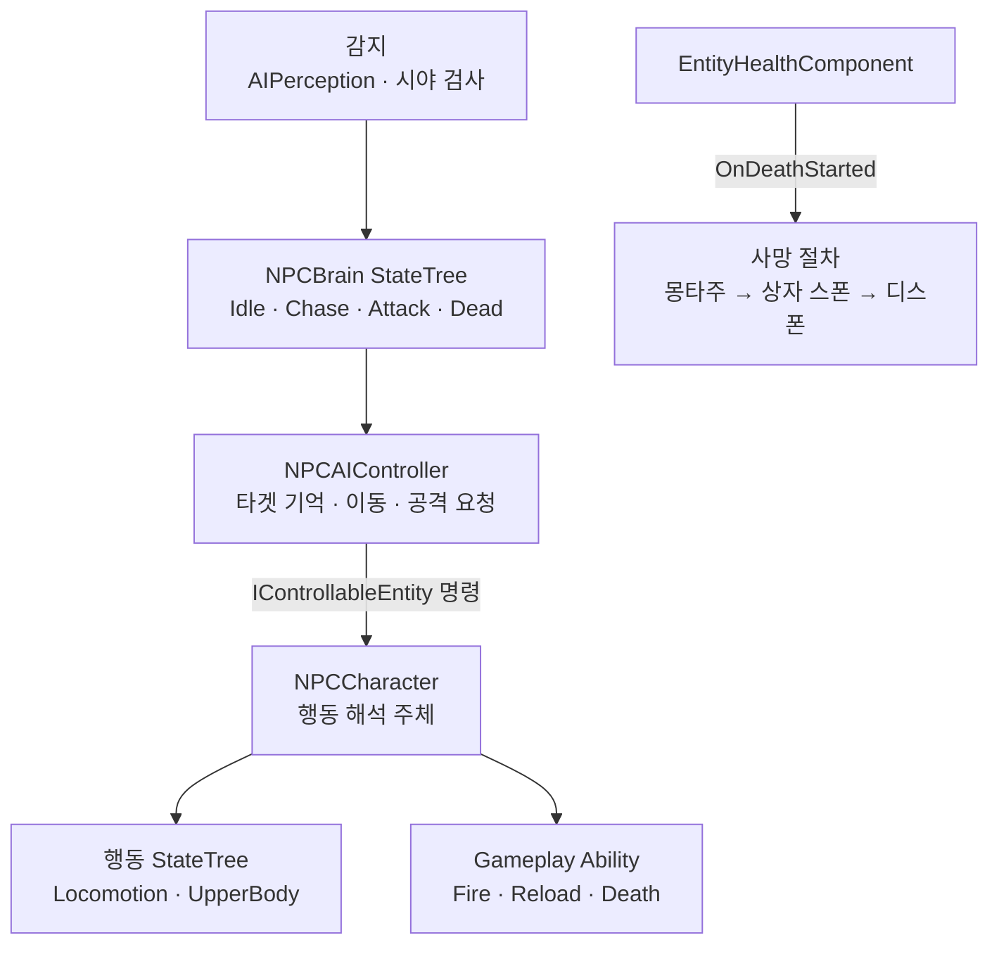

# NPC 행동



## 설계 의도

팩션·대상 유형·상태를 분리하여 행동 골격 재사용

NPC의 두뇌(상태 전이)와 몸(행동 실행)을 분리

- NPCBrain은 상태 전이·명령 시점 결정. AIController는 타겟 기억·PathFollowing·공격 요청 API 제공
- Pawn의 StateTree·GA는 Player와 동일한 행동 경로를 사용

## 상태

- 1단계(적대 인간형 1종) 구현 설계 확정: 2026-09-22
- 최종 대조: 2026-10-08. NPC 작업 대화·현재 C++ 소스 기준
- 사격·재장전 및 재빌드 후 발사 정상 동작 사용자 확인
- 마지막 확인 위치 추적 C++·연결 안내 반영. 전체 시나리오 완료 확인은 미기록
- 순찰 C++ 반영 및 Blueprint 연결 진행. HitReaction 상태 미구성 사용자 확인
- 1단계 범위 외 항목(동료 AI, 포획, 해킹·재조립, 상호작용)은 기획만 존재

## 1단계 범위

| 항목  | 내용                                                         |
| --- | ---------------------------------------------------------- |
| 대상  | Enemy — Human (발카의 세력) 1종                                  |
| 무장  | 권총 (Player와 동일한 `GA_WeaponFire` 경로)                        |
| 탄약  | 예비 탄약 무제한 — 재장전 반복 가능                                      |
| 상태  | Idle(배회·경계) → Combat(사격·재장전) → Dead(몽타주 → 전리품 상자 스폰 → 디스폰) |
| 제외  | 루팅 상호작용, 엄폐·투척물 등 전술 AI, 팩토리·풀 스폰                          |

1단계 NPC는 레벨에 직접 배치하여 검증하고, 팩토리·풀 스폰은 검증 후 도입

## 평상시

`EAIBrainState.Idle`

- 두뇌 Idle의 `NPC Idle Command`가 PatrolStarted 발신. Idle 이탈 시 PatrolCompleted 발신
- NPCCharacter가 PatrolStarted를 받아 Lower의 Patrol 명령 전달. 수납 요청 없음
- Base Patrol의 Blueprint Task가 Controller의 순찰 API 호출
- 순찰 중심은 최초 Possess 위치. 같은 Pawn 재Possess·전투 후 Idle 복귀 시 중심 유지
- 지정 반경의 도달 가능한 NavMesh 목적지·완전 경로 선택. 도착 후 PatrolWaitTime 대기
- 순찰 비활성화 또는 반경 0이면 이동 없음
- 현재 적 판정은 PlayerController가 조종하는 Pawn. 팩션 관계 기반 판정은 후속
- 시야 감지 후 사거리 안이면 Attack, 사거리 밖이면 Chase
- Idle Task의 무기 활동 갱신으로 자동 수납 방지. 성향별 휴대 상태 선택은 현재 미구현
- Falling은 이동 실행 중단만 담당. 착지 후 Ground 준비 알림을 Mediator가 Controller로 중계, 현재 BrainState의 Patrol·Chase·Stop 명령 재발행
- Base 연결 절차: [NPC 착지 후 현재 의도 복구 연결](../07_QA_테스트/NPC%20착지%20후%20현재%20의도%20복구%20연결.md)

## 전투

`EAIBrainState.Chase` → `Attack`

- Chase: 사거리 밖이면 추적 명령으로 접근, 사거리 진입 시 `Attack` 전이
  - 두뇌는 `HandleControlCommand(ChaseStarted)` 발신. 몸의 Task가 Controller 이동 API 호출
  - Pawn은 Mediator를 거쳐 하체 트리에 `LocomotionCommand.Chase` 전달. Chase Blueprint Task는 Enter에서 `RequestChaseMove`, Tick에서 `UpdateChaseMove`, Exit에서 `CancelChaseMove` 호출. AIController가 PathFollowing 이동·재시도·도착 후 대기 관리
  - NPC는 입력 경로(`EntityLocomotionComponent.Move`)를 거치지 않으므로 `MaxWalkSpeed`는 초기화 완료 시점에 MoveSpeed 어트리뷰트 값으로 직접 설정
  - 추적 종료(타겟 기억 만료·가시 타겟의 사거리 진입) 시 두뇌가 `ChaseCompleted` 발신. 시야 상실만으로 기억 위치 추적 종료하지 않음
- Attack: AIController가 `HandleControlCommand(AttackStarted)`를 발신
  - Pawn의 InputBuffer에 `Input.Attack`이 기록되고 Upper StateTree → `GA_WeaponFire`가 Player와 동일하게 동작
- 탄창 소진 시 `RequestWeaponReload` 경로로 재장전
  - NPC는 InventoryComponent를 소유하지 않으므로 **무제한 예비 탄약 정책**을 적용 (아래 탄약 정책 참조)
- 조준은 사용하지 않음 — `bCanAim = false`로 Capability 부여하지 않음
  - `GA_WeaponAim`과 카메라 FOV 경로는 1단계 NPC와 무관
- 가시 타겟과 마지막 확인 위치 기억을 분리. 타겟 상실 즉시 공격·Focus 중단 후 기억 위치 추적

### 반복 공격과 몸 방향

- 두뇌 Attack에 지속 Task `NPC Combat Attack` 배치. 일회성 AttackStarted 반복 사용 대체
- Controller가 Ready·행동 종료·쿨다운·입력 소비 여부를 확인하고 다음 공격 요청
- NPCCharacter의 `FaceRotation`과 `IsFacingCombatTarget`으로 타겟 추종 회전·허용 Yaw 검사
- 방향 정렬 전 공격 요청 대기. 연발 중 허용 각도 이탈 시 발사 중단 후 재정렬
- Upper Attack Task는 Enter에서 GA 한 번 활성화. 실패 시 Task 실패
- Tick은 Attacking 태그 종료와 `DidLastFireSucceed` 확인. 매 Tick GA 재활성화 제외
- 공격 완료 후 Ready 복귀. `STT_WeaponReady`가 손 부착 성공 후 ReadyEntered 발행
- Ready Task 성공 경로는 Running 유지. 부착 실패만 FinishTask(false)
- Player·NPC의 EntityContext 기반 공통 STC·STT 재사용 가능. 에셋 폴더 위치만으로 분리하지 않음
- 비무장 공격 실행·애니메이션은 미구현. 무기 누락 시 경고·실패 처리

### 마지막 확인 위치 추적

```text
Visible → LostDelay → LastKnownMove → Searching → None
   ↑          재발견 시 어느 단계에서든 Visible 복귀
```

- NPCBrain Root의 `NPC Update Target Tracking`에서 기억·시간 갱신
- 가시 상태에서만 마지막 확인 좌표 갱신. 벽 가림·Actor 소멸 후 좌표 유지
- LostTargetMoveDelay 대기 후 기억 좌표 또는 도달 가능한 접근 지점 이동
- 경로 실패 시 ChaseRetryDelay와 ChaseMaxRetries로 제한 재시도
- 비가시 타겟 접근 완료 또는 재시도 소진 시 GiveUpTime 탐색·대기
- GiveUpTime 만료 후 기억 제거·Idle 복귀. 재발견 시 이전 요청·시간 정리
- Blueprint Chase Task: Enter=RequestChaseMove, Tick=UpdateChaseMove, Exit=CancelChaseMove
- Reached·Failed 반환값만으로 Task 즉시 완료하지 않음. Controller의 대기·복구 유지
- 두뇌 전이는 `NPC Has Target Memory` 기준. Attack→Idle은 Invert=true
- 공격 사거리 Condition은 거리와 HasVisibleTarget 동시 검사. 벽 가림 시 Chase

### 순찰·피격 방향 API

| Blueprint Task | Enter | Tick | Exit |
|---|---|---|---|
| Patrol | RequestIdlePatrol | UpdateIdlePatrol | CancelIdlePatrol |
| DamageLook | BeginDamageLook | UpdateDamageLook(DeltaTime) | EndDamageLook |

- 두뇌 Task만 C++ 노드 사용. 몸의 Chase·Patrol·DamageLook Task는 Blueprint 유지
- NPC Idle Command는 NPCBrain Idle에 배치. Pawn Context인 Base Idle에 배치 금지
- 몸 Task의 Controller는 Pawn.GetController 또는 Actor.GetAIController로 확보 후 Cast
- Actor·Pawn을 Controller로 직접 Cast하지 않음
- Controller 구성 실패는 오류 로그·Task 실패. 유효성 실패를 성공으로 종료하지 않음
- Patrol→ChaseWalk는 Chase 명령, Patrol→Idle은 CancelPatrol 명령
- 피격 경로는 Health→Mediator→NPCCharacter→Controller.RememberDamageDirection
- 피격 순간 위치를 저장하고 회전 중 공격자 실제 위치를 다시 조회하지 않음
- 방향 정보 저장만으로 타겟 기억 생성·공격 정지하지 않음. 실제 DamageLook 활성 중 추가 발사 대기
- HitReaction 상태·Task는 2026-10-08 현재 미구성. 회전 완료 확인은 미기록

### NPC 탄약 정책

Player의 재장전은 InventoryComponent의 예비 탄약을 소비하지만 NPC는 인벤토리가 없음

- 성향 구조체(`FNPCCombatTendency`)의 `bInfiniteReserveAmmo`로 제어 — [NPC 전투 성향](NPC%20%EC%A0%84%ED%88%AC%20%EC%84%B1%ED%96%A5.md) 참조
- 재장전 실행 경로(`ReloadHandler`)가 Inventory 부재 시 이 플래그를 확인하여 탄창만 채우고 예비 소비를 생략
- 탄창 크기·발사 간격 등 수치는 기존처럼 WeaponDataAsset이 소유 — NPC 전용 수치 하드코딩 금지

## 기절·사망·파손·도주

1단계는 **사망(Dead)** 만 구현

- `EntityHealthComponent.OnDeathStarted`가 사망 절차의 유일한 시작점
- 사망 절차 순서:
  1. `Ability.Entity.Death` GA 활성화 — `State.Dead` Tag 부여로 모든 행동 차단
  2. AIController의 Brain State를 중지하고 이동·공격 명령 발신 중단
  3. 설정된 DeathMontage 재생
  4. Montage 종료 Delegate에서 LootBoxClass 스폰 후 Pawn Destroy. Montage 없음·재생 실패 시 동일 종료 경로
- 현재 종료 Delegate는 중단 여부와 관계없이 전리품·Destroy 처리. 사망 에셋 연결·실행 확인은 별도
- 시체는 잔존하지 않음
- 상자의 루팅 상호작용은 상호작용 시스템 구현 후 연결 — 1단계 상자는 스폰만 확인
- Fainted·Groggy·Flee·Broken은 Astra·Machine 유형 구현 시 설계

## 상호작용

- 1단계 적대 NPC는 기획대로 상호작용 불가
- 우호 NPC의 대화·상점·퀘스트와 사망 상자 루팅은 별도 상호작용 시스템 설계 후 구현

## 클래스 구성 (1단계)

| 클래스 | 책임 |
|---|---|
| `AstraNPCCharacter` (Character) | Entity ASC 소유(육체 귀속), HealthComponent·WeaponComponent 조립, `IControllableEntity` 구현, EntityContext 제공 |
| `AstraNPCAIController` | AIPerception, `EAIBrainState` 전이, 성향 데이터 조회, `HandleControlCommand` 명령 발신 |
| `UEntityDataAsset` 확장 | `bIsNPC` 식별 + 성향 구조체 소유 (아래 참조) |

### EntityDataAsset의 NPC 식별과 성향

`UEntityDataAsset`에 `bIsNPC`(Identity)와 성향 구조체를 추가하고, AIController는 `bIsNPC`가 참인 DataAsset에서 성향을 읽어 행동 파라미터로 사용

- Capability 플래그(`bCanAttack` 등)와 성향은 별개 개념
  - Capability: "그 행동을 **할 수 있는가**" — ASC에 Tag로 투영, StateTree/GA 전이 검사에 사용 (Player·NPC 공통)
  - 성향: "AI가 **어떻게** 행동하는가" — ASC에 투영하지 않고 AIController만 DataAsset에서 직접 조회
- Player용 DataAsset은 `bIsNPC = false`로 두고 성향 필드를 사용하지 않음
- 기존 `Faction`, `CombatTendency` 문자열 필드는 이 구조에 맞춰 enum·구조체로 정리

ASC 초기화는 기존 공통 경로 `UEntityAbilitySystemInitializer.InitializeEntityAttributes` + `ApplyInitialCapabilityTags` 사용

## StateTree 구성 — 두뇌와 몸

NPC의 StateTree는 두 층으로 나뉘며, 두 층은 직접 참조하지 않고 명령과 ASC Tag로만 연결

| 층 | 에셋 | Context | 역할 |
|---|---|---|---|
| 두뇌 | `ST_AIBrain` (신규, NPC 전용) | AstraNPCAIController | `EAIBrainState` 전이, 타겟 선정, 이동·공격 판단 |
| 몸 | `ST_NPCBaseState` · `ST_NPCUpperState` (NPC 전용) | AstraNPCCharacter | 로코모션·상체 행동 실행, GA 활성화 |

몸 트리는 처음에 Player와 동일 에셋 공유로 설계했으나, Context Actor 타입 차이로 Player 전용 STC/STT의 바인딩이 깨지는 문제가 있어 **트리 에셋은 Player·NPC 분리**로 확정 (2026-09-24)

- 공용 동작의 STT/STC 클래스는 `EntityBase` 계열(`AEntityCharacter`·`UEntityContext`만 참조)로 만들어 양쪽 트리에서 재사용 — 로직은 한 벌, 트리 구조만 두 벌
- Player 전용 기능(조준, Sprint 의도, 카메라)은 `PlayerBase` 계열 STC/STT로 격리하고 Player 트리에서만 사용
- `Has Buffered Entity Input`은 InputBuffer의 상태만 확인하므로 입력 출처(PlayerController·AIController)를 구분하지 않는 원칙은 동일하게 유지

### 두뇌 → 몸 (명령)

```text
ST_NPCBrain (두뇌)
  │  상태 전이 결과: 공격 판단
  ▼
IControllableEntity.HandleControlCommand(AttackStarted)
  │  Pawn이 InputBuffer에 Input.Attack 기록
  ▼
ST_NPCUpperState (몸, NPC 전용 트리·공통 Entity Task)
  │  STC: Input.Attack 확인 → Fire 전이
  ▼
STT: 입력 소비 → 상태 진입 게시 → Activate Ability By Tag
  ▼
GA_WeaponFire (Player와 동일 GA, 탄약·사망 재검사)
```

### 몸 → 두뇌 (상태 확인)

두뇌는 몸 트리에 묻지 않고 ASC GameplayTag로 확인

- 사격 중 여부: `State.Combat.Attacking`
- 사망 여부: `State.Dead` → 두뇌도 Dead로 전이하여 명령 발신 중단

몸 트리와 두뇌 트리는 각각 별도 StateTreeComponent에서 실행 — 몸 트리는 Pawn에, 두뇌 트리는 AIController에 구성

### Player 전용 참조 격리

- 카메라 참조는 `UPlayerContext`에 격리. NPC는 공통 UEntityContext 사용
- 카메라를 호출하는 코드(`GA_WeaponAim` 등)는 널 가드 필요 — 1단계 NPC는 `Capability.Combat.Aim` 미부여로 경로 차단
- Weapon GA는 UPlayerContext Cast 성공 시 카메라 FOV 호출

## AIController 구성

- AI 폰 하나당 AIController 하나 — 1:1 Possess 관계, 폰 Destroy 시 컨트롤러도 함께 정리
- 스폰 방식
  - 레벨 배치: `Auto Possess AI = Placed in World`
  - 런타임 스폰(팩토리·풀 도입 후): `Spawn Default Controller`로 컨트롤러 자동 생성
- 다수 생성(루트 슈터) 기준 성능
  - AIController 자체는 가벼워 수십 기 규모는 부담 없음
  - 실제 비용은 개체별 StateTree 틱과 AIPerception — 두뇌 로직은 개체 간 공유하고, 필요 시 Perception 갱신 주기·틱 간격을 성향 데이터로 조절
  - 수백 기 이상 규모가 되면 MassEntity 검토 — 현재 교전 규모에서는 표준 방식으로 충분
- 영혼 결속 대비: 두뇌만 정지하고 Player 입력을 같은 InputBuffer에 기록하는 Possess 전환 구조. 실제 영혼 결속 전환은 후속 구현

## 문서 연결

- 기획: [NPC 행동](../02_%EA%B2%8C%EC%9E%84%20%EA%B8%B0%ED%9A%8D/%EC%8B%9C%EC%8A%A4%ED%85%9C%20%EA%B8%B0%ED%9A%8D/NPC%20%ED%96%89%EB%8F%99.md)
- 시스템 설계: [NPC 행동](NPC%20%ED%96%89%EB%8F%99.md)
- 애니메이션 설계: [NPC 행동](../04_%EC%95%84%ED%8A%B8%20%EB%B0%8F%20%EC%95%A0%EB%8B%88%EB%A9%94%EC%9D%B4%EC%85%98/%EC%95%A0%EB%8B%88%EB%A9%94%EC%9D%B4%EC%85%98%20%EC%84%A4%EA%B3%84/NPC%20%ED%96%89%EB%8F%99.md)

## 관련

- [NPC 공격 반복·회전·추적 복귀 연결](../07_QA_%ED%85%8C%EC%8A%A4%ED%8A%B8/NPC%20%EA%B3%B5%EA%B2%A9%20%EB%B0%98%EB%B3%B5%C2%B7%ED%9A%8C%EC%A0%84%C2%B7%EC%B6%94%EC%A0%81%20%EB%B3%B5%EA%B7%80%20%EC%97%B0%EA%B2%B0.md)
- [NPC 마지막 확인 위치 추적 연결](../07_QA_%ED%85%8C%EC%8A%A4%ED%8A%B8/NPC%20%EB%A7%88%EC%A7%80%EB%A7%89%20%ED%99%95%EC%9D%B8%20%EC%9C%84%EC%B9%98%20%EC%B6%94%EC%A0%81%20%EC%97%B0%EA%B2%B0.md)
- [NPC Idle 순찰·피격 방향 확인 연결](../07_QA_%ED%85%8C%EC%8A%A4%ED%8A%B8/NPC%20Idle%20%EC%88%9C%EC%B0%B0%C2%B7%ED%94%BC%EA%B2%A9%20%EB%B0%A9%ED%96%A5%20%ED%99%95%EC%9D%B8%20%EC%97%B0%EA%B2%B0.md)

- [NPC 전투 성향](NPC%20%EC%A0%84%ED%88%AC%20%EC%84%B1%ED%96%A5.md)
- [StateTree와 GAS](StateTree%EC%99%80%20GAS.md)
- [무기](%EB%AC%B4%EA%B8%B0.md)
- [게임 객체 분류](%EA%B2%8C%EC%9E%84%20%EA%B0%9D%EC%B2%B4%20%EB%B6%84%EB%A5%98.md)
