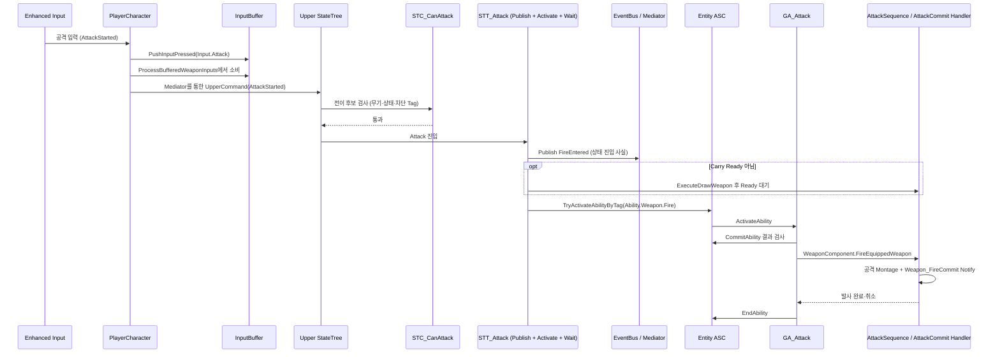

# StateTree와 Gameplay Ability System

> 2026-10-21 갱신. 추적·재장전 완료와 사망 전이 해결·우선권 상향 사용자 확인. 최신 자동 재장전은 사건 기반 AutoReload. 연사·반동 등 별도 잔여는 [현재 작업 상태](../01_일정%20관리/현재%20작업%20상태.md)와 [플레이어 연결 안내](../07_QA_테스트/플레이어%20연사·빈%20탄창%20재장전%20연결.md) 기준

## 설계 의도

## 1. 역할 분리

StateTree와 GAS는 서로를 대체하지 않음

| 시스템                 | 책임                                   |
| ------------------- | ------------------------------------ |
| StateTree Condition | 전이 후보가 현재 가능한지 빠르게 검사                |
| StateTree Task      | 상태 진입·틱·종료에 따른 실행과 Ability 활성화 요청    |
| EntityStateMediator | 상·하체 이벤트 라우팅, 상태 충돌 정책, Task의 Ability 요청 중계 |
| Gameplay Ability    | 실행 시점 검사·비용·쿨다운, C++ 실행 요청, 결과·취소·종료 처리 |
| ASC / GameplayTag   | 공유 전투 상태와 Ability 수명 관리              |
| C++ 실행부          | 몽타주·물리·자원 변경, 완료 알림과 공통 자원 정리 |

STC에서 모든 검사를 끝냈더라도 GA는 실행 시점에 탄약·사망·기절·비용 등 안전 검사 다시 수행
두 검사는 중복된 역할이 아니라 **전이 선택용 검사**와 **실행 권한 검사**

사망도 `Health 사실 → Mediator 명령 → Base Death Task → GA → EntityCharacter` 순서 적용. Mediator의 사망 GA 직접 활성화·연출 우회 실행 없음. Base는 제거 시점까지 Death 상태 유지. [공통 사망 연결](../07_QA_테스트/공통%20사망%20GA·몽타주·제거%20연결.md) 참조

StateTree와 GA는 행동 주체인 [Entity](../02_%EA%B2%8C%EC%9E%84%20%EA%B8%B0%ED%9A%8D/%EA%B2%8C%EC%9E%84%20%EA%B0%9D%EC%B2%B4%20%EB%B6%84%EB%A5%98.md)의 행동 계층 무기 상체 StateTree도 Weapon Item이 소유하는 로직이 아니라 Entity가 장착 무기를 사용하는 행동을 표현 Weapon Item은 정적 정의, 인스턴스 탄약과 실제 실행 결과를 소유

## 2. StateTree 구성

### Base StateTree

에셋: `Content/Astra/Entity/Player/StateTree/ST_PlayerBaseState.uasset`

현재 에셋 경로는 Player 아래에 있지만 책임상 Humanoid Entity의 Locomotion 행동 NPC 인간형과 공유 가능한 수준이 되면 `Entity/Humanoid/StateTrees/Locomotion`으로 이동

전신 로코모션을 담당

- Idle
- Walk
- Sprint
- CancelSprint
- JumpStart
- Jumping
- Falling
- Evade
- Hanging
- HangingDrop
- Mantle
- Vault

### Upper StateTree

에셋: `Content/Astra/Entity/Player/StateTree/ST_PlayerUpperState.uasset`

현재 에셋 경로는 Player 아래에 있지만 책임상 Humanoid Entity의 상체 행동 무기 외 상호작용과 스킬까지 확장할 수 있으므로 장기 분류명은 Weapon보다 `Actions` 또는 `UpperBody`를 사용

WeaponCarryState와 UpperAction을 하나의 트리에서 관리 무기를 들어야 공격할 수 있고, 상호작용·Sprint·Airborne·Traversal이 Carry와 Action에 동시에 영향을 주기 때문에 별도 트리 두 개로 나누지 않음

- Holstered
- Ready
- Holstering
- Attack
- Aim
- Reload

Aim 아래 Aim Ready·Aim Attack 자식 상태 구성. 현재 별도 Drawing 상태 없음. 수납 상태에서 Attack 진입 시 STT_Attack의 ExecuteDrawWeapon과 Carry Ready 대기로 처리. Root의 Draw 명령 전이는 비활성

## 3. 의미 입력 파이프라인

Controller는 입력을 직접 실행하지 않고 **의미 입력**을 `UEntityInputBufferComponent`에 기록. 현재 무기 Attack·Aim·Reload는 EntityCharacter.ProcessBufferedWeaponInputs가 Pressed를 소비하고 Mediator를 통해 Upper 명령 이벤트로 전달. STT에서 같은 Pressed를 다시 소비하지 않음

제어 명령 자체는 `IControllableEntity.HandleControlCommand` 단일 진입점으로 Pawn에 전달 — PlayerController와 AIController가 동일한 `EEntityControlCommand` 형식을 사용

### EntityInputBufferComponent

- `PushInputPressed` / `PushInputReleased` — Hold 상태를 만드는 입력
- `PushInputPulse` — Evade, Reload 같은 단발 입력 (Held 없음)
- `ConsumePressedInput` / `ConsumeReleasedInput` — 한 번만 소비
- `HasPressedInput` / `HasReleasedInput` / `IsInputHeld` — 소비 없이 확인
- `SetMoveInput` — 이동 축 입력
- 단발 Pressed/Released는 `BufferedInputLifetime`(기본 0.2초) 안에서만 유효
- Client→Server RPC(`ServerPushInputPressed/Released/Pulse`)로 서버 버퍼에도 기록

입력의 실행 대상 결정이나 GameplayAbility 직접 활성화는 하지 않음

### StateTree 노드

| 노드 | 종류 | 역할 |
|---|---|---|
| `Has Buffered Entity Input` | Condition | Pressed/Released/Held 상태 확인. 입력을 소비하지 않음 |
| `Consume Buffered Entity Input` | Task | State 진입이 확정된 뒤 Pressed 또는 Released 입력을 한 번 소비 |
| `Activate Entity Ability By Tag` | Task | State 진입 후 해당 Tag를 가진 Entity GA의 활성화를 요청 |

## 4. Condition과 Task 규칙

### Condition이 하는 일

- 바인딩된 Context와 Component를 사용한 전이 조건 검사
- 장착 무기 여부
- 현재 Base/Upper 상태
- 사망·기절·Traversal 등 차단 상태
- 발사 가능 여부, 탄약 여부 같은 전이 전 조건
- 버퍼된 의미 입력의 현재 상태 확인

### Condition이 하지 않는 일

- Montage 재생
- Socket 변경
- 탄약 소비
- Ability 취소
- 다른 State 직접 변경
- 입력 소비

### Task가 하는 일

- State 진입 사실을 EventBus에 게시
- Domain Component 함수 호출
- `Activate Entity Ability By Tag`로 GA 활성화 요청
- 확정된 시점에 버퍼된 입력 소비
- 지연 작업이 끝날 때 `Finish Task`
- ExitState에서 중단·복구 처리

## 5. 무기 공격 전체 경로



위 완료 대기 방식은 이번 Blueprint 수정 기준. 제공된 GA_Attack은 시작 성공 직후 EndAbility, STT_Attack은 Tick마다 활성화 요청하는 상태로 확인. 실제 적용 완료로 간주하지 않음

`FireEntered` 사건 게시는 Ability를 켜는 함수가 아닙니다 상체 Attack 진입 사실을 Mediator에 알려 Sprint 취소 같은 교차 상태 정책을 작동시키는 이벤트 그 다음 `Activate Entity Ability By Tag`가 실제 GA를 활성화

## 6. STT 기준 순서 — Activate Entity Ability By Tag

1. `Event EnterState`
2. C++에서 소비한 무기 입력을 다시 소비하지 않음. 무기 외 버퍼 직접 사용 Task의 소비 여부는 별도 결정
3. 바인딩된 `EntityContext.StateEventBus` 사용
4. `Publish Simple` — 상태 진입 사실 (`EEntityUpperStateEvent::FireEntered`)
5. 바인딩된 `EntityContext.AbilitySystem` 사용
6. `Try Activate Ability By Tag` — AbilityTag: `Ability.Weapon.Fire` (GA_Attack 에셋이 소유). Ready 도달 후 한 번 호출
7. 활성화 false이면 FinishTask(false). true이면 실행 대기 후 실제 결과로 FinishTask. 활성화 성공을 공격 완료로 즉시 반환하지 않음

STT_Attack의 Enter·Tick·Exit와 GA 완료 Delegate의 정확한 핀 연결은 위 연결 문서 기준

StateTree에서 `Actor.PlayerContext` 또는 `Actor.EntityContext` 바인딩을 반드시 지정 Blueprint 변수에 값이 존재하는 것과 StateTree의 인스턴스 바인딩은 별개

STT_EntityBase 자식은 부모의 actor·character·entitycontext·pawn 바인딩 참조 재사용. 필수 참조 누락은 구성 오류로 확인·수정. IsValid 분기로 실행 생략·오류 은폐 금지. STT_EntityDeath는 별도 캐스팅·참조 저장·ExitState 작업 없음

## 7. Ability 계층과 EntityContext

현재 프로젝트는 반복 튜닝과 콘텐츠 연결을 위해 GA 구체 클래스를 Blueprint로 생성

```text
UGameplayAbility
├─ UAstraEntityGameplayAbilityBase (C++, Abstract)
│  └─ Entity 행동 GA (GA_Evade · GA_Sprint · GA_Jump 등)
└─ UAstraWeaponGameplayAbilityBase (C++)
   ├─ GA_Attack
   ├─ GA_WeaponReload
   └─ GA_WeaponAim
```

별도 계열의 향후 확장:

```text
UGameplayAbility
├─ GA_SoulLinkBase
│  ├─ Possession
│  ├─ DirectSkill
│  ├─ Transform
│  └─ Totem
├─ GA_AstraActionBase
└─ GA_CommonBase
```

### UAstraEntityGameplayAbilityBase

- Pawn 소유 Entity ASC에서 실행
- `GetEntityAttributeValue` — 현재 Entity ASC의 런타임 Attribute 값 읽기
- GA의 일반 비용과 쿨다운은 GE Cost 경로 사용
- SoulEnergy 비용은 `UEntitySoulEnergyComponent`의 `CanPay` / `CommitCost` 경계로 처리 — 수치 원본은 조종 Player의 PlayerState ASC

### UAstraWeaponGameplayAbilityBase

- `InstancedPerActor`이며 `OnAvatarSet`에서 Avatar의 `IEntityContextProvider`를 통해 `EntityContext`를 캐시 Ability가 자신을 생성하면서 호출하는 것이 아니라 ASC가 Ability 지급 또는 Avatar 변경 과정에서 `OnAvatarSet`을 호출
- `GetEntityContext` / `GetWeaponComponent` — 캐시가 유효하지 않으면 Avatar에서 다시 해석
- 현재 Weapon Ability는 PlayerController나 PlayerCharacter의 구체 타입을 따라가며 침라를 찾지 않고, EntityContext에 등록된 `PlayerCameraManager`를 통해 `StartAimCameraFOV`와 `StopAimCameraFOV`를 요청 다만 이 FOV 기능 때문에 `UAstraWeaponGameplayAbilityBase`는 아직 Player 의존성을 가집니다 Humanoid 공용 기반으로 옮기려면 침라 정책을 분리하거나 인터페이스로 격리 필요 자세한 생명주기는 [PlayerCameraManager 참조 구성](../08_%EA%B8%B0%EC%88%A0%20%EC%9C%84%ED%82%A4_%EA%B3%B5%ED%86%B5%20%EA%B0%80%EC%9D%B4%EB%93%9C/Unreal/Gameplay%20Framework/PlayerCameraManager%20%EC%B0%B8%EC%A1%B0%20%EA%B5%AC%EC%84%B1.md)을 참고

## 8. Aim 구현 흐름

```text
IA_Astra_Aim.Started
→ PlayerController가 Pawn에 AimStarted 전달
→ EntityCharacter가 Input.Aim을 InputBuffer에 기록·소비하고 UpperCommand 전달
→ Upper StateTree의 STC_CanAim (무기·상태·차단 Tag)
→ STT_WeaponAim.EnterState
→ Publish Upper 상태 진입 사실 (EEntityUpperStateEvent::AimEntered)
→ Activate Entity Ability By Tag(Ability.Weapon.Aim)
→ GA_WeaponAim.ActivateAbility
→ CanAimWeapon 재검사
→ CommitAbility
→ WeaponComponent에서 AimFOV·보간 속도 조회
→ AstraWeaponGameplayAbilityBase.StartAimCameraFOV
→ AstraPlayerCameraManager.UpdateCamera
```

Aim은 즉시 종료하지 않고 활성 상태를 유지 Hold 입력 해제, Toggle 재입력 또는 외부 취소로 StateTree가 Aim을 벗어나면 `STT_WeaponAim.ExitState`가 Ability를 취소하고 `StopAimCameraFOV`가 기본 FOV 복귀를 시작

```text
STT_WeaponAim.ExitState
→ CancelAbilityByTag(Ability.Weapon.Aim)
→ GA_WeaponAim.OnEndAbility
→ StopAimCameraFOV
→ Activation Owned Tag: State.Combat.Aiming 제거
→ AstraPlayerCameraManager가 기본 FOV로 보간
```

## 9. Reload 구현 흐름

현재 `GA_WeaponReload`, `STT_WeaponReload`, `STC_CanReload`과 C++ 재장전 실행 경로가 연결되어 있음

```text
Input.Reload이 InputBuffer에 기록
→ EntityCharacter.ProcessBufferedWeaponInputs가 소비하고 UpperCommand(Reload) 전달
→ Upper StateTree의 STC_CanReload
→ STT_WeaponReload (필요 시 손 부착 + 상태 게시)
→ Activate Entity Ability By Tag(Ability.Weapon.Reload)
→ GA_WeaponReload
→ WeaponComponent.ExecuteReloadWeapon
→ Reload Montage
→ 정상 Montage 종료에서 탄약 반영
→ Montage 완료 또는 CancelReloadWeapon
→ Ability 종료와 Upper Ready 복귀
```

자동 재장전: 활성 무기 장착·교체, 탄창 소진, 현재 무기와 호환되는 탄약 획득 사건에서 요청 생성. Upper 부모의 AutoReload 이벤트 AND ShouldAutoReload 조건으로 Reload 진입. Holstered·Ready의 탄창 OnTick 감시와 AttackStarted 기반 자동 Reload 전이 제거 기준. 수동 Reload 이벤트는 기존 CanReloadWeapon 검사

두 판정 API인 ShouldAutoReload·ShouldReloadOnFireRequest도 CanReloadWeapon Facade를 사용하여 진행 중 발사·지속 공격·Action 검사와 실제 실행 조건 통일. ShouldAutoReload는 현재 WeaponInstance의 자동 요청 존재·탄창 정책·Sprint 상태도 검사. Sprint 진입 시 재장전 취소·요청 폐기, 종료 후 이전 요청 자동 재개 없음. GA_WeaponReload의 과거 실패 후 종료 미연결 진단과 최신 재장전 사용자 완료 확인 구분

## 10. EndAbility와 CancelAbility

- `EndAbility`: 정상 성공 또는 자체 종료 시 호출
- `CancelAbility`: 피격, 사망, Sprint, Airborne, Traversal 등 외부 사유로 중단할 때 사용
- 취소 경로에서도 Montage·타이머·예약 입력·GameplayTag를 정리한 뒤 Ability 수명을 끝냅니다

FireEquippedWeapon의 true는 몽타주 시작 수락. 탄 생성·완료를 뜻하지 않음. GA_Attack은 OnWeaponFireFinished까지 유지하는 연결이 기준. 실제 탄 생성은 Weapon_FireCommit, RapidFire 한 발 완료는 쿨다운 이후 후반 몽타주 정리 시점. 재장전 GA는 OnWeaponReloadFinished까지 유지

## 11. GameplayTag 기준

### Ability

- `Ability.Entity.Death` — Entity 사망 GA
- `Ability.Weapon.Fire` — GA_Attack 에셋이 소유
- `Ability.Weapon.Aim` — GA_WeaponAim 에셋이 소유
- `Ability.Weapon.Reload` — GA_WeaponReload 에셋이 소유

무기 Ability 태그는 `AstraGameplayTags`에 등록하지 않고 각 GA 에셋의 AbilityTags가 소유

### Entity 상태

- `State.Dead`
- `State.Stunned`
- `State.Invincible`
- `State.Resource.Exhausted` — Stamina 탈진 복구 기준 미만

### Capability — DataAsset 제작 기본값을 런타임 ASC에 투영

- `Capability.Movement.Walk`
- `Capability.Movement.Sprint`
- `Capability.Movement.Jump`
- `Capability.Movement.Evade`
- `Capability.Combat.Attack`
- `Capability.Combat.Aim`
- `Capability.Combat.Reload`
- `Capability.SoulLink`

### Entity 의미 입력 — Controller가 기록, StateTree가 조회·소비

- `Input.Jump`
- `Input.Sprint`
- `Input.Evade`
- `Input.Attack`
- `Input.Aim`
- `Input.Reload`
- `Input.Weapon.Cycle`

### 이동 상태

- `State.Movement.Airborne`
- `State.Movement.Sprinting`
- `State.Movement.Evading`
- `State.Movement.Traversal`

### 전투 상태

- `State.Combat.Attacking`
- `State.Combat.Aiming`
- `State.Combat.Reloading`
- `State.Weapon.Blocked`

### StateTree 명령 전달 — Payload enum으로 명령 종류 구분

태그당 하나씩 두지 않고 명령 태그 2개 + Payload 구조체로 전달

- `StateTree.Event.UpperCommand` + `FUpperStateCommandPayload` (`EUpperStateCommand`: AttackStarted, AimStarted, AimCompleted, Reload, Draw, Holster, ForceHolster, CancelAction, Disable)
- `StateTree.Event.LocomotionCommand` + `FLocomotionStateCommandPayload` (`ELocomotionStateCommand`: CancelSprint, ToggleSprint, HitReaction, Death)

상태 진입 사실은 Payload 없이 타입이 지정된 사건으로 게시 — `EEntityUpperStateEvent`(FireEntered·Aim·Reload·Ready 진입), `EEntityLocomotionStateEvent`(Sprint·Airborne·Traversal·Evade 진입)

### 크로스 트리 상태 판별

- 한 StateTree가 다른 StateTree의 상태를 알아야 할 때는 **ASC 게임플레이 태그**로 판별
- StateTree 상태의 `Tag` 속성은 StateTree 세부 식별용 — ASC에 투영되지 않으며 크로스 트리 조건으로 사용 불가
- ASC 태그 유지 주체 — Airborne: `OnMovementModeChanged`(자동), Evading/Traversal: EntityLocomotionComponent(C++), Sprinting: STT 진입·이탈에서 `SetSprintState` 호출

---

## 상위 페이지

- [03_시스템 설계](03_%EC%8B%9C%EC%8A%A4%ED%85%9C%20%EC%84%A4%EA%B3%84.md)

## 관련

- [시스템 아키텍처](%EC%8B%9C%EC%8A%A4%ED%85%9C%20%EC%95%84%ED%82%A4%ED%85%8D%EC%B2%98.md)
- [무기 시스템](%EB%AC%B4%EA%B8%B0.md)
- [게임 객체 분류](../02_%EA%B2%8C%EC%9E%84%20%EA%B8%B0%ED%9A%8D/%EA%B2%8C%EC%9E%84%20%EA%B0%9D%EC%B2%B4%20%EB%B6%84%EB%A5%98.md)
- [PlayerCameraManager 참조 구성](../08_%EA%B8%B0%EC%88%A0%20%EC%9C%84%ED%82%A4_%EA%B3%B5%ED%86%B5%20%EA%B0%80%EC%9D%B4%EB%93%9C/Unreal/Gameplay%20Framework/PlayerCameraManager%20%EC%B0%B8%EC%A1%B0%20%EA%B5%AC%EC%84%B1.md)
- [ADR-002 StateTree와 GAS 역할 분리](%EA%B2%B0%EC%A0%95%20%EA%B8%B0%EB%A1%9D/ADR-002%20StateTree%EC%99%80%20GAS%20%EC%97%AD%ED%95%A0%20%EB%B6%84%EB%A6%AC.md)
