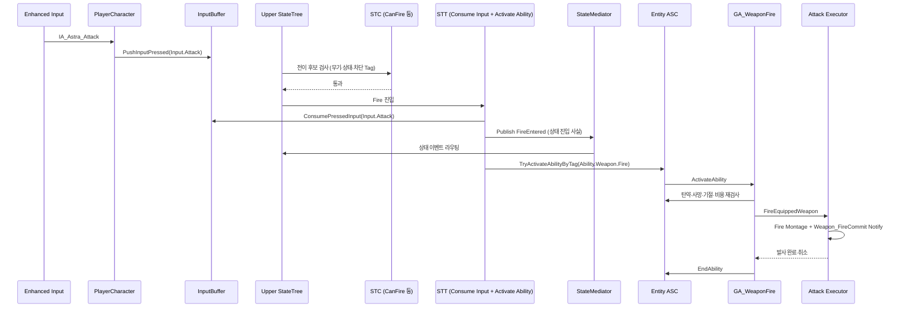

# StateTree와 Gameplay Ability System

## 설계 의도

## 1. 역할 분리

StateTree와 GAS는 서로를 대체하지 않음

| 시스템 | 책임 |
|---|---|
| StateTree Condition | 전이 후보가 현재 가능한지 빠르게 검사 |
| StateTree Task | 상태 진입·틱·종료에 따른 실행과 Ability 활성화 요청 |
| EntityStateMediator | 상·하체 이벤트 라우팅, 상태 충돌 정책, Ability 활성화 |
| Gameplay Ability | 비용, 쿨다운, 차단, Commit, 실제 전투 행동, 취소·종료 |
| ASC / GameplayTag | 공유 전투 상태와 Ability 수명 관리 |

STC에서 모든 검사를 끝냈더라도 GA는 실행 시점에 탄약·사망·기절·비용 등 안전 검사를 다시 수행 필요 두 검사는 중복된 역할이 아니라 **전이 선택용 검사**와 **실행 권한 검사**.

StateTree와 GA는 행동 주체인 [Entity](../02_%EA%B2%8C%EC%9E%84%20%EA%B8%B0%ED%9A%8D/%EA%B2%8C%EC%9E%84%20%EA%B0%9D%EC%B2%B4%20%EB%B6%84%EB%A5%98.md)의 행동 계층 `GA_Weapon*`과 무기 상체 StateTree도 Weapon Item이 소유하는 로직이 아니라 Entity가 장착 무기를 사용하는 행동을 표현 Weapon Item은 정적 정의, 인스턴스 탄약과 실제 실행 결과를 소유

## 2. StateTree 구성

### Base StateTree

에셋: `Content/Astra/Player/StateTree/BaseStateTree/ST_PlayerBaseState.uasset`

현재 에셋 경로는 Player 아래에 있지만 책임상 Humanoid Entity의 Locomotion 행동 NPC 인간형과 공유 가능한 수준이 되면 `Entity/Humanoid/StateTrees/Locomotion`으로 이동

전신 로코모션을 담당

- Idle
- Walk
- Sprint
- CancelSprint
- JumpStart
- Jumping
- Falling
- Evade
- Hanging
- HangingDrop
- Mantle
- Vault

### Upper StateTree

에셋: `Content/Astra/Player/StateTree/UpperStateTree/ST_UpperState.uasset`

현재 에셋 경로는 Player 아래에 있지만 책임상 Humanoid Entity의 상체 행동 무기 외 상호작용과 스킬까지 확장할 수 있으므로 장기 분류명은 Weapon보다 `Actions` 또는 `UpperBody`를 사용

WeaponCarryState와 UpperAction을 하나의 트리에서 관리 무기를 들어야 공격할 수 있고, 상호작용·Sprint·Airborne·Traversal이 Carry와 Action에 동시에 영향을 주기 때문에 별도 트리 두 개로 나누지 않음

- Holstered
- Drawing
- Ready
- Holstering
- Fire
- Aim
- Reload

## 3. 의미 입력 파이프라인

Controller는 입력을 직접 실행하지 않고 **의미 입력**을 `UEntityInputBufferComponent`에 기록 StateTree Condition이 확인하고 Task가 확정된 시점에 한 번 소비

### EntityInputBufferComponent

- `PushInputPressed` / `PushInputReleased` — Hold 상태를 만드는 입력
- `PushInputPulse` — Evade, Reload 같은 단발 입력 (Held 없음)
- `ConsumePressedInput` / `ConsumeReleasedInput` — 한 번만 소비
- `HasPressedInput` / `HasReleasedInput` / `IsInputHeld` — 소비 없이 확인
- `SetMoveInput` — 이동 축 입력
- 단발 Pressed/Released는 `BufferedInputLifetime`(기본 0.2초) 안에서만 유효
- Client→Server RPC(`ServerPushInputPressed/Released/Pulse`)로 서버 버퍼에도 기록

입력의 실행 대상 결정이나 GameplayAbility 직접 활성화는 하지 않음

### StateTree 노드

| 노드 | 종류 | 역할 |
|---|---|---|
| `Has Buffered Entity Input` | Condition | Pressed/Released/Held 상태 확인. 입력을 소비하지 않음 |
| `Consume Buffered Entity Input` | Task | State 진입이 확정된 뒤 Pressed 또는 Released 입력을 한 번 소비 |
| `Activate Entity Ability By Tag` | Task | State 진입 후 해당 Tag를 가진 Entity GA의 활성화를 요청 |

## 4. Condition과 Task 규칙

### Condition이 하는 일

- 필요한 Context와 Component 유효성 검사
- 장착 무기 여부
- 현재 Base/Upper 상태
- 사망·기절·Traversal 등 차단 상태
- 발사 가능 여부, 탄약 여부 같은 전이 전 조건
- 버퍼된 의미 입력의 현재 상태 확인

### Condition이 하지 않는 일

- Montage 재생
- Socket 변경
- 탄약 소비
- Ability 취소
- 다른 State 직접 변경
- 입력 소비

### Task가 하는 일

- State 진입 사실을 EventBus에 게시
- Domain Component 함수 호출
- Mediator에 Ability 활성화 요청 또는 `Activate Entity Ability By Tag`로 직접 활성화 요청
- 확정된 시점에 버퍼된 입력 소비
- 지연 작업이 끝날 때 `Finish Task`
- ExitState에서 중단·복구 처리

## 5. 무기 발사 전체 경로



`FireEntered` 게시는 Ability를 켜는 함수가 아닙니다 상체 Fire 진입 사실을 Mediator에 알려 Sprint 취소 같은 교차 상태 정책을 작동시키는 이벤트 그 다음 `Activate Entity Ability By Tag`가 실제 GA를 활성화

## 6. STT 기준 순서 — Activate Entity Ability By Tag

1. `Event EnterState`
2. `Consume Buffered Entity Input` — 해당 입력 Tag의 Pressed/Released를 한 번 소비
3. `EntityContext.StateEventBus` 유효성 확인
4. `Publish Simple` — 상태 진입 사실 (`EEntityUpperStateEvent::FireEntered`)
5. `EntityContext.AbilitySystem` 유효성 확인
6. `Activate Entity Ability By Tag` — AbilityTag: `Ability.Weapon.Fire`
7. 반환값을 `Finish Task.Succeeded`에 연결

StateTree에서 `Actor.PlayerContext` 또는 `Actor.EntityContext` 바인딩을 반드시 지정 Blueprint 변수에 값이 존재하는 것과 StateTree의 인스턴스 바인딩은 별개

## 7. Ability 계층과 EntityContext

현재 프로젝트는 반복 튜닝과 콘텐츠 연결을 위해 GA 구체 클래스를 Blueprint로 생성

```text
UGameplayAbility
├─ UAstraEntityGameplayAbilityBase (C++, Abstract)
│  └─ Entity 행동 GA (GA_Evade · GA_Sprint · GA_Jump 등)
└─ UAstraWeaponGameplayAbilityBase (C++)
   ├─ GA_WeaponFire
   ├─ GA_WeaponReload
   └─ GA_WeaponAim
```

별도 계열의 향후 확장:

```text
UGameplayAbility
├─ GA_SoulLinkBase
│  ├─ Possession
│  ├─ DirectSkill
│  ├─ Transform
│  └─ Totem
├─ GA_AstraActionBase
└─ GA_CommonBase
```

### UAstraEntityGameplayAbilityBase

- Pawn 소유 Entity ASC에서 실행
- `GetEntityAttributeValue` — 현재 Entity ASC의 런타임 Attribute 값 읽기
- SoulEnergy 비용은 자신의 ASC가 아닌 조종 Player의 PlayerState ASC에서 확정
- `CanPayPlayerSoulEnergyCost` / `CommitPlayerSoulEnergyCost` — Authority에서 확인과 차감을 한 경로에서 처리, 실패하면 Action 취소
- `ResolveControllingPlayerState`로 현재 조종 PlayerState를 해석

### UAstraWeaponGameplayAbilityBase

- `InstancedPerActor`이며 `OnAvatarSet`에서 Avatar의 `IEntityContextProvider`를 통해 `EntityContext`를 캐시 Ability가 자신을 생성하면서 호출하는 것이 아니라 ASC가 Ability 지급 또는 Avatar 변경 과정에서 `OnAvatarSet`을 호출
- 현재 Weapon Ability는 PlayerController나 PlayerCharacter의 구체 타입을 따라가며 카메라를 찾지 않고, EntityContext에 등록된 `PlayerCameraManager`를 통해 `StartAimCameraFOV`와 `StopAimCameraFOV`를 요청 다만 이 FOV 기능 때문에 `UAstraWeaponGameplayAbilityBase`는 아직 Player 의존성을 가집니다 Humanoid 공용 기반으로 옮기려면 카메라 정책을 분리하거나 인터페이스로 격리 필요 자세한 생명주기는 [PlayerCameraManager 참조 구성](../08_%EA%B8%B0%EC%88%A0%20%EC%9C%84%ED%82%A4_%EA%B3%B5%ED%86%B5%20%EA%B0%80%EC%9D%B4%EB%93%9C/Unreal/Gameplay%20Framework/PlayerCameraManager%20%EC%B0%B8%EC%A1%B0%20%EA%B5%AC%EC%84%B1.md)을 참고

## 8. Aim 구현 흐름

```text
IA_Astra_Aim.Started
→ PlayerCharacter가 Input.Aim을 InputBuffer에 기록
→ Upper StateTree의 STC_CanAim (무기·상태·차단 Tag)
→ STT_WeaponAim.EnterState
→ Consume Buffered Entity Input(Input.Aim)
→ Publish Upper 상태 진입 사실 (EEntityUpperStateEvent::AimEntered)
→ Activate Entity Ability By Tag(Ability.Weapon.Aim)
→ GA_WeaponAim.ActivateAbility
→ CanAimWeapon 재검사
→ CommitAbility
→ WeaponComponent에서 AimFOV·보간 속도 조회
→ AstraWeaponGameplayAbilityBase.StartAimCameraFOV
→ AstraPlayerCameraManager.UpdateCamera
```

Aim은 즉시 종료하지 않고 활성 상태를 유지 Hold 입력 해제, Toggle 재입력 또는 외부 취소로 StateTree가 Aim을 벗어나면 `STT_WeaponAim.ExitState`가 Ability를 취소하고 `StopAimCameraFOV`가 기본 FOV 복귀를 시작

```text
STT_WeaponAim.ExitState
→ CancelAbilityByTag(Ability.Weapon.Aim)
→ GA_WeaponAim.OnEndAbility
→ StopAimCameraFOV
→ Activation Owned Tag: State.Combat.Aiming 제거
→ AstraPlayerCameraManager가 기본 FOV로 보간
```

## 9. Reload 구현 흐름

현재 `GA_WeaponReload`, `STT_WeaponReload`, `STC_CanReload`과 C++ 재장전 실행 경로가 연결되어 있음

```text
Input.Reload이 InputBuffer에 기록
→ Upper StateTree의 STC_CanReload
→ STT_WeaponReload (입력 소비 + 상태 게시)
→ Activate Entity Ability By Tag(Ability.Weapon.Reload)
→ GA_WeaponReload
→ WeaponComponent.ExecuteReloadWeapon
→ Reload Montage
→ Weapon_ReloadCommit Notify에서 탄약 반영
→ Montage 완료 또는 CancelReloadWeapon
→ Ability 종료와 Upper Ready 복귀
```

탄창이 빈 상태에서 Fire 입력이 들어오면 자동 Reload 전환 경로를 사용 이 자동 전환은 PIE 회귀 검증 항목으로 남깁니다

## 10. EndAbility와 CancelAbility

- `EndAbility`: 정상 성공 또는 자체 종료 시 호출
- `CancelAbility`: 피격, 사망, Sprint, Airborne, Traversal 등 외부 사유로 중단할 때 사용
- 취소 경로에서도 Montage·타이머·예약 입력·GameplayTag를 정리한 뒤 Ability 수명을 끝냅니다

Ability가 즉시 한 발만 발사한다면 `Activate → Commit → Fire → EndAbility`가 기본 흐름 연사·충전·지속 조준은 Ability가 활성 상태로 남아 입력 해제 또는 취소를 기다립니다

## 11. GameplayTag 기준

### Ability

- `Ability.Entity.Death` — Entity 사망 GA
- `Ability.Weapon.Fire`
- `Ability.Weapon.Aim`
- `Ability.Weapon.Reload`

### Entity 상태

- `State.Dead`
- `State.Stunned`
- `State.Invincible`
- `State.Resource.Exhausted` — Stamina 탈진 복구 기준 미만

### Capability — DataAsset 제작 기본값을 런타임 ASC에 투영

- `Capability.Movement.Walk`
- `Capability.Movement.Sprint`
- `Capability.Movement.Jump`
- `Capability.Movement.Evade`
- `Capability.Combat.Attack`
- `Capability.Combat.Aim`
- `Capability.Combat.Reload`
- `Capability.SoulLink`

### Entity 의미 입력 — Controller가 기록, StateTree가 조회·소비

- `Input.Move` — 이동 축
- `Input.Jump`
- `Input.Sprint`
- `Input.Evade`
- `Input.Attack`
- `Input.Aim`
- `Input.Reload`
- `Input.Weapon.Cycle`

### 이동 상태

- `State.Movement.Airborne`
- `State.Movement.Sprinting`
- `State.Movement.Evading`
- `State.Movement.Traversal`

### 전투 상태

- `State.Combat.Attacking`
- `State.Combat.Aiming`
- `State.Combat.Reloading`
- `State.Weapon.Blocked`

### StateTree 명령 전달 — Payload enum으로 명령 종류 구분

태그당 하나씩 두지 않고 명령 태그 2개 + Payload 구조체로 전달

- `StateTree.Event.UpperCommand` + `FUpperStateCommandPayload` (`EUpperStateCommand`: Fire, AimStarted, AimCompleted, Reload, Draw, Holster, ForceHolster, CancelAction, Disable)
- `StateTree.Event.LocomotionCommand` + `FLocomotionStateCommandPayload` (`ELocomotionStateCommand`: CancelSprint, ToggleSprint, HitReaction, Death)

상태 진입 사실은 Payload 없이 타입이 지정된 사건으로 게시 — `EEntityUpperStateEvent`(Fire·Aim·Reload·Ready 진입), `EEntityLocomotionStateEvent`(Sprint·Airborne·Traversal·Evade 진입)

### 크로스 트리 상태 판별

- 한 StateTree가 다른 StateTree의 상태를 알아야 할 때는 **ASC 게임플레이 태그**로 판별
- StateTree 상태의 `Tag` 속성은 StateTree 세부 식별용 — ASC에 투영되지 않으며 크로스 트리 조건으로 사용 불가
- ASC 태그 유지 주체 — Airborne: `OnMovementModeChanged`(자동), Evading/Traversal: EntityLocomotionComponent(C++), Sprinting: STT 진입·이탈에서 `SetSprintState` 호출

---

## 상위 페이지

- [03_시스템 설계](03_%EC%8B%9C%EC%8A%A4%ED%85%9C%20%EC%84%A4%EA%B3%84.md)

## 관련

- [시스템 아키텍처](%EC%8B%9C%EC%8A%A4%ED%85%9C%20%EC%95%84%ED%82%A4%ED%85%8D%EC%B2%98.md)
- [무기 시스템](%EB%AC%B4%EA%B8%B0.md)
- [게임 객체 분류](../02_%EA%B2%8C%EC%9E%84%20%EA%B8%B0%ED%9A%8D/%EA%B2%8C%EC%9E%84%20%EA%B0%9D%EC%B2%B4%20%EB%B6%84%EB%A5%98.md)
- [PlayerCameraManager 참조 구성](../08_%EA%B8%B0%EC%88%A0%20%EC%9C%84%ED%82%A4_%EA%B3%B5%ED%86%B5%20%EA%B0%80%EC%9D%B4%EB%93%9C/Unreal/Gameplay%20Framework/PlayerCameraManager%20%EC%B0%B8%EC%A1%B0%20%EA%B5%AC%EC%84%B1.md)
- [ADR-002 StateTree와 GAS 역할 분리](%EA%B2%B0%EC%A0%95%20%EA%B8%B0%EB%A1%9D/ADR-002%20StateTree%EC%99%80%20GAS%20%EC%97%AD%ED%95%A0%20%EB%B6%84%EB%A6%AC.md)
