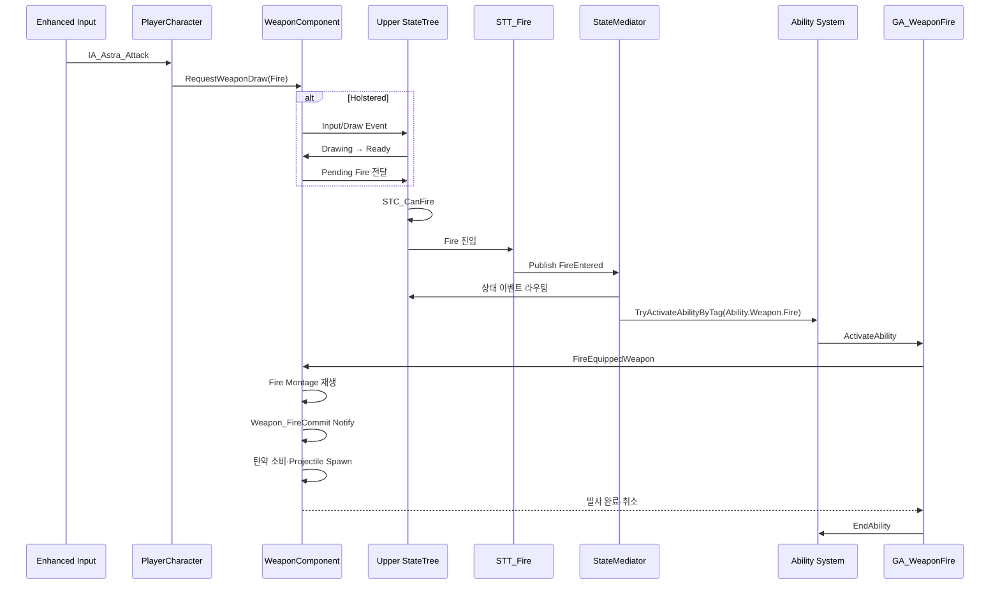

# StateTree와 Gameplay Ability System

## 1. 역할 분리

StateTree와 GAS는 서로를 대체하지 않습니다.

| 시스템 | 책임 |
|---|---|
| StateTree Condition | 전이 후보가 현재 가능한지 빠르게 검사 |
| StateTree Task | 상태 진입·틱·종료에 따른 실행과 Ability 활성화 요청 |
| EntityStateMediator | 상·하체 이벤트 라우팅, 상태 충돌 정책, Tag 기반 Ability 활성화 |
| Gameplay Ability | 비용, 쿨다운, 차단, Commit, 실제 전투 행동, 취소·종료 |
| ASC / GameplayTag | 공유 전투 상태와 Ability 수명 관리 |

STC에서 모든 검사를 끝냈더라도 GA는 실행 시점에 탄약·사망·기절·비용 등 안전 검사를 다시 수행해야 합니다. 두 검사는 중복된 역할이 아니라 **전이 선택용 검사**와 **실행 권한 검사**입니다.

StateTree와 GA는 행동 주체인 [[게임 객체 분류|Entity]]의 행동 계층입니다. `GA_Weapon*`과 무기 상체 StateTree도 Weapon Item이 소유하는 로직이 아니라 Entity가 장착 무기를 사용하는 행동을 표현합니다. Weapon Item은 정적 정의, 인스턴스 탄약과 실제 실행 결과를 소유합니다.

## 2. StateTree 구성

### Base StateTree

에셋: `Content/Astra/Player/StateTree/BaseStateTree/ST_PlayerBaseState.uasset`

현재 에셋 경로는 Player 아래에 있지만 책임상 Humanoid Entity의 Locomotion 행동입니다. NPC 인간형과 공유 가능한 수준이 되면 `Entity/Humanoid/StateTrees/Locomotion`으로 이동합니다.

전신 로코모션을 담당합니다.

- Idle
- Walk
- Sprint
- CancelSprint
- JumpStart
- Jumping
- Falling
- Evade
- Hanging
- HangingDrop
- Mantle
- Vault

### Upper StateTree

에셋: `Content/Astra/Player/StateTree/UpperStateTree/ST_UpperState.uasset`

현재 에셋 경로는 Player 아래에 있지만 책임상 Humanoid Entity의 상체 행동입니다. 무기 외 상호작용과 스킬까지 확장할 수 있으므로 장기 분류명은 Weapon보다 `Actions` 또는 `UpperBody`를 사용합니다.

WeaponCarryState와 UpperAction을 하나의 트리에서 관리합니다. 무기를 들어야 공격할 수 있고, 상호작용·Sprint·Airborne·Traversal이 Carry와 Action에 동시에 영향을 주기 때문에 별도 트리 두 개로 나누지 않습니다.

- Holstered
- Drawing
- Ready
- Holstering
- Fire
- Aim
- Reload

현재 구현된 주요 에셋:

- `Tasks/STT_WeaponHolstered`
- `Tasks/STT_WeaponDrawing`
- `Tasks/STT_WeaponReady`
- `Tasks/STT_WeaponHolstering`
- `Tasks/STT_Fire`
- `Tasks/STT_WeaponReload`
- `Tasks/STT_WeaponAim`
- `Conditions/STC_CanDrawWeapon`
- `Conditions/STC_CanFire`
- `Conditions/STC_CanReload`
- `Conditions/STC_CanAim`

## 3. Condition과 Task 규칙

### Condition이 하는 일

- 필요한 Context와 Component 유효성 검사
- 장착 무기 여부
- 현재 Base/Upper 상태
- 사망·기절·Traversal 등 차단 상태
- 발사 가능 여부, 탄약 여부 같은 전이 전 조건

### Condition이 하지 않는 일

- Montage 재생
- Socket 변경
- 탄약 소비
- Ability 취소
- 다른 State 직접 변경
- 입력 소비

### Task가 하는 일

- State 진입 사실을 EventBus에 게시
- Domain Component 함수 호출
- Mediator에 GameplayTag 기반 Ability 활성화 요청
- 지연 작업이 끝날 때 `Finish Task`
- ExitState에서 중단·복구 처리

## 4. 무기 발사 전체 경로



`STT_Fire`의 `Publish Simple`은 Ability를 켜는 함수가 아닙니다. 상체 Fire 진입 사실을 Mediator에 알려 Sprint 취소 같은 교차 상태 정책을 작동시키는 이벤트입니다. 그 다음 `Try Activate Ability by Tag`가 실제 GA를 활성화합니다.

## 5. STT_Fire 기준 순서

1. `Event EnterState`
2. `EntityContext.StateEventBus` 유효성 확인
3. `Publish Simple`
   - EventTag: `Event.State.Upper.FireEntered`
   - Source: `APlayer` 또는 Context Actor
4. `EntityContext.StateMediator` 유효성 확인
5. `Try Activate Ability by Tag`
   - AbilityTag: `Ability.Weapon.Fire`
6. 반환값을 `Finish Task.Succeeded`에 연결

StateTree에서 `Actor.PlayerContext` 또는 `Actor.EntityContext` 바인딩을 반드시 지정합니다. Blueprint 변수에 값이 존재하는 것과 StateTree의 인스턴스 바인딩은 별개입니다.

## 6. Ability 계층과 EntityContext

현재 프로젝트는 반복 튜닝과 콘텐츠 연결을 위해 GA 구체 클래스를 Blueprint로 만듭니다.

```text
UGameplayAbility
└─ UAstraWeaponGameplayAbilityBase (C++)
   ├─ GA_WeaponFire
   ├─ GA_WeaponReload
   └─ GA_WeaponAim
```

별도 계열의 향후 확장:

```text
UGameplayAbility
├─ GA_SoulLinkBase
│  ├─ Possession
│  ├─ DirectSkill
│  ├─ Transform
│  └─ Totem
├─ GA_AstraActionBase
└─ GA_CommonBase
```

`UAstraWeaponGameplayAbilityBase`는 `InstancedPerActor`이며 `OnAvatarSet`에서 Avatar의 `IEntityContextProvider`를 통해 `EntityContext`를 캐시합니다. Ability가 자신을 생성하면서 호출하는 것이 아니라 ASC가 Ability 지급 또는 Avatar 변경 과정에서 `OnAvatarSet`을 호출합니다.

현재 Weapon Ability는 PlayerController나 PlayerCharacter의 구체 타입을 따라가며 카메라를 찾지 않고, EntityContext에 등록된 `PlayerCameraManager`를 통해 `StartAimCameraFOV`와 `StopAimCameraFOV`를 요청합니다. 다만 이 FOV 기능 때문에 `UAstraWeaponGameplayAbilityBase`는 아직 Player 의존성을 가집니다. Humanoid 공용 기반으로 옮기려면 카메라 정책을 분리하거나 인터페이스로 격리해야 합니다. 자세한 생명주기는 [[PlayerCameraManager 참조 구성]]을 참고합니다.

## 7. Aim 구현 흐름

```text
IA_Astra_Aim.Started
→ PlayerCharacter.RequestWeaponAimStarted
→ Input.Ability.Aim
→ Upper StateTree의 STC_CanAim
→ STT_WeaponAim.EnterState
→ Publish Event.State.Upper.AimEntered
→ TryActivateAbilityByTag(Ability.Weapon.Aim)
→ GA_WeaponAim.ActivateAbility
→ CanAimWeapon 재검사
→ CommitAbility
→ WeaponComponent에서 AimFOV·보간 속도 조회
→ AstraWeaponGameplayAbilityBase.StartAimCameraFOV
→ AstraPlayerCameraManager.UpdateCamera
```

Aim은 즉시 종료하지 않고 활성 상태를 유지합니다. Hold 입력 해제, Toggle 재입력 또는 외부 취소로 StateTree가 Aim을 벗어나면 `STT_WeaponAim.ExitState`가 Ability를 취소하고 `StopAimCameraFOV`가 기본 FOV 복귀를 시작합니다.

```text
STT_WeaponAim.ExitState
→ CancelAbilityByTag(Ability.Weapon.Aim)
→ GA_WeaponAim.OnEndAbility
→ StopAimCameraFOV
→ Activation Owned Tag: State.Combat.Aiming 제거
→ AstraPlayerCameraManager가 기본 FOV로 보간
```

## 8. Reload 구현 흐름

현재 `GA_WeaponReload`, `STT_WeaponReload`, `STC_CanReload`과 C++ 재장전 실행 경로가 연결되어 있습니다.

```text
Input.Ability.Reload
→ Upper StateTree의 STC_CanReload
→ STT_WeaponReload
→ StateMediator.TryActivateAbilityByTag(Ability.Weapon.Reload)
→ GA_WeaponReload
→ WeaponComponent.ExecuteReloadWeapon
→ Reload Montage
→ Weapon_ReloadCommit Notify에서 탄약 반영
→ Montage 완료 또는 CancelReloadWeapon
→ Ability 종료와 Upper Ready 복귀
```

탄창이 빈 상태에서 Fire 입력이 들어오면 `PlayerCharacter::RequestWeaponFire`가 `WeaponComponent::ShouldReloadOnFireRequest`를 검사하여 Fire 대신 Reload 입력 태그와 Pending Reload를 사용합니다. 이 자동 전환은 PIE 회귀 검증 항목으로 남깁니다.

## 9. EndAbility와 CancelAbility

- `EndAbility`: 정상 성공 또는 자체 종료 시 호출합니다.
- `CancelAbility`: 피격, 사망, Sprint, Airborne, Traversal 등 외부 사유로 중단할 때 사용합니다.
- 취소 경로에서도 Montage·타이머·예약 입력·GameplayTag를 정리한 뒤 Ability 수명을 끝냅니다.

Ability가 즉시 한 발만 발사한다면 `Activate → Commit → Fire → EndAbility`가 기본 흐름입니다. 연사·충전·지속 조준은 Ability가 활성 상태로 남아 입력 해제 또는 취소를 기다립니다.

## 10. GameplayTag 기준

### 입력

- `Input.Ability.Primary`
- `Input.Ability.Aim`
- `Input.Ability.Reload`

### Ability

- `Ability.Weapon.Fire`
- `Ability.Weapon.Aim`
- `Ability.Weapon.Reload`

### 상태

- `State.Dead`
- `State.Stunned`
- `State.Movement.Airborne`
- `State.Movement.Sprinting`
- `State.Movement.Traversal`
- `State.Combat.Aiming`
- `State.Combat.Attacking`
- `State.Combat.Reloading`
- `State.Weapon.Holstered`
- `State.Weapon.Drawing`
- `State.Weapon.Ready`
- `State.Weapon.Holstering`
- `State.Weapon.Blocked`

### 상·하체 중재 이벤트

- `Event.State.Locomotion.SprintEntered`
- `Event.State.Locomotion.AirborneEntered`
- `Event.State.Locomotion.TraversalEntered`
- `Event.State.Upper.FireEntered`
- `Event.State.Upper.AimEntered`
- `Event.Command.Locomotion.CancelSprint`
- `Event.Command.Locomotion.HitReaction`
- `Event.Command.Locomotion.Death`
- `Event.Command.Upper.CancelAction`
- `Event.Command.Upper.ForceHolster`
- `Event.Command.Upper.Disable`

---

## 상위 페이지

- [[03_시스템 설계]]

## 관련

- [[시스템 아키텍처]]
- [[무기 시스템]]
- [[게임 객체 분류]]
- [[PlayerCameraManager 참조 구성]]
- [[ADR-002 StateTree와 GAS 역할 분리]]
