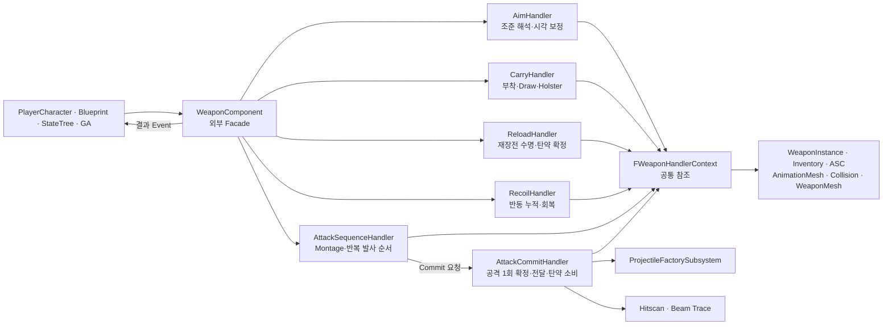
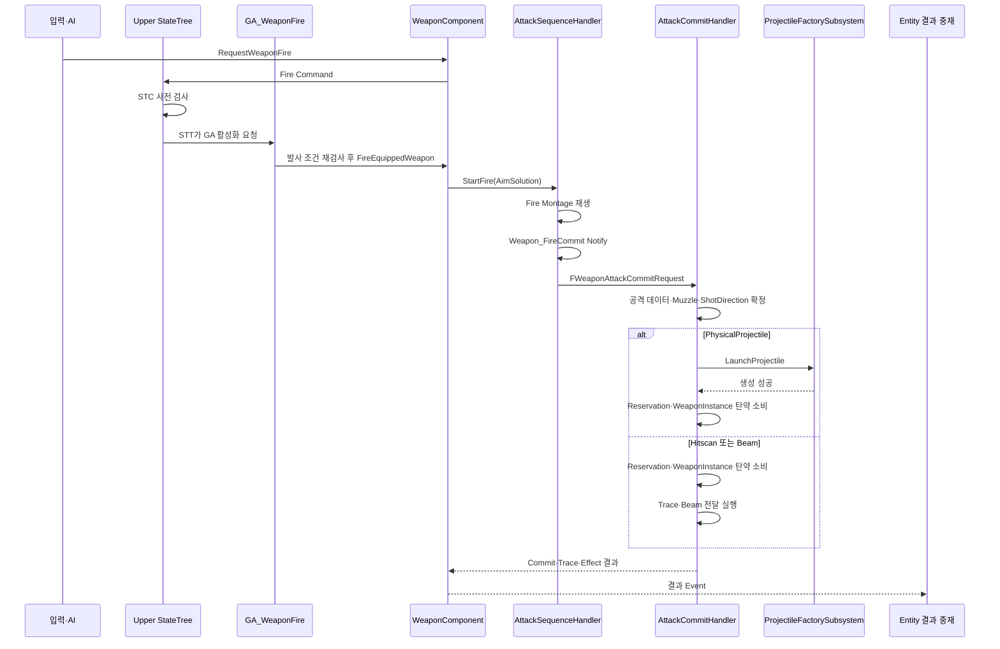
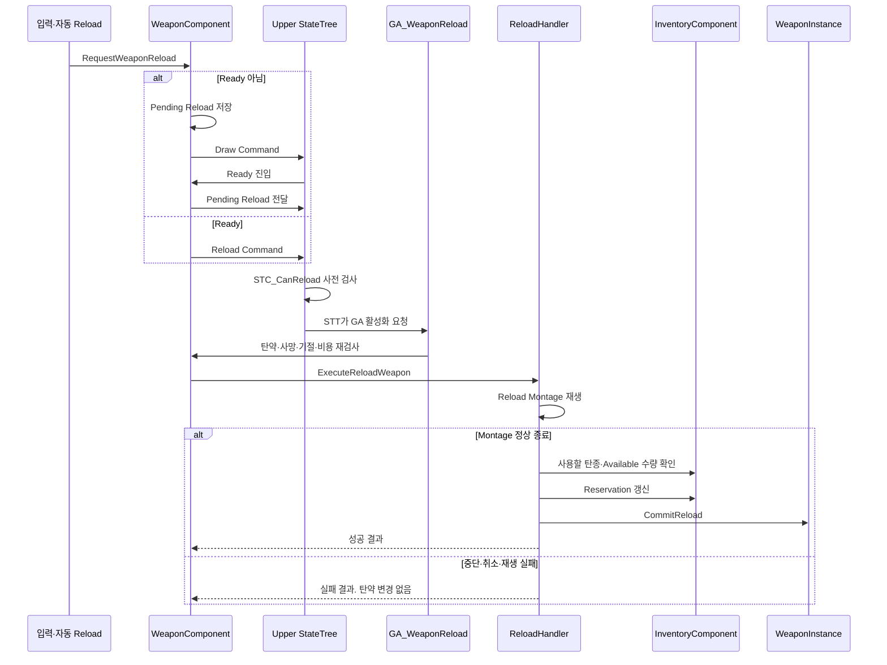
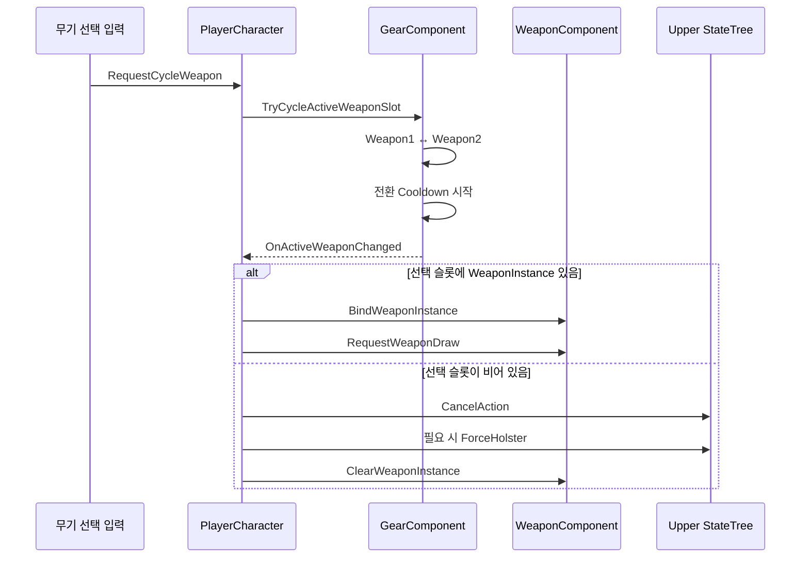
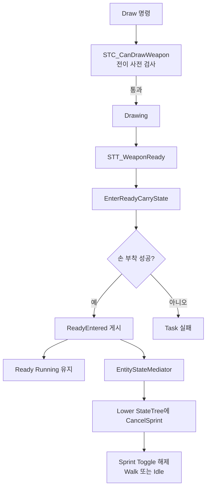

# WeaponComponent 기능 분리



## 설계 의도

WeaponComponent의 외부 계약 유지. 기능별 실행 책임 분리. Player와 NPC의 공통 무기 실행 기반 구성

## 1. 적용 상태

- WeaponComponent를 외부 Facade로 유지
- 기능별 Handler를 WeaponComponent 내부 객체로 분리
- 외부에서 Handler 객체를 직접 조회하거나 참조하지 않음
- Handler끼리 직접 참조하지 않음
- 공통 의존성은 `FWeaponHandlerContext`로 공급
- C++ 소스 반영 확인
- 이 문서 갱신 시 빌드·Blueprint Compile·PIE 결과는 별도 확인하지 않음

## 2. 의존 방향

```text
PlayerCharacter / Blueprint / StateTree / GA
→ WeaponComponent Facade
→ 기능별 Handler
→ FWeaponHandlerContext의 참조
```

WeaponComponent는 Handler를 생성하고 수명을 소유. `UPROPERTY(Transient)`로 GC 참조 유지

`InitializeWeapon`, ASC 변경, Inventory 변경, WeaponInstance 변경 시 Context 갱신

무기 해제 시 진행 행동과 Delegate를 정리한 뒤 Context의 WeaponInstance 제거

### 생성·갱신·해제 순서

```text
WeaponComponent 생성
→ Handler를 WeaponComponent Outer로 생성
→ UPROPERTY(Transient)로 Handler 수명 유지
→ 공통 Mesh와 Component 참조 연결
→ FWeaponHandlerContext 갱신
→ Handler Initialize
```

- Player가 소유한 WeaponMesh의 기본값은 `CreateDefaultSubobject` 이후 PlayerCharacter에서 설정
- WeaponComponent 생성자에서 `InitializeWeapon` 전의 WeaponMesh를 역참조하지 않음
- ASC·Inventory·WeaponInstance가 바뀌면 해당 Context 참조를 즉시 갱신
- 무기 교체·해제 전 Fire·Continuous Attack·Reload·Draw·Holster를 취소
- 탄약 변경 Delegate를 해제한 뒤 Handler의 실행 상태와 Context를 초기화
- Handler는 Context 또는 다른 Handler의 수명을 소유하지 않음

## 3. 역할

| 객체 | 역할 |
|---|---|
| `WeaponComponent` | 외부 API 제공. Handler 초기화·Context 갱신·명령 중재·결과 Event 재발행 |
| `FWeaponHandlerContext` | WeaponInstance, ASC, AnimationMesh, BodyCollision, InventoryComponent, WeaponMesh, OwnerActor 참조 보관. 판단·실행 없음 |
| `AimHandler` | 조준 가능 여부. Aim Solution Trace. Muzzle 기준 발사 방향 자료. Visual Aim Correction. Aim FOV 설정 조회 |
| `CarryHandler` | 손·홀스터 Socket 부착. Carry State. Draw·Holster Montage. Pending Action. Auto Holster Timer |
| `ReloadHandler` | 재장전 가능 여부. 사용할 탄종 선택. Reload Montage 수명. 정상 종료 시 Reservation·WeaponInstance 탄약 확정 |
| `RecoilHandler` | 발사 반동 누적. 정규화 반동. 시간 기반 회복. 초기화 |
| `AttackSequenceHandler` | Fire Montage. `Weapon_FireCommit` 수신. 입력 유지. 반복 발사와 Continuous Tick. Cooldown. 공격 Sequence 종료 |
| `AttackCommitHandler` | 공격 1회 데이터 확정. PhysicalProjectile·Hitscan·Beam 전달. 탄약 소비. Trace·Beam Effect 요청 |

## 4. WeaponComponent Facade 규칙

- Blueprint와 StateTree는 WeaponComponent 함수만 호출
- PlayerCharacter는 Handler를 알지 않음
- Handler의 성공·실패 결과는 WeaponComponent가 기존 Delegate로 전달
- `OnWeaponAttackCommitted`는 공격 실행 요청이 아니라 성공한 공격의 결과 알림
- PhysicalProjectile 생성은 AttackCommitHandler가 ProjectileFactorySubsystem에 직접 요청
- Hitscan 피해 적용과 Beam Effect 실행은 WeaponComponent 결과 Event를 받은 Entity 계층이 중재
- Muzzle·Hand·Holster Socket이 없으면 명시적 실패

## 5. 총기 발사 흐름



### 발사 규칙

- 2026-10-08 반영: 공격 취소·입력 종료·Sequence 종료 시 기존 발사 쿨다운 유지
- 비지속 공격의 Commit 성공 시 AttackCooldown 타이머 시작. 만료 또는 무기 런타임 초기화에서 해제
- CanAttackWeapon에서 쿨다운 재검사. 시야 상실·재발견만으로 간격 초기화하지 않음
- NPC 반복 요청은 몸 방향·Ready·GA 종료·쿨다운 확인 후 발신

- `AttackSequenceHandler`는 발사 시점과 반복 순서를 담당
- `AttackCommitHandler`는 한 발 또는 한 Tick의 공격 결과를 담당
- `FWeaponAttackCommitData`는 AttackInstanceId, DeliveryType, 탄약, MuzzleTransform, AimTargetLocation과 AttackSpec 포함
- ShotDirection은 `MuzzleLocation → AimTargetLocation`으로 다시 계산하여 `AttackSpec.ShotDirection`과 SpawnRotation에 반영
- PhysicalProjectile은 Factory 생성 성공 후 탄약 소비
- Hitscan·Beam은 탄약 소비 성공 후 전달 실행
- 공격 확정 성공 시 RecoilHandler에 반동 누적 요청
- 빈 탄창이면 `ShouldReloadOnFireRequest`가 Fire 명령 대신 Reload 명령 요청

## 6. 발사 방식과 전달 방식

| 구분 | 값 | 담당 |
|---|---|---|
| 발사 방식 | SingleShot, RapidFire, ThreeShot, ChargedShot, Continuous | AttackSequenceHandler |
| 전달 방식 | PhysicalProjectile, Hitscan, Beam | AttackCommitHandler |

두 축은 독립 조합

현재 반복 입력 처리는 RapidFire와 Continuous에 적용

- RapidFire: Fire Montage와 AttackCooldown 반복
- Continuous Beam: 하나의 AttackInstanceId 유지. 주기별 Commit. 입력 종료 시 Beam Stop 요청
- ThreeShot·ChargedShot의 전용 Sequence 규칙은 별도 확인 필요

## 7. 재장전 흐름



### 재장전 규칙

- Reload Montage의 정상 종료가 탄약 확정 시점
- `Weapon_ReloadCommit` Notify에서 탄약을 확정하지 않음
- 중단·취소된 Montage는 탄약 변경 없음
- 탄창에 탄약이 남았으면 같은 등록 탄종의 Available 수량 사용
- 탄창이 비었으면 Inventory의 호환 탄약 선택 규칙 사용
- Reservation과 WeaponInstance의 장전 탄수를 함께 갱신
- 위 Reservation 규칙은 Player 경로. NPC는 bIsNPC 기반으로 WeaponInstance 탄창만 소비
- NPC 무제한 예비 탄약은 CombatTendencyData.bInfiniteReserveAmmo 사용. Inventory 없이 등록 탄종의 탄창 보충
- NPC Reload에도 Capability.Combat.Reload 필요. bCanReload=false이면 요청 차단
- StateTree Condition은 전이 사전 검사
- StateTree Task는 상태 실행과 GA 활성화 요청
- GA와 Handler는 실행 직전에 상태와 자원을 다시 검사

## 8. 무기 선택과 재바인딩



- 빈 Weapon1·Weapon2 슬롯도 선택 가능한 정상 슬롯
- 빈 슬롯 선택은 오류가 아니라 맨손 상태
- 활성 슬롯과 장착 Instance의 원본은 GearComponent가 소유
- PlayerCharacter는 `OnActiveWeaponChanged`를 받아 WeaponComponent를 재바인딩
- 같은 슬롯 선택은 성공으로 처리. 전환 Cooldown 중 다른 슬롯 선택은 거부
- `InitClass`에서 직접 자동 Draw하지 않음
- 초기화가 끝난 뒤 활성 WeaponInstance가 새로 바인딩되면 Draw 요청

## 9. StateTree 연결 규칙



- 외부 Root의 무조건 `Draw → Ready` 전이로 `STC_CanDrawWeapon`을 우회하지 않음
- Draw 허용 Locomotion은 Idle·Walk·Sprint·Jumping·Falling
- Evade에서는 Draw를 허용하지 않음
- `STT_WeaponReady`는 손 부착 성공 후에만 `ReadyEntered` 게시
- Mediator는 Ready·Fire·Aim·Reload 진입을 판단하지 않고 Lower StateTree에 `CancelSprint`만 전달
- Lower StateTree는 Sprint 상태에서 `CancelSprint`를 처리
- Holstered Reload는 `RequestWeaponReload → Pending Reload → Draw → Ready → Reload` 유지
- Traversal·Evade 진입은 기존 `EntityStateMediator → ForceHolster` 유지
- C++ Event와 Mediator 경로는 반영됨
- StateTree Asset의 전이·Task 노드 연결, Compile, PIE는 Editor 확인 필요

2026-09-30 첨부 Ready Task 확인: 손 부착 성공→ReadyEntered 게시→Running 유지. 성공 시 FinishTask 호출 불필요. 부착 실패 시 FinishTask(false)

## 10. 관련 문서

- [무기](%EB%AC%B4%EA%B8%B0.md)
- [시스템 아키텍처](%EC%8B%9C%EC%8A%A4%ED%85%9C%20%EC%95%84%ED%82%A4%ED%85%8D%EC%B2%98.md)
- [StateTree와 GAS](StateTree%EC%99%80%20GAS.md)
- [장비와 인벤토리](%EC%9E%A5%EB%B9%84%EC%99%80%20%EC%9D%B8%EB%B2%A4%ED%86%A0%EB%A6%AC.md)
- [무기 조준·반동·명중률](%EB%AC%B4%EA%B8%B0%20%EC%A1%B0%EC%A4%80%C2%B7%EB%B0%98%EB%8F%99%C2%B7%EB%AA%85%EC%A4%91%EB%A5%A0.md)
