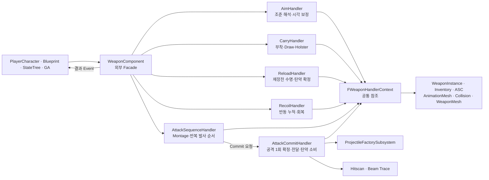
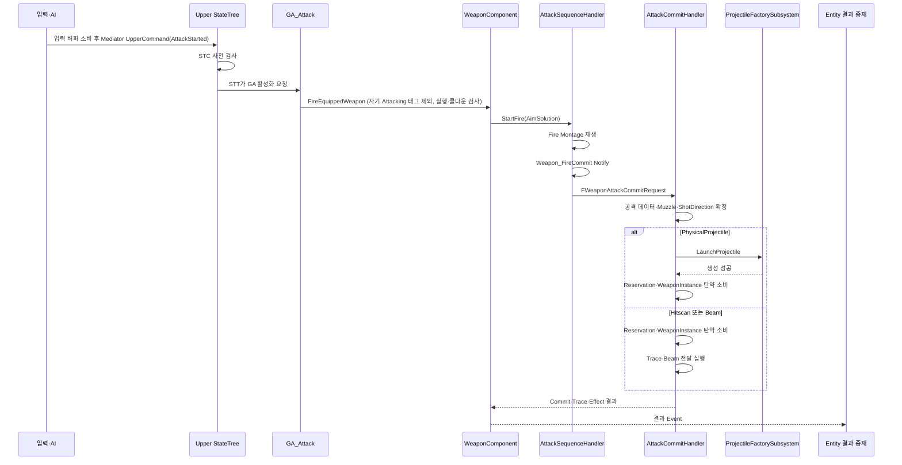
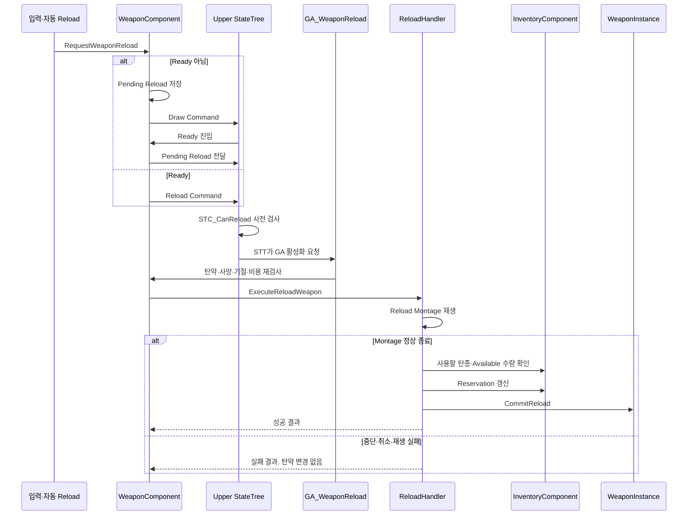
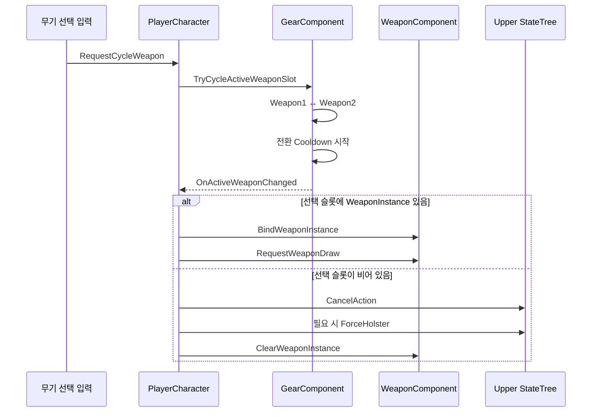
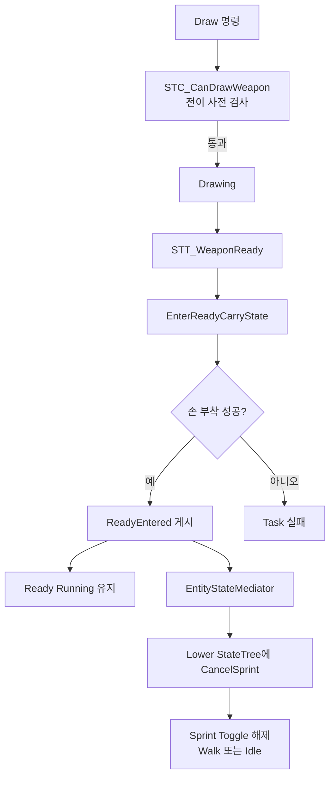

# WeaponComponent 기능 분리

2026-10-28 조종 입력 경계 반영: WeaponComponent·AttackSequenceHandler·WeaponHandlerBase의 구체 AIController 참조 제거. HandlerContext.CombatInputQuery로 Entity가 제공한 관측/선택/여유 입력만 조회. 무기 Facade는 명중률 Delegate 결과와 시선 입력을 기존 Commit/대상 선정에 반영. 근접 이동 인수 요청은 Handler 내부 사건→Facade 공개 Native 사건→현재 Controller 구독으로 동기 전달. 새 Handler/Component/Tick 없음. 상세 수명은 [아키텍처](시스템%20아키텍처.md#반영한-입력사건-수명), 기존 Blueprint API는 유지. 빌드·UHT·PIE 미수행.



## 설계 의도

WeaponComponent의 외부 계약 유지. 기능별 실행 책임 분리. Player와 NPC의 공통 무기 실행 기반 구성

## 1. 적용 상태

- 2026-10-26 기존 Handler 근접 분기 반영: WeaponComponent 외부 API와 Sequence의 몽타주/쿨다운/완료 재사용, Commit에 타격 구간 Sweep 추가. 새 Attack Component/Handler 없음. 맨손은 ASC 비무장 수치, 근접 무기는 기존 DA, 돌진 거리는 별도 설정. [에셋 설정·전체 호출 순서](근접%20공격·소환기%20사전%20점검.md#현재-반영-기존-handler-근접-분기). 빌드·UHT·PIE 전
- WeaponComponent를 외부 Facade로 유지
- 기능별 Handler를 WeaponComponent 내부 객체로 분리
- 외부에서 Handler 객체를 직접 조회하거나 참조하지 않음
- Handler끼리 직접 참조하지 않음
- 공통 의존성은 `FWeaponHandlerContext`로 공급
- C++ 소스 반영 확인
- 이 문서 갱신 시 빌드·Blueprint Compile·PIE 결과는 별도 확인하지 않음

## 2. 의존 방향

```text
PlayerCharacter / Blueprint / StateTree / GA
→ WeaponComponent Facade
→ 기능별 Handler
→ FWeaponHandlerContext의 참조
```

WeaponComponent는 Handler를 생성하고 수명을 소유. Handler 6개는 `UPROPERTY(Transient, Instanced)`로 GC 참조와 컴포넌트별 인스턴스 소유 명시

`InitHandlers`는 Context·Delegate 연결 전에 모든 Handler의 Outer가 현재 WeaponComponent이고 템플릿 객체가 아닌지 검사. Context.OwnerActor와 컴포넌트 Owner 일치 검사. 불일치 시 Development 검사 실패로 진단, 다른 인스턴스의 Context·Delegate를 덮어쓰지 않음

2026-10-24 디버그 정리: Handler 소유 로그·조준 도형·몽타주/Slot·발사 간격·명중률·반동 진단의 출력과 콘솔 설정은 `Utils/Debug/UAstraDebugSubsystem` 소유. 기능부는 서비스 호출만 수행. 소유 checkf와 실제 실패 로그는 기능부 유지. 전체 명령·사용처는 [디버그 서브시스템](디버그%20서브시스템.md)의 중앙 등록부 참조

초기화 최초 1회 `WeaponHandlerInit` 로그에 Owner·Component·Handler 경로/주소·Outer·Context 주소/Owner 기록. 같은 컴포넌트의 6개 Handler는 하나의 Context를 사용하고, 서로 다른 컴포넌트의 Handler·Context는 분리

`InitializeWeapon`, ASC 변경, Inventory 변경, WeaponInstance 변경 시 Context 갱신

무기 해제 시 진행 행동과 Delegate를 정리한 뒤 Context의 WeaponInstance 제거

### 생성·갱신·해제 순서

```text
WeaponComponent 생성
→ Handler를 WeaponComponent Outer로 생성
→ UPROPERTY(Transient)로 Handler 수명 유지
→ 공통 Mesh와 Component 참조 연결
→ FWeaponHandlerContext 갱신
→ Handler Initialize
```

- Player가 소유한 WeaponMesh의 기본값은 `CreateDefaultSubobject` 이후 PlayerCharacter에서 설정
- WeaponComponent 생성자에서 `InitializeWeapon` 전의 WeaponMesh를 역참조하지 않음
- ASC·Inventory·WeaponInstance가 바뀌면 해당 Context 참조를 즉시 갱신
- 무기 교체·해제 전 Fire·Continuous Attack·Reload·Draw·Holster를 취소
- 탄약 변경 Delegate를 해제한 뒤 Handler의 실행 상태와 Context를 초기화
- Handler는 Context 또는 다른 Handler의 수명을 소유하지 않음

## 3. 역할

| 객체 | 역할 |
|---|---|
| `WeaponComponent` | 외부 API 제공. Handler 초기화·Context 갱신·명령 중재·결과 Event 재발행 |
| `FWeaponHandlerContext` | WeaponInstance, ASC, AnimationMesh, BodyCollision, InventoryComponent, WeaponMesh, OwnerActor 참조 보관. 판단·실행 없음 |
| `AimHandler` | 조준 가능 여부. Aim Solution Trace. Muzzle 기준 발사 방향 자료. Visual Aim Correction. Aim FOV 설정 조회 |
| `CarryHandler` | 현재 ABP의 ItemID별 상대 Transform으로 손·홀스터 Socket 부착. Carry State. Draw·Holster Montage. Pending Action. Auto Holster Timer |
| `ReloadHandler` | 재장전 가능 여부. 사용할 탄종 선택. 현재 ABP의 WeaponType별 Reload Montage 조회·수명. 정상 종료 시 Reservation·WeaponInstance 탄약 확정 |
| `RecoilHandler` | 발사 반동 누적. 정규화 반동. 시간 기반 회복. 초기화 |
| `AttackSequenceHandler` | 현재 ABP의 WeaponType별 Fire Montage 조회·재생. `Weapon_FireCommit` 수신. 입력 유지. 반복 발사와 Continuous Tick. Cooldown. 공격 Sequence 종료 |
| `AttackCommitHandler` | 공격 1회 데이터 확정. PhysicalProjectile·Hitscan·Beam 전달. 탄약 소비. Trace·Beam Effect 요청 |

## 4. WeaponComponent Facade 규칙

- Blueprint와 StateTree는 WeaponComponent 함수만 호출
- PlayerCharacter는 Handler를 알지 않음
- Handler의 성공·실패 결과는 WeaponComponent가 기존 Delegate로 전달
- `OnWeaponAttackCommitted`는 공격 실행 요청이 아니라 성공한 공격의 결과 알림
- PhysicalProjectile 생성은 AttackCommitHandler가 ProjectileFactorySubsystem에 직접 요청
- Hitscan 피해 적용과 Beam Effect 실행은 WeaponComponent 결과 Event를 받은 Entity 계층이 중재
- Muzzle·Hand·Holster Socket이 없으면 명시적 실패

## 5. 총기 발사 흐름

2026-10-20 사용자 제공 Player 구조는 `PlayerController → Pawn 입력 버퍼 → EntityCharacter.ProcessBufferedWeaponInputs → Mediator → UpperCommand` 경로. 아래 RequestWeaponFire는 별도 Facade API 경로이며 Player의 현행 입력 경로와 동일하게 간주하지 않음. 전체 배치·현재 그래프와 변경 대상: [플레이어 연사·빈 탄창 재장전 연결](../07_QA_테스트/플레이어%20연사·빈%20탄창%20재장전%20연결.md)



### 발사 규칙

- 2026-10-08 반영: 공격 취소·입력 종료·Sequence 종료 시 기존 발사 쿨다운 유지
- 비지속 공격의 Commit 성공 시 AttackCooldown 타이머 시작. 만료 또는 무기 런타임 초기화에서 해제
- CanAttackWeapon에서 쿨다운 재검사. 시야 상실·재발견만으로 간격 초기화하지 않음
- 2026-10-20: World 허용 시각도 재검사. RapidFire 한 발 확정 후 쿨다운 만료 시 후반 몽타주 정리·Sequence 성공 종료
- 2026-10-24: RapidFire 후반 정지의 0초 Blend Out 대신 Fire Montage 자체 BlendOut 시간을 사용. 이전 Notify·종료 Delegate 해제와 Sequence 완료 시점·쿨다운 유지, 포즈 블렌드만 변경. 최신 빌드·PIE 미수행
- RapidFire 후반 정리 전 이전 Notify·Montage End Delegate 해제. SingleShot·지속 Beam 완료 경로 유지
- 중복 FireEquippedWeapon 거부 시 기존 Action 상태 보존
- NPC 반복 요청은 몸 방향·Ready·GA 종료·쿨다운 확인 후 발신

- `AttackSequenceHandler`는 발사 시점과 반복 순서를 담당
- `AttackCommitHandler`는 한 발 또는 한 Tick의 공격 결과를 담당
- `FWeaponAttackCommitData`는 AttackInstanceId, DeliveryType, 탄약, ProjectileFlight, MuzzleTransform, AimTargetLocation과 AttackSpec 포함
- 일반 ShotDirection은 `MuzzleLocation → AimTargetLocation`으로 계산. GrenadeLauncher는 WeaponType으로 중력 없는 지정 곡선 선택, 탄 DA Speed·ArcHeight와 목표점으로 경로 계산. 첫 구간 방향을 AttackSpec.ShotDirection·SpawnRotation에 반영
- NPC 직선 총기 산포: AIController가 무기·종류·성향·이동 정확도를 계산, Facade가 SpreadHalfAngleDegrees를 요청에 전달. Commit은 한 번 선택한 방향을 투사체·Hitscan에 공유. Controller·성향 조회를 Handler에 직접 추가하지 않음. Player·유탄·Homing·Beam 제외, 내구도 커브 보류
- ProjectileFlight는 초기 속도 벡터·CurvePoints·예상 비행시간·실제 수명. Factory는 유효 데이터만 전달, Actor는 곡선 구간을 Speed×DeltaTime 거리만큼 Sweep 이동. 목표점 고정·접촉 기폭·Pool 회수 상태 초기화. 공유 AmmunitionDataAsset 변경 없음. 곡선 없는 발사체는 기존 ProjectileMovement 사용, 이전 직접 Actor 활성화 API도 유지
- PhysicalProjectile은 Factory 생성 성공 후 탄약 소비
- Hitscan·Beam은 탄약 소비 성공 후 전달 실행
- 공격 확정 성공 시 RecoilHandler에 반동 누적 요청
- 2026-10-20 반동 회귀 보정: RapidFire의 실제 입력 Held·탄약 잔여 중에는 한 발 완료로 회복하지 않음. 실제 해제 후 실행 정리·취소·탄창 소진 시 기존 Duration 회복. 입력 유지 정보는 EntityCharacter가 공급하며 Handler가 InputBuffer를 직접 조회하지 않음
- RequestWeaponFire API 경로는 ShouldReloadOnFireRequest로 Reload 변환. 자동 재장전은 장착·교체·탄 소진·호환 탄약 획득 사건에서 요청 생성, AutoReload 명령과 ShouldAutoReload 조건을 거쳐 Upper 부모에서 전이. 탄창 OnTick 감시 없음. 재장전 사용자 완료 확인(2026-10-21)
- 자동 판정은 CanReloadWeapon Facade를 사용하여 실행 중 발사·지속 공격·Action까지 검사

## 6. 발사 방식과 전달 방식

| 구분 | 값 | 담당 |
|---|---|---|
| 발사 방식 | SingleShot, RapidFire, ThreeShot, ChargedShot, Continuous | AttackSequenceHandler |
| 전달 방식 | PhysicalProjectile, Hitscan, Beam | AttackCommitHandler |

두 축은 독립 조합

현재 반복 입력 처리는 RapidFire와 Continuous에 적용

- RapidFire: Triggered 입력 → StateTree → GA로 한 발씩 요청. 확정 후 AttackCooldown 만료 시 남은 Fire Montage 정리 후 다음 요청 허용
- Continuous Beam: 하나의 AttackInstanceId 유지. 주기별 Commit. 입력 종료 시 Beam Stop 요청
- ThreeShot·ChargedShot의 전용 Sequence 규칙은 별도 확인 필요

## 7. 재장전 흐름

아래 Pending Reload·Draw 흐름은 RequestWeaponReload API 계약. 현재 Player 입력은 버퍼 소비 후 Reload 명령으로 Upper StateTree에 직접 전달하며, Reload Task의 손 부착 경로 사용. 기존 트리에는 별도 Drawing 상태와 활성 Draw 전이가 없으므로 두 경로를 전면 교체하지 않음



### 재장전 규칙

- Reload Montage의 정상 종료가 탄약 확정 시점
- `Weapon_ReloadCommit` Notify에서 탄약을 확정하지 않음
- 중단·취소된 Montage는 탄약 변경 없음
- 탄창에 탄약이 남았으면 같은 등록 탄종의 Available 수량 사용
- 탄창이 비었으면 Inventory의 호환 탄약 선택 규칙 사용
- Reservation과 WeaponInstance의 장전 탄수를 함께 갱신
- 위 Reservation 규칙은 Player 경로. NPC는 bIsNPC 기반으로 WeaponInstance 탄창만 소비
- NPC 무제한 예비 탄약은 CombatTendencyData.bInfiniteReserveAmmo 사용. Inventory 없이 등록 탄종의 탄창 보충
- NPC Reload에도 Capability.Combat.Reload 필요. bCanReload=false이면 요청 차단
- StateTree Condition은 전이 사전 검사
- StateTree Task는 상태 실행과 GA 활성화 요청
- GA와 Handler는 실행 직전에 상태와 자원을 다시 검사

## 8. 무기 선택과 재바인딩



- 빈 Weapon1·Weapon2 슬롯도 선택 가능한 정상 슬롯
- 빈 슬롯 선택은 오류가 아니라 맨손 상태
- 활성 슬롯과 장착 Instance의 원본은 GearComponent가 소유
- PlayerCharacter는 `OnActiveWeaponChanged`를 받아 WeaponComponent를 재바인딩
- 같은 슬롯 선택은 성공으로 처리. 전환 Cooldown 중 다른 슬롯 선택은 거부
- `InitClass`에서 직접 자동 Draw하지 않음
- 초기화가 끝난 뒤 활성 WeaponInstance가 새로 바인딩되면 Draw 요청

## 9. StateTree 연결 규칙



- 외부 Root의 무조건 `Draw → Ready` 전이로 `STC_CanDrawWeapon`을 우회하지 않음
- Draw 허용 Locomotion은 Idle·Walk·Sprint·Jumping·Falling
- Evade에서는 Draw를 허용하지 않음
- `STT_WeaponReady`는 손 부착 성공 후에만 `ReadyEntered` 게시
- Mediator는 Ready·Fire·Aim·Reload 진입을 판단하지 않고 Lower StateTree에 `CancelSprint`만 전달
- Lower StateTree는 Sprint 상태에서 `CancelSprint`를 처리
- Holstered Reload는 `RequestWeaponReload → Pending Reload → Draw → Ready → Reload` 유지
- Traversal·Evade 진입은 기존 `EntityStateMediator → ForceHolster` 유지
- C++ Event와 Mediator 경로는 반영됨
- StateTree Asset의 전이·Task 노드 연결, Compile, PIE는 Editor 확인 필요

2026-09-30 첨부 Ready Task 확인: 손 부착 성공→ReadyEntered 게시→Running 유지. 성공 시 FinishTask 호출 불필요. 부착 실패 시 FinishTask(false)

## 10. 관련 문서

- [무기](%EB%AC%B4%EA%B8%B0.md)
- [시스템 아키텍처](%EC%8B%9C%EC%8A%A4%ED%85%9C%20%EC%95%84%ED%82%A4%ED%85%8D%EC%B2%98.md)
- [StateTree와 GAS](StateTree%EC%99%80%20GAS.md)
- [장비와 인벤토리](%EC%9E%A5%EB%B9%84%EC%99%80%20%EC%9D%B8%EB%B2%A4%ED%86%A0%EB%A6%AC.md)
- [무기 조준·반동·명중률](%EB%AC%B4%EA%B8%B0%20%EC%A1%B0%EC%A4%80%C2%B7%EB%B0%98%EB%8F%99%C2%B7%EB%AA%85%EC%A4%91%EB%A5%A0.md)
