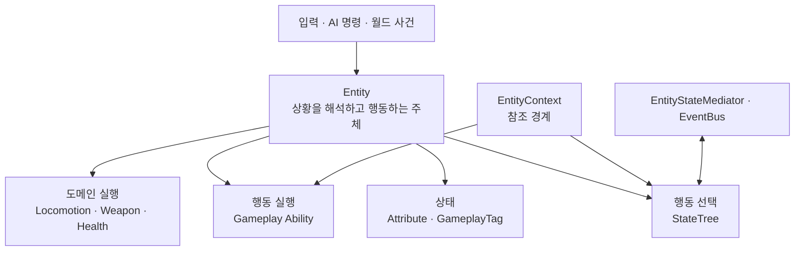

# Entity



## 정의

Entity는 고유한 게임플레이 상태를 가지며, 상황이나 명령을 해석하여 행동의 주체로 작동하는 객체다.

## 하위 유형

| 유형 | 기준 | 예시 |
|---|---|---|
| Player Entity | 사용자가 직접 조작 | 플레이어 캐릭터 |
| NPC Entity | AI 또는 게임 규칙에 따라 행동 | Humanoid, Astra, Machine, Android |
| Structure Entity | 이동 여부와 무관하게 독립 상태와 행동 체계를 보유 | 터렛, 생산 시설, 자동 상점, 기지 |

## 공통 책임

- 자신의 Attribute, GameplayTag와 생존 상태 유지
- 입력, AI 명령과 월드 사건을 행동 요청으로 해석
- StateTree를 통한 현재 행동 선택
- Gameplay Ability 활성화·취소와 행동 비용 검사
- Locomotion, Weapon, Health 같은 도메인 Component 조립
- EntityStateMediator와 EventBus를 통한 교차 상태 정책 적용
- EntityContext를 통한 런타임 참조 제공

## 소유권 원칙

- StateTree는 행동 상태를 선택하지만 영구 데이터 저장소가 아니다.
- Gameplay Ability는 활성화 시점에 비용·사망·기절·자원 조건을 다시 검사한다.
- EntityContext에는 참조만 저장하고 판단이나 실행 로직을 넣지 않는다.
- StateTree끼리 직접 참조하지 않고 EntityStateMediator와 EventBus를 사용한다.
- STC/STT는 가능하면 `Actor + EntityContext`만 바인딩한다.
- 장착 Item의 사용 행동은 Entity가 소유하고 Item은 자체 데이터와 인스턴스 상태를 소유한다.

## Capability와의 구분

`Controllable`, `Interactable`, `Damageable`, `Combatant`, `Shop`, `Container`, `Producing`은 Entity 종류가 아니라 조합 가능한 Capability다. Capability가 같더라도 독립적으로 판단하고 행동하면 Entity, 정해진 반응만 수행하면 Prop이다.

## 콘텐츠 경계

```text
Entity/
├─ Common/
├─ Humanoid/
│  ├─ Abilities/
│  ├─ StateTrees/
│  ├─ Animations/
│  ├─ AnimationBlueprints/
│  ├─ Meshes/
│  ├─ Skeletons/
│  └─ Rigs/
├─ Player/
├─ NPC/
└─ Structure/
```

Player와 인간형 NPC가 함께 사용할 수 있는 행동·애니메이션은 `Humanoid`, 모든 Entity가 공유할 수 있는 기반은 `Common`에 둔다. 현재 Player 전용 구현에 카메라나 입력 의존성이 남아 있다면 이를 분리한 뒤 공용 영역으로 승격한다.

---

## 상위 페이지

- [03_시스템 설계](../03_시스템%20설계.md)

## 관련

- [Player](Player.md)
- [Item](Item.md)
- [Prop](Prop.md)
- [게임 객체 분류](../../02_게임%20기획/게임%20객체%20분류.md)
- [시스템 아키텍처](../시스템%20아키텍처.md)
- [StateTree와 GAS](../StateTree와%20GAS.md)

