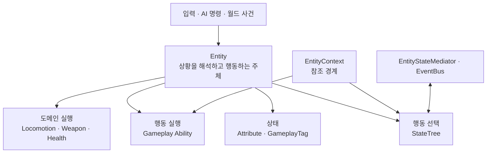

# Entity

## 설계 의도



## 정의

기획 정의: [Entity](../../02_%EA%B2%8C%EC%9E%84%20%EA%B8%B0%ED%9A%8D/%EA%B0%9D%EC%B2%B4%20%EA%B8%B0%ED%9A%8D/Entity.md)

구현 범위: 클래스·Component·데이터·소유권

## 하위 유형

기획 기준: [Entity](../../02_%EA%B2%8C%EC%9E%84%20%EA%B8%B0%ED%9A%8D/%EA%B0%9D%EC%B2%B4%20%EA%B8%B0%ED%9A%8D/Entity.md)

## 공통 책임

- 자신의 Attribute, GameplayTag와 생존 상태 유지
- 입력, AI 명령과 월드 사건을 행동 요청으로 해석
- StateTree를 통한 현재 행동 선택
- Gameplay Ability 활성화·취소와 행동 비용 검사
- Locomotion, Weapon, Health 같은 도메인 Component 조립
- EntityStateMediator와 EventBus를 통한 교차 상태 정책 적용
- EntityContext를 통한 런타임 참조 제공

## 소유권 원칙

- StateTree는 행동 상태를 선택하지만 영구 데이터 저장소가 아니다
- Gameplay Ability는 활성화 시점에 비용·사망·기절·자원 조건을 다시 검사
- EntityContext에는 참조만 저장하고 판단이나 실행 로직을 넣지 않음
- StateTree끼리 직접 참조하지 않고 EntityStateMediator와 EventBus를 사용
- STC/STT는 가능하면 `Actor + EntityContext`만 바인딩
- 장착 Item의 사용 행동은 Entity가 소유하고 Item은 자체 데이터와 인스턴스 상태를 소유

## Capability와의 구분

기획 기준: [Entity](../../02_%EA%B2%8C%EC%9E%84%20%EA%B8%B0%ED%9A%8D/%EA%B0%9D%EC%B2%B4%20%EA%B8%B0%ED%9A%8D/Entity.md)

## 콘텐츠 경계

```text
Entity/
├─ Common/
├─ Humanoid/
│  ├─ Abilities/
│  ├─ StateTrees/
│  ├─ Animations/
│  ├─ AnimationBlueprints/
│  ├─ Meshes/
│  ├─ Skeletons/
│  └─ Rigs/
├─ Player/
├─ NPC/
└─ Structure/
```

Player와 인간형 NPC가 함께 사용할 수 있는 행동·애니메이션은 `Humanoid`, 모든 Entity가 공유할 수 있는 기반은 `Common`에 둠

현재 Player 전용 구현에 카메라나 입력 의존성이 남아 있다면 이를 분리한 뒤 공용 영역으로 승격

---

## 상위 페이지

- [03_시스템 설계](../03_시스템%20설계.md)

## 관련

- [Player](%ED%94%8C%EB%A0%88%EC%9D%B4%EC%96%B4.md)
- [Item](Item.md)
- [Prop](Prop.md)
- [게임 객체 분류](../../02_게임%20기획/게임%20객체%20분류.md)
- [시스템 아키텍처](../시스템%20아키텍처.md)
- [StateTree와 GAS](../StateTree와%20GAS.md)

## 문서 연결

- 기획: [Entity](../../02_%EA%B2%8C%EC%9E%84%20%EA%B8%B0%ED%9A%8D/%EA%B0%9D%EC%B2%B4%20%EA%B8%B0%ED%9A%8D/Entity.md)
- 시스템 설계: [Entity](Entity.md)
- 애니메이션 설계: [Entity](../../04_%EC%95%84%ED%8A%B8%20%EB%B0%8F%20%EC%95%A0%EB%8B%88%EB%A9%94%EC%9D%B4%EC%85%98/%EC%95%A0%EB%8B%88%EB%A9%94%EC%9D%B4%EC%85%98%20%EC%84%A4%EA%B3%84/Entity.md)
