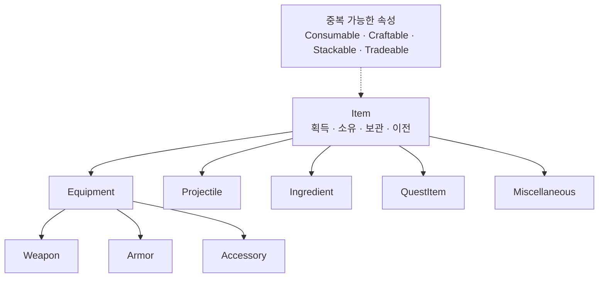

# Item



## 정의

Item은 플레이어 또는 다른 Entity가 획득·소유·보관·이전할 수 있는 객체다. 폴더는 대표 종류 하나로 결정하고, 사용 방식과 제작·거래 관계는 중복 가능한 속성으로 표현한다.

## 종류

| 종류 | 정의 |
|---|---|
| Equipment | 슬롯에 장착하여 지속적으로 사용하는 Item |
| Projectile | 발사체 슬롯에 장착하거나 발사에 사용하는 Item |
| Ingredient | 제작·수리·강화 재료로 사용하는 것이 주목적인 Item |
| QuestItem | 임무 진행과 조건 판정을 위해 소유하는 것이 주목적인 Item |
| Miscellaneous | 다른 종류에 명확히 속하지 않는 일반 Item |

`Consumable`과 `Crafting`은 종류가 아니다. 소모 여부와 제작 시스템 관계는 각각 `Item.Usage.*`, `Item.Crafting.*` 속성으로 관리한다. Unreal 렌더링 에셋과 혼동되는 `Material`은 Item 종류명으로 사용하지 않는다.

## Item과 월드 객체

- 인벤토리에 보관되는 탄환: Projectile Item
- 발사 후 월드에서 이동·충돌하는 탄환: Projectile Actor
- 발사체 정적 설정: Projectile Data
- 월드에 드롭된 Item 표현: Item을 참조하는 Pickup Actor 또는 Interactive Prop

표현 Actor가 존재한다는 이유만으로 Item의 소유 데이터와 월드 수명주기를 합치지 않는다.

## Weapon Item 책임

| 계층 | 책임 |
|---|---|
| WeaponDataAsset | 무기 종류, DeliveryType, ShootType, 피해·사거리·탄속·반동·탄약 비용 같은 정적 정의 |
| WeaponModel | 개별 무기의 장전량, 강화, 내구도, 부착물 같은 인스턴스 상태 |
| WeaponComponent | 장착·Draw/Holster, 행동 가능 여부, 공격 데이터 계산과 공격 확정 이벤트 |

조준·발사·재장전 StateTree와 Gameplay Ability는 Weapon Item의 행동이 아니라 Entity가 Item을 사용하는 행동이다.

## 탄약 소유 경계

현재 단계에서는 WeaponModel이 장전량을 임시 소유할 수 있다. Inventory 구현 후에는 예비 탄약 Item, Magazine Item 또는 Inventory 직접 소비 중 하나로 확정한다. WeaponComponent는 실제 저장 위치를 알지 않고 `AmmoCost`를 포함한 공격 확정 데이터를 제공한다.

```text
현재: PlayerCharacter → WeaponComponent/WeaponModel에 소비 요청
향후: PlayerCharacter → InventoryComponent 또는 Magazine Item에 소비 요청
```

## 콘텐츠 구조

```text
Item/
├─ Equipment/
│  ├─ Weapon/
│  ├─ Armor/
│  └─ Accessory/
├─ Projectile/
├─ Ingredient/
├─ QuestItem/
└─ Miscellaneous/
```

---

## 상위 페이지

- [03_시스템 설계](../03_시스템%20설계.md)

## 관련

- [Entity](Entity.md)
- [Prop](Prop.md)
- [게임 객체 분류](../../02_게임%20기획/게임%20객체%20분류.md)
- [무기 시스템](../무기%20시스템.md)

