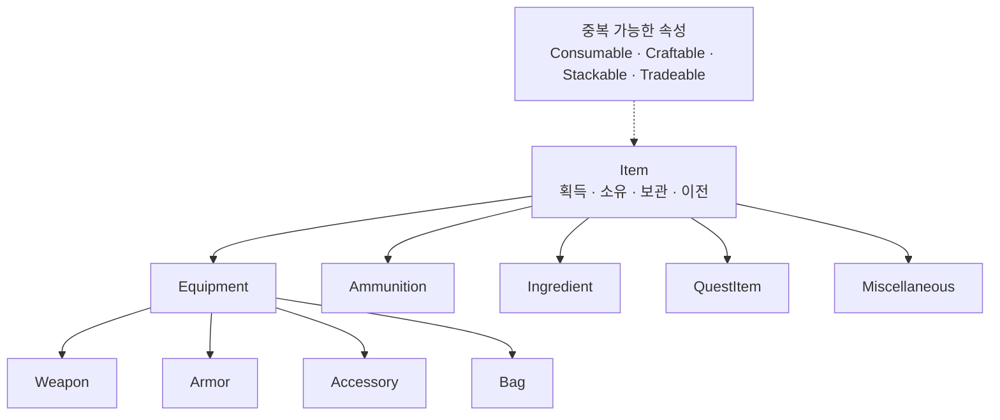

# Item



## 정의

Item은 플레이어 또는 다른 Entity가 획득·소유·보관·이전할 수 있는 객체다. 폴더는 대표 종류 하나로 결정하고, 사용 방식과 제작·거래 관계는 중복 가능한 속성으로 표현한다.

## 종류

| 종류 | 정의 |
|---|---|
| Equipment | 슬롯에 장착하여 지속적으로 사용하는 Item |
| Ammunition | Inventory에서 소유하며 무기에 사용 권한을 등록하는 탄약 Item |
| Ingredient | 제작·수리·강화 재료로 사용하는 것이 주목적인 Item |
| QuestItem | 임무 진행과 조건 판정을 위해 소유하는 것이 주목적인 Item |
| Miscellaneous | 다른 종류에 명확히 속하지 않는 일반 Item |

`Consumable`과 `Crafting`은 종류가 아니다. 소모 여부와 제작 시스템 관계는 각각 `Item.Usage.*`, `Item.Crafting.*` 속성으로 관리한다. Unreal 렌더링 에셋과 혼동되는 `Material`은 Item 종류명으로 사용하지 않는다.

## Item과 월드 객체

- 인벤토리에 보관되는 탄환: Ammunition Item
- 발사 후 월드에서 이동·충돌하는 탄환: Projectile Actor
- 발사체 정적 설정: Projectile Data
- 월드에 드롭된 Item 표현: Item을 참조하는 Pickup Actor 또는 Interactive Prop

표현 Actor가 존재한다는 이유만으로 Item의 소유 데이터와 월드 수명주기를 합치지 않는다.

## Weapon Item 책임

| 계층 | 책임 |
|---|---|
| WeaponDataAsset | 무기 종류, DeliveryType, ShootType, 피해·사거리·탄속·반동·탄약 비용 같은 정적 정의 |
| WeaponModel | 개별 무기의 등록 탄종·등록 탄수, 마지막 사용 탄종, 강화, 내구도, 부착물 같은 인스턴스 상태 |
| WeaponComponent | 장착·Draw/Holster, 행동 가능 여부, 공격 데이터 계산과 공격 확정 이벤트 |

조준·발사·재장전 StateTree와 Gameplay Ability는 Weapon Item의 행동이 아니라 Entity가 Item을 사용하는 행동이다.

## Model과 저장 데이터

ItemModel은 현재 레벨에서 존재하는 Smart Object다. 자기 상태와 자기 상태에 관한 판단은 수행하지만 UI, 다른 Component 검색, 월드 Actor Spawn은 직접 조율하지 않는다.

- Item DataAsset: 정적 정의
- ItemModel: 현재 레벨의 런타임 상태
- Item SaveData: 플레이어가 레벨을 넘어 유지할 직렬화 상태

Runtime Item ID는 레벨 단위 식별자다. 레벨 전환 시 Player SaveData에서 새 ItemModel을 만들고 새 Runtime ID를 발급한다. 세이브에 이전 Runtime ID나 영속 GUID를 유지하지 않는다.

## 탄약 소유 경계

InventoryComponent가 Ammunition Item의 Total, Reserved, Available 수량을 관리한다. 장전은 탄약을 WeaponModel로 옮기지 않고 특정 탄종의 사용 권한과 수량을 등록한다. WeaponModel은 특정 Stack을 참조하지 않는다.

```text
장전: Inventory Reservation 생성 → WeaponModel에 탄종·등록 수량 기록
발사: Inventory의 Total·Reserved 감소 + WeaponModel의 등록 수량 감소
버리기·이전: Available 수량만 사용
```

현재 C++의 WeaponModel 직접 탄약 보관은 Inventory 구현 전 임시 구조다. 목표 구조와 세부 규칙은 [장비와 인벤토리](../%EC%9E%A5%EB%B9%84%EC%99%80%20%EC%9D%B8%EB%B2%A4%ED%86%A0%EB%A6%AC.md)를 따른다.

## 콘텐츠 구조

```text
Item/
├─ Equipment/
│  ├─ Weapon/
│  ├─ Armor/
│  ├─ Accessory/
│  └─ Bag/
├─ Ammunition/
├─ Ingredient/
├─ QuestItem/
└─ Miscellaneous/
```

---

## 상위 페이지

- [03_시스템 설계](../03_시스템%20설계.md)

## 관련

- [Entity](Entity.md)
- [Prop](Prop.md)
- [게임 객체 분류](../../02_게임%20기획/게임%20객체%20분류.md)
- [무기 시스템](../무기%20시스템.md)
- [장비와 인벤토리](../장비와%20인벤토리.md)
