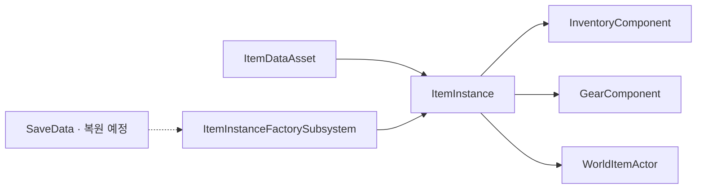

# Item

## 설계 의도



## 정의

기획 정의: [Item](../../02_%EA%B2%8C%EC%9E%84%20%EA%B8%B0%ED%9A%8D/%EA%B0%9D%EC%B2%B4%20%EA%B8%B0%ED%9A%8D/Item.md)

구현 범위: 클래스·Component·데이터·소유권

## 종류

기획 기준: [Item](../../02_%EA%B2%8C%EC%9E%84%20%EA%B8%B0%ED%9A%8D/%EA%B0%9D%EC%B2%B4%20%EA%B8%B0%ED%9A%8D/Item.md)

## Item과 월드 객체

- 인벤토리에 보관되는 탄환: Ammunition Item
- 발사 후 월드에서 이동·충돌하는 탄환: Projectile Actor
- 발사체 정적 설정: Ammunition DataAsset
- 월드에 드롭된 Item 표현: 복수 ItemInstance를 보관하는 `AWorldItemActor`

표현 Actor가 존재한다는 이유만으로 Item의 소유 데이터와 월드 수명주기를 합치지 않음

현재 Drop에서는 `UWorldItemFactorySubsystem`이 `BP_ItemActor` 클래스를 준비하고 플레이어 전방 지면에 배치

Inventory·Gear에서 Instance 제거가 성공한 뒤 Actor를 활성화하며, 내용물이 소진된 Actor는 파괴하는 대신 클래스별 Pool로 반환

이 Factory는 월드 표현의 생성·재사용을 담당할 뿐 ItemInstance의 Runtime ID는 계속 `UItemInstanceFactorySubsystem`이 발급

## Weapon Item 책임

| 계층 | 책임 |
|---|---|
| WeaponDataAsset | 무기 종류, DeliveryType, ShootType, 피해·사거리·반동·탄약 호환성과 비용 같은 정적 정의 |
| AmmunitionDataAsset | 탄종, ProjectileActorClass, 탄속·수명·충돌·Impact 같은 발사체 정적 정의 |
| WeaponInstance | 개별 무기의 등록 탄종·등록 탄수, 마지막 사용 탄종, 강화·부착물과 상속한 장비 내구도 같은 인스턴스 상태 |
| WeaponComponent | 장착·Draw/Holster, 행동 가능 여부, 공격 데이터 계산과 공격 확정 이벤트 |

Equipment의 최대 내구도는 `UEquipmentDataAsset`, 현재 내구도와 파손 판정은 `UEquipmentInstance`가 공통으로 소유

조준·발사·재장전 StateTree와 Gameplay Ability는 Weapon Item의 행동이 아니라 Entity가 Item을 사용하는 행동

## Model과 저장 데이터

설계의 ItemModel은 코드에서 `UItemInstance`로 구현됐다

ItemInstance는 현재 World에서 존재하는 Smart Object다

자기 상태와 자기 상태에 관한 판단은 수행하지만 UI, 다른 Component 검색, 월드 Actor Spawn은 직접 조율하지 않음

- Item DataAsset: 정적 정의
- ItemInstance: 현재 World의 런타임 상태
- Item SaveData: 플레이어가 레벨을 넘어 유지할 직렬화 상태

Runtime Item ID는 World 단위 식별자다

현재 `UItemInstanceFactorySubsystem`이 1부터 순차 발급

레벨 전환 시 Player SaveData에서 새 ItemInstance를 만들고 새 Runtime ID를 발급하며, 세이브에 이전 Runtime ID나 영속 GUID를 유지하지 않음

SaveData 복원 코드는 아직 구현 전

정적 `ItemID`와 런타임 `RuntimeItemId`는 별도 식별자

```text
ItemID
→ CSV 행과 DataAsset을 연결하는 정적 조립 키
→ 예: Equipment.Weapon.BasePistol, Ammunition.Base9mm

RuntimeItemId
→ 현재 World의 ItemInstance 식별자
→ ItemInstanceFactorySubsystem이 순차 발급
```

`ItemID`에는 `DA_`, `BP_` 같은 Unreal Asset 접두어를 넣지 않음

무기 DataAsset은 공통 Item·Equipment CSV와 9개 Weapon CSV의 동일한 `ItemID` 행을 조립해 구성

탄약 DataAsset은 공통 Item CSV와 Ammunition CSV를 조립하고, Projectile 전용 ID·CSV·DataAsset은 사용하지 않음

## 탄약 소유 경계

InventoryComponent가 Ammunition Instance의 Total, Reserved, Available 수량을 관리

장전은 탄약을 WeaponInstance로 옮기지 않고 특정 탄종의 사용 권한과 수량을 등록

WeaponInstance는 특정 Stack을 참조하지 않음

```text
장전: Inventory Reservation 생성 → WeaponInstance에 탄종·등록 수량 기록
발사: Inventory의 Total·Reserved 감소 + WeaponInstance의 등록 수량 감소
버리기·이전: Available 수량만 사용
```

현재 C++은 Inventory Reservation과 WeaponInstance 등록 탄수 연동을 구현했다

PlayerState가 InventoryComponent·GearComponent·ItemTransferComponent를 소유하며, 세부 규칙과 미구현 경계는 [장비와 인벤토리](../%EC%9E%A5%EB%B9%84%EC%99%80%20%EC%9D%B8%EB%B2%A4%ED%86%A0%EB%A6%AC.md)를 기준

## 콘텐츠 구조

```text
Item/
├─ Equipment/
│  ├─ Weapon/
│  ├─ Armor/
│  ├─ Accessory/
│  └─ Bag/
├─ Ammunition/
├─ Ingredient/
├─ QuestItem/
└─ Miscellaneous/
```

---

## 상위 페이지

- [03_시스템 설계](../03_시스템%20설계.md)

## 관련

- [Entity](Entity.md)
- [Prop](Prop.md)
- [게임 객체 분류](../../02_게임%20기획/게임%20객체%20분류.md)
- [무기 시스템](../%EB%AC%B4%EA%B8%B0.md)
- [장비와 인벤토리](../장비와%20인벤토리.md)
- [CSV 기반 DataAsset 구성](../../08_%EA%B8%B0%EC%88%A0%20%EC%9C%84%ED%82%A4_%EA%B3%B5%ED%86%B5%20%EA%B0%80%EC%9D%B4%EB%93%9C/Unreal/Assets/CSV%20%EA%B8%B0%EB%B0%98%20DataAsset%20%EA%B5%AC%EC%84%B1.md)

## 문서 연결

- 기획: [Item](../../02_%EA%B2%8C%EC%9E%84%20%EA%B8%B0%ED%9A%8D/%EA%B0%9D%EC%B2%B4%20%EA%B8%B0%ED%9A%8D/Item.md)
- 시스템 설계: [Item](Item.md)
- 애니메이션 설계: [Item](../../04_%EC%95%84%ED%8A%B8%20%EB%B0%8F%20%EC%95%A0%EB%8B%88%EB%A9%94%EC%9D%B4%EC%85%98/%EC%95%A0%EB%8B%88%EB%A9%94%EC%9D%B4%EC%85%98%20%EC%84%A4%EA%B3%84/Item.md)
