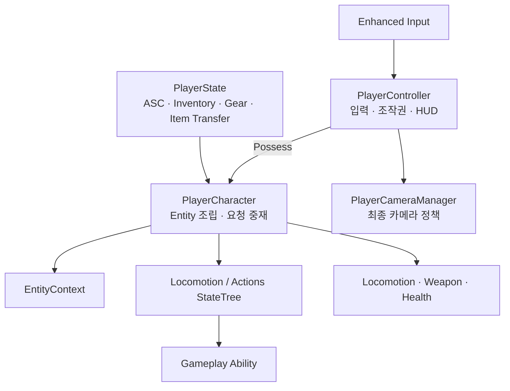
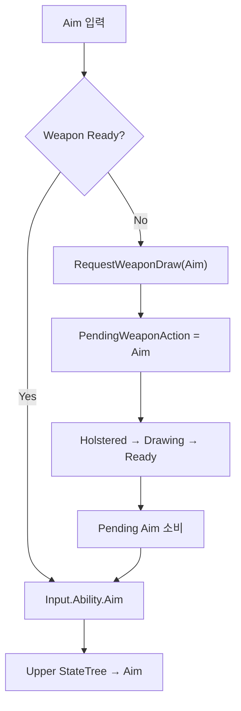

# Player



## 정의

Player는 사용자가 직접 조작하는 Entity다. Humanoid 공통 행동과 Player 전용 입력·카메라·조작권 정책을 분리한다.

## 객체별 책임

| 객체 | 책임 |
|---|---|
| PlayerController | Enhanced Input 처리, Pawn 조작권 변경, PlayerCameraManager와 HUD 소유 |
| PlayerCharacter | Entity Component 조립, 입력 요청 라우팅, Component 이벤트의 중앙 중재 |
| PlayerState | ASC, AttributeSet, InventoryComponent, GearComponent, ItemTransferComponent와 Pawn 교체 후에도 유지할 상태 소유 |
| PlayerCameraManager | 최종 View, Pitch 제한, Aim FOV, 향후 카메라 반동 처리 |
| PlayerHUDComponent | 현재 Pawn의 상태·WeaponComponent를 구독하고 화면에 표시 |

## 입력 라우팅

PlayerCharacter는 입력을 직접 행동 결과로 만들지 않고 현재 상태에 맞는 명령으로 변환한다.



`Event.Weapon.RequestDraw`는 Weapon Carry StateTree에 무기를 꺼내라고 요청하고, `Input.Ability.Aim`은 Upper StateTree에 조준 행동을 요청한다. 두 Tag의 목적을 합치지 않는다.

## 중앙 중재 원칙

PlayerCharacter는 Component의 세부 계산을 대신하지 않는다. WeaponComponent가 확정한 공격 이벤트를 받아 탄약 소유 객체와 공격 실행 객체에 전달하는 명시적 중재자다.

```text
WeaponComponent.OnWeaponAttackCommitted
→ PlayerCharacter.HandleWeaponAttackCommitted
├─ 탄약 소유 객체에 AmmoCost 소비 요청
└─ PhysicalProjectile이면 FProjectileLaunchRequest 구성
   └─ World의 ProjectileFactorySubsystem에 실행 요청

WeaponComponent.OnWeaponTraceResolved
→ PlayerCharacter.HandleWeaponTraceResolved
└─ Hitscan/Beam Trace 결과의 대상에 피해 적용

WeaponComponent.OnBeamEffectRequested
→ PlayerCharacter.HandleBeamEffectRequested
└─ World의 CombatEffectSubsystem에 Beam 표현 요청 전달
```

PhysicalProjectile은 `ProjectileFactorySubsystem`이 ProjectileDataAsset의 Actor Class별 Pool에서 `ProjectileActor`를 획득·활성화하고, 명중 또는 수명 종료 시 회수한다. Hitscan과 Beam은 별도 ExecutorComponent를 만들지 않는다. 공격 방식이 크게 늘기 전까지 별도의 숨겨진 Router나 Registry를 만들지 않는다.

## 장비·Inventory 수명

PlayerCharacter는 장비와 Inventory의 소유자가 아니다. `AAstraPlayerState`가 세 Component를 생성하고 `BeginPlay`에서 Transfer 경계를 연결한다.

```text
AAstraPlayerState
├─ InventoryComponent
├─ GearComponent
└─ ItemTransferComponent
   └─ InventoryComponent + GearComponent 참조

PlayerCharacter
├─ GearComponent.OnActiveWeaponChanged 구독
└─ 활성 WeaponInstance를 WeaponComponent에 Bind
```

Possess, `OnRep_PlayerState`, `PawnClientRestart` 때 PlayerCharacter가 PlayerState의 Inventory와 Gear를 다시 연결한다. UnPossess 때는 Gear 이벤트 구독과 WeaponComponent의 Instance 바인딩만 해제하며, PlayerState가 소유한 Item 상태는 유지한다.

## Player 전용 경계

- 물리 입력과 Input Mapping Context
- PlayerCameraManager 기반 Aim FOV와 카메라 반동
- HUD와 로컬 표시 정책
- Possess와 Soul-Link 조작권 전환

AI 인간형이 같은 Ability를 받아 정상적으로 사용할 수 있다면 Humanoid 공용 행동이다. 플레이어 입력이나 카메라가 반드시 필요하면 Player 전용으로 유지한다.

---

## 상위 페이지

- [Entity](Entity.md)

## 관련

- [시스템 아키텍처](../시스템%20아키텍처.md)
- [무기 시스템](../무기%20시스템.md)
- [PlayerCameraManager 참조 구성](../../08_기술%20위키_공통%20가이드/Unreal/Gameplay%20Framework/PlayerCameraManager%20참조%20구성.md)
