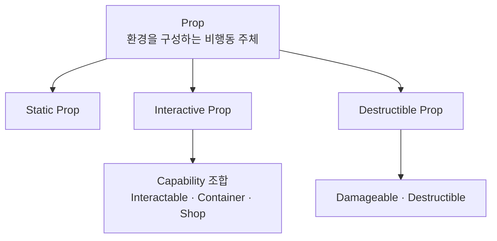

# Prop

## 정의

Prop은 월드 환경을 구성하지만 독립적인 행동 주체는 아닌 객체다. 입력이나 사건에 정해진 반응을 수행할 수 있지만 상황을 해석하여 자신의 행동을 선택하지 않는다.

## 하위 유형

| 유형 | 정의 | 예시 |
|---|---|---|
| Static Prop | 게임플레이 상태 변화가 없는 환경 객체 | 장식물, 고정 구조물 |
| Interactive Prop | 정해진 상호작용 요청에 반응 | 문, 레버, 단순 자판기, 보관 상자 |
| Destructible Prop | 피해에 따라 파괴 상태로 전환 | 파괴 가능한 상자, 장애물 |

하나의 Prop은 Interactive와 Destructible 특성을 동시에 가질 수 있다. 하위 유형이 배타적이어야 한다고 가정하지 않는다.

## Entity와의 경계

| 질문 | Entity | Prop |
|---|---|---|
| 고유한 지속 상태가 있는가 | 있음 | 없거나 단순 반응 상태만 있음 |
| 상황이나 명령을 해석하는가 | 해석하여 행동 선택 | 정해진 반응 수행 |
| 독립 행동 체계가 있는가 | StateTree, AI, 생산·전투 정책 등 | 없음 |
| 대표 사례 | 터렛, 자동 생산 시설 | 문, 레버, 단순 보관함 |

피해 가능, 상호작용 가능, 상점 기능 보유만으로 Entity가 되지는 않는다. 재고·가격·생산·전투·AI 같은 독립 상태와 행동을 소유하면 Structure Entity로 승격한다.

## Item과의 경계

획득 후 소유·보관·이전되는 데이터는 Item이다. 월드에 놓인 획득 대상은 Item 자체가 아니라 Item을 참조하는 Pickup Actor 또는 Interactive Prop으로 표현할 수 있다.

## 구현 원칙

- 단순 Prop에 EntityContext, StateTree와 ASC를 일괄 부여하지 않는다.
- 필요한 Capability만 Component 또는 인터페이스로 조합한다.
- 상호작용 결과는 자신의 제한된 상태만 변경하고 다른 시스템 정책을 직접 소유하지 않는다.
- 복잡성이 증가해 독립 행동 주체가 되면 이름만 유지하지 말고 Structure Entity로 재분류한다.

---

## 상위 페이지

- [03_시스템 설계](../03_시스템%20설계.md)

## 관련

- [Entity](Entity.md)
- [Item](Item.md)
- [게임 객체 분류](../../02_게임%20기획/게임%20객체%20분류.md)

