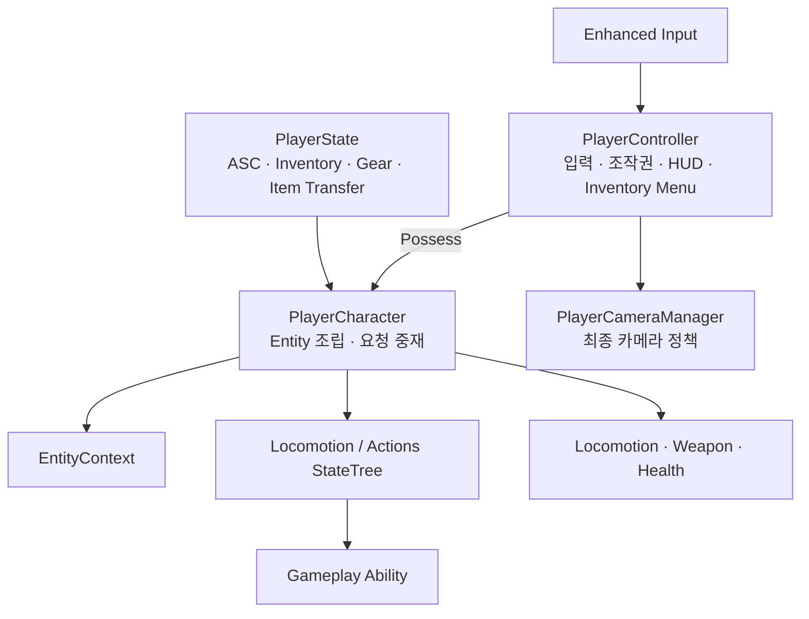
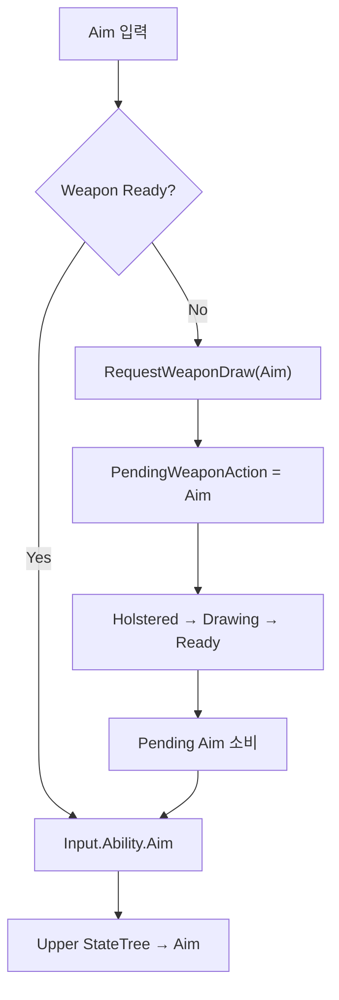

# 플레이어

## 설계 의도



## 정의

기획 정의: [플레이어](../../02_%EA%B2%8C%EC%9E%84%20%EA%B8%B0%ED%9A%8D/%EA%B0%9D%EC%B2%B4%20%EA%B8%B0%ED%9A%8D/%ED%94%8C%EB%A0%88%EC%9D%B4%EC%96%B4.md)

구현 범위: 입력·조작권·Component 조립·카메라·HUD

## 객체별 책임

| 객체 | 책임 |
|---|---|
| PlayerController | Enhanced Input 처리, Pawn 조작권 변경, PlayerCameraManager·HUD·InventoryMenuComponent 소유 |
| PlayerCharacter | Entity Component 조립, 입력 요청 라우팅, Component 이벤트의 중앙 중재 |
| PlayerState | ASC, AttributeSet, InventoryComponent, GearComponent, ItemTransferComponent와 Pawn 교체 후에도 유지할 상태 소유 |
| PlayerCameraManager | 최종 View, Pitch 제한, Aim FOV, 향후 카메라 반동 처리 |
| PlayerHUDComponent | 현재 Pawn의 상태·WeaponComponent를 구독하고 화면에 표시 |
| InventoryMenuComponent | PlayerState의 Inventory·Gear·ItemTransfer를 조회하고 메뉴 Widget·입력 모드·행동 요청을 중계 |

## 입력 라우팅

PlayerCharacter는 입력을 직접 행동 결과로 만들지 않고 현재 상태에 맞는 명령으로 변환



`Event.Weapon.RequestDraw`는 Weapon Carry StateTree에 무기를 꺼내라고 요청하고, `Input.Ability.Aim`은 Upper StateTree에 조준 행동을 요청

두 Tag의 목적을 합치지 않음

## 중앙 중재 원칙

PlayerCharacter는 Component의 세부 계산을 대신하지 않음

WeaponComponent가 확정한 공격 이벤트를 받아 탄약 소유 객체와 공격 실행 객체에 전달하는 명시적 중재자다

```text
WeaponComponent.OnWeaponAttackCommitted
→ PlayerCharacter.HandleWeaponAttackCommitted
├─ 탄약 소유 객체에 AmmoCost 소비 요청
└─ PhysicalProjectile이면 FProjectileLaunchRequest 구성
   └─ World의 ProjectileFactorySubsystem에 실행 요청

WeaponComponent.OnWeaponTraceResolved
→ PlayerCharacter.HandleWeaponTraceResolved
└─ Hitscan/Beam Trace 결과의 대상에 피해 적용

WeaponComponent.OnBeamEffectRequested
→ PlayerCharacter.HandleBeamEffectRequested
└─ World의 CombatEffectSubsystem에 Beam 표현 요청 전달
```

PhysicalProjectile은 `ProjectileFactorySubsystem`이 AmmunitionDataAsset의 Actor Class별 Pool에서 `ProjectileActor`를 획득·활성화하고, 명중 또는 수명 종료 시 회수

Hitscan과 Beam은 별도 ExecutorComponent를 만들지 않음

공격 방식이 크게 늘기 전까지 별도의 숨겨진 Router나 Registry를 만들지 않음

## 장비·Inventory 수명

PlayerCharacter는 장비와 Inventory의 소유자가 아니다

`AAstraPlayerState`가 세 Component를 생성하고 `BeginPlay`에서 Transfer 경계를 연결

```text
AAstraPlayerState
├─ InventoryComponent
├─ GearComponent
└─ ItemTransferComponent
   └─ InventoryComponent + GearComponent 참조

PlayerCharacter
├─ GearComponent.OnActiveWeaponChanged 구독
└─ 활성 WeaponInstance를 WeaponComponent에 Bind
```

Possess, `OnRep_PlayerState`, `PawnClientRestart` 때 PlayerCharacter가 PlayerState의 Inventory와 Gear를 다시 연결

UnPossess 때는 Gear 이벤트 구독과 WeaponComponent의 Instance 바인딩만 해제하며, PlayerState가 소유한 Item 상태는 유지

Inventory UI는 Pawn이 아니라 PlayerController에 둠

`IA_ToggleInventory`는 PlayerController의 Enhanced Input으로 메뉴를 열고 닫으며, 슬롯의 좌·우클릭은 UMG 이벤트로 처리

`UInventoryMenuComponent`는 현재 PlayerState의 Component를 다시 조회하므로 Pawn이 교체되어도 UI가 ItemInstance를 직접 소유하지 않음

## Player 전용 경계

- 물리 입력과 Input Mapping Context
- PlayerCameraManager 기반 Aim FOV와 카메라 반동
- HUD와 로컬 표시 정책
- Possess와 영혼 결속 조작권 전환

## 카메라

| 객체 | 책임 |
|---|---|
| CameraBoom / SpringArm | 거리·충돌·Lag |
| FollowCamera / CameraComponent | 카메라·FOV |
| PlayerCameraManager | 최종 View·Pitch 제한·Modifier·Shake |

- ViewPitchMin: -70°
- ViewPitchMax: 70°
- 커스텀 PlayerCameraManager 클래스 기본값에 설정
- 비무장·권총 상태의 Pitch 제한 확인 완료
- Aim FOV 시작·종료: GA_WeaponAim → UAstraWeaponGameplayAbilityBase → EntityContext.PlayerCameraManager
- FOV 보간: AAstraPlayerCameraManager::UpdateCamera
- 참조 등록·해제: [PlayerCameraManager 참조 구성](../../08_기술%20위키_공통%20가이드/Unreal/Gameplay%20Framework/PlayerCameraManager%20참조%20구성.md)

AI 인간형이 같은 Ability를 받아 정상적으로 사용할 수 있다면 Humanoid 공용 행동

플레이어 입력이나 카메라가 반드시 필요하면 Player 전용으로 유지

---

## 상위 페이지

- [Entity](Entity.md)

## 관련

- [시스템 아키텍처](../%EC%8B%9C%EC%8A%A4%ED%85%9C%20%EC%95%84%ED%82%A4%ED%85%8D%EC%B2%98.md)
- [무기 시스템](../%EB%AC%B4%EA%B8%B0.md)
- [PlayerCameraManager 참조 구성](../../08_%EA%B8%B0%EC%88%A0%20%EC%9C%84%ED%82%A4_%EA%B3%B5%ED%86%B5%20%EA%B0%80%EC%9D%B4%EB%93%9C/Unreal/Gameplay%20Framework/PlayerCameraManager%20%EC%B0%B8%EC%A1%B0%20%EA%B5%AC%EC%84%B1.md)

## 이동

- [이동과 파쿠르](../%EC%9D%B4%EB%8F%99%EA%B3%BC%20%ED%8C%8C%EC%BF%A0%EB%A5%B4.md)

## 파쿠르

- [이동과 파쿠르](../%EC%9D%B4%EB%8F%99%EA%B3%BC%20%ED%8C%8C%EC%BF%A0%EB%A5%B4.md)

## 공격

- [무기](../%EB%AC%B4%EA%B8%B0.md)

## 조준

- [무기 조준·반동·명중률](../%EB%AC%B4%EA%B8%B0%20%EC%A1%B0%EC%A4%80%C2%B7%EB%B0%98%EB%8F%99%C2%B7%EB%AA%85%EC%A4%91%EB%A5%A0.md)

## 재장전

- [StateTree와 GAS — Reload](../StateTree%EC%99%80%20GAS.md)
- [장비와 인벤토리](../%EC%9E%A5%EB%B9%84%EC%99%80%20%EC%9D%B8%EB%B2%A4%ED%86%A0%EB%A6%AC.md)

## 장비·보관

- [장비와 인벤토리](../%EC%9E%A5%EB%B9%84%EC%99%80%20%EC%9D%B8%EB%B2%A4%ED%86%A0%EB%A6%AC.md)

## 영혼 결속

- [영혼 결속](../%EC%98%81%ED%98%BC%20%EA%B2%B0%EC%86%8D.md)

## 상호작용

- [현재 WorldItem 획득 경로](../%EC%9E%A5%EB%B9%84%EC%99%80%20%EC%9D%B8%EB%B2%A4%ED%86%A0%EB%A6%AC.md)
- 통합 상호작용 구현:

## 생존

- [생존 시스템](../%EC%83%9D%EC%A1%B4%20%EC%8B%9C%EC%8A%A4%ED%85%9C.md)

## 문서 연결

- 기획: [플레이어](../../02_%EA%B2%8C%EC%9E%84%20%EA%B8%B0%ED%9A%8D/%EA%B0%9D%EC%B2%B4%20%EA%B8%B0%ED%9A%8D/%ED%94%8C%EB%A0%88%EC%9D%B4%EC%96%B4.md)
- 시스템 설계: [플레이어](%ED%94%8C%EB%A0%88%EC%9D%B4%EC%96%B4.md)
- 애니메이션 설계: [플레이어](../../04_%EC%95%84%ED%8A%B8%20%EB%B0%8F%20%EC%95%A0%EB%8B%88%EB%A9%94%EC%9D%B4%EC%85%98/%EC%95%A0%EB%8B%88%EB%A9%94%EC%9D%B4%EC%85%98%20%EC%84%A4%EA%B3%84/%ED%94%8C%EB%A0%88%EC%9D%B4%EC%96%B4.md)
