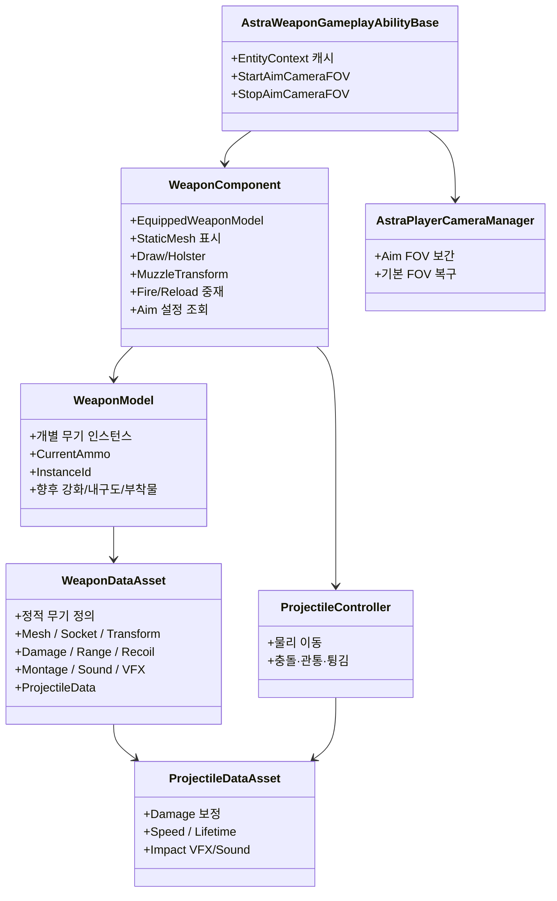
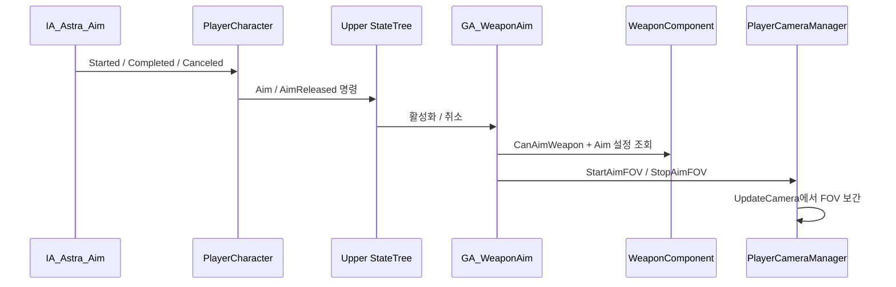

# 무기 시스템

## 1. 첫 기준 무기

현재 전투 시스템의 첫 기준 무기는 권총입니다.

- DataAsset: `Content/Astra/Weapons/Pistol/001_BasePistol/DA_001_BasePistol.uasset`
- Static Mesh: `Content/Astra/Weapons/Pistol/001_BasePistol/tesseract_revolver/StaticMeshes/STM_BasePistol.uasset`
- 발사 Ability: `Content/Astra/Player/GameplayAbilitySystem/GA_WeaponFire.uasset`
- 재장전 Ability: `Content/Astra/Player/GameplayAbilitySystem/GA_WeaponReload.uasset`
- 조준 Ability: `Content/Astra/Player/GameplayAbilitySystem/GA_WeaponAim.uasset`
- C++ 공통 기반: `Source/Astra_SoulLink/Ability/AstraWeaponGameplayAbilityBase`

## 2. 데이터 구조



### WeaponDataAsset

무기 하나의 정적 정의입니다. 권총이라는 분류가 같아도 개별 권총 종류마다 별도 DataAsset을 가질 수 있습니다.

주요 데이터:

- WeaponID / WeaponName / WeaponType
- Static Mesh와 장착·홀스터 보정 Transform
- 손 소켓, 홀스터 소켓, Muzzle 소켓
- 공격 종류, 피해, 치명타, 발사 간격
- 유효 사거리와 사거리 밖 피해 배율
- ProjectileDataAsset
- 탄창 크기와 재장전 시간
- 반동
- NPC 명중률 보정
- Equip/Holster/Fire/Reload/DryFire Montage
- Sound와 VFX

### WeaponModel

개별 무기 인스턴스의 동적 데이터를 소유합니다.

- 현재 탄창
- 인스턴스 식별자
- 향후 강화, 내구도, 부착물

무기를 교체하거나 인벤토리에 넣어도 해당 WeaponModel의 탄약은 유지됩니다. 인벤토리 구현 전에는 WeaponComponent가 WeaponModel 배열을 수명 관리합니다.

### WeaponComponent

현재 장착 무기와 화면 표현을 중재합니다.

- WeaponModel 생성·장착·해제
- Static Mesh 표시
- 손/홀스터 부착
- Draw/Holster Montage와 Notify 처리
- 자동 Holster Timer
- 발사 가능 여부
- 탄약 소비·재장전
- Muzzle Transform과 발사 방향 계산
- Projectile Spawn
- 반동 요청 이벤트
- `AimInputMode`, `AimFOV`, `AimFOVInterpSpeed` 조회

### Weapon Gameplay Ability Base

`UAstraWeaponGameplayAbilityBase`는 `InstancedPerActor` 정책을 사용합니다. `OnAvatarSet`에서 현재 Avatar가 제공하는 `EntityContext`를 캐시하고, 구체 PlayerController를 직접 조회하지 않고 카메라 기능을 요청합니다.

- `StartAimCameraFOV(AimFOV, InterpSpeed)`
- `StopAimCameraFOV()`
- `OnRemoveAbility`에서 Context 캐시 제거

Ability의 `OnAvatarSet` 호출 주체와 Possess 생명주기는 [[PlayerCameraManager 참조 구성]]에 기록합니다.

## 3. 무기 종류

현재 분류 계획:

- Pistol
- AR
- SR
- Grenade Launcher
- SG
- SMG
- LMG
- Laser Gun
- Club
- Blade

이 분류는 장비 UI, Anim Layer 선택, 세트 효과 조건 등에 사용합니다. 공격 방식인 `EAttackKind`와 장비 분류인 `EWeaponType`은 별개로 유지합니다.

## 4. 소켓

### 캐릭터 Skeleton

- `WeaponSocket_R`: 오른손 장착
- `PistolHolsterSocket`: 권총 수납

### 무기 Static Mesh

- `Muzzle`: Projectile과 Muzzle VFX 시작점
- `LeftHandGrip`: 권총 왼손 FABRIK 목표 — 생성·연결 완료, 미세 이격과 비틀림 보정 대기
- `ShellEject`: 탄피 기능 구현 시 추가
- `AimPoint`: 정밀 정렬이 필요할 때 추가

무기 모델의 원점·회전·크기가 달라도 Skeleton 소켓을 무기마다 수정하지 않습니다. WeaponDataAsset의 `EquippedMeshTransform`, `HolsteredMeshTransform`으로 보정합니다.

## 5. Draw와 Holster

### 상태

```text
Holstered → Drawing → Ready → Holstering → Holstered
```

### Montage Notify

- Draw: `Weapon_AttachToHand`
- Holster: `Weapon_AttachToHolster`

Notify가 실행되면 WeaponComponent가 부착 소켓을 바꿉니다. Notify가 누락되더라도 Montage 정상 종료 시 fallback으로 최종 소켓에 붙입니다. fallback 경고가 출력되면 Notify 이름, Notify 종류, 시간 위치, Slot, Montage 재생 구간을 확인합니다.

### 자동 수납

- 기본 지연: 5초
- Ready에서 무기 관련 입력이 없을 때 Holstering 요청
- Fire, Aim, Reload, 무기 전환 시 Timer 재시작
- Tick 누적이 아니라 TimerManager 사용

## 6. 발사 방향

카메라와 Muzzle의 위치 차이를 보정하기 위해 2단계로 계산합니다.

1. 카메라 위치에서 View 방향으로 Ray를 쏴 `AimTarget`을 구합니다.
2. Muzzle 위치에서 `AimTarget`을 향하는 방향으로 Projectile을 Spawn합니다.

```text
CameraStart + CameraForward × TraceDistance → AimTarget
ShotDirection = Normalize(AimTarget - MuzzleLocation)
SpawnRotation = MakeRotFromX(ShotDirection)
```

카메라 Ray는 소유 Character와 WeaponComponent를 무시해야 합니다. 총알이 뒤로 나가거나 Socket 회전을 바꿔도 동일하면 Muzzle 축이 아니라 `AimTarget - MuzzleLocation`의 순서와 Projectile의 전방 축을 확인합니다.

## 7. 조준과 카메라 FOV

정적 조준 설정은 `WeaponDataAsset`이 소유합니다.

- `AimInputMode`: Hold 또는 Toggle
- `AimFOV`: 조준 중 목표 FOV
- `AimFOVInterpSpeed`: 진입·복귀 보간 속도



- `PlayerCharacter::RequestWeaponAimStarted`는 장착 상태와 Hold/Toggle 입력을 처리하고 필요하면 Pending Aim을 저장합니다.
- `STC_CanAim`은 전이 사전 조건을 검사합니다.
- `STT_WeaponAim`은 `Ability.Weapon.Aim`을 활성화하거나 취소합니다.
- `GA_WeaponAim`은 `CanAimWeapon`과 `CommitAbility`를 다시 검사한 뒤 활성 상태를 유지합니다.
- `AAstraPlayerCameraManager`가 실제 FOV 보간과 기본 FOV 복귀를 담당합니다.
- `PlayerCharacter`는 FOV를 직접 계산하지 않습니다.

## 8. 탄약·발사 방식

### 현재

- 탄창: WeaponModel 소유
- 예비 탄약: 인벤토리 구현 전까지 무한
- 기본 발사: Physical Projectile
- 치명타: 발사 시 해당 탄환의 치명타 여부를 한 번 결정
- 단발 발사: Fire Montage의 `Weapon_FireCommit` Notify에서 탄약 소비와 Projectile Spawn 확정
- 재장전: Reload Montage의 `Weapon_ReloadCommit` Notify에서 탄창을 채움
- 재장전 취소: Sprint·Holster 등 중단 시 `CancelReloadWeapon`으로 Montage와 상태 정리

빈 탄창에서 공격하면 `ShouldReloadOnFireRequest()`가 Fire 요청을 Reload 요청으로 바꿉니다. Ready가 아니면 `PendingWeaponAction::Reload`로 저장해 Draw 완료 뒤 실행합니다. 코드 경로는 반영되었고 PIE 회귀 검증이 남아 있습니다.

### 계획

- Single Shot
- Rapid Fire
- Burst
- Charged Shot
- Hitscan / 지속 Laser
- Grenade Projectile
- 관통 탄환
- 튕기는 탄환

Charged Shot 규칙:

- 최소 0.2초 이상 누르면 충전 시작
- 충전 중 일정 간격으로 탄약 소비
- 최대 충전 시간 또는 탄약 0에서 추가 충전 정지
- 버튼 해제 시 발사
- 최소 시간 전에 해제하면 발사하지 않음
- 외부 취소 시 사용한 탄약은 반환하지 않고 발사하지 않음

## 9. 유효 사거리와 명중

### 플레이어

- 랜덤 명중률을 사용하지 않습니다.
- 반동과 유효 사거리로 제약합니다.
- 유효 사거리 밖에서는 현재 `OutOfRangeDamageMultiplier = 0.2`, 즉 피해가 80% 감소합니다.
- Laser를 제외한 모든 무기는 반동을 가집니다.
- 이동 속도에 비례해 반동 배율을 올리며 HUD에 확산 정보를 반영할 예정입니다.

### NPC

- NPC 성향과 기본 명중률을 사용합니다.
- NPC 이동과 대상 이동에 패널티를 적용합니다.
- 조준 유지 시간에 따른 정확도 상승 규칙은 사용하지 않습니다.
- 100% 명중률을 기본값으로 두지 않습니다.

## 10. 사운드와 피격 효과

- ProjectileDataAsset이 충돌 VFX와 Sound 참조를 가집니다.
- 표면 재질별 효과는 에셋 확보 전까지 보류합니다.
- 연사 사운드는 Sound Concurrency를 사용해 동일 계열 음원의 동시 재생 수와 볼륨 누적을 제한합니다.

---

## 상위 페이지

- [[03_시스템 설계]]

## 관련

- [[StateTree와 GAS]]
- [[시스템 아키텍처]]
- [[애니메이션과 조준]]
- [[PlayerCameraManager 참조 구성]]
- [[NPC 전투 성향]]
