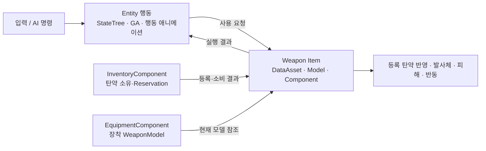
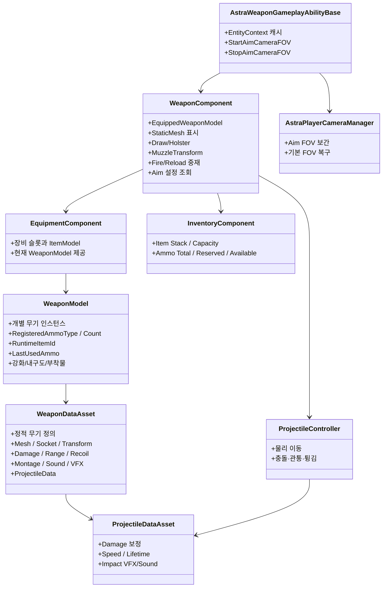
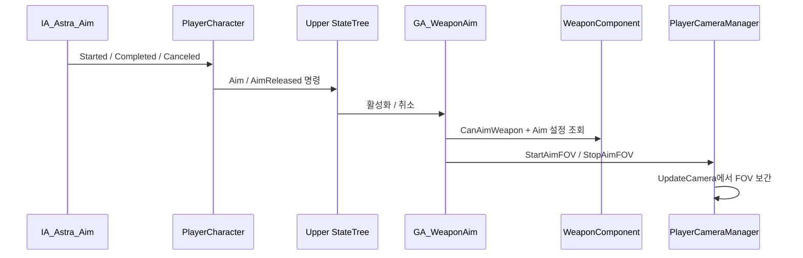

# 무기 시스템

## 1. 첫 기준 무기

현재 전투 시스템의 첫 기준 무기는 권총입니다.

- DataAsset: `Content/Astra/Weapons/Pistol/001_BasePistol/DA_001_BasePistol.uasset`
- Static Mesh: `Content/Astra/Weapons/Pistol/001_BasePistol/tesseract_revolver/StaticMeshes/STM_BasePistol.uasset`
- 발사 Ability: `Content/Astra/Player/GameplayAbilitySystem/GA_WeaponFire.uasset`
- 재장전 Ability: `Content/Astra/Player/GameplayAbilitySystem/GA_WeaponReload.uasset`
- 조준 Ability: `Content/Astra/Player/GameplayAbilitySystem/GA_WeaponAim.uasset`
- C++ 공통 기반: `Source/Astra_SoulLink/Ability/AstraWeaponGameplayAbilityBase`

`GA_WeaponFire`, `GA_WeaponReload`, `GA_WeaponAim`은 이름과 현재 저장 경로와 무관하게 **Entity가 Weapon Item을 사용하는 행동**입니다. 무기 자체의 데이터와 런타임 상태는 Weapon Item 영역이 소유합니다. 분류 기준은 [[게임 객체 분류]]를 따릅니다.

## 2. 책임 경계



| Entity가 소유 | Weapon Item이 소유 |
|---|---|
| 행동 가능 여부와 명령 해석 | 무기 종류와 정적 정의 |
| 조준·발사·재장전 행동 | 등록 탄약·발사 간격·발사 방식 |
| Upper StateTree와 GA 수명 | 피해·사거리·탄속·반동·탄 퍼짐 |
| 행동 충돌 정책과 애니메이션 | Muzzle·Projectile·과열·고장·내구도 |

재장전에서 Entity는 Reload 상태, 애니메이션, 이동·다른 행동 제한을 담당합니다. 목표 구조에서는 InventoryComponent가 Ammunition Item과 Reservation을 소유하고, WeaponModel은 등록 탄종·등록 탄수와 마지막 사용 탄종을 보관하며, WeaponComponent가 두 시스템 사이의 등록·소비 요청을 조율합니다.

### WeaponComponent 의존성 원칙

WeaponComponent는 무기를 사용하는 객체가 `AActor`, `APawn`, `ACharacter`, `APlayerCharacter` 중 무엇인지 알지 않습니다. `OwnerCharacter`, Controller, CharacterMovement, PlayerCharacter, ProjectileFactory 의존성과 `GetOwner()` 기반 게임 로직을 제거하는 방향을 사용합니다.

무기 부착과 Montage 실행에 필요한 `USkeletalMeshComponent`는 명시적으로 주입받습니다. 이는 Player 참조가 아니라 Socket 부착, Montage 재생과 AnimNotify Mesh 확인을 위한 실행 의존성입니다.

WeaponComponent는 공격 조건과 데이터가 확정되면 Projectile 전용 이벤트가 아닌 공통 이벤트를 전달합니다.

```text
공격 가능 여부·조준·탄약 확인
→ 피해량·탄약 소비량 계산
→ Muzzle과 ShotDirection 확정
→ FWeaponAttackCommitData 생성
→ OnWeaponAttackCommitted
```

현재 구현의 주요 데이터는 `AttackInstanceId`, `DeliveryType`, `WeaponData`, `MuzzleTransform`, `AimTargetLocation`, `ShotDirection`, `AttackSpec`, `bConsumesAmmo`, `AmmoCost`와 Beam Effect 명령입니다. `AttackInstanceId`는 지속 공격과 Effect의 수명을 식별합니다. 향후 개별 Tick의 중복 소비 방지가 별도로 필요하면 `RequestId`를 추가합니다.

## 3. 데이터 구조



### WeaponDataAsset

무기 하나의 정적 정의입니다. 권총이라는 분류가 같아도 개별 권총 종류마다 별도 DataAsset을 가질 수 있습니다.

주요 데이터:

- WeaponID / WeaponName / WeaponType
- Static Mesh와 장착·홀스터 보정 Transform
- 손 소켓, 홀스터 소켓, Muzzle 소켓
- 공격 종류, 피해, 치명타, 발사 간격
- 유효 사거리와 사거리 밖 피해 배율
- ProjectileDataAsset
- 탄창 크기와 재장전 시간
- Pitch/Yaw 반동 범위, 최대 누적 반동과 회복 시간
- 기본·조준·이동 명중률, 내구도 배율과 최대 확산각
- 최대 내구도
- NPC 명중률 보정
- Equip/Holster/Fire/Reload/DryFire Montage
- Sound와 VFX

### WeaponModel

개별 무기 인스턴스의 동적 데이터와 자기 상태에 관한 판단을 소유합니다.

- 등록 탄종과 등록 탄수
- 마지막 사용 탄종
- 레벨 단위 Runtime Item ID
- 현재 내구도
- 향후 강화와 부착물

현재 C++에서는 WeaponComponent가 WeaponModel을 생성·보관하고 현재 탄약을 직접 관리합니다. 이는 Inventory 구현 전 임시 구조입니다. 목표 구조에서는 EquipmentComponent가 장착 WeaponModel을 관리하고 WeaponComponent가 현재 모델을 참조합니다. 실제 Ammunition Item은 Inventory에 남으며 WeaponModel에는 사용 권한만 등록됩니다.

### WeaponComponent

현재 장착 무기의 실행과 화면 표현을 중재합니다.

- EquipmentComponent에서 현재 WeaponModel 참조
- Static Mesh 표시
- 손/홀스터 부착
- Draw 정렬 대기, 선택적 Draw Montage, Holster Montage와 Notify 처리
- 자동 Holster Timer
- 발사 가능 여부
- InventoryComponent에 탄약 Reservation·소비 요청
- Muzzle Transform과 발사 방향 계산
- 공격 확정 데이터와 Effect 요청 생성
- 절대 누적 반동 변경 이벤트
- 현재 명중률과 확산 각도·반경 계산
- `AimInputMode`, `AimFOV`, `AimFOVInterpSpeed` 조회

목표 책임과 Inventory 상세 규칙은 [[장비와 인벤토리]]를 참고합니다.

### Weapon Gameplay Ability Base

`UAstraWeaponGameplayAbilityBase`는 `InstancedPerActor` 정책을 사용합니다. `OnAvatarSet`에서 현재 Avatar가 제공하는 `EntityContext`를 캐시하고, 구체 PlayerController를 직접 조회하지 않고 카메라 기능을 요청합니다.

- `StartAimCameraFOV(AimFOV, InterpSpeed)`
- `StopAimCameraFOV()`
- `OnRemoveAbility`에서 Context 캐시 제거

Ability의 `OnAvatarSet` 호출 주체와 Possess 생명주기는 [[PlayerCameraManager 참조 구성]]에 기록합니다.

## 4. 무기 종류

현재 분류 계획:

- Pistol
- AR
- SR
- Grenade Launcher
- SG
- SMG
- LMG
- Laser Gun
- Club
- Blade

이 분류는 장비 UI, Anim Layer 선택, 세트 효과 조건 등에 사용합니다. 공격 방식인 `EAttackKind`와 장비 분류인 `EWeaponType`은 별개로 유지합니다.

### 공격 전달 방식과 발사 방식

공격이 목표에 도달하는 방식과 입력을 시간에 따라 공격으로 변환하는 방식을 분리합니다.

| 축 | 값 |
|---|---|
| `EAttackDeliveryType` | PhysicalProjectile, Hitscan, Beam |
| `EShootType` | SingleShot, RapidFire, ThreeShot, ChargedShot, Continuous |

두 값은 독립적으로 조합합니다. Beam이 항상 지속형인 것은 아니며 `Beam + SingleShot`, `Hitscan + Continuous`도 표현할 수 있습니다. 기존 DataAsset 직렬화 순서를 보호하기 위해 `Continuous`는 Enum 마지막에 추가합니다.

실행 책임:

- PhysicalProjectile: `UProjectileFactorySubsystem`과 Object Pool을 통한 Projectile Actor 실행
- Hitscan: `UHitscanExecutorComponent`의 즉시 Trace와 피해 처리
- Beam: `UBeamExecutorComponent`의 Trace, 피해 주기와 Niagara 표현

일반 Hitscan과 Beam에는 Actor를 생성하지 않습니다. 독립 이동·파괴·충돌·복제 수명주기가 필요한 Beam만 Actor 후보입니다.

## 5. 소켓

### 캐릭터 Skeleton

- `WeaponSocket_R`: 오른손 장착
- `PistolHolsterSocket`: 권총 수납

### 무기 Static Mesh

- `Muzzle`: Projectile과 Muzzle VFX 시작점
- `LeftHandGrip`: 총열 Control Rig 적용 후 왼손 최종 보정 목표로 사용 예정
- `ShellEject`: 탄피 기능 구현 시 추가
- `AimPoint`: 정밀 정렬이 필요할 때 추가

무기 모델의 원점·회전·크기가 달라도 Skeleton 소켓을 무기마다 수정하지 않습니다. WeaponDataAsset의 `EquippedMeshTransform`, `HolsteredMeshTransform`으로 보정합니다.

## 6. Draw와 Holster

### 상태

```text
Holstered → Drawing → Ready → Holstering → Holstered
```

`Drawing`은 Montage 재생 상태가 아니라 전투 방향 정렬과 무기 준비가 완료될 때까지의 전이 상태입니다. Fire/Aim/Reload 요청은 Pending Action으로 저장하고, 몸이 Control Rotation 방향에 정렬된 뒤에만 손 부착과 Ready 전이를 완료합니다.

현재 C++은 `bWaitingForDrawAlignment`, `IsWaitingForDrawAlignment`, `NotifyWeaponDrawAlignmentCompleted`를 제공합니다. Player Blueprint가 Actor Yaw와 Control Rotation Yaw의 차이를 검사하며 기본 허용값은 `5°`입니다. Blueprint 연결과 PIE 검증이 남아 있습니다.

### Montage Notify

- Draw: `Weapon_AttachToHand`
- Holster: `Weapon_AttachToHolster`

Draw Montage는 선택 사항입니다. 정렬 완료 후 Montage가 없으면 즉시 손에 부착하고, Montage가 있으면 기존 Notify/종료 경로를 사용합니다. Holster Montage Notify가 실행되면 수납 소켓으로 변경하며, Notify 누락 시 정상 종료 fallback을 유지합니다.

### 자동 수납

- 기본 지연: 5초
- Ready에서 무기 관련 입력이 없을 때 Holstering 요청
- Fire, Aim, Reload, 무기 전환 시 Timer 재시작
- Tick 누적이 아니라 TimerManager 사용

## 7. 발사 방향

카메라와 Muzzle의 위치 차이를 보정하기 위해 2단계로 계산합니다.

1. 카메라 위치에서 View 방향으로 Ray를 쏴 `AimTarget`을 구합니다.
2. Muzzle 위치에서 `AimTarget`을 향하는 방향으로 Projectile을 Spawn합니다.

```text
CameraStart + CameraForward × TraceDistance → AimTarget
ShotDirection = Normalize(AimTarget - MuzzleLocation)
SpawnRotation = MakeRotFromX(ShotDirection)
```

카메라 Ray는 소유 Character와 WeaponComponent를 무시해야 합니다. 총알이 뒤로 나가거나 Socket 회전을 바꿔도 동일하면 Muzzle 축이 아니라 `AimTarget - MuzzleLocation`의 순서와 Projectile의 전방 축을 확인합니다.

논리적 발사 방향과 애니메이션상의 총열 정렬은 분리합니다. 유효 사거리 안에 Blocking Hit가 있을 때만 시각 총열 보정을 적용하고, Hit가 없으면 탄환은 TraceEnd 방향으로 발사하되 팔과 총은 억지로 정렬하지 않습니다. 측정값과 Control Rig 정책은 [[무기 조준·반동·명중률]]을 참고합니다.

## 8. 조준과 카메라 FOV

정적 조준 설정은 `WeaponDataAsset`이 소유합니다.

- `AimInputMode`: Hold 또는 Toggle
- `AimFOV`: 조준 중 목표 FOV
- `AimFOVInterpSpeed`: 진입·복귀 보간 속도



- `PlayerCharacter::RequestWeaponAimStarted`는 장착 상태와 Hold/Toggle 입력을 처리하고 필요하면 Pending Aim을 저장합니다.
- `STC_CanAim`은 전이 사전 조건을 검사합니다.
- `STT_WeaponAim`은 `Ability.Weapon.Aim`을 활성화하거나 취소합니다.
- `GA_WeaponAim`은 `CanAimWeapon`과 `CommitAbility`를 다시 검사한 뒤 활성 상태를 유지합니다.
- `AAstraPlayerCameraManager`가 실제 FOV 보간과 기본 FOV 복귀를 담당합니다.
- `PlayerCharacter`는 FOV를 직접 계산하지 않습니다.

## 9. 탄약·발사 방식

### 현재

- 탄창: WeaponModel 소유
- 예비 탄약: 인벤토리 구현 전까지 무한
- 기본 발사: Physical Projectile
- 치명타: 발사 시 해당 탄환의 치명타 여부를 한 번 결정
- 단발 발사: Fire Montage의 `Weapon_FireCommit` Notify에서 공격 데이터를 확정하고 PlayerCharacter에 실행·탄약 소비 요청 전달
- 재장전: Reload Montage의 `Weapon_ReloadCommit` Notify에서 탄창을 채움
- 재장전 취소: Sprint·Holster 등 중단 시 `CancelReloadWeapon`으로 Montage와 상태 정리

탄약 소비량은 코드 상수 `1`이 아니라 WeaponDataAsset이 정의합니다. 단발 계열은 `AmmoPerShot`, 지속 계열은 계산 주기·초기 소비량·주기별 소비 증가량·초기 피해 배율·주기별 피해 증가량을 사용합니다. 실탄과 에너지 충전량을 함께 표현할 수 있도록 `MaxMagazine`보다 `MaxLoadedAmmo` 같은 일반화된 명칭을 사용하며 정확한 코드명은 구현 검토에서 확정합니다.

지속 공격의 정적 규칙은 WeaponDataAsset, 현재 진행 상태(`bContinuousAttackActive`, 경과 시간, Tick Index)는 WeaponComponent가 소유합니다. 입력 해제, Ability 취소, Holster, 피격, 기절, 사망, 탄약 부족과 무기 교체 시 초기화합니다.

입력 계층은 `StartFire/StopFire`만 요청하고 Beam 여부를 알지 않습니다. 지속 공격은 하나의 `AttackInstanceId`를 유지하며 각 Tick에서 공격 확정을 발생시킵니다. 입력 종료와 내부 중단 사유는 `StopContinuousAttack`으로 모이고 Beam이면 동일한 ID로 Effect Stop을 요청합니다.

빈 탄창에서 공격하면 `ShouldReloadOnFireRequest()`가 Fire 요청을 Reload 요청으로 바꿉니다. Ready가 아니면 `PendingWeaponAction::Reload`로 저장해 Draw 완료 뒤 실행합니다. 코드 경로는 반영되었고 PIE 회귀 검증이 남아 있습니다.

### 계획

- Single Shot
- Rapid Fire
- Burst
- Charged Shot
- Hitscan / 지속 Laser
- Grenade Projectile
- 관통 탄환
- 튕기는 탄환

Charged Shot 규칙:

- 최소 0.2초 이상 누르면 충전 시작
- 충전 중 일정 간격으로 탄약 소비
- 최대 충전 시간 또는 탄약 0에서 추가 충전 정지
- 버튼 해제 시 발사
- 최소 시간 전에 해제하면 발사하지 않음
- 외부 취소 시 사용한 탄약은 반환하지 않고 발사하지 않음

## 10. 유효 사거리와 명중

### 플레이어

- 정지 초탄은 조준점 방향을 기준으로 하고, 연속 사격은 누적 카메라 반동으로 제약합니다.
- 이동 중에는 조준 여부에 따른 명중률 Penalty를 적용하고 확산 영역 안에서 발사 방향을 결정할 예정입니다.
- 유효 사거리 밖에서는 현재 `OutOfRangeDamageMultiplier = 0.2`, 즉 피해가 80% 감소합니다.
- Laser를 제외한 모든 무기는 반동을 가집니다.
- 정지 사격의 카메라 반동과 이동 사격의 조준점 확산·명중 오차를 별도 정책으로 다룹니다.
- 명중률·확산 계산 함수는 구현됐지만 실제 ShotDirection과 HUD에는 아직 연결하지 않았습니다.

### 반동 회복

- `CommitAttack` 성공 후에만 Pitch/Yaw Min/Max 범위에서 반동을 누적하고 Max Pitch/Yaw로 제한합니다.
- Continuous 공격은 최초 Commit과 성공한 각 공격 Tick에서 반동을 누적합니다.
- Fire Montage 종료 후 `RecoilRecoveryDuration` 동안 누적 회전 Offset을 0으로 보간합니다.
- 회복 중 다시 발사하면 남은 반동에 새 반동을 더하고 회복을 중단합니다.
- 카메라 조작은 회복 조건에 영향을 주지 않습니다.
- PlayerCharacter가 절대 누적 반동을 캐시된 PlayerCameraManager에 전달합니다.
- CameraManager는 최종 회전에 반동을 적용한 뒤 View Pitch 제한을 재적용합니다.
- `RecoilRecoveryDuration`의 C++ 기본값은 0이므로 무기 DataAsset에서 값을 지정하지 않으면 즉시 회복합니다.

### 현재 명중률 적용 경계

- `WeaponComponent`는 조준 여부, 이동 여부, 외부 보정과 내구도로 0~100 명중률을 계산합니다.
- 명중률은 `MaxSpreadAngleDegrees`를 기준으로 확산 반각과 거리별 반경으로 변환할 수 있습니다.
- 현재 계산값은 실제 `LockedFireAimSolution.ShotDirection` 또는 HUD에 적용되지 않습니다.
- 따라서 현재 Projectile은 명중률·내구도와 무관하게 잠긴 Aim Solution 방향으로 발사됩니다.

### NPC

- NPC 성향과 기본 명중률을 사용합니다.
- NPC 이동과 대상 이동에 패널티를 적용합니다.
- 조준 유지 시간에 따른 정확도 상승 규칙은 사용하지 않습니다.
- 100% 명중률을 기본값으로 두지 않습니다.

## 11. 사운드와 피격 효과

- ProjectileDataAsset이 충돌 VFX와 Sound 참조를 가집니다.
- 표면 재질별 효과는 에셋 확보 전까지 보류합니다.
- 연사 사운드는 Sound Concurrency를 사용해 동일 계열 음원의 동시 재생 수와 볼륨 누적을 제한합니다.

---

## 상위 페이지

- [[03_시스템 설계]]

## 관련

- [[StateTree와 GAS]]
- [[시스템 아키텍처]]
- [[게임 객체 분류]]
- [[애니메이션과 조준]]
- [[무기 조준·반동·명중률]]
- [[PlayerCameraManager 참조 구성]]
- [[NPC 전투 성향]]
