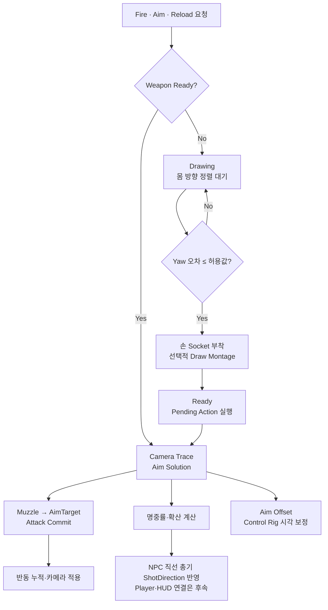
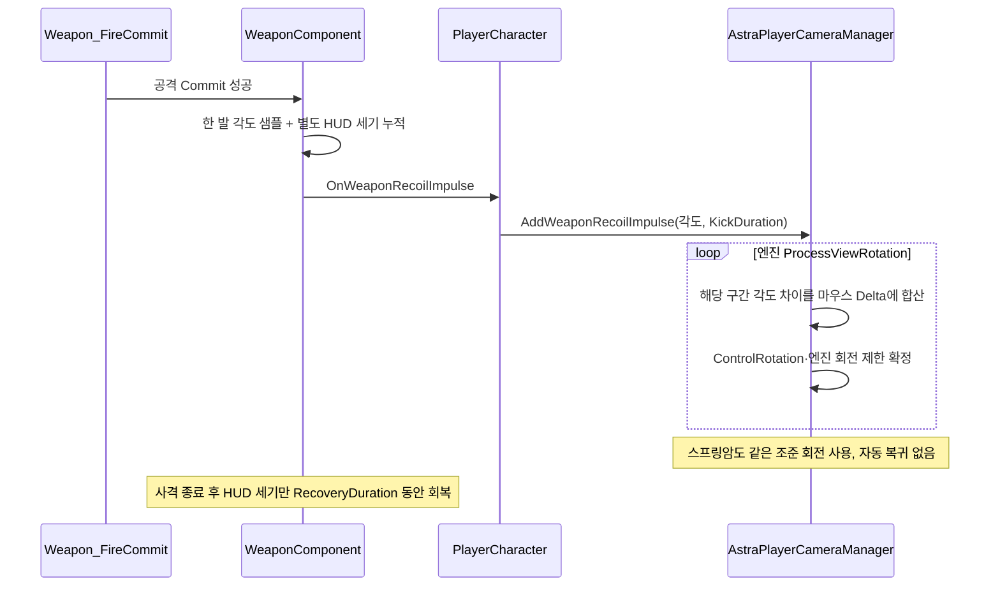
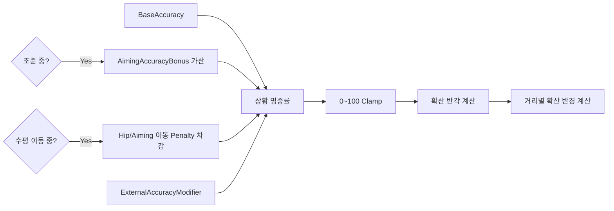
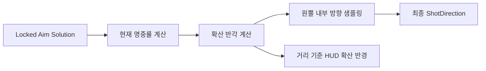
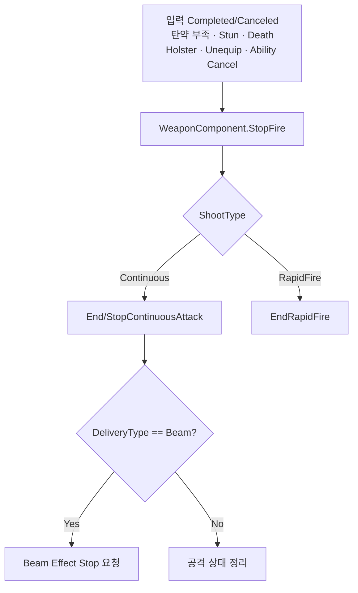

# 무기 조준·반동·명중률

> 2026-10-20 현재 구조: Draw 정렬 완료 검사는 EntityCharacter C++ Tick에서 수행. Player Upper에는 활성 Drawing 상태가 없으며 아래 Drawing은 Weapon Carry 내부 상태·API 계약을 뜻함. 실제 입력·Task 경로는 [현재 작업 상태](../01_일정%20관리/현재%20작업%20상태.md)와 [플레이어 연결 안내](../07_QA_테스트/플레이어%20연사·빈%20탄창%20재장전%20연결.md) 참조

## 설계 의도



## 상태

| 항목 | 상태 | 비고 |
|---|---|---|
| Draw 정렬 대기 C++ | 반영 | WeaponComponent가 `bWaitingForDrawAlignment`와 완료 통지를 관리 |
| EntityCharacter C++ 정렬 검사 | 반영 | ProcessWeaponDrawAlignment → Locomotion.IsFacingControlRotation → 완료 통지 |
| Aim Solution과 공격 확정 | C++ 반영 | 논리적 발사 방향과 시각 정렬 분리 |
| AimOffset 왼손 이탈 | 과거 사례와 최근 사례 구분 | 기존 FABRIK 사례와 별개로 최근 Lyra Rifle AO는 참조 변경 후 해결 사용자 확인. LeftHandGrip은 최근 증상 원인에서 제외 |
| 총열 시각 보정 | 완료 | 상·하 조준과 보정 해제 시 0 복귀 확인 |
| 반동 누적·카메라 적용·회복 | C++ 반영, 최신 변경 실행 확인 대기 | 연사 중 실제 Held 유지·해제/취소/탄창 소진 회복 보정. 과거 빌드와 최신 변경을 구분 |
| 명중률·확산 계산 | NPC 직선 총기 실제 탄도 연결 C++ 반영 | Player 실제 산포·HUD·내구도 커브 미연결. 최신 빌드·PIE 미수행 |

## Draw는 전투 준비 상태

전투 준비 규칙: [무기](../02_%EA%B2%8C%EC%9E%84%20%EA%B8%B0%ED%9A%8D/%EC%8B%9C%EC%8A%A4%ED%85%9C%20%EA%B8%B0%ED%9A%8D/%EB%AC%B4%EA%B8%B0.md)

Drawing 상태·Pending Action 유지

```text
Holstered
→ Fire / Aim / Reload 요청
→ PendingWeaponAction 저장
→ Drawing
→ 캐릭터가 Control Rotation 방향으로 회전
→ Yaw 정렬 완료
→ 무기를 손 Socket에 부착
→ Draw Montage가 있으면 재생, 없으면 즉시 완료
→ Ready
→ Pending Action 실행
```

`Ready`는 무기가 손에 있고, 몸이 전투 방향으로 정렬되었으며, Draw 과정이 끝나 Fire/Aim을 실행할 수 있는 상태다

### 책임

- WeaponComponent: Drawing 상태, 정렬 대기, Pending Action과 Draw 완료 경로
- PlayerCharacter/Locomotion: Control Rotation 방향으로 몸 회전
- EntityCharacter.ProcessWeaponDrawAlignment: 현재 Draw 정렬 대기와 Locomotion.IsFacingControlRotation 검사 후 완료 통지
- WeaponDataAsset: Draw Montage 사용 여부

WeaponComponent가 PlayerCharacter를 참조하거나 직접 회전시키지 않음

현재 `WeaponDrawAlignmentToleranceYaw` 기본값은 `5°`다

### 현재 C++ 실행 흐름

```text
EntityCharacter.Tick (장착 무기 있음)
→ ProcessWeaponDrawAlignment
→ WeaponComponent.IsWaitingForDrawAlignment
→ LocomotionComponent.IsFacingControlRotation(WeaponDrawAlignmentToleranceYaw)
→ 정렬 완료 시 WeaponComponent.NotifyWeaponDrawAlignmentCompleted
```

이전 Blueprint Tick 정렬 검사 안내는 현재 C++ 처리로 대체한다. 동일 정렬 완료 통지를 BP Tick에 중복 추가하지 않는다.

완료 통지 후 무기 부착·선택적 Montage·DrawReadyDelay·Ready 전환이 이어진다. 실제 Player 공격 Task는 필요 시 Draw를 실행하고 Ready를 기다리는 현재 경로를 유지한다.

권총의 `EquipMontage = None`은 오류가 아니라 “정렬 완료 후 즉시 손에 부착”하는 정상 설정

다른 무기는 같은 상태 구조에서 선택적으로 Montage를 사용 가능

## 논리적 발사 방향과 시각 정렬

```text
Camera Trace → AimTarget
ShotDirection = Normalize(AimTarget - MuzzleLocation)
DesiredMuzzleRotation = MakeRotFromX(ShotDirection)
```

- 논리 탄도: Aim Solution
- 시각 보정·측정·검증 결과: [무기 조준·반동·명중률](../04_%EC%95%84%ED%8A%B8%20%EB%B0%8F%20%EC%95%A0%EB%8B%88%EB%A9%94%EC%9D%B4%EC%85%98/%EC%95%A0%EB%8B%88%EB%A9%94%EC%9D%B4%EC%85%98%20%EC%84%A4%EA%B3%84/%EB%AC%B4%EA%B8%B0%20%EC%A1%B0%EC%A4%80%C2%B7%EB%B0%98%EB%8F%99%C2%B7%EB%AA%85%EC%A4%91%EB%A5%A0.md)

## AimOffset과 왼손

- 상태: 완료
- 원인·해결·적용 범위: [무기 조준·반동·명중률](../04_%EC%95%84%ED%8A%B8%20%EB%B0%8F%20%EC%95%A0%EB%8B%88%EB%A9%94%EC%9D%B4%EC%85%98/%EC%95%A0%EB%8B%88%EB%A9%94%EC%9D%B4%EC%85%98%20%EC%84%A4%EA%B3%84/%EB%AC%B4%EA%B8%B0%20%EC%A1%B0%EC%A4%80%C2%B7%EB%B0%98%EB%8F%99%C2%B7%EB%AA%85%EC%A4%91%EB%A5%A0.md)

## 반동과 이동 사격

반동과 이동 사격 정확도는 별도 정책

- 2026-10-25 사용자 확정: 마우스로 보정하는 지속 조준 상승. 이전 최종 POV 절대 Offset·자동 조준 복귀 방식 대체
- 사용자 제공 라이플 DA: AimFOV=40, AttackCooldown=0.15초, Pitch=1도/발, Yaw=-0.5~0.5도/발, 누적 한도=15/8, 회복=0.4초
- 기존 코드는 스프링암 위치 계산 후 최종 POV 회전에만 누적 반동 가산. 좁은 FOV에서 시선만 크게 들리면 캐릭터가 화면 아래로 이탈할 수 있는 구조. 실제 PIE 원인 전체 확인과 구분
- RecoilHandler는 한 발의 각도를 한 번 샘플링하여 FWeaponRecoilImpulse와 별도의 FWeaponRecoilState 생성
- OnWeaponRecoilImpulse→PlayerCharacter→CameraManager.AddWeaponRecoilImpulse. 엔진 ProcessViewRotation에서 마우스와 같은 OutDeltaRot에 나눠 적용→ControlRotation 확정→기존 스프링암/카메라 사용
- 한 발의 총각도는 유지, RecoilKickDuration 기본 0.05초에 Smoothstep 구간 차이로 나눠 적용. 새 값은 초기 튜닝값이며 플레이 감각 검증 전. 별도 Tick 추가 없음
- 실제 조준은 자동 복귀하지 않음. 마우스 보정은 덮어쓰지 않고 엔진 Pitch/Yaw 제한 사용
- 기존 FWeaponRecoilState·누적 한도·RecoilRecoveryDuration은 HUD/진단용 세기 상태에만 사용. 이 상태가 0으로 돌아가도 조준은 내려가지 않음
- RapidFire Held 동안 표시 세기 유지·입력 종료 후 표시 회복이라는 기존 입력 계약 유지. 이후 발의 조준 Impulse는 표시 세기 한도와 독립
- 이동 사격: 조준점 확산이 커지고 확산 영역 안에서 탄환 방향 오차가 발생
- 수직 속도는 이동 사격 확산 판단과 직접 관계가 없음
- 수평 이동량이 필요할 때만 `Vector Length XY`를 사용

현재 구현은 이동 페널티를 반동 크기가 아니라 명중률 계산에 사용

`CalculateCurrentAccuracy`는 조준 여부, 이동 상태와 외부 보정값을 합산하고 `CalculateSpreadAngleDegrees/Radius`가 정확도를 확산으로 변환

계산 함수는 구현됐지만 실제 ShotDirection과 HUD 조준점에는 아직 적용하지 않음

WeaponDataAsset의 반동 데이터:

| 항목 | 현재 C++ 기본값 | 역할 |
|---|---:|---|
| `bUsesRecoil` | `true` | 무기별 반동 사용 여부 |
| `RecoilPitchPerShotMin / Max` | `1 / 1` | 성공한 공격 1회에 더할 Pitch 범위 |
| `RecoilYawPerShotMin / Max` | `-0.5 / 0.5` | 성공한 공격 1회에 더할 Yaw 범위 |
| `RecoilKickDuration` | `0.05` | 한 발 각도를 나눠 적용할 시간, 0이면 다음 갱신에서 즉시 적용 |
| `RecoilPitchAccumulationLimit / RecoilYawAccumulationLimit` | `15 / 8` | HUD 누적 세기 제한. 실제 조준 각도 상한 아님 |
| `RecoilRecoveryDuration` | `0` | HUD 누적 세기가 0으로 회복하는 시간 |

`RecoilRecoveryDelay`는 사용하지 않음

`RecoilRecoveryDuration = 0`이면 표시 세기만 즉시 0으로 복구. 실제 조준 자동 복귀 없음

반동은 입력 시점이 아니라 `CommitAttack`이 성공한 뒤에만 누적

단발은 최초 공격 Commit 성공 시 한 번, Continuous는 최초 Commit과 이후 성공한 각 Tick마다 누적

탄약·상태 검사에서 실패한 요청은 반동을 만들지 않음

`bUsesRecoil = false`이면 누적과 회복을 모두 건너뛴다

### 반동 실행 흐름



최종 POV에 반동 회전을 별도로 가산하지 않음. 기존 SetWeaponRecoilOffset은 구형 BP 참조 로딩용 Deprecated 함수로 유지하며 실행 효과 없음

PlayerCharacter는 캐시된 CameraManager에 한 발의 Impulse를 전달, 새 Blueprint 바인딩 불필요. 같은 Impulse를 BP에서 다시 적용하지 않음

무기 교체·CameraManager 변경은 아직 적용하지 않은 반동 구간만 취소. 이미 적용된 조준은 유지. 기존 조준 FOV와 반동 크기 DA 값은 변경하지 않음

### 공개 구현 참고·현재 검증

- [Valve Half-Life 2 공개 소스](https://github.com/ValveSoftware/source-sdk-2013/blob/master/src/game/server/hl2/basehlcombatweapon.cpp): 한 발의 View Kick과 반동 범위 제한을 별도 처리
- [Facepunch Sandbox 공개 소스](https://sbox.game/facepunch/sandbox/source?file=Game/Weapon/BaseBulletWeapon/BaseBulletWeapon.cs): EyeAngles의 한 발 변화와 별도의 Camera Punch 구분, 추가 Punch는 1인칭에서 사용
- Astra 변경은 위 구현의 구조를 참고한 TPS 적용 판단. 각 게임의 수치를 Astra DA에 복사하지 않으며 프레임/입력/스프링암 흐름은 현재 UE 5.8 소스와 대조
- 이번 C++ 변경은 정적 검토까지, 빌드·UHT·Editor 실행·Automation·PIE 미수행. 사용자가 DA 값을 제공해 Editor 조작 없이 확인, computer-use는 실행 중 창 목록 조회까지만 수행
- 검증: 연사/마우스 하향 보정/사격 종료 후 조준 유지, 15발 이후에도 반동 유지, 30/60/120fps의 각도·구간, ViewPitch 상한·벽 근처 스프링암, 무기 교체·취소·빙의 전환
- 중앙 진단: astra.Debug Weapon.Recoil 1. Intensity와 Impulse 구분, NPC.Combat의 기존 반동 로그 호환 유지

### 명중률과 장비 내구도

```text
Accuracy = BaseAccuracy + AimingAccuracyBonus - MovementPenalty + ExternalAccuracyModifier
SpreadAngle = MaxSpreadAngleDegrees × (1 - Accuracy / 100)
```

- WeaponDataAsset: Base/Aiming/Moving/Airborne Accuracy와 최대 확산각 정의
- EquipmentDataAsset: 장비 공통 최대 내구도 정의
- EquipmentInstance: 현재 내구도·파손 판정과 변경 이벤트 제공
- WeaponComponent: 현재 정확도, 확산 각도와 거리별 확산 반경 계산

현재 계산 순서는 다음과 같다



| 항목 | 현재 C++ 기본값 | 역할 |
|---|---:|---|
| `MaxDurability` | `100` | EquipmentDataAsset의 장비 공통 최대 내구도. `-1`은 파손 없음 |
| `BaseAccuracy` | `80` | 기본 상황 명중률 |
| `AimingAccuracyBonus` | `20` | 조준 중 가산값 |
| `MovingHipFireAccuracyPenalty` | `80` | 비조준 이동 중 차감값 |
| `MovingAimingAccuracyPenalty` | `20` | 조준 이동 중 차감값 |
| `AirborneHipFireAccuracyPenalty` | `80` | 공중 비조준 중 차감값 |
| `AirborneAimingAccuracyPenalty` | `20` | 공중 조준 중 차감값 |
| `MaxSpreadAngleDegrees` | `10°` | 명중률 0일 때 발사 원뿔 반각 |

```text
MovementPenalty = Moving
    ? (Aiming ? MovingAimingAccuracyPenalty : MovingHipFireAccuracyPenalty)
    : 0

```

상황별 수치·의도: [무기 조준·반동·명중률](../02_%EA%B2%8C%EC%9E%84%20%EA%B8%B0%ED%9A%8D/%EC%8B%9C%EC%8A%A4%ED%85%9C%20%EA%B8%B0%ED%9A%8D/%EB%AC%B4%EA%B8%B0%20%EC%A1%B0%EC%A4%80%C2%B7%EB%B0%98%EB%8F%99%C2%B7%EB%AA%85%EC%A4%91%EB%A5%A0.md)

상태 페널티는 중복하지 않고 `공중 → 지상 이동 → 지상 정지` 우선순위로 하나만 적용

다만 현재 `CalculateCurrentAccuracy`는 `NormalizedMoveSpeed`만 검사하므로 Airborne 데이터가 실제 명중률 계산에 아직 연결되지 않았다

`UpdateWeaponRuntime` 또는 별도 Context 입력에 공중 상태를 추가 필요

현재 내구도는 `EquipmentInstance` 공통 데이터이며 `0 ~ MaxDurability`로 제한되고, 변경 시 `OnDurabilityChanged`를 방송

현재 내구도는 명중률 배율에 사용하지 않음

2026-10-24 사용자 의도 재확인: 명중률은 내구도와 관계있으며 감쇠는 무기 DA 커브로 지정. 이번 단계에서 내구도 커브를 구현하지 않도록 명시. 정규화 내구도 값을 그대로 선형 배율로 사용하지 않음. 파손 장비 사용 거부와 명중률 커브는 별개

파손 장비는 ItemInstance로 남아 있지만 WeaponComponent가 꺼내기·발사·조준·재장전 요청을 거부하고 `장비가 파손되었다` 메시지를 방송

플레이어의 CalculateCurrentAccuracy·SpreadAngle/Radius는 현재 조회용. NPC 직선 총기는 아래 전용 계산·발사 확정 경로 사용

`CalculateCurrentAccuracy`, `CalculateSpreadAngleDegrees`, `CalculateSpreadRadius`는 구현됐지만 Airborne 페널티, 무작위 원뿔 방향 생성과 `LockedFireAimSolution.ShotDirection` 변경은 아직 연결되지 않았다

HUD 조준점은 이동·공중·조준·반동 상태에 따른 Scale 변경 기반이 구현됐지만 실제 명중률·거리별 확산 반경과는 아직 연결되지 않았다

따라서 현재 플레이어 Projectile은 정확도 수치와 관계없이 잠긴 Aim Solution 방향으로 발사. NPC 직선 총기는 아래 산포 방향으로 생성

### NPC 직선 총기의 명중률 — 2026-10-24

사용자 승인 후 실제 산포 C++ 반영. 내구도 감쇠는 DA 커브 후속으로 보류, 현재 계산에 정규화 내구도를 선형 곱하지 않음

```text
NPCAccuracy = Clamp(
    BaseAccuracy × AIAccuracyMultiplier
    × EntityData.NPCTypeAccuracyMultiplier × CombatTendencyData.AccuracyMultiplier
    − (NPC 수평 이동 중 ? AIMovingAccuracyPenalty : 0)
    − (가시 타겟 수평 이동 중 ? AITargetMovingAccuracyPenalty : 0), 0, 100)
SpreadHalfAngle = MaxSpreadAngleDegrees × (1 − NPCAccuracy / 100)
```

종류·성향 배율은 각각 1이 중립. AIController가 성향과 가시 타겟을 조회해 정확도 계산, WeaponComponent가 반각을 FWeaponAttackCommitRequest에 전달. Commit은 원뿔에서 한 번 샘플링한 방향을 물리 투사체 속도·회전·AttackSpec과 Hitscan 레이 끝점에 동일 적용. 기존 Hitscan 조준 거리 유지, 정확도에 따른 피해 성공/실패 추첨 없음

AIController 조종의 NPC 직선 총기(PhysicalProjectile/Hitscan)에만 적용. Player 조종·유탄 곡선·Homing·Beam·근접 제외. NPC 카메라 반동·시각적 조준 회전·AimingAccuracyBonus·조준 유지시간 보정 추가 없음. AIMissSpreadAngle은 사용하지 않고 MaxSpreadAngleDegrees가 산포 상한

내구도 커브·HUD 연결·NPC별 수치 튜닝은 구현 완료 범위와 구분. 정적·수치 확인만 수행, 이번 빌드·UHT·Editor·Automation·PIE 미수행. [DA 설정·검증](../07_QA_테스트/NPC%20연결·검증.md#npc-명중률-연결-검토--2026-10-24)

### 탄 퍼짐

탄 퍼짐은 명중률의 시각·탄도 결과이며 별도의 독립 명중 판정값이 아니다

명중률이 낮을수록 `MaxSpreadAngleDegrees`를 상한으로 하는 원뿔 반각이 커진다

```text
SpreadHalfAngle = MaxSpreadAngleDegrees × (1 - Accuracy / 100)
SpreadRadiusAtDistance = tan(SpreadHalfAngle) × Distance
```

예를 들어 `MaxSpreadAngleDegrees = 10°`일 때:

| 명중률 | 확산 반각 | 의미 |
|---:|---:|---|
| 100 | 0° | 잠긴 Aim Solution과 동일한 방향 |
| 80 | 2° | 작은 원뿔 안에서 분산 |
| 50 | 5° | 최대 확산의 절반 |
| 0 | 10° | 설정된 최대 확산 |

실제 적용 단계에서는 잠긴 Aim Solution을 중심축으로 원뿔 안의 방향을 1회 샘플링하여 최종 `ShotDirection`을 생성

HUD 조준점은 같은 명중률과 거리 기준 확산 반경을 사용해야 화면 표시와 실제 탄도가 일치

다음 흐름은 NPC 직선 총기 실제 방향에 연결. 플레이어 실제 방향·HUD 확산 연결은 후속 작업



## 지속 공격 종료

입력 계층은 현재 공격이 Beam인지 알지 않고 `StartFire/StopFire`만 요청

WeaponComponent가 ShootType과 DeliveryType을 해석



- `AttackInstanceId`: 하나의 지속 공격 수명과 Effect 인스턴스 식별
- `RequestId`: 지속 공격 안의 개별 피해·탄약 소비 확정 식별

입력 종료만 Effect 종료 조건으로 사용하지 않음

모든 종료 사유가 같은 공격 종료 함수로 모여야 탄약 부족이나 사망 시 Beam Effect가 남지 않음

## 확장 순서

- Rifle과 추가 Projectile/발사 방식: Inventory·Gear 기본 C++ 이후 별도 확장
- Unarmed: Item Weapon이 아니라 Humanoid Combat 행동으로 별도 분류
- 실제 발사 방향 확산과 HUD 조준점 표시: 정확도 계산 검증 이후

---

## 상위 페이지

- [무기 시스템](%EB%AC%B4%EA%B8%B0.md)

## 관련

- [애니메이션과 조준](../04_%EC%95%84%ED%8A%B8%20%EB%B0%8F%20%EC%95%A0%EB%8B%88%EB%A9%94%EC%9D%B4%EC%85%98/%EC%95%A0%EB%8B%88%EB%A9%94%EC%9D%B4%EC%85%98%20%EC%84%A4%EA%B3%84/%EB%AC%B4%EA%B8%B0.md)
- [Player](%EA%B0%9D%EC%B2%B4%20%EC%84%A4%EA%B3%84/%ED%94%8C%EB%A0%88%EC%9D%B4%EC%96%B4.md)
- [남은 이슈](../01_일정%20관리/남은%20이슈.md)

## 문서 연결

- 기획: [무기 조준·반동·명중률](../02_%EA%B2%8C%EC%9E%84%20%EA%B8%B0%ED%9A%8D/%EC%8B%9C%EC%8A%A4%ED%85%9C%20%EA%B8%B0%ED%9A%8D/%EB%AC%B4%EA%B8%B0%20%EC%A1%B0%EC%A4%80%C2%B7%EB%B0%98%EB%8F%99%C2%B7%EB%AA%85%EC%A4%91%EB%A5%A0.md)
- 시스템 설계: [무기 조준·반동·명중률](%EB%AC%B4%EA%B8%B0%20%EC%A1%B0%EC%A4%80%C2%B7%EB%B0%98%EB%8F%99%C2%B7%EB%AA%85%EC%A4%91%EB%A5%A0.md)
- 애니메이션 설계: [무기 조준·반동·명중률](../04_%EC%95%84%ED%8A%B8%20%EB%B0%8F%20%EC%95%A0%EB%8B%88%EB%A9%94%EC%9D%B4%EC%85%98/%EC%95%A0%EB%8B%88%EB%A9%94%EC%9D%B4%EC%85%98%20%EC%84%A4%EA%B3%84/%EB%AC%B4%EA%B8%B0%20%EC%A1%B0%EC%A4%80%C2%B7%EB%B0%98%EB%8F%99%C2%B7%EB%AA%85%EC%A4%91%EB%A5%A0.md)
