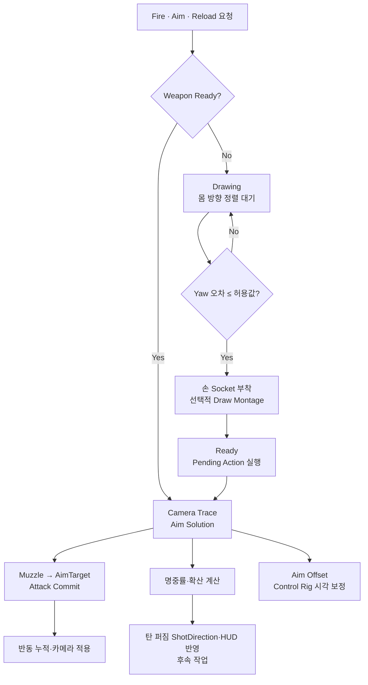
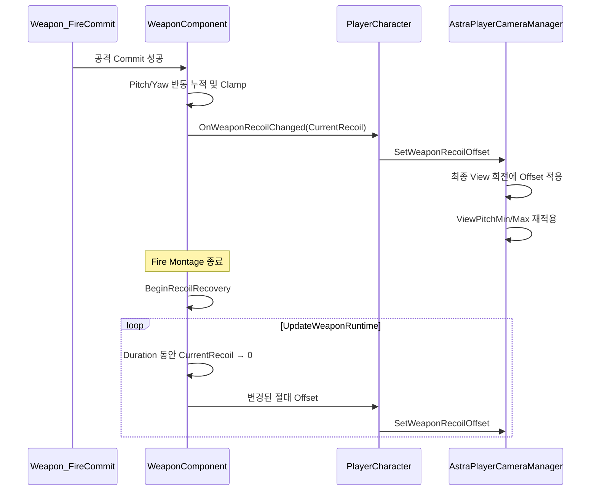
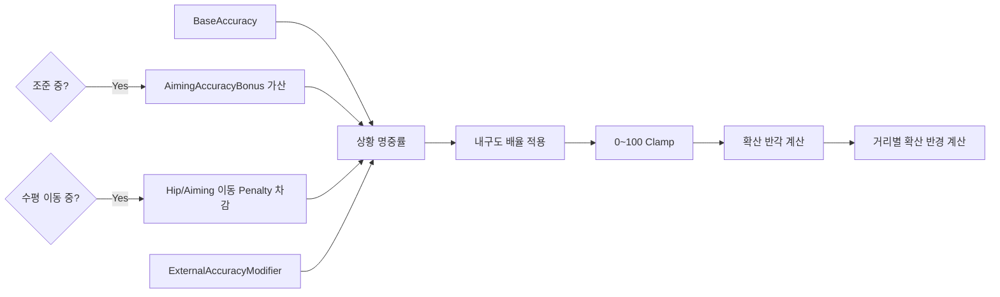
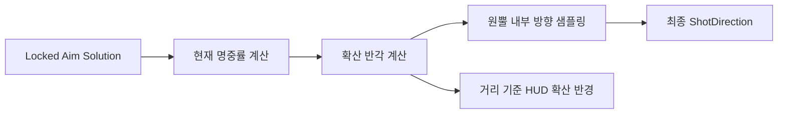
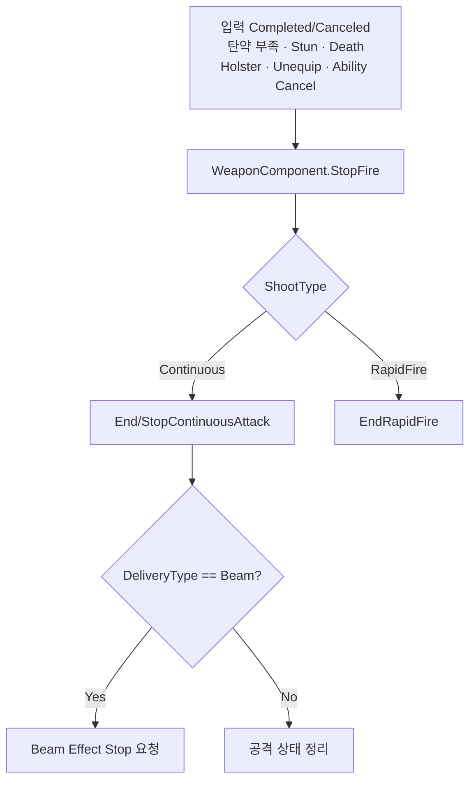

# 무기 조준·반동·명중률



## 상태

| 항목 | 상태 | 비고 |
|---|---|---|
| Draw 정렬 대기 C++ | 반영 | WeaponComponent가 `bWaitingForDrawAlignment`와 완료 통지를 관리 |
| Player Blueprint 정렬 검사 | 완료 | Actor Yaw와 Control Rotation Yaw 비교 후 완료 통지 검증 |
| Aim Solution과 공격 확정 | C++ 반영 | 논리적 발사 방향과 시각 정렬 분리 |
| AimOffset 왼손 이탈 | 완료 | 완성된 애니메이션에 추가한 FABRIK이 팔 분리의 원인이었음 |
| 총열 시각 보정 | 완료 | 상·하 조준과 보정 해제 시 0 복귀 확인 |
| 반동 누적·카메라 적용·회복 | C++ 반영 | DataAsset 설정, 빌드와 PIE 검증 필요 |
| 명중률·확산 계산 | C++ 반영 | 실제 ShotDirection과 HUD에는 아직 미적용 |

## Draw는 전투 준비 상태

Draw Montage를 제거해도 `Drawing` 상태와 Pending Action은 제거하지 않는다. Draw는 단순 애니메이션이 아니라 캐릭터가 발사 가능한 방향과 자세로 정렬되는 준비 과정이다.

```text
Holstered
→ Fire / Aim / Reload 요청
→ PendingWeaponAction 저장
→ Drawing
→ 캐릭터가 Control Rotation 방향으로 회전
→ Yaw 정렬 완료
→ 무기를 손 Socket에 부착
→ Draw Montage가 있으면 재생, 없으면 즉시 완료
→ Ready
→ Pending Action 실행
```

`Ready`는 무기가 손에 있고, 몸이 전투 방향으로 정렬되었으며, Draw 과정이 끝나 Fire/Aim을 실행할 수 있는 상태다.

### 책임

- WeaponComponent: Drawing 상태, 정렬 대기, Pending Action과 Draw 완료 경로
- PlayerCharacter/Locomotion: Control Rotation 방향으로 몸 회전
- Player Blueprint: 현재 Actor Yaw와 Control Rotation Yaw 비교 후 완료 통지
- WeaponDataAsset: Draw Montage 사용 여부

WeaponComponent가 PlayerCharacter를 참조하거나 직접 회전시키지 않는다. 현재 `WeaponDrawAlignmentToleranceYaw` 기본값은 `5°`다.

### Blueprint 실행 흐름

```text
Event Tick
→ IsWaitingForDrawAlignment
→ Branch(True)
→ GetControlRotation
→ GetActorRotation
→ NormalizedDeltaRotator(Control, Actor)
→ BreakRotator.Yaw
→ Abs
→ <= WeaponDrawAlignmentToleranceYaw
→ Branch(True)
→ NotifyWeaponDrawAlignmentCompleted
```

이 Blueprint 정렬 검사는 연결과 실행을 완료했다. 비교 노드는 `Abs Delta Yaw <= WeaponDrawAlignmentToleranceYaw` 순서로 연결하며, 완료 통지 후 무기 부착과 Pending Action 실행이 이어지는 것을 기준으로 한다.

권총의 `EquipMontage = None`은 오류가 아니라 “정렬 완료 후 즉시 손에 부착”하는 정상 설정이다. 다른 무기는 같은 상태 구조에서 선택적으로 Montage를 사용할 수 있다.

## 논리적 발사 방향과 시각 정렬

카메라 Trace가 정한 목표와 실제 총열 방향을 분리한다.

```text
Camera Trace → AimTarget
ShotDirection = Normalize(AimTarget - MuzzleLocation)
DesiredMuzzleRotation = MakeRotFromX(ShotDirection)
```

- 논리적 발사 방향: Muzzle에서 AimTarget 또는 TraceEnd로 향하는 방향
- 시각적 총열 방향: 현재 애니메이션 Pose의 Muzzle Forward
- 시각 보정: 두 방향의 차이를 Control Rig으로 제한 적용

### 두 오차의 구분

```text
Parallax Error
= DesiredMuzzleRotation - CameraDirectionRotation

Visual Muzzle Correction
= DesiredMuzzleRotation - CurrentMuzzleRotation
```

`Camera Forward Vector → Make Rot from X`를 사용하면 Roll을 제거하고 Desired 방향과 같은 “방향 벡터 기반 회전”으로 비교할 수 있다. Parallax Error는 TPS 카메라와 총구 위치 차이에 따른 수렴각이며 실제 Control Rig 보정량이 아니다.

측정된 Parallax:

| 조건 | Pitch | Yaw | 해석 |
|---|---:|---:|---|
| 근거리 | 0.77° | 0.69° | 작은 수렴각 |
| 초근접·지면 | 7.32° | 3.24° | 카메라와 총구 시차가 급격히 증가 |
| 약 20~30m | 0.70° | 0.36° | 거의 평행에 가까움 |
| 유효 사거리 밖·하늘 | 1.10° | 0.41° | TraceEnd 기준 수렴각 |

다음 측정은 `DesiredMuzzleRotation - CurrentMuzzleRotation`의 Pitch/Yaw다. 이 값이 실제 Control Rig 입력이다.

### 시각 정렬 정책

```text
Camera Trace Blocking Hit 있음
→ AimTarget = ImpactPoint
→ 논리 발사 방향 사용
→ 시각 총열 정렬 활성화

Blocking Hit 없음
→ AimTarget = TraceEnd
→ 논리 발사 방향은 계속 사용
→ 유효 사거리 밖 시각 정렬 비활성화
```

현재는 최대 Pitch/Yaw를 각각 `30°`로 제한한 상태에서 평사·상향·하향 조준을 검증했다. 이후 다른 무기나 초근접 자세에서 팔과 손목 꺾임이 확인될 때만 최소 시각 정렬 거리 또는 무기별 최대 보정각을 추가한다.

### 현재 검증 결과

`MaxVisualAimCorrectionYaw/Pitch`를 `30°`로 설정하고 Yaw 보간의 Target을 `TargetVisualAimCorrectionYaw`에 연결한 뒤 다음을 확인했다.

- 평상시 조준에서 실제 총열 방향과 발사 방향이 일치
- 위·아래 조준에서도 두 방향이 일치
- 조준 보정 해제 시 Yaw/Pitch 값이 0으로 복귀
- Fire Montage 중 반동 애니메이션으로 총열선이 일시적으로 벗어나지만 탄환은 확정된 사격 방향으로 정상 발사
- Montage 종료 후 총열과 발사 방향이 다시 일치

따라서 총열 시각 보정은 완료 상태다. `30°`는 비정상 입력을 막는 안전 한계로 유지하고 무기별 최종 튜닝값은 향후 조정할 수 있다. 현재 스켈레톤에서는 앞뒤 숙임이 `Transform (Modify) Bone`의 Roll 축에 대응하므로 Pitch 보정값을 해당 축에 부호 조절하여 적용한다.

## AimOffset과 왼손

AimOffset에서 Pitch 절대값이 커질수록 왼손과 팔이 분리되던 문제는 완료 상태다. 원인은 이미 완성된 무기 애니메이션에 FABRIK을 추가하여, 애니메이션이 가진 손·팔 관계를 다시 강제로 보정한 것이었다.

- 완성된 무기 애니메이션은 기존 손·팔 포즈를 기준으로 사용한다.
- 해당 경로에는 불필요한 FABRIK을 중복 적용하지 않는다.
- FABRIK은 절차적 왼손 고정이 실제로 필요한 무기·상태에서만 별도 검증 후 사용한다.
- AimOffset 샘플은 `Mesh Space Additive`와 동일 Base Pose를 유지한다.

따라서 이 문제의 해결 기준은 FABRIK 수치 튜닝이 아니라, 완성된 애니메이션 위에 중복된 절차적 보정을 제거하는 것이다.

## 반동과 이동 사격

반동과 이동 사격 정확도는 별도 정책이다.

- 정지 사격: 초탄은 조준점으로 향하고 이후 카메라 Pitch/Yaw 회전 Offset이 누적된다.
- Fire Montage가 끝나면 `RecoilRecoveryDuration` 동안 현재 누적 반동이 0으로 감소한다.
- 회복 도중 다시 발사에 성공하면 남아 있는 누적 반동에 새 반동을 더하고 진행 중인 회복을 중단한다.
- 카메라 조작 여부는 반동 회복을 차단하지 않는다.
- 이동 사격: 조준점 확산이 커지고 확산 영역 안에서 탄환 방향 오차가 발생한다.
- 수직 속도는 이동 사격 확산 판단과 직접 관계가 없다. 수평 이동량이 필요할 때만 `Vector Length XY`를 사용한다.

현재 구현은 이동 페널티를 반동 크기가 아니라 명중률 계산에 사용한다. `CalculateCurrentAccuracy`는 조준 여부, 이동 상태, 외부 보정값과 내구도를 합산하고 `CalculateSpreadAngleDegrees/Radius`가 정확도를 확산으로 변환한다. 계산 함수는 구현됐지만 실제 ShotDirection과 HUD 조준점에는 아직 적용하지 않는다.

WeaponDataAsset의 반동 데이터:

| 항목 | 현재 C++ 기본값 | 역할 |
|---|---:|---|
| `bUsesRecoil` | `true` | 무기별 반동 사용 여부 |
| `RecoilPitchMin / Max` | `1 / 1` | 성공한 공격 1회에 더할 Pitch 범위 |
| `RecoilYawMin / Max` | `-0.5 / 0.5` | 성공한 공격 1회에 더할 Yaw 범위 |
| `MaxRecoilPitch / Yaw` | `15 / 8` | 누적 절대 Offset 제한 |
| `RecoilRecoveryDuration` | `0` | 회복 시작 후 0까지 보간하는 시간 |

`RecoilRecoveryDelay`는 사용하지 않는다. `RecoilRecoveryDuration = 0`이면 즉시 0으로 복구되므로 무기별 DataAsset 값을 반드시 지정한다.

반동은 입력 시점이 아니라 `CommitAttack`이 성공한 뒤에만 누적한다. 단발은 최초 공격 Commit 성공 시 한 번, Continuous는 최초 Commit과 이후 성공한 각 Tick마다 누적한다. 탄약·상태 검사에서 실패한 요청은 반동을 만들지 않는다. `bUsesRecoil = false`이면 누적과 회복을 모두 건너뛴다.

### 반동 실행 흐름



누적 반동은 카메라 위치가 아니라 기준 조준 회전에서 벗어난 절대 Pitch/Yaw Offset이다. PlayerCharacter는 캐시된 CameraManager에 값을 전달하며 발사마다 Cast하지 않는다. CameraManager는 반동 적용 후 기존 Pitch 제한을 다시 적용한다.

### 명중률과 내구도

```text
Accuracy = BaseAccuracy + AimingAccuracyBonus - MovementPenalty + ExternalAccuracyModifier
FinalAccuracy = Accuracy × DurabilityMultiplier
SpreadAngle = MaxSpreadAngleDegrees × (1 - Accuracy / 100)
```

- WeaponDataAsset: Base/Aiming/Moving Accuracy, ZeroDurability 배율, 최대 확산각 정의
- WeaponInstance: 현재 내구도와 정규화 값 소유, 변경 이벤트 제공
- WeaponComponent: 현재 정확도, 확산 각도와 거리별 확산 반경 계산

현재 계산 순서는 다음과 같다.



| 항목 | 현재 C++ 기본값 | 역할 |
|---|---:|---|
| `MaxDurability` | `100` | WeaponInstance가 참조하는 최대 내구도 |
| `BaseAccuracy` | `80` | 기본 상황 명중률 |
| `AimingAccuracyBonus` | `20` | 조준 중 가산값 |
| `MovingHipFireAccuracyPenalty` | `80` | 비조준 이동 중 차감값 |
| `MovingAimingAccuracyPenalty` | `20` | 조준 이동 중 차감값 |
| `AirborneHipFireAccuracyPenalty` | `80` | 공중 비조준 중 차감값 |
| `AirborneAimingAccuracyPenalty` | `20` | 공중 조준 중 차감값 |
| `ZeroDurabilityAccuracyMultiplier` | `1` | 내구도 0일 때 상황 명중률 배율 |
| `MaxSpreadAngleDegrees` | `10°` | 명중률 0일 때 발사 원뿔 반각 |

```text
MovementPenalty = Moving
    ? (Aiming ? MovingAimingAccuracyPenalty : MovingHipFireAccuracyPenalty)
    : 0

DurabilityMultiplier = Lerp(
    ZeroDurabilityAccuracyMultiplier,
    1,
    NormalizedDurability)
```

확정된 기본 상황 명중률은 정지 조준 `100`, 정지 미조준 `80`, 이동 조준 `80`, 이동 미조준 `0`, 공중 조준 `80`, 공중 미조준 `0`이다. 다수의 적을 상대하는 전투 특성상 공중 조준 사격은 이동 조준과 같은 기준을 사용한다.

상태 페널티는 중복하지 않고 `공중 → 지상 이동 → 지상 정지` 우선순위로 하나만 적용한다. 다만 현재 `CalculateCurrentAccuracy`는 `NormalizedMoveSpeed`만 검사하므로 Airborne 데이터가 실제 명중률 계산에 아직 연결되지 않았다. `UpdateWeaponRuntime` 또는 별도 Context 입력에 공중 상태를 추가해야 한다. 현재 내구도는 WeaponInstance 데이터이며 `0 ~ MaxDurability`로 제한되고, 변경 시 `OnDurabilityChanged`를 방송한다.

중요하게, 이 단계에서 계산 결과는 조회용이다. `CalculateCurrentAccuracy`, `CalculateSpreadAngleDegrees`, `CalculateSpreadRadius`는 구현됐지만 Airborne 페널티, 무작위 원뿔 방향 생성과 `LockedFireAimSolution.ShotDirection` 변경은 아직 연결되지 않았다. HUD 조준점은 이동·공중·조준·반동 상태에 따른 Scale 변경 기반이 구현됐지만 실제 명중률·거리별 확산 반경과는 아직 연결되지 않았다. 따라서 현재 실제 Projectile은 정확도 수치와 관계없이 잠긴 Aim Solution 방향으로 발사된다.

### 탄 퍼짐

탄 퍼짐은 명중률의 시각·탄도 결과이며 별도의 독립 명중 판정값이 아니다. 명중률이 낮을수록 `MaxSpreadAngleDegrees`를 상한으로 하는 원뿔 반각이 커진다.

```text
SpreadHalfAngle = MaxSpreadAngleDegrees × (1 - Accuracy / 100)
SpreadRadiusAtDistance = tan(SpreadHalfAngle) × Distance
```

예를 들어 `MaxSpreadAngleDegrees = 10°`일 때:

| 명중률 | 확산 반각 | 의미 |
|---:|---:|---|
| 100 | 0° | 잠긴 Aim Solution과 동일한 방향 |
| 80 | 2° | 작은 원뿔 안에서 분산 |
| 50 | 5° | 최대 확산의 절반 |
| 0 | 10° | 설정된 최대 확산 |

실제 적용 단계에서는 잠긴 Aim Solution을 중심축으로 원뿔 안의 방향을 1회 샘플링하여 최종 `ShotDirection`을 만든다. HUD 조준점은 같은 명중률과 거리 기준 확산 반경을 사용해야 화면 표시와 실제 탄도가 일치한다. 현재는 각도·반경 계산까지만 구현되어 있으므로 다음 연결은 후속 작업이다.



## 지속 공격 종료

입력 계층은 현재 공격이 Beam인지 알지 않고 `StartFire/StopFire`만 요청한다. WeaponComponent가 ShootType과 DeliveryType을 해석한다.



- `AttackInstanceId`: 하나의 지속 공격 수명과 Effect 인스턴스 식별
- `RequestId`: 지속 공격 안의 개별 피해·탄약 소비 확정 식별

입력 종료만 Effect 종료 조건으로 사용하지 않는다. 모든 종료 사유가 같은 공격 종료 함수로 모여야 탄약 부족이나 사망 시 Beam Effect가 남지 않는다.

## 확장 순서

- Rifle과 추가 Projectile/발사 방식: Inventory·Gear 기본 C++ 이후 별도 확장
- Unarmed: Item Weapon이 아니라 Humanoid Combat 행동으로 별도 분류
- 실제 발사 방향 확산과 HUD 조준점 표시: 정확도 계산 검증 이후

---

## 상위 페이지

- [무기 시스템](무기%20시스템.md)

## 관련

- [애니메이션과 조준](../04_아트%20및%20애니메이션/애니메이션과%20조준.md)
- [Player](객체%20설계/Player.md)
- [남은 이슈](../01_일정%20관리/남은%20이슈.md)
