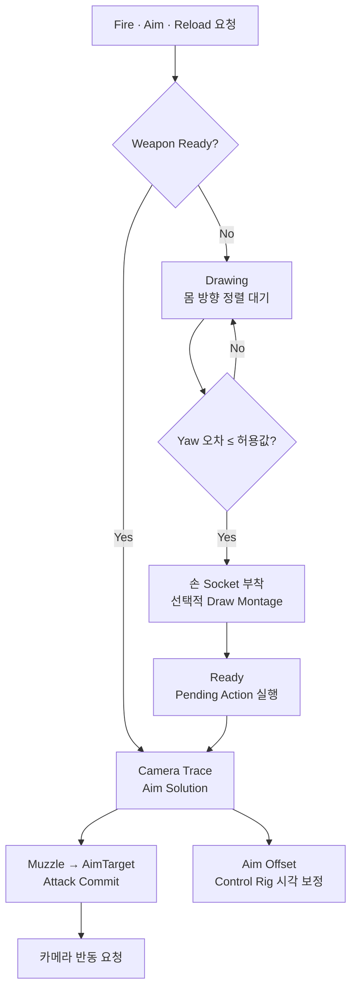
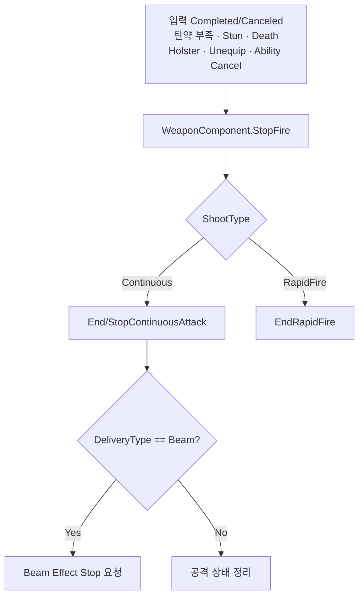

# 무기 조준과 반동



## 상태

| 항목 | 상태 | 비고 |
|---|---|---|
| Draw 정렬 대기 C++ | 반영 | WeaponComponent가 `bWaitingForDrawAlignment`와 완료 통지를 관리 |
| Player Blueprint 정렬 검사 | 연결·PIE 확인 필요 | Actor Yaw와 Control Rotation Yaw 비교 |
| Aim Solution과 공격 확정 | C++ 반영 | 논리적 발사 방향과 시각 정렬 분리 |
| AimOffset 왼손 이탈 | 원인 검증 중 | FABRIK·Control Rig·좌표계만의 문제는 아님 |
| 총열 Control Rig | 설계·측정 중 | 실제 보정량 측정 후 적용 |
| 반동 요청 데이터 | C++ 반영 | 최종 카메라 반동과 이동 확산 정책 검증 필요 |

## Draw는 전투 준비 상태다

Draw Montage를 제거해도 `Drawing` 상태와 Pending Action은 제거하지 않는다. Draw는 단순 애니메이션이 아니라 캐릭터가 발사 가능한 방향과 자세로 정렬되는 준비 과정이다.

```text
Holstered
→ Fire / Aim / Reload 요청
→ PendingWeaponAction 저장
→ Drawing
→ 캐릭터가 Control Rotation 방향으로 회전
→ Yaw 정렬 완료
→ 무기를 손 Socket에 부착
→ Draw Montage가 있으면 재생, 없으면 즉시 완료
→ Ready
→ Pending Action 실행
```

`Ready`는 무기가 손에 있고, 몸이 전투 방향으로 정렬되었으며, Draw 과정이 끝나 Fire/Aim을 실행할 수 있는 상태다.

### 책임

- WeaponComponent: Drawing 상태, 정렬 대기, Pending Action과 Draw 완료 경로
- PlayerCharacter/Locomotion: Control Rotation 방향으로 몸 회전
- Player Blueprint: 현재 Actor Yaw와 Control Rotation Yaw 비교 후 완료 통지
- WeaponDataAsset: Draw Montage 사용 여부

WeaponComponent가 PlayerCharacter를 참조하거나 직접 회전시키지 않는다. 현재 `WeaponDrawAlignmentToleranceYaw` 기본값은 `5°`다.

### Blueprint 실행 흐름

```text
Event Tick
→ IsWaitingForDrawAlignment
→ Branch(True)
→ GetControlRotation
→ GetActorRotation
→ NormalizedDeltaRotator(Control, Actor)
→ BreakRotator.Yaw
→ Abs
→ <= WeaponDrawAlignmentToleranceYaw
→ Branch(True)
→ NotifyWeaponDrawAlignmentCompleted
```

권총의 `EquipMontage = None`은 오류가 아니라 “정렬 완료 후 즉시 손에 부착”하는 정상 설정이다. 다른 무기는 같은 상태 구조에서 선택적으로 Montage를 사용할 수 있다.

## 논리적 발사 방향과 시각 정렬

카메라 Trace가 정한 목표와 실제 총열 방향을 분리한다.

```text
Camera Trace → AimTarget
ShotDirection = Normalize(AimTarget - MuzzleLocation)
DesiredMuzzleRotation = MakeRotFromX(ShotDirection)
```

- 논리적 발사 방향: Muzzle에서 AimTarget 또는 TraceEnd로 향하는 방향
- 시각적 총열 방향: 현재 애니메이션 Pose의 Muzzle Forward
- 시각 보정: 두 방향의 차이를 Control Rig으로 제한 적용

### 두 오차의 구분

```text
Parallax Error
= DesiredMuzzleRotation - CameraDirectionRotation

Visual Muzzle Correction
= DesiredMuzzleRotation - CurrentMuzzleRotation
```

`Camera Forward Vector → Make Rot from X`를 사용하면 Roll을 제거하고 Desired 방향과 같은 “방향 벡터 기반 회전”으로 비교할 수 있다. Parallax Error는 TPS 카메라와 총구 위치 차이에 따른 수렴각이며 실제 Control Rig 보정량이 아니다.

측정된 Parallax:

| 조건 | Pitch | Yaw | 해석 |
|---|---:|---:|---|
| 근거리 | 0.77° | 0.69° | 작은 수렴각 |
| 초근접·지면 | 7.32° | 3.24° | 카메라와 총구 시차가 급격히 증가 |
| 약 20~30m | 0.70° | 0.36° | 거의 평행에 가까움 |
| 유효 사거리 밖·하늘 | 1.10° | 0.41° | TraceEnd 기준 수렴각 |

다음 측정은 `DesiredMuzzleRotation - CurrentMuzzleRotation`의 Pitch/Yaw다. 이 값이 실제 Control Rig 입력이다.

### 시각 정렬 정책

```text
Camera Trace Blocking Hit 있음
→ AimTarget = ImpactPoint
→ 논리 발사 방향 사용
→ 시각 총열 정렬 활성화

Blocking Hit 없음
→ AimTarget = TraceEnd
→ 논리 발사 방향은 계속 사용
→ 유효 사거리 밖 시각 정렬 비활성화
```

초근접에서는 보정각이 커져 팔과 손목이 꺾일 수 있다. Control Rig 육안 검증 후 필요할 때만 `MinimumAimAlignmentDistance`, `MaxVisualAimPitch`, `MaxVisualAimYaw`를 DataAsset에 추가한다.

## AimOffset과 왼손

Pitch 0에서는 정상이고 Pitch 절대값이 커질수록 왼손이 총에서 이탈하는 현상이 남아 있다. 다음 항목은 단독 원인에서 제외되었다.

- LeftHandGrip Socket 위치
- FABRIK 사용 여부
- Control Rig 사용 여부
- Component Space/Bone Space 선택만의 문제
- 최소 AnimGraph까지 줄였을 때의 Layered Blend 구조

AimOffset 샘플은 `Mesh Space Additive`와 동일 Base Pose를 사용해야 한다. 하지만 이 설정 후에도 반복되면 Center/Up/Down 샘플의 Skeleton, Retarget, Import Transform과 `hand_l relative to hand_r` 상대 Transform을 비교한다.

장기 구조는 AimOffset이 큰 상체 방향을 만들고, 같은 Control Rig 평가 안에서 오른손·총열의 잔여 오차를 먼저 보정한 뒤 변경된 무기 위치를 기준으로 왼손을 보정하는 방식이다. EventGraph에서 읽은 이전 프레임 Transform을 별도 FABRIK에 전달하는 구조는 사용하지 않는다.

## 반동과 이동 사격

반동과 이동 사격 정확도는 별도 정책이다.

- 정지 사격: 초탄은 조준점으로 향하고 이후 카메라/조준 회전 반동이 누적된다.
- 입력이 없고 마지막 발사 후 `RecoilRecoveryDelay`가 지나면 `RecoilReturnSpeed`로 원래 조준 방향에 복귀한다.
- 이동 사격: 조준점 확산이 커지고 확산 영역 안에서 탄환 방향 오차가 발생한다.
- 수직 속도는 이동 사격 확산 판단과 직접 관계가 없다. 수평 이동량이 필요할 때만 `Vector Length XY`를 사용한다.

현재 코드의 `CurrentNormalizedMoveSpeed → MovingRecoilMultiplier`는 이동 속도에 따라 반동 충격 자체를 키우는 규칙이다. 최종 기획은 이동 페널티를 조준점 확산에 둘 것인지, 카메라 반동에도 둘 것인지 구분한 뒤 불필요하면 이 경로를 제거한다.

WeaponDataAsset의 반동 데이터:

- RecoilPitch / RecoilYaw
- RecoilSnappiness
- RecoilReturnSpeed
- RecoilRecoveryDelay
- MaxRecoilPitch / MaxRecoilYaw
- MovingRecoilMultiplier — 적용 여부 재검토

## 지속 공격 종료

입력 계층은 현재 공격이 Beam인지 알지 않고 `StartFire/StopFire`만 요청한다. WeaponComponent가 ShootType과 DeliveryType을 해석한다.



- `AttackInstanceId`: 하나의 지속 공격 수명과 Effect 인스턴스 식별
- `RequestId`: 지속 공격 안의 개별 피해·탄약 소비 확정 식별

입력 종료만 Effect 종료 조건으로 사용하지 않는다. 모든 종료 사유가 같은 공격 종료 함수로 모여야 탄약 부족이나 사망 시 Beam Effect가 남지 않는다.

## 확장 순서

- Rifle과 추가 Projectile/발사 방식: Inventory와 Equipment Slot 이후
- Unarmed: Item Weapon이 아니라 Humanoid Combat 행동으로 별도 분류
- 반동 카메라 적용과 HUD 확산 표시: 권총 기본 조준 보정 이후

---

## 상위 페이지

- [무기 시스템](무기%20시스템.md)

## 관련

- [애니메이션과 조준](../04_아트%20및%20애니메이션/애니메이션과%20조준.md)
- [Player](객체%20설계/Player.md)
- [남은 이슈](../01_일정%20관리/남은%20이슈.md)

