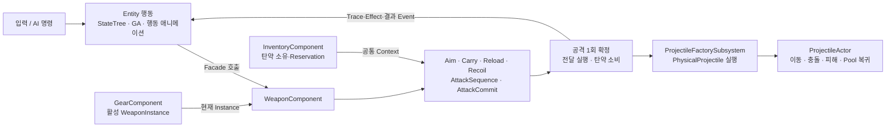
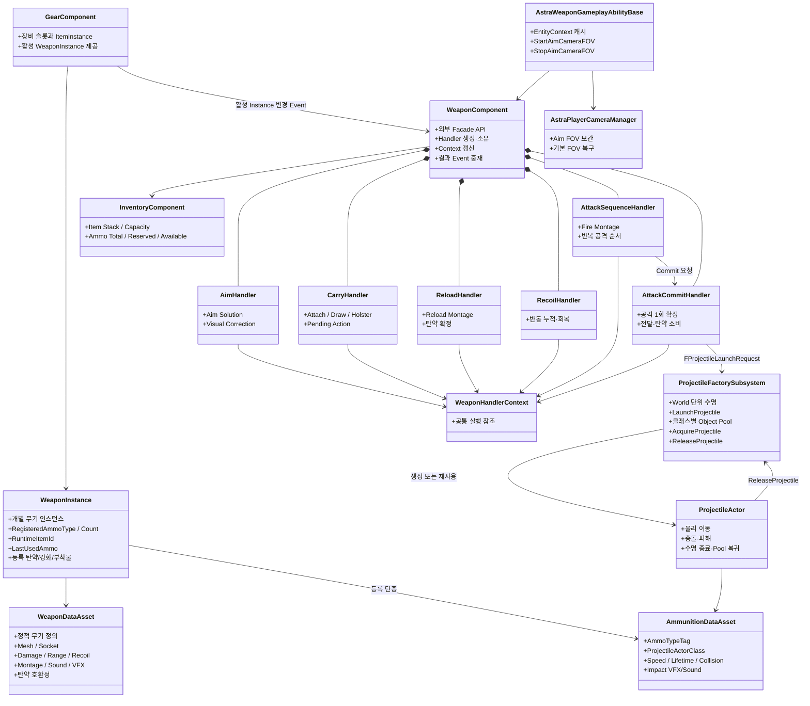
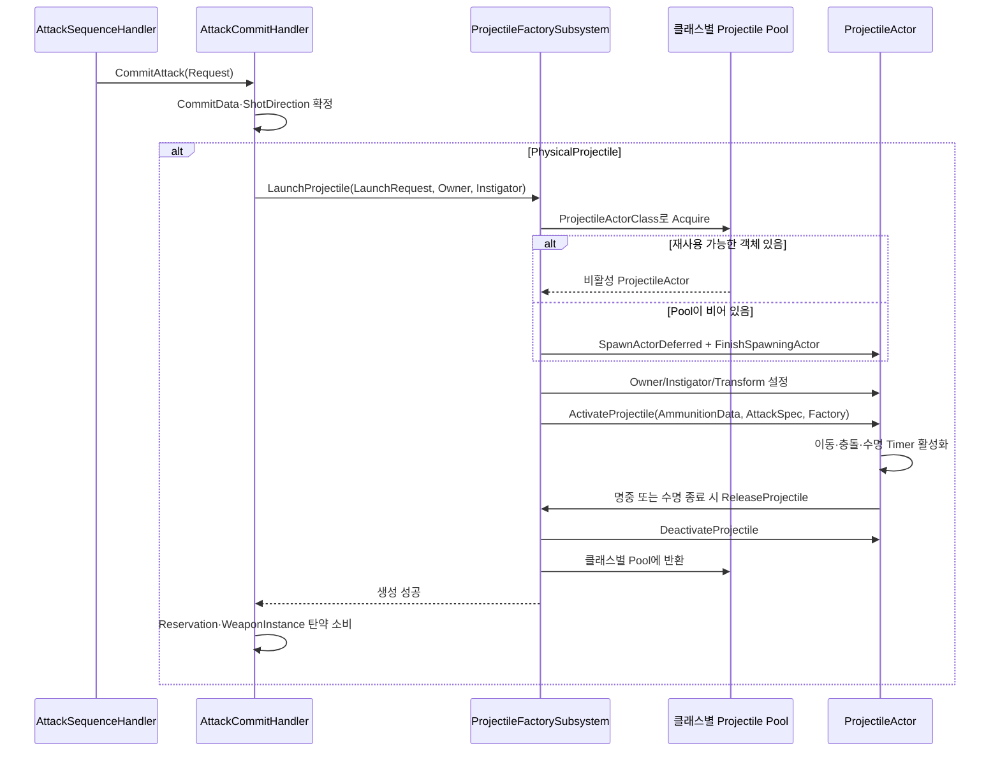
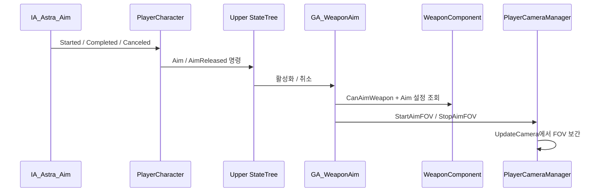

# 무기

2026-10-25 보스 표현 연결: 탄 DA의 ImpactWarningMaterial/ExplosionRadius로 발사 성공 순간 고정 지면 경고, 실제 접촉 시 경고 제거 후 기존 폭발 피해 처리와 CombatEffectSubsystem의 표면 방향 폭발 VFX 재생. 사용자 선택 ExplosionVFX=`/Game/Free_Spells/VFX_Niagara/NS_Free_Spells_Explosion`. 폭발은 월드에 일회성 생성해 탄 풀 회수와 독립. 경고 머티리얼/DA 지정은 사용자 Editor 작업, 신규 피해 반경·보스 전용 효과 데이터 없음. [연결·검증](../07_QA_테스트/NPC%20연결·검증.md#현재-작업-로코모션-수치-통일탄착-경고폭발-효과--2026-10-25). 빌드·Material Compile·PIE 전.



## 설계 의도

## 1. 첫 기준 무기

현재 전투 시스템의 첫 기준 무기는 권총

- DataAsset: `Content/Astra/Weapons/Pistol/001_BasePistol/DA_001_BasePistol.uasset`
- Static Mesh: `Content/Astra/Weapons/Pistol/001_BasePistol/tesseract_revolver/StaticMeshes/STM_BasePistol.uasset`
- 발사 Ability: `Content/Astra/Player/GameplayAbilitySystem/GA_WeaponFire.uasset`
- 재장전 Ability: `Content/Astra/Player/GameplayAbilitySystem/GA_WeaponReload.uasset`
- 조준 Ability: `Content/Astra/Player/GameplayAbilitySystem/GA_WeaponAim.uasset`
- C++ 공통 기반: `Source/Astra_SoulLink/Ability/AstraWeaponGameplayAbilityBase`

`GA_WeaponFire`, `GA_WeaponReload`, `GA_WeaponAim`은 이름과 현재 저장 경로와 무관하게 **Entity가 Weapon Item을 사용하는 행동**

무기 자체의 데이터와 런타임 상태는 Weapon Item 영역이 소유

분류 기준은 [게임 객체 분류](../02_%EA%B2%8C%EC%9E%84%20%EA%B8%B0%ED%9A%8D/%EA%B2%8C%EC%9E%84%20%EA%B0%9D%EC%B2%B4%20%EB%B6%84%EB%A5%98.md)를 기준

## 2. 책임 경계


| Entity가 소유 | Weapon Item이 소유 |
|---|---|
| 행동 가능 여부와 명령 해석 | 무기 종류와 정적 정의 |
| 조준·발사·재장전 행동 | 등록 탄약·발사 간격·발사 방식 |
| Upper StateTree와 GA 수명 | 피해·사거리·탄약 호환성·반동·탄 퍼짐 |
| 행동 충돌 정책과 애니메이션 | Muzzle·공격 정의·과열·고장·내구도 |

재장전에서 Entity는 Reload 상태, 애니메이션, 이동·다른 행동 제한을 담당

InventoryComponent가 Ammunition Instance와 Reservation을 소유하고, WeaponInstance는 등록 탄종·등록 탄수와 마지막 사용 탄종을 보관하며, WeaponComponent가 두 시스템 사이의 등록·소비 요청을 조율

### WeaponComponent 의존성 원칙

WeaponComponent는 외부에서 사용하는 Facade

PlayerCharacter, Blueprint, StateTree와 GA는 Handler를 직접 조회하거나 참조하지 않음

WeaponComponent가 Handler를 생성·소유하고 공통 Context를 갱신하며 외부 요청과 내부 결과를 중재

Handler는 서로 직접 참조하지 않음

무기 실행에 필요한 WeaponInstance, ASC, AnimationMesh, BodyCollision, InventoryComponent, WeaponMesh와 OwnerActor는 `FWeaponHandlerContext`로 공급

StatusModel 참조 제거. 현재 OwnerActor는 EntityDataAsset의 NPC 탄약 정책 확인에 사용

Context는 참조만 보관. 판단과 실행 없음

PhysicalProjectile의 실제 생성 요청은 `AttackCommitHandler`가 World의 `UProjectileFactorySubsystem`에 직접 전달

PlayerCharacter는 PhysicalProjectile 생성이나 탄약 소비를 수행하지 않음. Hitscan 피해와 Beam Effect 같은 Entity 결과만 중재

```text
PlayerCharacter / Blueprint / StateTree / GA
→ WeaponComponent Facade
→ 기능별 Handler
→ FWeaponHandlerContext
```

현재 `FWeaponAttackCommitData`의 주요 데이터는 `AttackInstanceId`, `DeliveryType`, `bConsumesAmmo`, `AmmoCost`, `AmmoTypeTag`, `AmmunitionData`, `ProjectileFlight`, `MuzzleTransform`, `AimTargetLocation`, `AttackSpec`. ProjectileFlight는 확정 초기 속도·고정 곡선 구간·예상 비행시간·실제 수명 보관

ShotDirection은 별도 필드가 아니라 `AttackSpec.ShotDirection`에 포함됨

Projectile Actor Class는 `AmmunitionData.ProjectileActorClass`가 소유

Beam Effect 명령은 별도의 `FBeamEffectRequest`로 Entity 계층에 전달

세부 책임: [WeaponComponent 기능 분리](WeaponComponent%20%EA%B8%B0%EB%8A%A5%20%EB%B6%84%EB%A6%AC.md)

## 3. 데이터 구조



### WeaponDataAsset

무기 하나의 정적 정의

권총이라는 분류가 같아도 개별 권총 종류마다 별도 DataAsset을 가질 수 있음

주요 데이터:

- ItemID / ItemName / WeaponType
- Static Mesh. 장착·홀스터 보정 Transform은 캐릭터 ABP의 ItemID별 설정 소유
- 손 소켓, 홀스터 소켓, Muzzle 소켓
- 공격 종류, 피해, 치명타, 발사 간격
- 유효 사거리와 사거리 밖 피해 배율
- 탄창 크기와 재장전 시간
- 1발당 Pitch/Yaw 반동 범위, 누적 제한과 회복 시간
- 기본·조준·이동·공중 명중률과 최대 확산각
- NPC 명중률 보정
- Equip/Holster Montage. Fire·Reload는 현재 캐릭터 ABP.ActionAnimations의 WeaponType별 설정 소유. DryFire 몽타주·사운드 설정 제거
- Sound와 VFX

수치·Bool·Enum은 `CsvSource`에 따라 분리된 CSV에서 조립

```text
01_Weapon.csv
├─ WeaponDamage.csv
├─ WeaponFire.csv
├─ WeaponAmmo.csv
├─ WeaponContinuous.csv
├─ WeaponCharge.csv
├─ WeaponAim.csv
├─ WeaponRecoil.csv
└─ WeaponAccuracy.csv
```

`ItemID`를 공통 조립 키로 사용

Mesh·Socket·Equip/Holster Montage·Sound·VFX는 DataAsset에서 직접 설정. 발사·재장전 몽타주는 현재 AnimInstance에서 WeaponType으로 조회. 손·홀스터 Transform은 실제 WeaponData.ItemID로 현재 ABP 설정 조회. 노티파이·쿨다운·공격·탄약 확정은 기존 Handler 책임

최대 내구도는 무기 전용 값이 아니라 `UEquipmentDataAsset`의 장비 공통 값

### WeaponInstance

개별 무기 인스턴스의 동적 데이터와 자기 상태에 관한 판단을 소유

- 등록 탄종과 등록 탄수
- 마지막 사용 탄종
- 레벨 단위 Runtime Item ID
- `UEquipmentInstance`에서 상속한 현재 내구도
- 향후 강화와 부착물

`UWeaponInstance`는 ItemInstance 계층에 편입되어 있으며 GearComponent가 장착·활성 Instance를 관리

WeaponComponent는 PlayerCharacter가 전달한 활성 WeaponInstance를 바인딩

실제 Ammunition Instance는 Inventory에 남고 WeaponInstance에는 정확한 탄약 Definition과 Reservation 수량이 등록됨

### WeaponComponent

현재 장착 무기의 외부 API를 제공하는 Facade

- 활성 WeaponInstance 바인딩·해제
- Handler 생성과 수명 소유
- 공통 Handler Context 갱신
- Blueprint·StateTree·GA 요청을 해당 Handler로 위임
- Handler 결과를 기존 Weapon Event로 재발행
- 현재 명중률과 확산 각도·반경 계산

내부 Handler:

| Handler | 책임 |
|---|---|
| AimHandler | 조준 조건·Aim Solution·총열 시각 보정·FOV 설정 조회 |
| CarryHandler | Mesh 부착·Carry State·Draw·Holster·Pending Action·Auto Holster |
| ReloadHandler | 재장전 조건·탄종 선택·Montage 수명·정상 종료 탄약 확정 |
| RecoilHandler | 반동 누적·정규화·회복 |
| AttackSequenceHandler | Fire Montage·Commit 시점·입력 유지·반복 공격·Cooldown |
| AttackCommitHandler | 공격 1회 데이터·전달 방식 실행·탄약 소비·Trace·Beam 요청 |

WeaponComponent와 Handler는 ProjectileActor Pool을 소유하지 않음

AttackCommitHandler가 `UProjectileFactorySubsystem`에 PhysicalProjectile 생성을 요청

별도 `ProjectileDataAsset`, `ProjectileID`, `DefaultProjectile`은 사용하지 않음

현재 PhysicalProjectile 실행에는 `ProjectileActorClass`가 연결된 `AmmunitionDataAsset`이 필요

상세 구조: [WeaponComponent 기능 분리](WeaponComponent%20%EA%B8%B0%EB%8A%A5%20%EB%B6%84%EB%A6%AC.md)

### ProjectileFactorySubsystem

`UProjectileFactorySubsystem`은 World마다 존재하는 PhysicalProjectile 전용 Factory이자 클래스별 Object Pool

현재 경로에서는 `AttackCommitHandler`가 `FProjectileLaunchRequest`를 만든 뒤 Factory를 직접 호출



실행 규칙:

- Factory는 `UWorldSubsystem`이므로 레벨의 World 수명에 맞춰 유지됨
- Pool은 `ProjectileActorClass`별로 분리하며 `TWeakObjectPtr` 배열로 사용 가능한 객체를 보관
- 재사용할 객체가 없을 때만 `SpawnActorDeferred`와 `FinishSpawningActor`로 새 Actor를 생성
- 발사할 때마다 Owner, Instigator, SpawnTransform, AmmunitionData와 `AttackSpec`을 다시 설정
- `ProjectileActor`는 명중 또는 Lifetime 만료 시 Factory에 반환을 요청
- Factory는 반환된 객체의 이동·충돌·Timer를 비활성화하고 Owner와 Instigator를 지운 뒤 같은 클래스 Pool에 보관
- 현재 충돌 결과는 `ProjectileActor`가 처리
- 유효 사거리 밖 피해 배율을 적용한 뒤 `EntityHealthComponent` 또는 Unreal 기본 Damage 경로로 피해를 전달하고 기본 Impact VFX/Sound를 재생
- 관통·도탄·폭발·Homing 관련 DataAsset 필드는 존재하지만 현재 `ProjectileActor` 실행 로직에는 아직 연결되지 않았습니다
- PhysicalProjectile은 Factory 생성 성공 후 탄약 소비
- Factory 조회나 발사 요청이 실패하면 탄약을 소비하지 않음
- 생성 성공 후 탄약 소비 실패는 상태 불일치로 처리하며 단언과 오류 결과를 남김

목표 책임과 Inventory 상세 규칙은 [장비와 인벤토리](%EC%9E%A5%EB%B9%84%EC%99%80%20%EC%9D%B8%EB%B2%A4%ED%86%A0%EB%A6%AC.md)를 참고

### Weapon Gameplay Ability Base

`UAstraWeaponGameplayAbilityBase`는 `InstancedPerActor` 정책을 사용

`OnAvatarSet`에서 현재 Avatar가 제공하는 `EntityContext`를 캐시하고, 구체 PlayerController를 직접 조회하지 않고 카메라 기능을 요청

- `StartAimCameraFOV(AimFOV, InterpSpeed)`
- `StopAimCameraFOV()`
- `OnRemoveAbility`에서 Context 캐시 제거

Ability의 `OnAvatarSet` 호출 주체와 Possess 생명주기는 [PlayerCameraManager 참조 구성](../08_%EA%B8%B0%EC%88%A0%20%EC%9C%84%ED%82%A4_%EA%B3%B5%ED%86%B5%20%EA%B0%80%EC%9D%B4%EB%93%9C/Unreal/Gameplay%20Framework/PlayerCameraManager%20%EC%B0%B8%EC%A1%B0%20%EA%B5%AC%EC%84%B1.md)에 기록

## 4. 무기 종류

무기 종류·기능: [무기](../02_%EA%B2%8C%EC%9E%84%20%EA%B8%B0%ED%9A%8D/%EC%8B%9C%EC%8A%A4%ED%85%9C%20%EA%B8%B0%ED%9A%8D/%EB%AC%B4%EA%B8%B0.md)

- 발사 형태·장비 분류: EWeaponType. 유탄발사기는 GrenadeLauncher 타입이 포물선 발사를 선택
- 공격 종류: EAttackKind

### 공격 전달 방식과 발사 방식

공격이 목표에 도달하는 방식과 입력을 시간에 따라 공격으로 변환하는 방식을 분리

| 축 | 값 |
|---|---|
| `EAttackDeliveryType` | PhysicalProjectile, Hitscan, Beam |
| `EShootType` | SingleShot, RapidFire, ThreeShot, ChargedShot, Continuous |

두 값은 독립적으로 조합

Beam이 항상 지속형인 것은 아니며 `Beam + SingleShot`, `Hitscan + Continuous`도 표현 가능

기존 DataAsset 직렬화 순서를 보호하기 위해 `Continuous`는 Enum 마지막에 추가

실행 책임:

- 발사 시점·반복 순서: `AttackSequenceHandler`
- 공격 1회 확정·전달·탄약 소비: `AttackCommitHandler`
- PhysicalProjectile: AttackCommitHandler가 `UProjectileFactorySubsystem`과 Object Pool을 통해 Projectile Actor 실행
- Hitscan: AttackCommitHandler가 즉시 Trace하고 WeaponComponent가 `OnWeaponTraceResolved` 재발행. Entity가 피해 적용
- Beam: AttackCommitHandler가 Trace·주기·Effect 요청 생성. Entity가 피해 적용과 `UCombatEffectSubsystem` 전달 중재

별도 `HitscanExecutorComponent`와 `BeamExecutorComponent`는 사용하지 않음

일반 Hitscan과 Beam에는 Actor를 생성하지 않으며, 독립 이동·파괴·충돌·복제 수명주기가 필요한 Beam만 향후 Actor 후보

현재 PhysicalProjectile 호출 경계는 다음과 같습니다

```text
AttackSequenceHandler
  └─ Montage · 입력 유지 · 반복 순서 · Commit 요청

AttackCommitHandler
  └─ 공격 데이터와 ShotDirection 확정
  └─ FProjectileLaunchRequest 구성
  └─ Projectile 생성 성공 뒤 탄약 소비

ProjectileFactorySubsystem
  └─ ProjectileActorClass별 Acquire · Activate · Release

ProjectileActor
  └─ 이동 · 충돌 · 피해 · Impact 효과 · Pool 복귀
```

## 5. 무기 선택과 맨손

활성 무기 슬롯은 GearComponent가 소유

Weapon1과 Weapon2는 장비 유무와 관계없이 선택 가능

```text
무기가 있는 슬롯 선택
→ GearComponent가 ActiveWeaponSlot 변경
→ OnActiveWeaponChanged
→ PlayerCharacter가 WeaponComponent에 WeaponInstance 바인딩
→ 초기화 완료 상태이면 Draw 요청

빈 슬롯 선택
→ ActiveWeaponSlot 변경
→ 행동 취소와 필요 시 ForceHolster
→ WeaponComponent의 WeaponInstance 해제
→ 맨손
```

- `TryCycleActiveWeaponSlot`은 Weapon1과 Weapon2를 순환
- 슬롯 전환 Cooldown 중에는 다른 슬롯으로 바꾸지 않음
- 같은 활성 슬롯 요청은 성공으로 처리
- 빈 슬롯은 잘못된 장비 상태가 아님
- 시작 장비 생성과 활성 슬롯 복구는 PlayerState의 GearComponent 기준
- `InitClass`의 직접 자동 Draw는 사용하지 않음
- 활성 무기가 초기화 완료 뒤 바인딩되면 현재 구현은 Draw 요청

## 6. 소켓

애니메이션 연결: [소켓·부착·Montage](../04_%EC%95%84%ED%8A%B8%20%EB%B0%8F%20%EC%95%A0%EB%8B%88%EB%A9%94%EC%9D%B4%EC%85%98/%EC%95%A0%EB%8B%88%EB%A9%94%EC%9D%B4%EC%85%98%20%EC%84%A4%EA%B3%84/%EB%AC%B4%EA%B8%B0.md)

## 7. Draw와 Holster

### 상태

```text
Holstered → Drawing → Ready → Holstering → Holstered
```

`Drawing`은 Montage 재생 상태가 아니라 전투 방향 정렬과 무기 준비가 완료될 때까지의 전이 상태

Fire/Aim/Reload 요청은 Pending Action으로 저장하고, 몸이 Control Rotation 방향에 정렬된 뒤에만 손 부착과 Ready 전이를 완료

현재 C++은 `bWaitingForDrawAlignment`, `IsWaitingForDrawAlignment`, `NotifyWeaponDrawAlignmentCompleted`를 제공

Player Blueprint가 Actor Yaw와 Control Rotation Yaw의 차이를 검사하며 기본 허용값은 `5°`

Player Blueprint 정렬 검사: 완료

연결·실행 검증 완료

### StateTree 연결

- `STC_CanDrawWeapon`은 Idle·Walk·Sprint·Jumping·Falling에서 Draw 허용
- Evade에서는 Draw 불가
- Root의 무조건 Draw 전이로 Condition을 우회하지 않음
- `STT_WeaponReady`는 손 소켓 부착 성공 후 `ReadyEntered` 게시
- EntityStateMediator는 `ReadyEntered`를 Lower StateTree의 `CancelSprint`로 중계
- Lower StateTree가 Sprint Toggle 해제와 Walk·Idle 전이를 담당
- Traversal·Evade 진입은 ForceHolster 유지
- C++ 중계는 반영. StateTree Asset 연결과 PIE는 Editor 확인 필요

### Montage Notify

- Draw: `Weapon_AttachToHand`
- Holster: `Weapon_AttachToHolster`

Draw Montage는 선택 사항

정렬 완료 후 Montage가 없으면 즉시 손에 부착하고, Montage가 있으면 기존 Notify/종료 경로를 사용

Holster Montage Notify가 실행되면 수납 소켓으로 변경하며, Notify 누락 시 정상 종료 fallback을 유지

### 자동 수납

- 자동 수납 조건·지연: [무기](../02_%EA%B2%8C%EC%9E%84%20%EA%B8%B0%ED%9A%8D/%EC%8B%9C%EC%8A%A4%ED%85%9C%20%EA%B8%B0%ED%9A%8D/%EB%AC%B4%EA%B8%B0.md)
- CarryHandler가 Ready 상태에서 Holstering 요청
- 무기 요청 시 Timer 재시작
- Aiming 태그 또는 Fire·Reload 행동이 유지되는 동안 Timer 중지
- 조준·행동 종료 후 Timer 재시작
- Tick 누적이 아니라 TimerManager 사용

## 8. 발사 방향

카메라와 Muzzle의 위치 차이를 보정한 뒤 실행 계층으로 전달

1. 카메라 위치에서 View 방향으로 Ray를 쏴 `AimTarget`을 구
2. Muzzle 위치에서 `AimTarget`을 향하는 `ShotDirection`과 SpawnTransform을 확정
3. AttackCommitHandler가 `ProjectileFactorySubsystem`에 발사 요청을 전달
4. Factory가 Muzzle Transform에서 ProjectileActor를 활성화

```text
CameraStart + CameraForward × TraceDistance → AimTarget
ShotDirection = Normalize(AimTarget - MuzzleLocation)
SpawnRotation = MakeRotFromX(ShotDirection)
```

카메라 Ray는 소유 Character와 WeaponComponent를 무시 필요

총알이 뒤로 나가거나 Socket 회전을 바꿔도 동일하면 Muzzle 축이 아니라 `AimTarget - MuzzleLocation`의 순서와 Projectile의 전방 축을 확인

논리적 발사 방향과 애니메이션상의 총열 정렬은 분리

유효 사거리 안에 Blocking Hit가 있을 때만 시각 총열 보정을 적용하고, Hit가 없으면 탄환은 TraceEnd 방향으로 발사하되 팔과 총은 억지로 정렬하지 않음

측정값과 Control Rig 정책은 [무기 조준·반동·명중률](%EB%AC%B4%EA%B8%B0%20%EC%A1%B0%EC%A4%80%C2%B7%EB%B0%98%EB%8F%99%C2%B7%EB%AA%85%EC%A4%91%EB%A5%A0.md)을 참고

## 9. 조준과 카메라 FOV

정적 조준 설정은 `WeaponDataAsset`이 소유

- `AimInputMode`: Hold 또는 Toggle
- `AimFOV`: 조준 중 목표 FOV
- `AimFOVInterpSpeed`: 진입·복귀 보간 속도



- `PlayerCharacter::RequestWeaponAimStarted`는 장착 상태와 Hold/Toggle 입력을 처리하고 필요하면 Pending Aim을 저장
- `STC_CanAim`은 전이 사전 조건을 검사
- `STT_WeaponAim`은 `Ability.Weapon.Aim`을 활성화하거나 취소
- `GA_WeaponAim`은 `CanAimWeapon`과 `CommitAbility`를 다시 검사한 뒤 활성 상태를 유지
- `AAstraPlayerCameraManager`가 실제 FOV 보간과 기본 FOV 복귀를 담당
- `PlayerCharacter`는 FOV를 직접 계산하지 않음

## 10. 탄약·발사 방식

### 무소모 물리 발사체와 유탄 — 2026-10-24

- 사용자 확정: 일반 NPC 공격 정상. 보스 유탄은 탄약 소비·재장전 없음. 좀비형 적·근접형 아스트라는 근접 공격 대상
- `bUsesAmmo`는 탄수 검사·소비·재장전 정책. 발사체 생성 여부와 별개
- `WeaponInstance.GetProjectileData()`: 소모형 물리 발사체는 등록 탄약 DA, 무소모형은 `WeaponDataAsset.NonAmmoProjectileData` 조회. 소모형의 등록 실패를 무소모 설정으로 대체하지 않음
- `NonAmmoProjectileData` 자료형은 기존 `AmmunitionDataAsset`. 비행·충돌·폭발 정의 재사용, Inventory Item 생성·탄종 등록·탄창 충전 없음. 기존 권총·라이플 DA의 설정 이전 없음
- `AttackCommitHandler.CanCommitAttack`: 원거리 전달 준비와 선택적 탄약 소비 검사. 과거 `EnoughAmmo` 명칭 제거
- 무소모 물리 발사체의 정의·클래스·비행·폭발 설정 누락은 최초 무기 연결 Error. 원점·임의 발사체 대체 없음
- 근접 무기 연결은 Muzzle 소켓 검사 제외. 근접 전용 판정·Notify·비무장 실행은 후속 구현 범위. 근접이 총기 발사체 경로를 사용하도록 처리하지 않음

유탄 실행:

- `WeaponType=GrenadeLauncher`: 중력 없는 지정 포물선 이동 선택. 탄 DA의 Speed로 곡선 위 이동 속력, ArcHeight로 정점 높이 지정. 무기 EffectiveRange는 AI 공격 거리, 별도 포물선 활성화 토글 없음
- 후속 `bAimAtTargetGround=true`: NPC의 타겟 현재 위치에서 AttackTraceChannel로 아래 첫 지면 탐색. 수직 탐색 한도는 해당 무기의 EffectiveRange. 자신·타겟 제외. 지면 미검출·타겟 상실 시 조준 무효화, 몸통 조준 대체 없음
- 지면 좌표는 WeaponComponent Facade→AimHandler의 명시적 좌표 갱신 API로 전달. 카메라 방향 Trace로 타겟 몸을 다시 선택하지 않음. Tick·Draw 완료 갱신 모두 같은 가상 함수 경유
- 지면 조준 옵션 기본 false, 기존 일반 총기·플레이어 카메라 조준 유지. 기존 Montage의 조준 스냅샷 수명 유지, 이동 타겟 선행 조준 추가 없음
- 사용자 최종 확정: Pawn·지형 접촉 시 즉시 폭발. Pawn 통과·튕김 변경 없음. 지면은 조준 목표이며 비행 중 몸에 먼저 닿으면 해당 충돌 위치에서 기폭
- 유탄의 곡선 정의·Speed·ArcHeight·수명·생성 정의가 유효하지 않으면 Commit 실패. World 중력·GravityScale을 도달 조건으로 사용하지 않음
- 유탄은 ProjectileMovement의 물리 이동을 비활성화하고 Actor Tick에서 곡선 구간마다 Sweep 이동. 일반 물리 발사체의 기존 중력·이동 방식 유지
- `bExplosive=true`: 충돌 지점 중심 ExplosionRadius 구형 범위 검사, Actor당 1회 피해. 직격 피해와 폭발 피해 중복 없음
- ExplosionTraceChannel로 벽 차단 확인. 소유자와 발사체 자신 제외. EntityHealthComponent 경유로 기존 방어력·무적·사망 적용, 일반 Damageable은 엔진 Damage 경로
- 폭발 거리 감쇠는 추가하지 않음. 기존 무기 유효 사거리 감쇠 적용 후 범위 내 동일 피해 전달
- 충돌 처리 진입 시 이동·충돌·수명 Timer 먼저 중단. 정상 충돌·수명 만료는 기존 Pool 반환, EndPlay는 Timer 정리
- ExplosionVFX·DefaultImpactVFX 사용 가능. 사운드 확보는 프로토타입 범위 밖
- 착탄 경고는 아래 충전·경고 후속 절에서 반영. 시한 기폭·재시작의 회차별 일괄 정리는 별도 잔여
- 지면 조준 후속분은 코드·정적 대조만 수행. 추가 빌드·UHT·Editor·Automation 실행 없음, 사용자 빌드·검증 대상

Editor 설정·정상/실패/취소 검증: [NPC 연결·검증 — 보스 무소모 유탄](../07_QA_테스트/NPC%20연결·검증.md#보스-무소모-유탄--2026-10-24)

### 충전 유탄·탄착 경고 변경안 — 2026-10-24

상태: 공통 충전 규칙·입력 해제/완충 자동 발사·선택적 성장/무기 이펙트·착탄 경고 C++ 반영. DA·연출 에셋 연결과 이번 변경의 빌드·플레이 확인 전

사용자 확정:

- 머즐에 생성한 탄이 전기 구체처럼 성장한 뒤 발사
- 발사 순간에 바닥 탄착 경고 표시
- 발사 속도 고정. 먼 거리의 긴 회피 시간·근접 시 짧은 비행시간의 높은 위험 유지
- 발밑 지면 조준·Pawn/지형 충돌 즉시 폭발 유지

변경안:

1. 기존 StateTree Task→GA→WeaponComponent 진입 경계 유지. AttackSequence는 충전 시작·유지·발사·취소 수명 소유
2. 머즐에 준비된 발사체의 부착·성장 연출과 발사 후 이동 상태 구분. 성장 값·충전 시간·에셋은 DA/ABP 경계에서 설정, 실제 갱신은 기존 C++ Tick 경로
3. 발사 순간 목표 지면·곡선·이동 속도 확정. GrenadeLauncher의 Speed·ArcHeight로 곡선과 예상 착탄 위치·비행시간 계산, 발사 후 타겟 추종 없음
4. Factory 발사 성공 이후 CombatEffectSubsystem에 경고 생성 요청. 기존 CommitData의 AttackInstanceId·ProjectileFlight와 탄 DA의 ExplosionRadius 사용. 경고용 목표점 재계산 없음
5. 실제 유탄과 경고에 같은 공격 식별자 사용. Pawn/지형 조기 충돌·정상 착탄·수명 만료·강제 회수에 경고 정리 연결
6. 충전 중 취소·사망·무기 교체는 준비 발사체·연출 회수. 발사 실패 시 경고 생성 없음. 발사 후에는 기존 접촉 기폭 정책 유지

곡선·발사체 정의는 사전 검사. 타겟이 멀어질 때마다 발사 속도를 증가시키는 정책 없음

사용자 후속 확정: 실제 공격 거리 100m 확보, 사정거리는 DA에서 조절. 현재 무기 DA의 EffectiveRange=10000을 기준으로 사용

최신 C++ 반영: 사용자 의도에 따라 WeaponType이 발사 형태 결정. GrenadeLauncher는 중력 없는 지정 곡선 선택. bUseEffectiveRangeForBallistics 추가 철회, 기존 bUseBallisticAim·bFavorHighArc는 구버전 값 로딩용 비노출 필드로만 유지. 이전 사거리·중력 기반 초기 속력 계산은 사용자 속도 피드백과 후속 요청으로 교체

무기 DA EffectiveRange는 AI 공격 거리(cm), 탄 DA Speed는 곡선 위 이동 속력(cm/s), ArcHeight는 출발점·고정 목표점 중 높은 위치보다 정점이 위로 솟는 높이(cm). 곡선 높이의 구체 값은 사용자 지정, 기본 0. 동일 높이에서 0이면 직선. 사거리·월드 중력·GravityScale로 Speed를 변경하지 않음

곡선은 양 끝점과 지정 정점을 통과하는 이차 곡선. 충돌 반경 이내의 기하 오차로 구간 분할, 정점 포함. 과도한 할당 방지를 위한 최대 1024 분할 상한 초과는 정의 오류로 발사 거부. 예상 비행시간은 곡선 구간 길이 합/Speed, 실제 이동도 매 프레임 Speed×DeltaTime의 경로 거리만 진행. 구간마다 Sweep해 Pawn·지형 조기 충돌 시 즉시 기존 폭발 경로 실행

ProjectileFlight의 LaunchVelocity·CurvePoints·ExpectedFlightTime·Lifetime을 Commit→Factory→ProjectileActor에 전달, 공유 DA 값 변경 없음. 실제 수명은 max(DA Lifetime, 예상 비행시간+현재 프레임 시간). 충돌 없이 목표점에 도달한 경우는 공중 기폭을 만들지 않고 회수. 회수 시 곡선 배열·진행 지점·속력·Actor Tick 초기화, 일반 발사체로 Pool 재사용 시 물리 이동 복원

유탄발사기는 양수 EffectiveRange·Speed와 0 이상 ArcHeight, PhysicalProjectile 전달 방식 필수. GravityScale=0도 발사 가능. 정적·수치 확인까지만 수행, 이번 변경의 빌드·UHT·Editor·Automation·PIE 미수행

#### 충전·착탄 경고 실행 반영

사용자 최신 확정: 플레이어는 입력 해제 시 20% 이하 미발사·부분 충전 ×1·완충 ×1.5, 보스는 항상 완충 자동 발사·×1.5. 이전 모든 충전 무기의 자동 발사·피해 배율 1 구현 대체

- 기존 Task→GA→WeaponComponent→AttackSequence 경계 유지. ChargedShot에서만 충전 시작, 일반 SingleShot·RapidFire 경로 유지
- AttackSequence가 공격 ID와 공통 충전 수명 소유. 충전과 DeliveryType·GrenadeLauncher 곡선·연출을 분리, Handler 간 직접 참조 없음
- 무기 DA MinChargeRatio=0.2, PartialChargeDamageMultiplier=1, FullChargeDamageMultiplier=1.5. 입력 해제 시 최소 비율 이하 미발사, 그 외 부분/완충 두 단계 판정. 피해 배율 보간 없음
- bAutoFireWhenFullyCharged=false 기본값: 입력 해제 때 발사 판정. true: 완충까지 진행한 뒤 자동 발사. 보스 DA는 true, 입력 해제로 부분 발사하지 않음
- 월드 시각 기준 충전량 사용. 발사 요청 때 피해 배율을 잠그고 Fire Montage 시작. 실제 발사·목표점/곡선 확정은 기존 Weapon_FireCommit Notify. 99% 해제 후 몽타주 대기 중 완충 피해로 변경 없음
- 기존 UpdateWeaponRuntime→UpdateSequence 갱신 사용, 별도 Tick 없음. 충전 100%에서도 해제형은 입력 해제까지 대기
- ChargeVisualType=None 기본값: 준비 탄/충전 이펙트 없음. PhysicalProjectile·Hitscan·Beam의 기존 발사 실행 사용
- ChargeVisualType=GrowingProjectile: PhysicalProjectile에서만 Factory의 실제 탄 예약·머즐 부착, ChargeStartScale→ChargeEndScale 성장. 준비 탄 자체의 독립 비행·충돌·수명·경고 없음. 캐릭터는 충전 중 이동 가능하며 탄은 머즐 부착 유지. 발사 때 같은 탄 분리·활성화, 유실 시 새 탄 대체 없이 실패
- ChargeVisualType=WeaponEffect: CombatEffectSubsystem에서 ChargeVFX 부착. ChargeEffectSocketName=None이면 무기 메시 원점, 지정 시 해당 소켓. 선택적 ChargeProgressParameterName에 0..1 전달. 발사·취소·교체·월드 종료에서 제거, 실제 준비 탄 없음
- 충전 취소·사망·무기 교체·제거 시 준비 탄/부착 이펙트 정리. 2026-10-25 NPC 진행 중 충전은 추격 전환·타겟/사선 유실만으로 취소하지 않고 마지막 관측 좌표에 발사하며, 기억 만료 시 취소. 일반 공격의 기존 취소 정책 유지. 이미 비행 중인 탄은 회수하지 않음
- 구버전 MinChargeHoldTime·Min/MaxChargeDamageMultiplier는 비노출 로딩용. 새 비율·부분/완충 배율 사용, 기존 MaxChargeDamageMultiplier=3을 현재 완충 피해로 가져오지 않음
- ChargeAmmoConsumeInterval·ChargeAmmoPerTick의 주기 소비는 미구현 후속. 현재 AmmoPerShot을 Commit 성공 시 소비, 무소모 보스는 탄약 소비·Reload 없음
- Draw 완료 전에 이미 입력을 놓은 해제형 충전은 지연 시작 거부. 기존 Entity 입력 처리의 SetFireInputHeld·RequestWeaponFireCompleted 사용
- 충전 중 IsFireInProgress=true로 보고하여 기존 GA/Task 실행 대기·중복 요청 보호 유지. 쿨다운은 충전 시작이 아니라 실제 발사 확정 시점부터 계산
- 탄 DA ImpactWarningMaterial 추가. 초기 None, 원형 Deferred Decal 머티리얼 사용자 지정. 미지정 시 발사·피해는 유지하고 경고 생성 생략
- 실제 발사 성공 후 비행 곡선 끝점에 원형 데칼 생성. Y/Z 반폭은 ExplosionRadius, 투영 깊이는 CollisionRadius. 발사 후 타겟을 따라 움직이지 않음
- 경고는 발사체의 별도 ImpactWarningAttackId로 관리. 충돌→폭발→풀 회수, 수명/곡선 종료, 직접 제거, World 종료에서 정리. 안전 수명은 Flight.Lifetime
- 현재 경고는 고정 원형 영역. 착탄까지 채움/확대 애니메이션은 미포함. 전기 구체의 외형은 실제 ProjectileMesh·해당 메시/발사체 BP의 머티리얼로 연결
- 소스 정적 검토만 수행. 빌드·UHT·Editor·Automation·PIE 미수행, 신규 테스트 파일 없음
- 백업: Saved/CodexChanges/ChargedGrenadeWarning-20261024-213658, Saved/CodexChanges/ChargedGrenadeRuntime-20261024, Saved/CodexChanges/ChargePolicySplit-20261024-222649

Editor 설정·정상/실패/취소 검증: [충전 유탄·착탄 경고 연결](../07_QA_테스트/NPC%20연결·검증.md#충전-유탄착탄-경고-연결--2026-10-24)

#### 발사체 간 충돌 제외·본체 이펙트 후속

사용자 확인: 앞선 충전 규칙 변경의 빌드 완료, 구체 성장 동작 확인. 완충 피해·모든 연출 조합·착탄 경고 회귀 전체 통과와 구분

- 사용자 현재 정책: 탄끼리 충돌·피격 파괴 없음. Pawn·지형 접촉 시 폭발 유지
- 기존 코드의 Sphere 비활성화만으로는 BP에서 충돌을 켠 메시·보조 Primitive까지 제외하지 못함. 해당 BP 실제 설정은 미확인, 원인 확정과 구분
- Config에 Projectile 객체 채널(ECC_GameTraceChannel1)·AstraProjectile 프로필 추가. Projectile 상호 Ignore, Visibility·Camera Trace Ignore, Pawn·지형은 기본 Block 유지
- 발사체 Native 초기화·준비/회수·발사 시 프로필 재적용. 충전/비활성 중 Actor 전체 충돌 해제, 비행 중 Sphere만 충돌. BP 메시·보조 Primitive는 시각 표현 전용
- 현재 비파괴 발사체 정책에 따라 TakeDamage는 0 반환, BP Damage 이벤트 전달 없음. 직접/폭발 피해에서도 다른 AProjectileActor 제외. 발사체 사격 파괴가 필요한 향후 정책은 별도 변경
- 기존 UpdateSequence에서 준비 탄의 예약/Actor 유효성을 확인. 충전 중·완충 후 Notify 대기 중 외부 제거 시 CancelFire→OnWeaponFireFinished(false) 경로. 실제 GA/Task는 실패도 종료·Ready 복귀로 처리 필요
- 탄 DA ProjectileVFX 추가: 성장 준비부터 실제 발사까지 같은 Niagara 컴포넌트 유지, 메시 상대 크기 상속. 일반 탄은 실제 발사 때 생성
- 기존 TrailVFX를 비행 시작 때만 생성하도록 연결. 본체·궤적은 충돌/풀 회수·직접 제거에서 정리. VFX 미지정·생성 실패는 공격 실행을 막지 않음
- Niagara 시스템 자체의 수명·루프·알파/크기 곡선은 콘텐츠 설정 소유. 코드에서 0.3초로 Pause/Seek하지 않음
- 이번 C++·Config 변경은 정적 검토만 수행. 빌드·UHT·Editor·Automation·PIE 미수행, 신규 테스트 파일 없음. Config 채널 반영은 Editor 재시작 필요
- 백업 Saved/CodexChanges/ProjectileCollisionVFX-20261024-233433

Niagara와 설정 안내: [발사체 충돌·지속 이펙트](../07_QA_테스트/NPC%20연결·검증.md#발사체-충돌지속-이펙트--2026-10-24)

일반 라이플 NPC 다중 배치 시 한쪽만 발사하는 문제는 Handler 인스턴스 소유 수정 후 동시 발사 사용자 확인으로 해결. 보스 유탄 포물선 실패와 별도 문제. [검증 기록](../07_QA_테스트/NPC%20연결·검증.md#다중-npc-무기-handler-소유--2026-10-24)

### 현재

- 2026-10-08: 취소·시야 상실·재발견 후에도 이미 시작한 AttackCooldown 유지
- 비지속 공격 Commit 성공 시 쿨다운 시작. CanAttackWeapon에서 쿨다운 재검사
- NPC 탄약: Inventory 없이 등록 탄종·WeaponInstance 탄창 검사 및 소비
- NPC 재장전: bInfiniteReserveAmmo와 Capability.Combat.Reload 확인 후 정상 Montage 종료에서 탄창 보충
- NPC 사격·재장전 정상 동작 사용자 확인. 순찰·피격 방향 StateTree 연결은 진행 중

- 등록 탄종·현재 탄수: WeaponInstance 소유
- 예비 탄약: InventoryComponent의 AmmunitionInstance Stack과 Reservation 사용
- 기본 발사: Physical Projectile
- 치명타: 발사 시 해당 탄환의 치명타 여부를 한 번 결정
- 단발 발사: Fire Montage의 `Weapon_FireCommit` Notify에서 AttackSequenceHandler가 공격 Commit 요청
- 반복 발사: RapidFire는 Triggered → StateTree → GA로 한 발씩 요청. 2026-10-20 C++에서 발사 확정 후 AttackCooldown 만료 시 후반 Fire Montage 정리 추가. Blueprint 완료 Delegate·Task 1회 활성화 연결은 [플레이어 연사·빈 탄창 재장전 연결](../07_QA_테스트/플레이어%20연사·빈%20탄창%20재장전%20연결.md) 기준. Continuous Beam은 주기별 Commit
- 공격 확정: AttackCommitHandler가 Muzzle·ShotDirection·피해·탄약·DeliveryType 확정
- PhysicalProjectile 실행: AttackCommitHandler가 World의 `ProjectileFactorySubsystem`을 조회하여 `FProjectileLaunchRequest` 전달
- 재장전: Reload Montage가 중단 없이 정상 종료되면 ReloadHandler가 탄창을 채움
- 재장전 취소: Sprint·Holster 등 중단 시 `CancelReloadWeapon`으로 Montage와 상태 정리

탄약 소비량은 코드 상수 `1`이 아니라 WeaponDataAsset이 정의

단발 계열은 `AmmoPerShot`, 지속 계열은 계산 주기·초기 소비량·주기별 소비 증가량·초기 피해 배율·주기별 피해 증가량을 사용

실탄과 에너지 충전량을 함께 표현할 수 있도록 `MaxMagazine`보다 `MaxLoadedAmmo` 같은 일반화된 명칭을 사용하며 정확한 코드명은 구현 검토에서 확정

지속 공격의 정적 규칙은 WeaponDataAsset, 현재 진행 상태와 입력 유지·Tick Index는 AttackSequenceHandler가 소유

```text
DamageMultiplierIncrease
= ContinuousDamageMultiplierIncreasePerTick × TickIndex

MaxDamageMultiplierIncreasePerTick > 0
→ DamageMultiplierIncrease를 해당 값으로 제한

FinalMultiplier
= InitialContinuousDamageMultiplier + DamageMultiplierIncrease
```

`MaxDamageMultiplierIncreasePerTick = 0`이면 증가 상한 없음

입력 해제, Ability 취소, Holster, 피격, 기절, 사망, 탄약 부족과 무기 교체 시 초기화

2026-10-25 보스 충전 예외: Entity DA의 bCanInterruptChargedAttackOnDamage=false이면 충전 시작~발사 몽타주 종료 구간의 일반 피격은 피해만 받고 충전 공격을 유지. 피격에 의한 Upper 취소·DamageLook·HitReaction을 함께 생략하며 사망·명시적 취소는 유지. 기본 true는 기존 동작. 전체 피격 반응 기획은 미정 — [연결·검증](../07_QA_테스트/NPC%20연결·검증.md#보스-충전-피격-보호-연결--2026-10-25)

입력 계층은 `StartFire/StopFire`만 요청하고 Beam 여부를 알지 않음

지속 공격은 하나의 `AttackInstanceId`를 유지하며 각 Tick에서 공격 확정을 발생시킵니다

입력 종료와 내부 중단 사유는 AttackSequenceHandler의 종료 경로로 모이고 Beam이면 동일한 ID로 Effect Stop을 요청

빈 탄창에서 공격하면 `ShouldReloadOnFireRequest()`가 Fire 요청을 Reload 요청으로 바꿉니다

Ready가 아니면 `PendingWeaponAction::Reload`로 저장해 Draw 완료 뒤 실행

자동 Reload 전환과 Draw 이후 지연 실행 경로는 완료 상태

### 기획 규칙

- [충전 공격·확장 계획](../02_%EA%B2%8C%EC%9E%84%20%EA%B8%B0%ED%9A%8D/%EC%8B%9C%EC%8A%A4%ED%85%9C%20%EA%B8%B0%ED%9A%8D/%EB%AC%B4%EA%B8%B0.md)

## 11. 유효 사거리와 명중

유효 사거리 밖 피해:

```text
FinalDamage = Damage × (1 - OutOfRangeDamageMultiplier)
```

`OutOfRangeDamageMultiplier = 0.2`이면 피해 20% 감소

PhysicalProjectile은 ProjectileActor의 이동 거리, Hitscan과 Beam은 Trace 시작점과 충돌점의 거리로 판정

### 플레이어

- 명중률·반동·사거리 규칙: [무기 조준·반동·명중률](../02_%EA%B2%8C%EC%9E%84%20%EA%B8%B0%ED%9A%8D/%EC%8B%9C%EC%8A%A4%ED%85%9C%20%EA%B8%B0%ED%9A%8D/%EB%AC%B4%EA%B8%B0%20%EC%A1%B0%EC%A4%80%C2%B7%EB%B0%98%EB%8F%99%C2%B7%EB%AA%85%EC%A4%91%EB%A5%A0.md)
- 실제 적용 상태: [무기 조준·반동·명중률](%EB%AC%B4%EA%B8%B0%20%EC%A1%B0%EC%A4%80%C2%B7%EB%B0%98%EB%8F%99%C2%B7%EB%AA%85%EC%A4%91%EB%A5%A0.md)

### 반동 회복

- `CommitAttack` 성공 후에만 Pitch/Yaw Min/Max 범위에서 반동을 누적하고 Max Pitch/Yaw로 제한
- Continuous 공격은 최초 Commit과 성공한 각 공격 Tick에서 반동을 누적
- SingleShot은 기존 실행 완료 후 회복. RapidFire는 실제 공격 입력 유지·탄약 잔여 중 한 발 완료만으로 회복하지 않음
- RapidFire의 실제 입력 해제 후 실행 정리·취소·탄창 소진 시 `RecoilRecoveryDuration` 동안 누적 회전 Offset을 0으로 보간
- 입력 유지 상태는 EntityCharacter가 WeaponComponent로 전달. AttackSequenceHandler의 한 발 종료 상태와 구분. 반복 해제 처리로 회복 시작 시각을 재설정하지 않음
- 회복 중 다시 발사하면 남은 반동에 새 반동을 더하고 회복을 중단
- 카메라 조작은 회복 조건에 영향을 주지 않음
- PlayerCharacter가 절대 누적 반동을 캐시된 PlayerCameraManager에 전달
- CameraManager는 최종 회전에 반동을 적용한 뒤 View Pitch 제한을 재적용
- `RecoilRecoveryDuration`의 C++ 기본값은 0이므로 무기 DataAsset에서 값을 지정하지 않으면 즉시 회복

### 현재 명중률 적용 경계

- `WeaponComponent`는 조준 여부, 이동 여부와 외부 보정으로 0~100 명중률을 계산
- 명중률은 `MaxSpreadAngleDegrees`를 기준으로 확산 반각과 거리별 반경으로 변환 가능
- 현재 계산값은 실제 `LockedFireAimSolution.ShotDirection` 또는 HUD에 적용되지 않음
- 따라서 현재 Projectile은 계산된 명중률과 무관하게 잠긴 Aim Solution 방향으로 발사됨

### NPC

- 규칙: [무기 조준·반동·명중률](../02_%EA%B2%8C%EC%9E%84%20%EA%B8%B0%ED%9A%8D/%EC%8B%9C%EC%8A%A4%ED%85%9C%20%EA%B8%B0%ED%9A%8D/%EB%AC%B4%EA%B8%B0%20%EC%A1%B0%EC%A4%80%C2%B7%EB%B0%98%EB%8F%99%C2%B7%EB%AA%85%EC%A4%91%EB%A5%A0.md)
- 성향 데이터: [NPC 전투 성향](NPC%20%EC%A0%84%ED%88%AC%20%EC%84%B1%ED%96%A5.md)

## 12. 사운드와 피격 효과

- AmmunitionDataAsset이 기본 충돌 VFX와 Sound 참조를 가짐
- 표면 재질별 효과는 에셋 확보 전까지 보류
- 연사 사운드는 Sound Concurrency를 사용해 동일 계열 음원의 동시 재생 수와 볼륨 누적을 제한

---

## 상위 페이지

- [03_시스템 설계](03_%EC%8B%9C%EC%8A%A4%ED%85%9C%20%EC%84%A4%EA%B3%84.md)

## 관련

- [StateTree와 GAS](StateTree%EC%99%80%20GAS.md)
- [시스템 아키텍처](%EC%8B%9C%EC%8A%A4%ED%85%9C%20%EC%95%84%ED%82%A4%ED%85%8D%EC%B2%98.md)
- [게임 객체 분류](../02_%EA%B2%8C%EC%9E%84%20%EA%B8%B0%ED%9A%8D/%EA%B2%8C%EC%9E%84%20%EA%B0%9D%EC%B2%B4%20%EB%B6%84%EB%A5%98.md)
- [애니메이션과 조준](../04_%EC%95%84%ED%8A%B8%20%EB%B0%8F%20%EC%95%A0%EB%8B%88%EB%A9%94%EC%9D%B4%EC%85%98/%EC%95%A0%EB%8B%88%EB%A9%94%EC%9D%B4%EC%85%98%20%EC%84%A4%EA%B3%84/%EB%AC%B4%EA%B8%B0.md)
- [무기 조준·반동·명중률](%EB%AC%B4%EA%B8%B0%20%EC%A1%B0%EC%A4%80%C2%B7%EB%B0%98%EB%8F%99%C2%B7%EB%AA%85%EC%A4%91%EB%A5%A0.md)
- [PlayerCameraManager 참조 구성](../08_%EA%B8%B0%EC%88%A0%20%EC%9C%84%ED%82%A4_%EA%B3%B5%ED%86%B5%20%EA%B0%80%EC%9D%B4%EB%93%9C/Unreal/Gameplay%20Framework/PlayerCameraManager%20%EC%B0%B8%EC%A1%B0%20%EA%B5%AC%EC%84%B1.md)
- [CSV 기반 DataAsset 구성](../08_%EA%B8%B0%EC%88%A0%20%EC%9C%84%ED%82%A4_%EA%B3%B5%ED%86%B5%20%EA%B0%80%EC%9D%B4%EB%93%9C/Unreal/Assets/CSV%20%EA%B8%B0%EB%B0%98%20DataAsset%20%EA%B5%AC%EC%84%B1.md)
- [NPC 전투 성향](../02_%EA%B2%8C%EC%9E%84%20%EA%B8%B0%ED%9A%8D/%EC%8B%9C%EC%8A%A4%ED%85%9C%20%EA%B8%B0%ED%9A%8D/NPC%20%EC%A0%84%ED%88%AC%20%EC%84%B1%ED%96%A5.md)

## 문서 연결

- 기획: [무기](../02_%EA%B2%8C%EC%9E%84%20%EA%B8%B0%ED%9A%8D/%EC%8B%9C%EC%8A%A4%ED%85%9C%20%EA%B8%B0%ED%9A%8D/%EB%AC%B4%EA%B8%B0.md)
- 시스템 설계: [무기](%EB%AC%B4%EA%B8%B0.md)
- 애니메이션 설계: [무기](../04_%EC%95%84%ED%8A%B8%20%EB%B0%8F%20%EC%95%A0%EB%8B%88%EB%A9%94%EC%9D%B4%EC%85%98/%EC%95%A0%EB%8B%88%EB%A9%94%EC%9D%B4%EC%85%98%20%EC%84%A4%EA%B3%84/%EB%AC%B4%EA%B8%B0.md)
