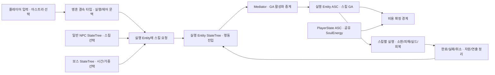

# 스킬

> 최신: 2026-10-26 공통 실행 기반·보스 소환기 C++ 반영. 사용자 GA/Task/DA/몽타주 연결 및 전체 빌드·PIE는 미수행
> 사용자 지정: 보스 전용 구현보다 플레이어·아스트라·스킬 보유 NPC를 함께 고려한 구조 설계 우선
> 용어 확정: 영혼 결속은 플레이어가 아스트라의 스킬을 사용하는 체계. 공통 스킬과 별개의 중복 스킬 시스템을 뜻하지 않음

## 공통 사용 형식 DA — 2026-10-28

사용자 범위 확인: 추가할 구분은 소환/공격 같은 효과 종류가 아니라 **즉시 사용형/채널링형**. 일반 스킬과 아스트라 영혼 결속이 같은 기본 `UEntitySkillDataAsset.UseType`을 사용한다. 사용 형식마다 별도 DA 상속 계층이나 일반/영혼 결속 전용 실행 체계를 만들지 않음.

| 항목         | 현재 C++ 정의·의미                                                    |
| ---------- | --------------------------------------------------------------- |
| UseType    | EEntitySkillUseType: Instant / Channeling. Blueprint·DA에서 조회/설정 |
| Instant    | 즉시 사용. 기존 BeginExecution 실행 후 완료, Duration=0                    |
| Channeling | Duration 동안 시전 실행 유지. Duration>0                                |
| Duration   | 기존 공통 필드 재사용. 시전 실행 시간이며 소환물/실드 등 생성 효과의 별도 유지 시간 아님            |
| 소환 DA 기본값  | Channeling. 기존 즉시 첫 생성→간격 소환→Duration 종료 흐름 유지                  |

기본 스킬 DA의 Abstract는 공통 정의 기반이라는 의미다. 소환 파생 DA는 소환 BP/수량/배치 같은 효과 고유 수치를 추가하며, 사용 형식을 상속 타입으로 구분하는 의미가 아니다. 현재 간격형 소환 실행은 기존 채널링 동작을 유지한다.

사용 형식과 Duration이 맞지 않으면 정의 유효성 검사에서 거부한다. Instant로 바꾸면 Duration도 0으로 설정하며, Channeling은 양수 시전 시간을 지정한다. Duration은 둘 다 보이도록 유지해 숨겨진 이전 값 때문에 설정을 고칠 수 없는 상태를 만들지 않음. 미정 채널링 시간은 기존 0으로 비워 두며 사용자 입력 전에는 유효하지 않음.

영혼 결속의 Possession/DirectSkill/Transform/Totem은 별도의 기획 메커니즘이고, 즉시/초당 자원 소모는 비용 방식이다. 이를 UseType과 일대일로 자동 매핑하지 않는다. 빙의/변신/비용·입력 유지/해제·환불 정책 실행은 아스트라 제작 단계 범위 유지. 이번 변경은 공통 사용 형식 데이터와 기존 Duration 실행의 정합성 검사를 추가한 것.

수정 Source 2개: EntitySkillDataAsset.h/.cpp, 백업 `Saved/CodexChanges/SkillUseType-20261028-164856`. 기존 소환 DA에 새 필드가 없으면 소환 클래스 기본값 Channeling 사용. 실제 기존 에셋 로드/기본값 확인은 사용자 전체 빌드·Editor 재시작 후 수행. 빌드·UHT·Editor·PIE 미수행.

## 현재 구현 — 2026-10-26

사용자 최종 확정: **첫 좀비는 채널링 시작 즉시 생성. 일반 취소 시 이미 소환된 좀비 유지. 보스 사망 시 자기 소환물 전부 제거. 생존 수 상한 없음.** 다음 표는 현재 Source이며, 아래 10월 25일 검토안·26일 사전 점검 이력보다 우선한다.

| 소유자 | 현재 책임 |
|---|---|
| UEntitySkillDataAsset / UEntitySummonSkillDataAsset | SkillId·AbilityTag·Duration·실행 클래스/행동 조건, 소환 BP·시전당 수량/간격/배치 수치 |
| Entity DA.Skills | 보유 정의의 단일 목록과 NPC 자동 선택 가중치. 미보유 DA 요청 거부 |
| 캐릭터 BP.StartupAbilityClasses | 기존 Entity ASC에 구체 GA 부여. 스킬 DA에서 별도 부여하지 않음 |
| 선택적 UEntitySkillComponent | Context 참조 기반 요청·시전 ID·결과·시전 몽타주/이동 잠금·시전 뒤 생성물 목록. 캐릭터 BP에서 사용하는 Entity에만 추가 |
| UEntitySkillExecution | 한 시전의 수행 확장점. 보스/플레이어/무기 종류 switch 없음 |
| UEntitySummonSkillExecution | 즉시 첫 생성·DA 주기별 나머지 생성, 소환 Agent NavMesh/바닥·캡슐 공간 배치 |
| 기존 Entity Tick | SkillComponent.UpdateSkill 호출. 새 Component Tick·Timer 없음 |
| 기존 StateTree/Mediator/사용자 GA | UpperCommand.Skill → Skill Task → Mediator 활성화 → GA Commit → BeginRequestedSkill. GA가 State.Skill.Casting 소유 |
| NPCAIController | Entity DA.AutomaticSkillInterval·양수 가중치로 후보 선택. 일반 무기 성공과 무기/GA 종료 후 요청, 종료 뒤 현재 Brain 이동 의도 재요청 |
| ABP.ActionAnimations.SkillMontages | SkillId별 현재 캐릭터의 채널링 몽타주. 종료 시간은 DA 소유 |
| Utils/Debug/UAstraDebugSubsystem | Skill.Execution 중앙 옵션·시전 ID/생성/결과 로그 |

소스: `Source/Astra_SoulLink/Entity/Combat/Skill/EntitySkill{DataAsset,Execution,Component}.h/.cpp`. 기존 19개 Source/Config 수정·신규 6개. 이전 파일 백업 `Saved/CodexChanges/SharedSummonSkill-20261026-213811`. 중복 Attack Component/Handler·보스 전용 Skill Component·별도 ASC/입력 시스템은 만들지 않았다.

### 실행 계약과 수명

```text
등록 원본 DA → RequestSkill(실행 Entity의 Component, Target, Requester, CostASC)
→ 정의 복제/고유 ID → UpperCommand.Skill
→ 사용자 Skill Task → 기존 Mediator → 사용자 GA
→ GA CommitAbility → BeginRequestedSkill(저장 ID, AbilityTag)
→ 실행 인스턴스/몽타주/이동 잠금 → 즉시 첫 소환 → 간격별 소환
→ Duration 종료 또는 실패/취소 → 실행 ID 무효화·해당 몽타주/잠금 정리
→ OnSkillFinished → GA 종료·Casting 해제 → Task 결과 → 현재 Brain 행동
```

- 요청·실행은 실행 Entity Authority에서 처리. 실행자는 Component Owner로 고정. Requester/CostASC는 별도 참조로 보존하되 이번에는 자원을 소비하지 않음. 현재 Possess Pawn을 통해 실행자/지불자를 바꿔 찾지 않음.
- 원본 정의는 Entity DA.Skills에 등록되어야 하고 정확한 Asset Tag를 가진 부여 GA 하나만 매칭되어야 함. 활성 GA와 Casting 태그가 없으면 실제 실행 시작 거부. GA/StateTree를 건너뛰어 직접 소환하는 우회 경로 없음.
- 시전 정의는 요청 시 복제. 이전 GA/Task의 CancelSkill은 저장 ID가 현재 ID와 같을 때만 적용. 정상/실패/취소 결과는 한 번 확정하고 자체 Delegate/몽타주만 정리.
- `(SpawnCount−1)×SpawnInterval ≤ Duration`. 첫 생성 0초, 이후 간격별 생성. 마지막 생성 뒤에도 Duration까지 채널링. 시전당 수량과 살아 있는 총수는 별개.
- 소환 위치를 확보하지 못하면 Failed, 이미 생성된 개체는 유지. 일반 취소도 앞으로의 소환만 중단. 사망/EndPlay는 앞선 시전까지 포함한 자기 소환 목록 전체 제거. 다른 시전자의 개체는 유지. 직접 제거에서 Death GA·처치 보상은 호출하지 않음.
- 이동 잠금은 정의의 bLocksMovement 소유. 살아 있고 잠금 당시 MOVE_None을 여전히 소유할 때만 원래 MovementMode 복구. 경로/목적지는 저장 복원하지 않고 NPC가 현재 Brain 의도를 다시 요청.
- 스킬 요청/시전 중 새 일반 공격 요청을 막고 Casting 중 발사·재장전·조준·일반 수납·꺼내기를 차단. 강제 취소·사망 경로 유지. 보스의 일반 피격 중단 정책은 기존 Entity DA 설정을 사용.
- 자동 선택 간격 0 또는 가중치 0은 자동 선택 비활성. 자동 시전은 일반 무기 GA 종료 뒤만 가능하며 다른 일반 공격 성공 없이 스킬끼리 연속 시전하지 않음. 이 간격은 스킬 자체의 GAS 쿨다운이 아님.

정확한 클래스 기본값·노드·핀·전이·정상/실패/취소·확인표는 [공통 스킬·보스 소환기 연결](../07_QA_테스트/공통%20스킬·보스%20소환기%20연결.md)을 기준으로 한다. 아래 도식의 SoulEnergy 비용/네 결속 타입은 아스트라 제작 단계 확장 요구이며 현재 연결 완료가 아니다.

### 확인과 잔여

25개 Source/Config의 변경 diff·공백·중괄호·generated include·선언/정의/호출 경로 정적 대조, 시간/생성물 소유/직렬 선택 모델 18조건 확인. 빌드·UHT·Editor·Blueprint/StateTree Compile·실제 NavMesh/충돌/몽타주/PIE 미수행. 새 테스트/검증 스크립트 파일 없음.

현재 잔여는 사용자 소환 GA/Upper Task·State/DA/ABP 연결 및 플레이 검증, 이어서 전멸기. 영혼 결속의 파티 명령·교차 ASC 비용 확정/환불·제어 전환/외형 변경·동일 기술 잠금은 아스트라 제작 시 구현. 이번 소환 코드가 해당 기능을 이미 구현한 것으로 간주하지 않음.

## 설계 의도

스킬 요청자·실행자·비용 지불자를 구분하고 실행 수명을 하나의 GA가 소유하는 구조. 보스의 자동 선택 규칙과 실제 소환·범위 피해 실행 분리. 기존 Entity ASC·PlayerState 자원 소유 유지.

## 소환기 재개 사전 점검 — 2026-10-26

아래는 코드 작성 전 점검 이력. 당시 미구현/질문 상태와 이후 상단 구현 완료·사용자 확정을 구분한다.

사용자: '이정도면 좀비는 괜찮은 것 같으니 스킬로 넘어가야 함'. 좀비 본체 작업은 사용자 현재 확인 상태로 진행 종료, **소환기→전멸기→아스트라/영혼 결속** 순서로 재개. 이 보고를 모든 앞선 변경의 전체 빌드·회귀 테스트 결과로 확대하지 않음.

### 현재 Source와 보관 초안 대조

| 영역 | 확인 결과 | 다음 구현에서 사용할 경계 |
|---|---|---|
| Entity ASC·GA 부여 | Entity별 ASC·StartupAbilityClasses 존재 | 스킬용 별도 ASC/GA 부여 시스템 신설 없음 |
| GA 활성화·취소 | Mediator.TryActivateAbilityByTag/CancelAbilityByTag 존재 | 사용자 StateTree Task와 구체 BP GA가 기존 중계 재사용 |
| 공통 GA 상속 | AstraEntityGameplayAbilityBase는 InstancedPerActor·Attribute 조회, Weapon 파생은 카메라/Weapon Context 제공 | 스킬을 Weapon GA 전용 경로에 종속시키지 않음 |
| 현재 공격 | WeaponComponent·Sequence/Commit Handler가 맨손/무기 실행 소유 | 스킬 때문에 EntityAttackComponent를 복원하거나 Weapon 공격을 다시 제작하지 않음 |
| 실제 소환/채널링/시전 결과 | 현재 Source에 없음 | 소환 전용 수치·실행과 공통 요청/완료 수명은 추가 필요 |
| 생성물 수명 | 시전 종료 뒤 좀비 유지·보스 사망 시 제거를 소유할 공통 코드 없음 | GA 한 시전의 완료와 생성물 소유자 수명 분리 |
| 표현 | 캐릭터별 몽타주 ABP, 효과 CombatEffectSubsystem | 별도 보스 애니메이션/효과 매니저 신설 없음 |

보관 중인 `DeferredDuplicateDraft`는 Source가 아님. SkillComponent.cpp에 삭제된 EntityAttackComponent 참조가 있고, CanRequestSkill의 헤더/구현 서명도 일치하지 않아 그대로 복원하지 않음. BossOnlyDraft의 보스 전용 구조도 공통 구현으로 취급하지 않음. 이번 점검에서 Source 수정·초안 복원·빌드·Editor 조작 없음.

### 첫 구현의 구체 범위

- **공통 요청/결과**: 아래 책임 표의 EntitySkillComponent 후보에 해당하는 최소 실행 Facade만 검토. 기존 기능과 중복되는 무기 공격/GA 활성화/비용/AI 선택 타이머를 넣지 않음. 채택 시 역할은 요청 ID·정의/대상 참조·현재 시전·결과 사건 및 시전 뒤 생성물 추적.
- **실제 수행**: 소환 실행부에서 DA의 채널링 시간·첫 생성 시점·소환 간격·시전당 수량·배치 반경·좀비 BP를 사용. 생존 중인 좀비 총수에는 상한 없음. 배치는 NavMesh·캡슐 공간을 검사하고 벽 안 강제 생성하지 않음. 미정 수치를 예시 기본값으로 확정하지 않음.
- **GA/StateTree**: 구체 GA·Task·DA 에셋은 사용자 생성 범위 유지. 기존 Task→Mediator→GA 활성화, GA→실행 시작/완료/취소 패턴 재사용. 스킬 종료·실패·취소 결과는 실행 ID로 구분하여 이전 Delegate가 다음 시전을 끝내지 않게 함.
- **애니메이션**: 소환용 채널링 몽타주는 보스 ABP의 스킬별 매핑으로 소유하는 방향. 소환 시각은 DA의 간격으로 제어하며 근접 Melee_Hit나 Weapon_FireCommit을 재사용하지 않음. 문서의 Revenent Idle은 선택된 모션이며 최종 보스 Skeleton 리타게팅/몽타주 연결 완료를 뜻하지 않음.
- **행동 조정**: 유탄 공격 완료 후 스킬 시작, 채널링 중 이동/일반 공격 중단, 종료 후 현재 Brain 의도로 복귀. 보스의 시간/가중 자동 선택은 공통 실행부와 분리하고 실제 소환 한 시전을 연결한 뒤 통합.
- **정리**: 보스 사망/제거에서 자기 소환물만 정리, 다른 보스/다른 시전자의 소환물은 유지. 강제 제거는 좀비 정상 처치와 구분하여 사망 보상 경로를 임의 호출하지 않음.
- **후속**: 전멸기는 같은 요청/GA/결과 기반에 별도 수행으로 추가. 영혼 결속의 요청자/실행자/PlayerState 비용은 아스트라 단계에서 연결하고 현재 자원 정책 미정을 보스 작업으로 확정하지 않음.

### 사전 질문과 이후 확정

1. 첫 좀비 생성 시각 → 사용자: **채널링 시작과 동시에 생성**.
2. 사망 외 채널링 중단 시 기존 생성물 → 사용자: **이미 소환된 좀비 유지**.

위 답변을 상단 C++에 반영. 보스 사망 시 자기 좀비 모두 제거는 기존 확정 유지.

영혼 결속의 기준 문서는 [기획](../02_게임%20기획/시스템%20기획/영혼%20결속.md)·[타입별 상세](../02_게임%20기획/시스템%20기획/영혼%20결속%20상세.md)·[시스템 설계](영혼%20결속.md). 이 문서는 해당 기획을 대체하지 않고 적 스킬과 공유할 실행 경계를 정의하는 검토안.



## 현재 코드와 검토안 구분

- 2026-10-26 사전 점검: 공격 Facade는 기존 WeaponComponent, 공격 순서·몽타주·쿨다운은 기존 AttackSequenceHandler, 근접 타격은 기존 AttackCommitHandler의 분기 확장 우선. EntityAttackComponent·MeleeAttackHandler를 별도 신설하지 않음. 중복 초안은 Source 밖으로 분리하고 작성 직전 상태로 복구. 플레이어 맨손·Club/Blade 근접 무기의 공통 실행 및 별도 돌진/타격 거리 설계 포함. [누락 기능·최소 변경안](근접%20공격·소환기%20사전%20점검.md) 참조
- 현재 구현: Entity마다 Pawn 소유 ASC, StartupAbilityClasses 부여, StateTree→Mediator의 GA 활성화 요청, 공통 체력·피해·사망 경로
- 현재 구현: PlayerState ASC의 SoulEnergy 초기화, EntitySoulEnergyComponent의 CanPay/CommitCost API 존재. PlayerCharacter가 이 컴포넌트에 Entity ASC를 전달하는 연결 불일치 및 자원 변경 알림 누락 확인. 실제 스킬 소비·교차 ASC 비용 확정은 미연결이며 [영혼 결속의 자원 보완 항목](영혼%20결속.md#아스트라-제작-시-먼저-보완할-자원-연결)에서 관리
- 현재 구현: 캐릭터별 행동 몽타주는 ABP 소유, 시각 효과 생성/정리는 CombatEffectSubsystem 소유
- 2026-10-26 후속 구현: 상단 공통 요청/소환 수명·자동 선택. 현재 미구현: 아스트라 기술 명령, 영혼 결속 동일 기술 잠금/비용, 전멸기 판정
- 작성 중이던 BossSkillComponent/BossSkillDataAsset/AstraBossSkillAbility 초안은 Saved/CodexChanges/BossSkills-20261025-223403/DeferredBossOnlyDraft로 분리. 기존 파일 변경은 해당 초안 작성 직전 내용으로 복원. 앞선 피격/추격 수정은 유지. 빌드·UHT·Editor 에셋 변경 없음

## 요청자·실행자·지불자

| 사용 사례 | 요청자 | 실행 GA 소유 ASC | 비용 지불자 |
|---|---|---|---|
| 플레이어 직접 스킬 | 플레이어 입력 경로 | 플레이어 육체의 Entity ASC | 해당 스킬의 비용 정책 |
| 아스트라 기술 명령 | 플레이어의 파티/영혼 결속 명령 경로 | 선택한 아스트라의 Entity ASC | 플레이어 PlayerState의 SoulEnergy |
| 일반 NPC 스킬 | NPC StateTree | 해당 NPC의 Entity ASC | 해당 스킬의 비용 정책 |
| 보스 스킬 | 보스 StateTree | 보스 Entity ASC | 현재 소환/전멸기는 별도 자원 비용 미지정 |

위 아스트라 명령 행은 아스트라가 직접 행동하는 기술의 기본 사례. 영혼 결속 전체를 '선택한 아스트라가 제자리에서 시전'으로 제한하지 않음. 변신형의 실제 행동 대상은 플레이어 육체, 빙의형은 제어권 전환을 포함하므로 아래 타입별 문맥 적용. PlayerState의 장기 자원/결속 쿨다운과 육체의 행동 ASC 경계 유지. 타입별 결속 세션과 GA 활성화 중계의 구체 배치는 구현 전 확정 대상.

- 요청자와 실행자가 달라도 실행자는 한 번의 요청에서 고정. 스킬 도중 현재 Possess된 Pawn으로 실행자나 비용 지불자를 다시 찾지 않는 방향
- 파티 명령 경로에서 실제 보유 아스트라·허용 스킬·조종 권한 검사. 임의 Actor 참조만으로 다른 NPC의 스킬 실행을 허용하지 않는 방향
- 아스트라 스킬을 사용할 때마다 PlayerState ASC의 Avatar를 아스트라로 교체하지 않는 방향. 다른 아스트라 기술의 동시 실행 및 플레이어 자원 소유와 충돌 방지
- 플레이어가 누른 기술과 적의 자율 기술이 같은 실행 경로로 합류. 일반 NPC의 비용 규칙·플레이어 직접 기술 종류는 미정

## 영혼 결속 타입별 요구

| 타입 | 실제 실행·제어 대상 | 소모 방식 | 문서에 정의된 종료·취소 | 공통 구조가 수용할 책임 |
|---|---|---|---|---|
| Possession · 빙의형 | 아스트라 육체를 플레이어가 직접 조종 | 지속 소모 | 게이지 0, 아스트라/플레이어 사망, 거리 초과, 특정 이벤트, 취소 | 원래 육체/컨트롤러 보존, 제어권·카메라·AI 복귀, 강화 해제, 종료 후 게이지 회복 |
| DirectSkill · 직접스킬형 | 아스트라의 단발 기술 | 즉시 소모 | 시전 애니메이션 완료, 시전 중 아스트라 피격/사망 | 행동 요청·판정·완료와 지속 효과 수명 구분, 타입의 피격 취소 정책 |
| Transform · 변신형 | 플레이어 육체의 외형·기능 | 지속 소모 | 게이지 0, 플레이어 사망, 특정 이벤트, 취소 | 외형/ABP/기능 복구, 변신 이동 제한, 해제 후 쿨다운 |
| Totem · 토템형 | 제자리에 고정된 아스트라 | 즉시 소모 | 지속 시간 만료, 아스트라 사망, 거리 초과, 상태이상 취소는 선택 | 해당 아스트라 이동 제한, 범위 지원 수명, 종료 후 현재 행동 복귀 |

- 최소 요구 게이지·플레이어 지상 조건은 영혼 결속 진입 규칙. 적 보스·일반 NPC의 모든 스킬에 동일한 플레이어 지상 조건을 강제하지 않음
- 일반 영혼 결속 상세는 빙의/변신의 쿨다운 존재와 직접스킬/토템의 스킬별 차이를 기록. 현재 프로토타입 방어·공격·회복 3종은 후속 제작 계획에서 **별도 쿨다운 없음** 확정. 이 예외를 모든 영혼 결속/적 스킬의 쿨다운 삭제로 확대하지 않음
- DirectSkill의 피격 취소는 기존 상세 기획에 명시. 보스의 일반 피격 중단 비허용을 아스트라 직접스킬에도 공통 적용하지 않음
- 네 타입의 기능·종료 조건은 기존 기획 요구. 네 타입 전체를 이번 보스 구현 범위에 포함하는 의미는 아님. 최초 공통 구조가 제어 전환·외형 변경·지속 비용을 막지 않도록 확장 경계 확보
- 프로토타입 방어/공격/회복은 기술의 역할, 위 네 타입은 사용 방식. 역할만 보고 회복=Totem·공격=DirectSkill처럼 임의 분류하지 않음
- 일반 스킬 요청 문맥에 실행 Entity 외에도 요청 플레이어/PlayerState·선택 아스트라·제어/유지 대상 참조를 구분하는 방향. 실행 중 현재 Possess Pawn으로 이 참조들을 재계산하지 않음
- 거리 초과·최소 게이지·소모량·쿨다운 수치와 Totem 상태이상 취소 선택은 기존 미정 상태 유지. 즉시 소모의 정확한 확정 프레임 및 실패/취소 환불도 미정

## 책임과 데이터

아래는 최초 역할 설명용 후보 표이며 실제 클래스·소유권은 상단 현재 구현 표를 우선. 비용·영혼 결속·범위 피해 표현은 후속 요구다.

| 역할                            | 소유 내용                                          | 소유하지 않는 내용                          |
| ----------------------------- | ---------------------------------------------- | ----------------------------------- |
| SkillDefinition DA            | SkillId, 실행 GA, 스킬별 정적 수치·대상 규칙·비용 정의          | 현재 실행 상태, 보스 무작위 선택 시각, 캐릭터별 몽타주    |
| EntitySkillComponent 후보       | 실행 Entity의 요청 접수·동일 요청 식별·현재 스킬 조회·취소 전달·결과 사건 | 보스 전용 패턴, 파티 자원 원본, GA와 중복되는 별도 쿨다운 |
| EntitySkillGameplayAbility 후보 | 실행 시점 재검사, 비용·쿨다운 확정, 실행 시작, 종료/취소의 단일 소유      | 플레이어의 키 입력, 보스가 다음에 어떤 기술을 선택할지     |
| 스킬별 실행부                       | 소환·범위 판정·실드·회복 등의 실제 실행과 멱등 정리                 | AI의 다음 행동 선택, 자원 무단 차감              |
| StateTree                     | 실행 가능 후보 선택, 스킬 행동 진입/이탈, 이동·무기와의 전이           | 비용 선차감, 효과 생성과 직접 피해 계산             |
| Mediator / EventBus           | 요청·행동 사실·결과 중계                                 | 스킬 종류별 거대 switch, 월드 범위 계산          |
| ABP                           | SkillId별 현재 캐릭터의 시전·채널링·종료 몽타주 표현              | 스킬 사용 허가와 피해 시각 확정                  |
| CombatEffectSubsystem         | 예고·채널링·폭격 효과의 생성/갱신/제거                         | 피해량·소환 수량·비용 결정                     |

- 공통 실행부에서 Boss/Player/Astra 여부로 분기해 스킬 종류를 결정하지 않는 방향
- 모든 기술을 Summon/Bombardment enum 두 가지로 제한하지 않는 방향. 소환·반복 범위 피해·실드·회복은 각 GA와 실행부로 확장
- 즉발·채널링·지속 효과는 실행 형태. 모든 스킬이 채널링 시간이나 반복 판정을 가져야 하는 구조로 일반화하지 않음
- 구체 GA는 Blueprint에서 조합, 공통 생명주기·계산·엔진 API 래퍼·실패 정리는 C++ 책임. 스킬 하나마다 별도 ActorComponent를 붙이는 방식은 기본 구조로 두지 않음
- 플레이어의 요청 식별자, 실행 Entity, 지불자, 대상 정보는 요청 문맥으로 전달. EntityContext는 현재 규칙대로 참조만 보관

## 시전과 효과 수명

시전 종료와 효과 종료 구분. 예를 들어 소환기는 채널링이 끝나도 이미 소환된 좀비가 남고, 실드는 시전 동작 뒤에도 보호가 지속될 수 있는 구조.

- 실행 단위마다 고유 식별자 사용. 이전 실행의 완료 Delegate가 다음 실행을 종료하지 않는 방향
- GA가 정상/실패/취소 결과와 정리를 한 번만 확정. StateTree Exit·사망·EndPlay가 같은 정리를 중복 요청해도 안전한 방향
- 사망/기절/일반 피격/입력 해제의 취소 여부는 각 행동 정책. 일반 피격을 모든 스킬의 무조건 취소로 연결하지 않음
- 이동 차단·일반 공격 차단은 해당 스킬 행동이 소유. 종료 시 현재 StateTree 의도에 맞춰 복귀하며 과거 이동 상태를 강제로 복원하지 않음
- 몽타주 중단·필수 설정 누락·유효 대상 소실 시 안전한 실패/취소 처리. 예정된 피해·소환·경고가 유령 실행으로 남지 않는 방향
- 채널링 동안 확정된 소환 객체와 진행 중인 시전 효과 구분. 사용자 확정: 일반 시전 취소는 이미 생성된 좀비 유지, 보스 사망/제거는 자기 소환물 전체 제거. 별도 인카운터 회차 전환의 구체 연결은 후속

## 공유 자원과 중복 사용

- 아스트라 기술은 플레이어가 요청하더라도 해당 아스트라 GA에서 실제 실행 허가 재검사
- 플레이어가 요청할 때의 자원 사전 검사와 GA 발동 시 비용 확정 구분. 사전 검사에서 자원 소비 없음
- 서로 다른 아스트라 기술의 동시 요청은 같은 PlayerState 자원 원본을 사용하므로 Authority의 비용 확정 경계에서 잔액 재검사, 중복 차감 방지
- 비용 차감을 EntitySkillComponent·GA·PlayerController에 중복 구현하지 않는 방향
- 프로토타입 아스트라 3종은 별도 쿨다운 없음. 일반 NPC/보스의 선택 간격을 공통 스킬 쿨다운으로 취급하지 않음
- 같은 기술 사용 중 재사용 불가, 다른 아스트라 기술 동시 사용 가능은 확정. 잠금은 요청 전체를 막는 플레이어 전역 bool이 아니라 SkillId별 상태로 구분하는 방향
- 같은 기술의 사용 중 범위를 시전 종료까지 볼지 효과 종료까지 볼지, 비용 확정 시점·발동 실패/취소 시 환불은 미정. 미정 정책을 임의 기본 동작으로 확정하지 않음

## 보스에 적용할 확정 정책

| 항목 | 사용자 확정 |
|---|---|
| 특수 선택 기준 | 지정 시간 경과 후 현재 유탄 공격이 끝나면 무작위 스킬 선택 |
| 일반 공격 관계 | 유탄과 스킬을 순서대로 실행 |
| 이동 | 스킬 채널링 중 이동 불필요 |
| 두 기술 실행 | 소환기·전멸기 각각 하나의 GA, 채널링 완료 후 상황에 맞춰 Brain 동작 |
| 소환 시각 | 채널링 중 일정 간격으로 나누어 소환 |
| 좀비 생존 수 | 제한 없음. 누적 개체가 보스 공략을 방해하는 의도 |
| 소환 개체 정리 | 보스 사망 시 자신이 소환한 좀비 제거. 전투 정리와 사망 보상 드롭 구분 |
| 전멸기 예고 | 빨간 큰 원 + 작은 원 확대 |
| 첫 피해 | 예고 종료 후 DamageInterval만큼 대기 |
| 이후 피해 | 약 2초의 폭격 구간에서 간격마다 반복, 최대 체력 비율 그대로 적용·방어력 무시 |
| 실드 | 피해 무효 실드 유지 |
| 수치/에셋 | 채널링 시간·소환 수량/간격/반경·좀비 BP·피해 간격/비율·반경·효과는 DA에서 지정, 미정 값 공란 |

보스의 시간/가중 선택과 무기 완료 대기는 보스 AI 정책으로 분리. 공통 스킬 실행부에 일반 공격 횟수·특수 공격 타이머·보스 Brain 참조를 기본 필수 상태로 넣지 않는 방향.

## 전체 실행 순서 검토안

```text
플레이어 입력 / NPC AI / 보스 AI
→ 요청 문맥 생성: 요청 ID·SkillId·실행 Entity·지불자·대상 정보
→ 권한·보유 기술·생존·현재 행동·동일 기술 사용 여부 사전 검사
├─ 실패 → 거절 결과, 비용/효과 변경 없음
└─ 통과 → 실행 Entity StateTree의 스킬 행동 진입
   → 필요한 이동/무기 상태 전이 → Mediator로 GA 활성화 요청
   → 실행 Entity ASC의 GA에서 권한·사망/기절·비용·대상 재검사
   ├─ 실패 → 실패 결과 → 현재 StateTree 의도로 복귀
   └─ 통과 → 정의된 시점에 비용 한 번 확정 → 스킬별 실행
      ├─ 즉발 → 판정/생성 → 완료
      ├─ 채널링 → 예고/몽타주 → 스킬별 주기 실행 → 완료
      └─ 지속 효과 → 정의된 소유자/수명으로 유지 → 종료
완료 → 해당 실행의 Delegate/예고/시간 예약 정리 → 결과 사건 → 현재 행동 선택
취소/사망/강제 이탈 → 해당 실행만 취소 → 잔여 판정/연출 정리 → 취소 결과
피해가 이미 확정된 효과·소환 객체 → 해당 효과/인카운터 수명 정책 적용
```

## 구현 전 확정할 항목과 진행 순서

2026-10-25 사용자 지정 순서: **보스 → 아스트라**. 영혼 결속 실제 구현은 아스트라 제작 시 수행. 아래 두 단계는 제작 순서이며 날짜 재산정은 별도.

1. 보스 단계: 공통 요청·실행 Entity·GA 생명주기·취소 결과 경계 확정. 공통 실행 진입과 기존 StateTree/Mediator 연결을 만들고 보스 소환기·전멸기에 적용. 자동 시간/가중 선택과 유탄 종료 대기는 보스 AI 정책으로 분리. 파티 명령·SoulEnergy 비용·빙의/변신 구현을 선행 조건으로 두지 않음
2. 아스트라 단계: 같은 실행 기반에 영혼 결속 요청·선택 아스트라·지불자 연결 추가. 기존 SoulEnergy ASC 바인딩/변경 알림 보완 후 비용 확정/환불·동일 기술 사용 중 범위 확정. 방어·공격·회복과 공유 자원·서로 다른 기술 동시 사용 검증. 네 결속 타입 전체의 이번 프로토타입 구현 여부는 별도 범위 판단

보스 단계에서도 요청자·실행자·지불자가 같다는 가정을 공통 API에 고정하지 않음. 아스트라 세부 정책은 확장 경계로 남기며 미정 자원 비용·환불 규칙을 보스 제작을 위해 임의 확정하지 않음.

시전/실패/취소/사망, 무기 공격과 채널링 전환, 채널링 종료 후 추격/공격 복귀는 이번 사용자 연결 후 검증. 교차 아스트라 동시 비용·Possess 변경은 아스트라 제작 시 검증. 최초 검토안 이후 현재 구현/확인 범위는 상단 기준이며 빌드·PIE 미수행.

## 관련 문서

- [프로토타입 제작 계획](../01_일정%20관리/2026년%2012월%20프로토타입%20제작%20계획.md)
- [시스템 아키텍처](시스템%20아키텍처.md)
- [StateTree와 GAS](StateTree와%20GAS.md)
- [영혼 결속](영혼%20결속.md)
