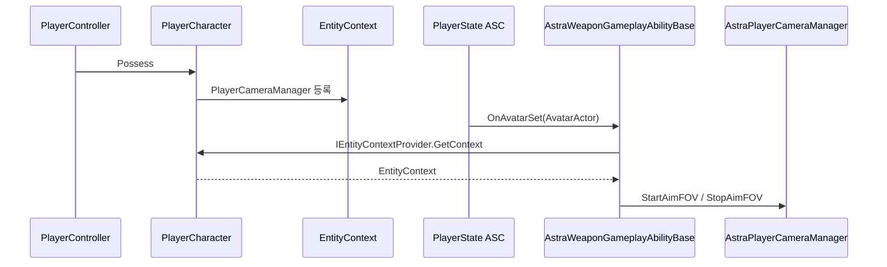
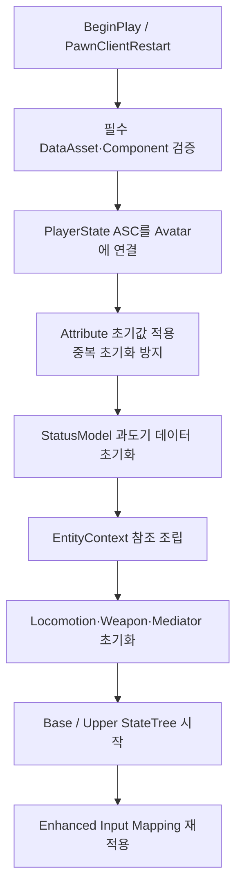

# 시스템 아키텍처

## 설계 의도

## 1. 적용 원칙

현재 프로젝트는 Unity 시절의 Pure DI 계층을 그대로 재현하지 않음 Unreal의 Actor, Component, PlayerState, StateTree, Gameplay Ability System 생명주기에 맞추되 다음 철학은 유지

- 데이터 주도 설계: 정적 정의와 런타임 인스턴스 데이터를 분리
- 중재자 패턴: 하위 컴포넌트끼리 직접 결합하지 않고 엔티티 정책은 Mediator가 라우팅
- 단일 소유권: 하나의 사실을 여러 시스템이 동시에 수정하지 않음
- 이벤트 주도: 상태 간 요청은 GameplayTag 기반 StateTree Event와 EventBus를 사용
- Context는 참조 가방: 판단과 실행 로직을 넣지 않음

객체의 기획 분류는 [게임 객체 분류](../02_%EA%B2%8C%EC%9E%84%20%EA%B8%B0%ED%9A%8D/%EA%B2%8C%EC%9E%84%20%EA%B0%9D%EC%B2%B4%20%EB%B6%84%EB%A5%98.md)의 `Entity / Item / Prop`을 사용 `Interactable`, `Damageable`, `Shop` 같은 기능은 객체 정체성이 아니라 조합 가능한 Capability.

## 2. 현재 계층

| 계층 | Unreal 타입 | 책임 |
|---|---|---|
| 레벨 규칙 | GameMode / GameInstance / Subsystem | 레벨·게임 규칙과 전역 서비스. 현재 별도 Installer/Director 계층은 만들지 않습니다. |
| 입력·조작권 | PlayerController | Enhanced Input·Pawn 조작권·카메라·HUD·Inventory Menu 관리. 영혼 결속의 조작 대상 전환 |
| 플레이어 지속 상태 | `AAstraPlayerState` | ASC·AttributeSet·Inventory·Gear·ItemTransfer 소유. Pawn 교체 시 쿨다운·자원·아이템 유지 |
| 엔티티 셸 | `APlayerCharacter` | Component 조립·엔진 생명주기·입력 전달·Possess 시 Context 갱신 |
| 엔티티 중재 | `UEntityStateMediatorComponent` | Base/Upper StateTree·Health·ASC의 이벤트 라우팅과 충돌 정책 |
| 상태 선택 | `UStateTreeComponent` | 조건 평가·상태 선택·Task 실행 |
| 실행 | `UEntityLocomotionComponent`, `UWeaponComponent` 등 | CharacterMovement·Motion Warping·무기 장착·발사 API 호출 |
| 참조 묶음 | `UEntityContext` | StatusModel·Locomotion·Weapon·ASC·Health·Mediator·EventBus·로컬 PlayerCameraManager 참조 |
| 런타임 데이터 | ASC/AttributeSet, ItemInstance, WeaponInstance, 현행 StatusModel | 소유자별 스탯·자원·아이템·입력·실행 상태 관리 |
| 정적 데이터 | Primary DataAsset | 캐릭터·무기·발사체 튜닝값과 애셋 참조 |
| 표현 | AnimBP, Montage, Aim Offset, Control Rig | 게임플레이 상태 읽기·시각화. 상태 직접 소유 없음 |

Inventory Menu도 같은 원칙을 기준 PlayerController 소유 `UInventoryMenuComponent`가 PlayerState의 Inventory·Gear·ItemTransfer와 Widget 사이를 중계하며, Blueprint Widget은 Slot이나 ItemInstance의 소유자가 되지 않음 World Item 생성은 `UWorldItemFactorySubsystem`이 담당하고 ItemTransfer는 준비·보관 위치 제거·활성화 순서로 Drop Transaction을 조율

## 3. 객체별 소유권

### AstraPlayerState

플레이어의 Ability System을 소유

- `UAbilitySystemComponent`
- `UEntityAttributeSet`
- `UPlayerAttributeSet`
- Pawn 교체 후에도 유지해야 하는 자원과 쿨다운

현재 싱글 플레이가 목표여도 PlayerState를 사용하는 이유는 서버 구현 때문만이 아니라 **Avatar 교체와 지속 상태의 분리** 때문 향후 빙의 시 PlayerController가 다른 Pawn을 조작해도 PlayerState의 ASC, 쿨다운, Inventory와 Gear 상태를 유지 가능

### PlayerCharacter

- 로코모션, 무기, StateTree, Mediator 등 엔티티 컴포넌트를 소유·초기화
- 입력을 직접 실행 로직으로 바꾸지 않고 요청으로 전달
- ASC의 Avatar로 등록됨
- 무기 소지 여부에 따라 회전 방식과 카메라 표현을 갱신
- `PossessedBy`, `OnRep_PlayerState`, `PawnClientRestart`, `UnPossessed`에서 로컬 PlayerCameraManager 참조를 EntityContext에 갱신

PlayerCharacter는 이벤트 허브의 세부 정책을 직접 소유하지 않음 상·하체 간 상태 충돌은 `EntityStateMediatorComponent`가 담당

### EntityStateMediatorComponent

현재 구현된 핵심 정책은 다음과 같습니다

| 원인 | 결과 |
|---|---|
| 상체 Fire 또는 Aim 진입 | Base StateTree에 Sprint 취소 명령 |
| Base Sprint 진입 | 상체 행동 취소 및 강제 Holster |
| Base Airborne 진입 | 상체 행동 취소 및 강제 Holster |
| Base Traversal 진입 | 상체 행동 취소 및 강제 Holster |
| 피해 발생 | 상체 행동 취소, 하체 HitReaction 요청 |
| 사망 시작 | 상체 취소·비활성화, 하체 Death 요청, 모든 Ability 취소 |

Mediator는 StateTree의 현재 상태를 직접 쓰지 않음 `SendStateTreeEvent`로 명령을 보내며 Condition이 전이 가능 여부를 결정

### EntityContext

`UEntityContext`는 다음 참조만 보관

- StatusModel
- LocomotionComponent
- WeaponComponent
- AbilitySystemComponent
- HealthComponent
- StateMediator
- StateEventBus
- PlayerCameraManager

- StateTree Condition/Task 바인딩: 가능하면 `Actor + EntityContext`
- 필요한 Component: Context에서 조회
- 초기화 순서: Context 구성 → StateTree 시작
- 순서 위반 시 `None` 참조 오류 가능

Context는 카메라 동작을 실행하지 않음 `PlayerCameraManager` 참조만 보관하고, 실제 FOV 보간은 `AAstraPlayerCameraManager::UpdateCamera`가 수행

## 4. Entity 행동과 Weapon Item 경계

무기 조준·발사·재장전 GA와 Upper StateTree는 Weapon Item의 행동이 아니라 **Entity가 무기를 사용하는 행동**. Weapon Item은 데이터와 인스턴스 상태, 실행 결과를 소유

| Entity 행동 계층 | Weapon Item 계층 |
|---|---|
| 입력·AI 명령 해석, 행동 가능 여부 | WeaponDataAsset의 정적 정의 |
| Locomotion/Actions StateTree | Inventory의 탄약 Reservation, WeaponInstance의 등록 탄약·강화·내구도 |
| GA 활성화·취소와 행동 충돌 정책 | WeaponComponent의 장착·발사·재장전 실행 |
| 행동 애니메이션과 카메라 정책 | 피해·사거리·탄속·반동·Muzzle·Projectile 결과 |

재장전 시 Entity는 행동과 제한을 소유 InventoryComponent는 Ammunition Instance와 Reservation, WeaponInstance는 등록 탄종·등록 탄수, WeaponComponent는 등록·소비 요청의 조율과 실행 결과를 담당 `GA_Weapon*` 이름은 “Weapon이 소유한 Ability”가 아니라 “Entity가 Weapon을 사용하는 Ability”를 뜻

## 5. Weapon Ability와 카메라 참조 경계

- PlayerState가 ASC를 소유하고 현재 Pawn을 Avatar로 등록
- `UAbilitySystemComponent`가 Ability 지급 또는 Avatar 변경 시 `OnAvatarSet`을 호출
- `UAstraWeaponGameplayAbilityBase`는 Avatar의 `IEntityContextProvider`를 통해 EntityContext만 캐시
- Weapon Ability는 PlayerController나 PlayerCharacter의 구체 카메라 구조를 직접 참조하지 않음
- `OnRemoveAbility`에서 Context 캐시를 제거

자세한 Gameplay Framework 생명주기는 [PlayerCameraManager 참조 구성](../08_%EA%B8%B0%EC%88%A0%20%EC%9C%84%ED%82%A4_%EA%B3%B5%ED%86%B5%20%EA%B0%80%EC%9D%B4%EB%93%9C/Unreal/Gameplay%20Framework/PlayerCameraManager%20%EC%B0%B8%EC%A1%B0%20%EA%B5%AC%EC%84%B1.md)을 참고

현재 `UAstraWeaponGameplayAbilityBase`는 PlayerCameraManager FOV 기능을 포함하므로 Player 의존성이 있음 Humanoid 공용 Ability로 확장할 때는 카메라 정책을 Player 전용 계층으로 분리하거나 인터페이스로 격리 필요

## 6. StatusModel과 GAS 전환

현행 코드에는 `EntityStatusModel`과 `PlayerStatusModel`이 남아 있음 하지만 장기 소유권은 다음과 같이 정리

| 데이터 | 목표 소유자 |
|---|---|
| 체력, 방어력, 이동 속도 | Entity AttributeSet |
| 스태미나, 영혼 에너지 | Player AttributeSet |
| 사망, 기절, 조준, 공격, 재장전 등 공유 상태 | ASC GameplayTag |
| Ability 비용·쿨다운 | GameplayEffect / ASC |
| 등록 탄종·등록 탄수와 개별 무기 강화값 | WeaponInstance |
| 탄약 Total·Reserved·Available | InventoryComponent |
| 장착 슬롯과 활성 WeaponInstance | GearComponent |
| 상태 선택과 흐름 | StateTree |
| 짧은 입력 의도 | PlayerController 또는 해당 요청 버퍼 |

StateTree는 영구 스탯 저장소가 아닙니다 Condition이 읽을 사실은 Attribute/Tag/Component가 소유하며, StateTree는 그 사실을 이용해 실행 상태를 선택

StatusModel은 현재 로코모션과 기존 Blueprint 연결을 유지하기 위한 과도기 계층 한 번에 제거하지 않고 Attribute/Tag로 옮긴 항목부터 책임을 삭제

## 7. 초기화 생명주기

- 초기화 함수: 중복 호출 안전성 확보
- PawnClientRestart: 기존 Mapping Context 제거 → 재등록
- 재소유 후 입력 중복 적용 방지

## 8. 향후 NPC와 Soul-Link 적용

- 일반 NPC는 자신의 ASC와 AttributeSet을 Pawn 또는 NPC 전용 지속 객체가 소유
- 빙의형 Soul-Link는 PlayerController가 NPC Pawn을 Possess.
- 플레이어의 고유 자원과 Soul-Link 쿨다운은 AstraPlayerState ASC에 유지
- 빙의 대상의 일반 공격은 대상 NPC의 AbilitySet과 Avatar 컴포넌트를 사용
- 변신 중에는 무기 사용을 차단
- 변신 해제 후에도 PlayerState ASC에 있는 Soul-Link 스킬 쿨다운은 유지

---

## 상위 페이지

- [03_시스템 설계](03_%EC%8B%9C%EC%8A%A4%ED%85%9C%20%EC%84%A4%EA%B3%84.md)

## 관련

- [StateTree와 GAS](StateTree%EC%99%80%20GAS.md)
- [무기 시스템](%EB%AC%B4%EA%B8%B0.md)
- [게임 객체 분류](../02_%EA%B2%8C%EC%9E%84%20%EA%B8%B0%ED%9A%8D/%EA%B2%8C%EC%9E%84%20%EA%B0%9D%EC%B2%B4%20%EB%B6%84%EB%A5%98.md)
- [PlayerCameraManager 참조 구성](../08_%EA%B8%B0%EC%88%A0%20%EC%9C%84%ED%82%A4_%EA%B3%B5%ED%86%B5%20%EA%B0%80%EC%9D%B4%EB%93%9C/Unreal/Gameplay%20Framework/PlayerCameraManager%20%EC%B0%B8%EC%A1%B0%20%EA%B5%AC%EC%84%B1.md)
- [ADR-001 EntityContext를 참조 경계로 사용](%EA%B2%B0%EC%A0%95%20%EA%B8%B0%EB%A1%9D/ADR-001%20EntityContext%EB%A5%BC%20%EC%B0%B8%EC%A1%B0%20%EA%B2%BD%EA%B3%84%EB%A1%9C%20%EC%82%AC%EC%9A%A9.md)
- [ADR-003 PlayerState가 장기 ASC를 소유](%EA%B2%B0%EC%A0%95%20%EA%B8%B0%EB%A1%9D/ADR-003%20PlayerState%EA%B0%80%20%EC%9E%A5%EA%B8%B0%20ASC%EB%A5%BC%20%EC%86%8C%EC%9C%A0.md)
