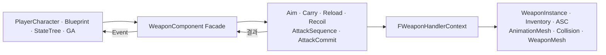
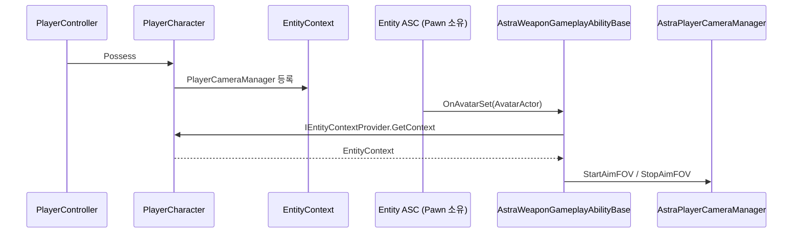
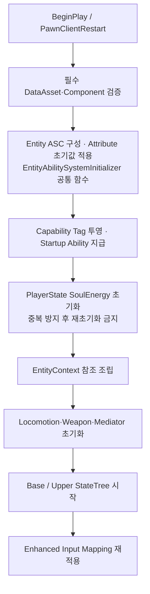

# 시스템 아키텍처

## 설계 의도

## 1. 적용 원칙

현재 프로젝트는 Unity 시절의 Pure DI 계층을 그대로 재현하지 않음 Unreal의 Actor, Component, PlayerState, StateTree, Gameplay Ability System 생명주기에 맞추되 다음 철학은 유지

- 데이터 주도 설계: 정적 정의와 런타임 인스턴스 데이터를 분리
- 중재자 패턴: 하위 컴포넌트끼리 직접 결합하지 않고 엔티티 정책은 Mediator가 라우팅
- 단일 소유권: 하나의 사실을 여러 시스템이 동시에 수정하지 않음
- 이벤트 주도: 상태 간 요청은 StateTree Event와 EventBus를 사용
- Context는 참조 가방: 판단과 실행 로직을 넣지 않음

객체의 기획 분류는 [게임 객체 분류](../02_%EA%B2%8C%EC%9E%84%20%EA%B8%B0%ED%9A%8D/%EA%B2%8C%EC%9E%84%20%EA%B0%9D%EC%B2%B4%20%EB%B6%84%EB%A5%98.md)의 `Entity / Item / Prop`을 사용 `Interactable`, `Damageable`, `Shop` 같은 기능은 객체 정체성이 아니라 조합 가능한 Capability.

## 2. 객체별 역할과 소유권

2026-10-28 사용자 지정: 객체 간 독립성과 불필요한 직접 참조 제한을 일관되게 적용한다. 아래 표의 분류는 역할·데이터 소유권이며 Controller > Character > PlayerState 같은 객체 상하 서열이 아니다. Controller·Character·PlayerState는 별도 Actor이고 Possess·엔진 생명주기로 연결된다. StateTree는 행동 선택을 담당하며 Actor들과 같은 의미의 플레이어 지속 상태 객체가 아니다.

| 계층 | Unreal 타입 | 책임 |
|---|---|---|
| 레벨 규칙 | GameMode / GameInstance / Subsystem | 레벨·게임 규칙과 전역 서비스. 현재 별도 Installer/Director 계층은 만들지 않습니다. |
| 입력·조작권 | PlayerController | Enhanced Input·Pawn 조작권·카메라·HUD·Inventory Menu 관리. 의미 입력을 `EntityInputBufferComponent`에 기록. 영혼 결속의 조작 대상 전환 |
| 플레이어 지속 상태 | `AAstraPlayerState` | SoulEnergy 전용 ASC·`PlayerAttributeSet`과 Inventory·Gear·ItemTransfer 소유. Pawn 교체 후에도 자원 원본 유지. 현재 `UEntitySoulEnergyComponent`는 PlayerCharacter 소유이며 자원 ASC 바인딩 보완 필요 |
| 엔티티 셸 | `APlayerCharacter` | Entity ASC·`EntityAttributeSet`·`EntityStaminaAttributeSet`·`EntityStaminaComponent`·`EntityHealthComponent`·`EntityInputBufferComponent` 등 육체 귀속 컴포넌트 조립. 엔진 생명주기·입력 전달·ASC Avatar 등록 |
| 엔티티 중재 | `UEntityStateMediatorComponent` | Base/Upper StateTree·Health·ASC의 이벤트 라우팅과 충돌 정책 |
| 상태 선택 | `UStateTreeComponent` | 조건 평가·상태 선택·Task 실행 |
| 실행 Facade | `UEntityLocomotionComponent`, `UWeaponComponent` 등 | 외부 실행 API 제공. 내부 기능 객체로 요청 위임. 결과 Event 중재 |
| 무기 기능 객체 | Aim·Carry·Reload·Recoil·AttackSequence·AttackCommit Handler | 조준·소지·재장전·반동·공격 순서·공격 1회 실행 책임 분리 |
| 참조 묶음 | `UEntityContext` | Locomotion·InputBuffer·Stamina·Weapon·ASC·Health·Mediator·EventBus·로컬 PlayerCameraManager 참조 |
| 런타임 데이터 | ASC/AttributeSet, ItemInstance, WeaponInstance, 입력 버퍼 | 소유자별 스탯·자원·아이템·의미 입력·실행 상태 관리 |
| 정적 데이터 | Primary DataAsset | 캐릭터·무기·발사체 튜닝값과 애셋 참조 |
| 표현 | AnimBP, Montage, Aim Offset, Control Rig | 게임플레이 상태 읽기·시각화. 상태 직접 소유 없음 |

Inventory Menu도 같은 원칙을 기준 PlayerController 소유 `UInventoryMenuComponent`가 PlayerState의 Inventory·Gear·ItemTransfer와 Widget 사이를 중계하며, Blueprint Widget은 Slot이나 ItemInstance의 소유자가 되지 않음 World Item 생성은 `UWorldItemFactorySubsystem`이 담당하고 ItemTransfer는 준비·보관 위치 제거·활성화 순서로 Drop Transaction을 조율

### 참조와 통신 계약 — 2026-10-28

**공통 실행부가 특정 조종자·AI 판단 구현을 몰라도 동작하도록 한다.** 직접 참조는 엔진 연결·조립·책임 소유자가 제공하는 좁은 공개 계약에 한정한다. 참조 가능 여부는 public/protected, Cast 성공, 약한 포인터 여부가 아니라 역할·변경 이유·수명으로 판단한다. 기반 클래스로 Cast하거나 Context에 포인터를 넣는 것만으로 정책 결합이 해소되지는 않는다.

| 경계 | 허용 경로 | 피해야 하는 경로 |
|---|---|---|
| 초기화·Possess·조립 | 엔진 API로 현재 Pawn/Controller/PlayerState 연결, 필요한 참조 제공·해제 | 실행 도중 전역 Player 0/현재 Possess를 임의 조회해 실행자·지불자 변경 |
| 정적 정의 조회 | 공통 Entity API로 해당 Entity DA의 자기 정책용 수치 읽기 | Character가 AI의 판단 상태를 조회해 다음 Brain 전이 결정 |
| Controller→Entity 행동 요청 | 기존 IControllableEntity·의미 입력, 명시적 Facade 요청 계약 | 특정 NPC/Boss BP 내부 함수·몽타주·Handler를 직접 조작 |
| Entity→Controller 결과·사실 | Health/Mediator/Facade 사건을 Controller가 구독 | Character/Handler가 AIController를 Cast해 재추격·타겟 기억·Brain 중단 호출 |
| 조준 대상·마지막 관측 위치·AI 보정 | 선택 정책 소유자가 제공하는 명시적 조회 계약/입력 데이터. 실행 시 필요한 재검사 유지 | 공통 무기 실행부가 AIController를 찾아 AI 정책 함수를 호출하거나 가려진 대상의 실제 위치 조회 |
| Task→실행 | 공통 Task는 EntityContext의 필요한 Facade·Mediator 사용. NPC 전용 Brain/이동 Task는 바인딩한 AI 실행 API 사용 | 공통 Task가 특정 Player/NPC/Boss 구현을 캐스팅해 내부 세부 조작 |
| StateTree→다른 StateTree | EventBus 사실·Mediator 명령·ASC Tag | 상대 트리 상태를 직접 설정하거나 강제 실행 |
| Facade→내부 Handler | 소유한 실행 객체에 명시적으로 위임, Handler 결과/요청을 Facade가 중계 | Handler끼리 직접 호출, Handler가 Controller/상위 행동 정책 직접 변경 |
| 육체·공간 계산 | 제공된 Entity/Mesh/Movement/ASC의 필요한 공통 API 사용 | 육체 참조를 경유해 조종자의 구체 판단 클래스까지 탐색 |

Context에는 필요한 참조만 둔다. 모든 조회를 Mediator나 새 전역 버스에 몰아넣지 않는다. 데이터 조회·실행 요청·결과 사건을 구분하며, 기존 API/Delegate/Context로 수용할 수 있으면 새 Component·인터페이스·타이머를 추가하지 않는다. 새 계약이 필요한 경우 제공자·소비자·데이터·갱신/무효화 시점·취소/실패를 먼저 정한다.

```text
Controller의 입력/AI 선택 → 공통 행동 계약 → StateTree / Mediator / GA → 실행 Facade → Handler
Health·Facade의 결과/사실 → 필요한 구독자 → 각 소유자의 다음 판단
```

이 그림은 모든 입력을 새 버스 하나로 통합한다는 뜻이 아니다. 스킬의 등록 DA·대상·요청 ID를 가진 기존 RequestSkill Facade 계약, 무기의 의미 입력, 상태 간 Mediator 명령은 각 수신 경계를 유지한다. Character는 육체 조립·공통 실행 연결을 담당하고 AI 정책 전달 허브로 확장하지 않는다.

조종자 교체 시 기존 구독과 조종자 귀속 대상/시선 입력을 해제·무효화한 뒤 새 제공자에 연결한다. 이미 시작된 공격/충전의 유지·취소 여부는 기존 행동 정책을 보존하며 참조 정리 때문에 임의 변경하지 않는다. PlayerState의 지속 자원은 유지하고 Entity ASC의 행동·체력 원본을 PlayerState로 옮기지 않는다.

### 현재 구현과 정리 범위 — 2026-10-28 Source 점검

사용자 승인 후 아래 경계를 C++에 반영했다. 기존 플레이 확인은 유지하되 이번 리팩터의 빌드·UHT·PIE 완료로 확대하지 않는다. 최근 C2248 수정의 공통 public Entity DA 조회는 그대로 유지한다.

| 현재 위치 | 점검 때 확인한 의존 | 반영한 경계 |
|---|---|---|
| NPCAIController.BeginCombatAttack 등 | AEntityCharacter 공개 API로 Entity DA·성향/자동 스킬 간격 조회 | 유지. AI가 자기 선택 수치를 읽는 경계 |
| NPCCharacter | 구체 AIController로 타겟/가시성/충전 지속/기억 위치 조회, 피격 방향·착지 재개·사망 Brain 중단 요청 | GetCombatInput 값 조회로 교체. 사건 중계 함수·구체 Controller include/Cast 제거 |
| WeaponComponent | AIController에서 근접 타겟·가시성 및 명중률 정책 조회 | 조작 입력·시선 값·명중률 조회 계약 사용. 구체 AI/PlayerController 탐색 제거 |
| AttackSequenceHandler | AIController의 근접 추격 인계 및 매 Tick 가시성/기억 위치 조회 | Context의 값 조회와 Handler→Facade→Controller 동기 요청 사건 사용. 직접 참조 제거 |
| WeaponHandlerBase | 구체 AIController로 대상/조종 방식 판별 | Context 조회의 선택 대상·몸통 여유 플래그 사용. 구체 조종자 탐색 제거 |
| NPCBrainStateTreeNodes | NPC 전용 Task가 바인딩된 NPCAIController API 사용 | 역할에 맞는 전용 연결 유지. 공통 Task로 의존을 퍼뜨리지 않음 |
| EntitySkillComponent / SkillExecution | 구체 NPCController/보스 실행 의존 없음 | 유지. AI 선택과 소환 실행 분리 |

### 반영한 입력·사건 수명

- `Entity/Control/EntityCombatInput.h`: FEntityCombatInput 값과 두 Native 조회 Delegate만 정의. 새 Component·전역 버스·인터페이스·Timer·Tick 없음. Controller/Brain 포인터를 입력에 넣지 않음.
- Entity의 `GetCombatInput` / `TryGetShotAccuracy`는 바인딩된 조회 계약 호출. AIController가 Possess 후 제공자를 BindUObject로 등록. 값은 매 조회에서 원본으로부터 계산하며 캐릭터/Context에 타겟·Brain 상태를 이중 저장하지 않음.
- 전투 입력은 선택 Target 약한 참조, 가시 여부·유효 AimLocation·충전 유지 허가·Focus 사실·몸통 여유/명중률 적용 플래그. 충전 중/가려진 타겟의 AimLocation은 마지막 관측 위치만 제공. 명중률 계산 원본·기존 산포식/유탄·Homing 제외는 AI 정책에 유지.
- 플레이어 근접 선택의 카메라 시선은 Entity 조립 경계에서 엔진 Controller API로 읽어 ViewOrigin/ViewDirection 값으로 제공. WeaponComponent는 Controller를 조회하지 않고 기존 조준점 후보 선택 함수를 사용. 미조종/제공자 없음은 선택 타겟·시선 없음.
- WeaponHandlerContext의 CombatInputQuery는 조립 시 Entity.GetCombatInput에 바인딩. Handler는 이 값 계약과 육체 공통 API만 사용. Delegate 바인딩은 제공자 UObject에 대한 약한 연결을 보유하지만 소비자는 구체 Controller 클래스·Brain API를 알지 못함. 모든 런타임 연결을 없앤다는 의미가 아니라 필요한 계약으로 의존을 제한하는 구조.
- 피격·착지는 AIController가 기존 Mediator.OnDamageDirectionRequested/OnGroundedReady에 직접 구독. 사망은 Health.OnDeathStarted에 구독하여 **HP 0 사실 시점에** 자기 Brain/공격/경로/타겟 정리. 이전 NPCCharacter.OnDeathSequenceStarted의 Brain 제어를 제거하여 사망 몽타주 진입을 기다리지 않음. Base 사망 GA·Death 전이·전리품은 기존 경로 유지.
- 근접 이동 인수 직전에 AttackSequence.OnMeleeMovementRequested → WeaponComponent.OnMeleeMovementRequested → AIController.SuspendChaseForMeleeAttack. 기존 PathFollowing Keep 경로를 같은 호출 안에서 수행한 뒤 접근 속도 적용. 사건 구독 중 공격 취소가 발생하면 Sequence가 재검사해 이동을 계속하지 않음.
- UnPossess/EndPlay에서 해당 Controller의 조회 바인딩만 해제하고 Mediator·Health·Weapon·Skill 구독 해제. 참조는 약한 포인터. 이전 Controller 정리가 새 제공자의 바인딩을 해제하지 않도록 IsBoundToObject 검사. Entity EndPlay도 조회 계약 해제.

수정: 기존 Source 13개·신규 입력 계약 헤더 1개. 백업 `Saved/CodexChanges/ControlBoundaries-20261028-145854`. 기존 Blueprint 공개 API·StateTree Task·GA·DA·충돌/몽타주 수치 변경 없음. [사용자 빌드 후 검증](../07_QA_테스트/NPC%20연결·검증.md#조종실행-참조-경계-회귀--2026-10-28).

정적 확인: 13개 기존 diff 공백/중괄호/generated include, 신규 헤더, 11개 새/변경 메서드 선언·정의, Native/동적 Delegate 연결·해제 및 값/수명/실행 순서 모델 20조건. NPCCharacter·공통 무기 실행부에서 구체 AIController 참조와 GetController 탐색 제거 확인. NPC 전용 Brain Task·Controller 자신의 정책 구현 및 Debug 관찰 참조는 유지. 빌드·UHT·Editor·Blueprint/StateTree Compile·실제 물리/몽타주/PIE 미수행.

## 3. 객체별 소유권

### AstraPlayerState

플레이어의 고유 자원과 인벤토리를 소유. **Entity Action Ability는 소유하지 않습니다**

- `UAbilitySystemComponent` — SoulEnergy 전용 ASC
- `UPlayerAttributeSet` — SoulEnergy·MaxSoulEnergy·회복 수치
- `UPlayerSoulResourceComponent` — SoulEnergy 리소스 처리
- `UInventoryComponent`·`UGearComponent`·`UItemTransferComponent`
- Pawn 교체 후에도 유지해야 하는 SoulEnergy와 Soul-Link 함다운

PlayerState를 사용하는 이유는 서버 구현 때문만이 아니라 **Avatar 교체와 지속 상태의 분리** 때문 빙의 시 PlayerController가 다른 Pawn을 조작해도 PlayerState의 SoulEnergy·Inventory·Gear 상태를 유지 가능

Possess 대상이 바뀌어도 SoulEnergy를 초기값으로 되돌리지 않음 `bPlayerResourcesInitialized`로 재초기화 방지

### PlayerCharacter

- **육체 귀속 Entity ASC를 소유** — 이 육체의 Action·Effect·GameplayTag·쿨다운 관리
- `UEntityAttributeSet` — 체력·방어력·이동 속도·회피·비무장 공격 (플레이어와 NPC 공통)
- `UEntityStaminaAttributeSet`·`UEntityStaminaComponent` — 스태미너와 탈진
- `UEntitySoulEnergyComponent` — SoulEnergy 소비·회복의 캐릭터 귀속 경계. 수치 원본은 PlayerState ASC
- `UEntityHealthComponent` — 체력과 피해 처리를 ASC Attribute에 연결
- `UEntityInputBufferComponent` — PlayerController와 AIController의 의미 입력을 StateTree가 읽고 소비할 수 있게 보관
- `StartupAbilityClasses`에 지급할 Blueprint GA 목록을 두고 Entity ASC에 부여
- 입력을 직접 실행 로직으로 바꾸지 않고 버퍼에 기록
- ASC의 Avatar로 등록됨
- 무기 소지 여부에 따라 회전 방식과 칠레라 표현을 갱신
- `PossessedBy`, `OnRep_PlayerState`, `PawnClientRestart`, `UnPossessed`에서 로컬 PlayerCameraManager 참조를 EntityContext에 갱신

PlayerCharacter는 이벤트 허브의 세부 정책을 직접 소유하지 않음 상·하체 간 상태 충돌은 `EntityStateMediatorComponent`가 담당

PlayerCharacter는 PhysicalProjectile을 생성하거나 무기 탄약을 소비하지 않음. WeaponComponent가 발행한 Hitscan 결과의 피해 적용과 Beam Effect 요청 같은 Entity 결과만 중재

### WeaponComponent와 Handler



- WeaponComponent가 Handler 생성과 수명 소유
- 외부 객체는 WeaponComponent Facade만 사용
- Handler 객체 외부 노출 금지
- Handler 간 직접 참조 금지
- 공통 참조는 FWeaponHandlerContext에서 관리
- Context는 판단과 실행을 소유하지 않음
- PhysicalProjectile 생성 요청은 AttackCommitHandler가 ProjectileFactorySubsystem에 직접 전달

세부 역할과 실행 흐름: [WeaponComponent 기능 분리](WeaponComponent%20%EA%B8%B0%EB%8A%A5%20%EB%B6%84%EB%A6%AC.md)

### EntityStateMediatorComponent

현재 구현된 핵심 정책은 다음과 같습니다

| 원인 | 결과 |
|---|---|
| 상체 Fire 또는 Aim 진입 | Base StateTree에 Sprint 취소 명령 |
| Base Sprint 진입 | 상체 행동 취소 및 강제 Holster |
| Base Airborne 진입 | 상체 행동 취소 및 강제 Holster |
| Base Traversal 진입 | 상체 행동 취소 및 강제 Holster |
| 피해 발생 | 상체 행동 취소, 하체 HitReaction 요청 |
| 사망 시작 | 상체 취소·비활성화, 하체 Death 요청, 모든 Ability 취소 |

Mediator는 StateTree의 현재 상태를 직접 쓰지 않음 `SendStateTreeEvent`로 명령을 보내며 Condition이 전이 가능 여부를 결정

### EntityContext

`UEntityContext`는 다음 참조만 보관

- LocomotionComponent
- InputBuffer (`UEntityInputBufferComponent`)
- StaminaComponent
- WeaponComponent
- AbilitySystemComponent — 이 육체의 Entity ASC
- HealthComponent
- StateMediator
- StateEventBus
- PlayerCameraManager

- StateTree Condition/Task 바인딩: 가능하면 `Actor + EntityContext`
- 필요한 Component: Context에서 조회
- 초기화 순서: Context 구성 → StateTree 시작
- 순서 위반 시 `None` 참조 오류 가능

Context는 칠레라 동작을 실행하지 않음 `PlayerCameraManager` 참조만 보관하고, 실제 FOV 보간은 `AAstraPlayerCameraManager::UpdateCamera`가 수행

## 4. Entity 행동과 Weapon·Ammunition Item 경계

무기 조준·발사·재장전 GA와 Upper StateTree는 Weapon Item의 행동이 아니라 **Entity가 무기를 사용하는 행동**. Weapon과 Ammunition Item은 각 데이터와 인스턴스 상태를 소유

| Entity 행동 계층 | Item·실행 계층 |
|---|---|
| 입력·AI 명령 해석, 행동 가능 여부 | WeaponDataAsset의 정적 정의 |
| Locomotion/Actions StateTree | Inventory의 탄약 Reservation, WeaponInstance의 등록 탄약·강화·내구도 |
| GA 활성화·취소와 행동 충돌 정책 | WeaponComponent Facade와 기능별 Handler의 장착·발사·재장전 실행 |
| 행동 애니메이션과 칠레라 정책 | Weapon 피해·사거리·반동·Muzzle, Ammunition 탄속·충돌, ProjectileActor 결과 |

재장전 시 Entity는 행동과 제한을 소유 InventoryComponent는 Ammunition Instance와 Reservation, WeaponInstance는 등록 탄종·등록 탄수, ReloadHandler는 Montage 정상 종료 시 Reservation과 탄창을 확정, WeaponComponent는 외부 요청과 결과를 중재 `GA_Weapon*` 이름은 “Weapon이 소유한 Ability”가 아니라 “Entity가 Weapon을 사용하는 Ability”를 뜻함

NPC 예외: 인벤토리 없는 NPC는 장전 탄창만 소비. `bInfiniteReserveAmmo` 활성 시 예비 탄약 Reservation 없이 재장전. 탄창 무한 발사와 구분

## 5. Weapon Ability와 칠레라 참조 경계



- PlayerCharacter의 Entity ASC가 Ability를 지급하거나 Avatar 변경 시 `OnAvatarSet`을 호출
- `UAstraWeaponGameplayAbilityBase`는 Avatar의 `IEntityContextProvider`를 통해 EntityContext만 캐시
- Weapon Ability는 PlayerController나 PlayerCharacter의 구체 칠레라 구조를 직접 참조하지 않음
- `OnRemoveAbility`에서 Context 캐시를 제거

자세한 Gameplay Framework 생명주기는 [PlayerCameraManager 참조 구성](../08_%EA%B8%B0%EC%88%A0%20%EC%9C%84%ED%82%A4_%EA%B3%B5%ED%86%B5%20%EA%B0%80%EC%9D%B4%EB%93%9C/Unreal/Gameplay%20Framework/PlayerCameraManager%20%EC%B0%B8%EC%A1%B0%20%EA%B5%AC%EC%84%B1.md)을 참고

현재 `UAstraWeaponGameplayAbilityBase`는 PlayerCameraManager FOV 기능을 포함하므로 Player 의존성이 있음 Humanoid 공용 Ability로 확장할 때는 칠레라 정책을 Player 전용 계층으로 분리하거나 인터페이스로 격리 필요

## 6. GAS 소유권 — StatusModel 제거와 확정 구조

`EntityStatusModel`과 `PlayerStatusModel`은 제거됨 능력치는 모두 GAS Attribute와 GameplayTag가 소유

| 데이터 | 소유자 |
|---|---|
| 체력·방어력·체력 재생 | `UEntityAttributeSet` — Entity ASC (Character/Pawn 소유) |
| 이동 속도·Sprint 배율·점프력·회전 속도 | `UEntityAttributeSet` |
| 회피 거리·시간·무적 시간 | `UEntityAttributeSet` |
| 비무장 공격·쿨다운·사거리 | `UEntityAttributeSet` |
| 스태미너·Max·재생·탈진 복구 비율·행동 비용 | `UEntityStaminaAttributeSet` — Entity ASC |
| SoulEnergy·Max·재생 | `UPlayerAttributeSet` — PlayerState ASC |
| 사망·기절·무적·탈진 등 공유 상태 | ASC GameplayTag (`State.*`) |
| Ability 비용·쿨다운 | GameplayEffect / ASC |
| 등록 탄종·등록 탄수와 개별 무기 강화값 | WeaponInstance |
| 탄약 Total·Reserved·Available | InventoryComponent |
| 장착 슬롯과 활성 WeaponInstance | GearComponent |
| 짧은 입력 의도 | `UEntityInputBufferComponent` |

StateTree는 영구 스탯 저장소가 아닙니다 Condition이 읽을 사실은 Attribute/Tag/Component가 소유하며, StateTree는 그 사실을 이용해 실행 상태를 선택

공통 규칙

- **DataAsset→Attribute 초기화 공통 함수**: `UEntityAbilitySystemInitializer::InitializeEntityAttributes` — Player와 NPC가 동일한 방식으로 Entity Attribute 기본값을 적용
- **Capability 투영**: `UEntityAbilitySystemInitializer::ApplyInitialCapabilityTags` — DataAsset의 기능 플래그를 Entity ASC의 `Capability.*` Tag로 투영
- **Authority 확정 변경**: HP·Stamina·SoulEnergy 변경은 Authority에서만 확정
- **Max 감소 시 Current 제한**: Max Attribute 감소 시 Current 값도 함께 제한
- **육체 귀속**: NPC가 Possess 해제돼도 NPC ASC의 HP·Effect·쿨다운은 육체에 남음

## 7. 초기화 생명주기



- 초기화 함수: 중복 호출 안전성 확보
- PawnClientRestart: 기존 Mapping Context 제거 → 재등록
- 재소유 후 입력 중복 적용 방지

## 8. NPC와 영혼 결속 적용

- 일반 NPC는 자신의 ASC와 AttributeSet을 Pawn(NPC Character)이 소유 — Player와 동일한 육체 귀속 구조
- 제어 명령은 `IControllableEntity.HandleControlCommand` 단일 진입점 — PlayerController와 AIController가 동일한 `EEntityControlCommand` 형식으로 Pawn에 전달
- NPC의 Entity ASC 구성은 `EntityAbilitySystemInitializer` 공통 함수로 Player와 동일한 방식으로 초기화
- 현재 PlayerState ASC가 SoulEnergy 원본을 소유. Entity 행동 GA는 해당 Pawn ASC가 소유하며 StartupAbilityClasses로 부여
- 2026-10-25 Source 대조: `AAstraPlayerController::TrySoulLinking` 본문은 미구현. 일반 Possess API의 존재를 영혼 결속 전환·해제·AI/HUD 복구 완료로 해석하지 않음
- `UEntitySoulEnergyComponent`에 CanPay·CommitCost API는 있으나 PlayerCharacter 초기화에서 Entity ASC를 전달하고 있어 PlayerState의 PlayerAttributeSet 소유와 불일치. 외부 비용 소비 호출·자원 변경 사건 발행도 현재 Source에서 확인되지 않음. 상세 보완 항목은 [영혼 결속](영혼%20결속.md#아스트라-제작-시-먼저-보완할-자원-연결) 참조
- 목표 계약: 빙의는 PlayerController가 대상 NPC를 조종하고 대상의 Entity ASC·컴포넌트를 사용. 플레이어 자원·장기 결속 쿨다운은 PlayerState에 유지. 변신 중 무기 사용 차단·해제 후 결속 쿨다운 유지도 목표 정책이며 타입별 실제 연결은 미구현
- 제작 순서: 보스 → 아스트라. 영혼 결속·교차 ASC 비용 연결은 아스트라 제작 시 수행하며 보스 스킬 제작의 선행 필수 작업으로 두지 않음

2026-10-08 기준: NPC Character·AIController·육체 귀속 ASC 반영. NPC 발사·재장전 정상 사용자 확인. 마지막 위치 추적·순찰·피격 방향 확인 C++ 반영

남은 구현 범위: NPC 순찰·HitReaction·사망 에셋 연결 완료와 동작 확인, GA_Evade·Sprint·Jump Cost/Effect 에셋 구성, 영혼 결속 실제 Possess/해제와 AI 제어 복귀, AbilitySet 기반 부여 구조

---

## 상위 페이지

- [03_시스템 설계](03_%EC%8B%9C%EC%8A%A4%ED%85%9C%20%EC%84%A4%EA%B3%84.md)

## 관련

- [StateTree와 GAS](StateTree%EC%99%80%20GAS.md)
- [무기 시스템](%EB%AC%B4%EA%B8%B0.md)
- [게임 객체 분류](../02_%EA%B2%8C%EC%9E%84%20%EA%B8%B0%ED%9A%8D/%EA%B2%8C%EC%9E%84%20%EA%B0%9D%EC%B2%B4%20%EB%B6%84%EB%A5%98.md)
- [PlayerCameraManager 참조 구성](../08_%EA%B8%B0%EC%88%A0%20%EC%9C%84%ED%82%A4_%EA%B3%B5%ED%86%B5%20%EA%B0%80%EC%9D%B4%EB%93%9C/Unreal/Gameplay%20Framework/PlayerCameraManager%20%EC%B0%B8%EC%A1%B0%20%EA%B5%AC%EC%84%B1.md)
- [ADR-001 EntityContext를 참조 경계로 사용](%EA%B2%B0%EC%A0%95%20%EA%B8%B0%EB%A1%9D/ADR-001%20EntityContext%EB%A5%BC%20%EC%B0%B8%EC%A1%B0%20%EA%B2%BD%EA%B3%84%EB%A1%9C%20%EC%82%AC%EC%9A%A9.md)
- [ADR-003 PlayerState가 장기 ASC를 소유](%EA%B2%B0%EC%A0%95%20%EA%B8%B0%EB%A1%9D/ADR-003%20PlayerState%EA%B0%80%20%EC%9E%A5%EA%B8%B0%20ASC%EB%A5%BC%20%EC%86%8C%EC%9C%A0.md)
