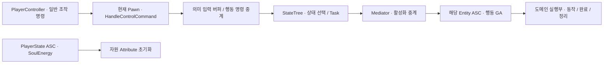

# 영혼 결속

## 설계 의도

타입별 메커니즘과 공통 생명주기(진입 조건·비용·취소·롤백·쿨다운)를 분리

2026-10-25 용어 확인: **영혼 결속은 플레이어가 사용하는 아스트라의 스킬 체계**. 적의 스킬과 공통으로 사용할 요청/GA/실행/취소 기반은 [스킬 공통 구조 검토안](스킬.md)에서 관리. 영혼 결속 네 타입을 단순한 아스트라 시전 요청으로 축소하지 않고, 빙의의 제어권 전환·변신의 플레이어 육체 변경·토템의 고정 지원 수명 유지. 타입별 원칙은 [영혼 결속 상세](../02_게임%20기획/시스템%20기획/영혼%20결속%20상세.md) 참조.

프로토타입 방어/공격/회복 3종의 별도 쿨다운 없음은 후속 제작 계획의 한정 정책. 아래 원문 메모의 일반 타입별 쿨다운 요구와 구분하며 전체 영혼 결속 기획을 일괄 변경하지 않음.

## 제작 순서와 현재 범위

2026-10-28 사용 형식 정리: 일반 스킬과 영혼 결속 모두 기본 EntitySkillDataAsset의 UseType(Instant/Channeling)을 공유. 결속 메커니즘 네 타입이나 즉시/초당 비용과는 다른 축이며 스킬 종류별 강제 매핑 없음. 현재 간격형 보스 소환 DA는 Channeling 기본값, 빙의/변신/자원 연결은 기존 아스트라 제작 단계 유지 — [공통 DA 데이터](스킬.md#공통-사용-형식-da--2026-10-28).

2026-10-25 사용자 지정: **보스 → 아스트라** 순서로 제작. 영혼 결속 구현은 아스트라 제작 단계에서 수행. 기존 일정표의 병행·선행 순서보다 이 지정을 우선하며 날짜는 재확정하지 않음.

2026-10-26 보스 소환기용 공통 요청/실행 ID·사용자 GA/StateTree 연결 API·소환물 수명 C++ 반영. 요청자/실행자/CostASC 참조를 구분하며 비용 차감·영혼 결속 연결은 아직 없음. 사용자 에셋 연결·빌드·PIE 미수행 — [현재 스킬 구현](스킬.md#현재-구현--2026-10-26).

영혼 결속의 네 타입은 확장 요구로 보존하며, 파티 명령·제어권 전환·SoulEnergy 비용을 보스 스킬 제작의 선행 필수 기능으로 만들지 않음.

## 현재 코드에서 확인한 실행 기반

2026-10-25 Source 대조 기준. 아래는 C++ 확인 결과이며 영혼 결속의 Blueprint 연결·PIE 완료를 의미하지 않음.

| 영역       | 현재 확인 내용                                                                                                  | 영혼 결속 관점의 한계                                    |
| -------- | --------------------------------------------------------------------------------------------------------- | ----------------------------------------------- |
| 일반 조작 명령 | PlayerController.SendControlCommand → 현재 Pawn의 IControllableEntity.HandleControlCommand                   | EEntityControlCommand에 영혼 결속·스킬 명령 없음           |
| 행동 실행    | EntityCharacter가 자신의 ASC를 구성하고 StartupAbilityClasses 지급. Mediator.TryActivateAbilityByTag가 해당 ASC에 활성화 요청 | 영혼 결속 타입별 행동·GA 연결은 별도 구현 대상                    |
| 플레이어 자원  | AstraPlayerState가 자원 ASC·PlayerAttributeSet 소유. InitializePlayerResources에서 SoulEnergy 초기화 및 중복 초기화 방지    | 행동 GA가 PlayerState ASC에 있는 구조가 아님               |
| 비용 API   | EntitySoulEnergyComponent에 CanPay·CommitCost·회복 지연 계산 존재                                                  | 자원 ASC 연결 불일치와 소비 호출 연결 누락 확인. 아래 보완 항목 참조      |
| 영혼 결속 진입 | AAstraPlayerController.TrySoulLinking 함수 선언·정의 존재                                                         | 함수 본문은 이후 구현 주석만 있음. 대상 탐색·결속 시작 실행 없음          |
| 제어권·HUD  | 일반 OnPossess/OnUnPossess 생명주기 존재. PlayerController의 HUD 바인딩은 APlayerCharacter 캐스팅 사용                      | 아스트라 빙의·원래 육체 복귀·AI 복구·HUD 재바인딩을 완료한 것으로 볼 수 없음 |

현재 일반 행동의 소유 관계:



입력 버퍼·StateTree·Mediator는 현재 행동 기반의 책임 구분. 각 Blueprint의 실제 연결은 별도 확인 대상이며, 위 흐름에 영혼 결속 스킬이 이미 연결되었다는 뜻이 아님.

## 아스트라 제작 시 먼저 보완할 자원 연결

1. `APlayerCharacter::OnInitializationCompleted`는 `SoulEnergyComponent->InitializeWithAbilitySystem(AbilitySystemComponent)` 호출. 여기의 ASC는 육체의 Entity ASC이지만 `UPlayerAttributeSet`은 PlayerState 자원 ASC가 소유. 초기화 함수는 해당 Set 존재 여부를 반환하며 호출부는 실패 반환을 처리하지 않음. 자원 소유자에 맞는 연결과 실패 처리가 필요.
2. `UEntitySoulEnergyComponent::CanPay/CommitCost`는 존재하지만 현재 Source에서 외부 소비 호출은 확인되지 않음. API 존재를 실제 스킬 비용 연결 완료로 기록하지 않음.
3. PlayerCharacter는 `OnSoulEnergyChanged`를 구독하지만 현재 자원 컴포넌트에 Attribute 변경 구독·해당 사건 Broadcast가 없음. SoulEnergy HUD 갱신 경로 보완 필요.
4. 현재 회복은 PlayerCharacter Tick에서 컴포넌트를 호출하는 구조. 빙의형의 '종료 후 회복 시작', Pawn 교체 중 지속 소모·회복, 공유 자원의 동시 비용 확정은 아직 별도 정책 연결이 필요.

이 항목은 이번 문서 대조에서 발견한 C++ 보완 대상. 지금 소스를 수정하거나 실행 검증한 결과가 아니며 보스 스킬 구현을 막는 선행 작업으로 두지 않음.

확인 소스: `Player/AAstraPlayerController.cpp`, `Player/AstraPlayerState.h/.cpp`, `Player/PlayerCharacter.cpp`, `Entity/Control/ControllableEntity.h`, `Entity/EntityCharacter.cpp`, `Entity/State/EntityStateMediatorComponent.cpp`, `Entity/Ability/EntitySoulEnergyComponent.h/.cpp` (`Source/Astra_SoulLink` 기준).

## 아스트라 단계의 실행 계약 검토안

아래는 이후 구현할 계약. 클래스·노드 연결 확정 또는 현재 동작을 뜻하지 않음.

- 요청자는 플레이어, 선택 아스트라·실제 행동 Entity·비용 지불 PlayerState는 요청 시 구분. 실행 중 현재 조종 Pawn으로 다시 해석하지 않음
- StateTree가 행동 선택·Task 진입, Mediator/EventBus가 행동 사건과 GA 활성화 요청 중계, 실행 Entity ASC의 GA가 실행 허가·비용 확정·완료/취소 소유
- SoulEnergy 원본은 PlayerState 자원 ASC. 별도 Entity ASC의 GA에서 비용을 지불할 연결 경계를 구현. GA의 기본 비용 처리가 자동으로 다른 ASC를 차감한다고 가정하지 않음
- 장기 결속 쿨다운의 PlayerState 유지 원칙은 목표 설계. 실제 결속 쿨다운 구현 완료와 구분. 프로토타입 3종의 별도 쿨다운 없음 유지
- 빙의는 조종 전환 세션과 대상 육체 행동 구분, 변신은 플레이어 육체 변경·복구, 직접스킬은 아스트라 행동, 토템은 고정 지원 수명으로 구분. 세션 소유 객체와 구체 GA 배치는 미정
- 타입별 비용·피격 취소·이동 제한은 상세 기획 유지. 보스 채널링의 이동 정지·일반 피격 유지 정책을 모든 아스트라 스킬에 적용하지 않음
- 시전 수명과 생성된 효과 수명 구분. 종료 시 해당 실행의 예약·Delegate·연출·행동 제한만 한 번 정리하며 이미 생성된 효과는 정의된 수명 정책 적용

### 정상·실패·취소 전체 순서 검토안

```text
플레이어 요청 → 선택 아스트라 / 타입 / 실행 Entity / 자원 소유자 확정
→ 보유·권한·생존·지상·게이지·동일 스킬 사용 여부 등 타입별 사전 검사
├─ 실패 → 거절 결과, 자원·제어권·외형 변경 없음
└─ 통과 → 해당 행동 StateTree Task → Mediator → GA 활성화
   → 실행 시점 조건·비용 재검사
   ├─ 실패 → 실패 결과 → 현재 행동 재선택
   └─ 통과 → 정해진 시점에 비용 확정 → 타입별 실행
      ├─ 직접스킬 → 시전 / 판정 → 시전 종료, 지속 효과는 별도 수명
      ├─ 빙의 → 제어권·카메라 전환 / 지속 비용 → 종료 시 원래 제어 복귀
      ├─ 변신 → 외형·ABP·기능 변경 / 지속 비용 → 종료 시 복구
      └─ 토템 → 아스트라 이동 제한 / 범위 지원 → 종료 후 제한 해제
완료 / 취소 / 사망 / 강제 이탈
→ 실행별 잔여 예약·연출·제한 정리 → 타입별 복구 → 결과 사건 → 현재 행동 선택
```

비용 확정 프레임·실패/취소 환불·동일 기술의 사용 중 범위는 미정. 종료 조건은 [상세 기획](../02_게임%20기획/시스템%20기획/영혼%20결속%20상세.md), 공유 실행 경계는 [스킬 검토안](스킬.md)에서 관리.

## 원문 구현 메모

- 최초 엑셀의 처리 역할 보존
- FSM·Release·스킬SO 표기는 레거시 메모
- 현재 Unreal 클래스·API 확정을 의미하지 않음

### Possession  (빙의형)

> - FSM 제어권 및 카메라 타겟 변경
> - Update에서 플레이어와의 거리 지속 체크
>
> - 종료 조건 충족 시 강제 Release() 호출
>
> - 해제 시 적용했던 버프 롤백(Cancel)
> - 사용 시 요구 게이지량 지속 차감
> - 스킬 게이지는 스킬이 종료된 후부터 회복되어야 함

### DirectSkill  (직접스킬형)

> - 사용 시 요구 게이지량 즉시 차감
>
> - 아스트라 AI에게 스킬 사용 명령(State 전이) 전달
>
> - 쿨다운 타이머 시작

### Transform  (변신형)

> - 사용 시 요구 게이지량 지속 차감
> - 플레이어의 모델, 애니메이션 블루프린트 변경 및 애니메이션 재생
> - 변신 중에는 움직일 수 없도록 State로 처리
> - 스킬 해제 시 쿨다운 타이머 적용

### Totem  (토템형)

> - 사용 시 요구 게이지량 즉시 차감
>
> - 아스트라의 물리 이동(Locomotion) 강제 정지
>
> - 스킬SO에 정의된 지속 시간 타이머 가동
>
> - 지속 시간 만료 시 일반 상태로 복귀

## 원본

- [NPC 행동 설계](../../%EC%9B%90%EB%B3%B8%20%EB%AC%B8%EC%84%9C/NPC%20%ED%96%89%EB%8F%99%20%EC%84%A4%EA%B3%84.xlsx)
- 범위: `NPC 스킬 구조 설계!H2:H6`

## 문서 연결

- 기획: [영혼 결속](../02_%EA%B2%8C%EC%9E%84%20%EA%B8%B0%ED%9A%8D/%EC%8B%9C%EC%8A%A4%ED%85%9C%20%EA%B8%B0%ED%9A%8D/%EC%98%81%ED%98%BC%20%EA%B2%B0%EC%86%8D.md)
- 시스템 설계: [영혼 결속](%EC%98%81%ED%98%BC%20%EA%B2%B0%EC%86%8D.md)
- 애니메이션 설계: [영혼 결속](../04_%EC%95%84%ED%8A%B8%20%EB%B0%8F%20%EC%95%A0%EB%8B%88%EB%A9%94%EC%9D%B4%EC%85%98/%EC%95%A0%EB%8B%88%EB%A9%94%EC%9D%B4%EC%85%98%20%EC%84%A4%EA%B3%84/%EC%98%81%ED%98%BC%20%EA%B2%B0%EC%86%8D.md)
