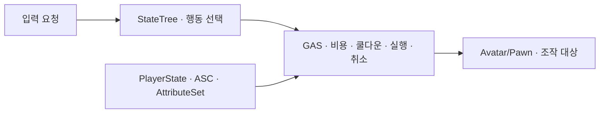

# 영혼 결속

## 설계 의도

타입별 메커니즘과 공통 생명주기(진입 조건·비용·취소·롤백·쿨다운)를 분리

## 책임

- 입력: PlayerController 또는 입력 Context
- 행동 선택·전이: StateTree
- 비용·쿨다운·효과·취소: Gameplay Ability
- 지속 자원·장기 쿨다운: PlayerState의 ASC·AttributeSet
- 조작 대상 변경: Possession
- StateTree 간 통신: EntityStateMediator·EventBus

## 구현 상태

- 공통 구현 원칙과 타입별 요구 분리
- 타입별 구체 클래스·노드 연결:
- Blueprint 정상·실패·취소 실행 순서:

## 원문 구현 메모

- 최초 엑셀의 처리 역할 보존
- FSM·Release·스킬SO 표기는 레거시 메모
- 현재 Unreal 클래스·API 확정을 의미하지 않음

### Possession  (빙의형)

> - FSM 제어권 및 카메라 타겟 변경
> - Update에서 플레이어와의 거리 지속 체크
>
> - 종료 조건 충족 시 강제 Release() 호출
>
> - 해제 시 적용했던 버프 롤백(Cancel)
> - 사용 시 요구 게이지량 지속 차감
> - 스킬 게이지는 스킬이 종료된 후부터 회복되어야 함

### DirectSkill  (직접스킬형)

> - 사용 시 요구 게이지량 즉시 차감
>
> - 아스트라 AI에게 스킬 사용 명령(State 전이) 전달
>
> - 쿨다운 타이머 시작

### Transform  (변신형)

> - 사용 시 요구 게이지량 지속 차감
> - 플레이어의 모델, 애니메이션 블루프린트 변경 및 애니메이션 재생
> - 변신 중에는 움직일 수 없도록 State로 처리
> - 스킬 해제 시 쿨다운 타이머 적용

### Totem  (토템형)

> - 사용 시 요구 게이지량 즉시 차감
>
> - 아스트라의 물리 이동(Locomotion) 강제 정지
>
> - 스킬SO에 정의된 지속 시간 타이머 가동
>
> - 지속 시간 만료 시 일반 상태로 복귀

## 원본

- [NPC 행동 설계](../../%EC%9B%90%EB%B3%B8%20%EB%AC%B8%EC%84%9C/NPC%20%ED%96%89%EB%8F%99%20%EC%84%A4%EA%B3%84.xlsx)
- 범위: `NPC 스킬 구조 설계!H2:H6`

## 문서 연결

- 기획: [영혼 결속](../02_%EA%B2%8C%EC%9E%84%20%EA%B8%B0%ED%9A%8D/%EC%8B%9C%EC%8A%A4%ED%85%9C%20%EA%B8%B0%ED%9A%8D/%EC%98%81%ED%98%BC%20%EA%B2%B0%EC%86%8D.md)
- 시스템 설계: [영혼 결속](%EC%98%81%ED%98%BC%20%EA%B2%B0%EC%86%8D.md)
- 애니메이션 설계: [영혼 결속](../04_%EC%95%84%ED%8A%B8%20%EB%B0%8F%20%EC%95%A0%EB%8B%88%EB%A9%94%EC%9D%B4%EC%85%98/%EC%95%A0%EB%8B%88%EB%A9%94%EC%9D%B4%EC%85%98%20%EC%84%A4%EA%B3%84/%EC%98%81%ED%98%BC%20%EA%B2%B0%EC%86%8D.md)
