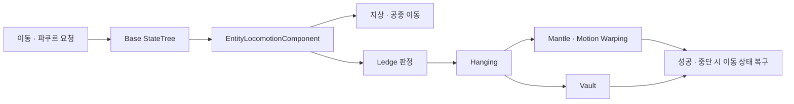

# 이동과 파쿠르

## 설계 의도

## 1. 현재 상태

| 기능 | 상태 | 비고 |
|---|---|---|
| Idle / Walk / Sprint | 완료 | Enhanced Input → StateTree 흐름 확인 |
| JumpStart / Jumping / Falling | 완료 | Falling 안정화 |
| Evade | 완료 | 비용·복구 경로 유지 |
| Hanging | 완료 | 정면 판정, 어깨 폭, 재감지 방지 적용 |
| Mantle | 완료 | Root Motion Montage + Motion Warping |
| Vault | 기능 구현 | 시각적으로 부자연스러워 전용 애니메이션 확보 전까지 보류 |

기준 StateTree:

`Content/Astra/Player/StateTree/BaseStateTree/ST_PlayerBaseState.uasset`

## 2. Ledge 감지

### 기본 조건

- 캐릭터가 벽을 바라보고 있어야 수행
- 공중 상태에서만 Hanging 후보를 검사
- 벽의 상단과 전면 Normal을 구
- 양쪽 어깨 폭을 수용할 수 있는 벽인지 Shape Trace로 검사
- 캡슐이 들어갈 안전 위치를 확인

선형 Ray 하나는 점만 검사하므로 어깨 폭이나 올라설 면적을 보장하지 못

면적 판정에는 Box/Sphere/Capsule Sweep과 여러 샘플을 사용

## 3. Hanging

- 매달리는 벽과 플레이어 캡슐의 상대 위치는 일정하게 유지
- 손 높이 기준은 `Ledge Grab ZOffset` 약 55가 현재 기준
- `HangingWallClearance`는 0을 기준으로 두고 손·무릎 깊이 차이는 애니메이션 또는 IK에서 처리
- 벽에서 내려가는 동안 캐릭터가 자동으로 뒤돌아 다시 매달리지 않도록 캐릭터 Forward와 벽 방향의 Dot 조건을 사용

애니메이션 전이·Inertialization: [이동과 파쿠르](../04_%EC%95%84%ED%8A%B8%20%EB%B0%8F%20%EC%95%A0%EB%8B%88%EB%A9%94%EC%9D%B4%EC%85%98/%EC%95%A0%EB%8B%88%EB%A9%94%EC%9D%B4%EC%85%98%20%EC%84%A4%EA%B3%84/%EC%9D%B4%EB%8F%99%EA%B3%BC%20%ED%8C%8C%EC%BF%A0%EB%A5%B4.md)

## 4. Mantle

### 판정

Mantle은 다음 두 영역이 모두 확보되어야 수행

1. 벽 위의 캡슐 최종 위치가 비어 있음
2. 최종 위치 아래에 실제로 설 수 있는 바닥이 있음

Overlap만으로는 바닥 지지 여부를 알 수 없음

최종 캡슐 위치의 `Overlap/Sweep`과 아래 방향 `Trace`를 분리

### 실행

- Hanging에서 Jump 또는 W 입력
- Mantle 가능 여부 검사
- 목표 캡슐 위치와 회전 계산
- Motion Warping Target 설정
- Root Motion Montage 재생
- Montage Delegate에서 성공·중단 처리
- 성공 시 최종 캡슐 Transform 보정
- Idle/Walk로 복귀

`Montage_SetEndDelegate`는 해당 AnimInstance와 Montage의 종료 콜백을 교체 등록

일반 멀티캐스트 Action처럼 호출할 때마다 구독자가 계속 누적되는 형태가 아닙니다

Montage 종료 후 콜백이 호출되며, Component 종료나 중단 경로에서는 활성 참조와 Delegate 의존성을 정리

### 시각 보정

- [이동과 파쿠르](../04_%EC%95%84%ED%8A%B8%20%EB%B0%8F%20%EC%95%A0%EB%8B%88%EB%A9%94%EC%9D%B4%EC%85%98/%EC%95%A0%EB%8B%88%EB%A9%94%EC%9D%B4%EC%85%98%20%EC%84%A4%EA%B3%84/%EC%9D%B4%EB%8F%99%EA%B3%BC%20%ED%8C%8C%EC%BF%A0%EB%A5%B4.md)

## 5. Vault

Vault 정의·허용 조건: [이동과 파쿠르](../02_%EA%B2%8C%EC%9E%84%20%EA%B8%B0%ED%9A%8D/%EC%8B%9C%EC%8A%A4%ED%85%9C%20%EA%B8%B0%ED%9A%8D/%EC%9D%B4%EB%8F%99%EA%B3%BC%20%ED%8C%8C%EC%BF%A0%EB%A5%B4.md)

- 담장 두께를 완주 거리로 사용하지 않고 현재는 일정한 1/4 호 이동을 사용

현재 Vault는 전용 애니메이션이 없어 기능만 유지

동작이 점프와 시각적으로 큰 차이가 없어 신규 애니메이션 또는 Motion Warping용 Vault Montage 확보 후 다시 다듬습니다

## 6. 회귀 테스트

- [ ] Hanging 진입 시 정면과 어깨 폭 조건 통과
- [ ] 벽을 보지 않으면 Hanging 미진입
- [ ] Hanging에서 뒤로 떨어진 직후 재매달림 없음
- [ ] Mantle 가능 위치에서만 Mantle 진입
- [ ] 머리 위 장애물이 있으면 Mantle/Vault 미진입
- [ ] Mantle 성공 후 Idle/Walk 정상 전환
- [ ] Mantle 후 Jump 시 이전 Ledge에 재매달리지 않음
- [ ] Vault 성공 후 Falling 또는 Ground 상태 정상 복귀
- [ ] 파쿠르 중 피해·사망 시 취소 함수가 MovementMode와 Gravity 복원

---

## 상위 페이지

- [03_시스템 설계](03_%EC%8B%9C%EC%8A%A4%ED%85%9C%20%EC%84%A4%EA%B3%84.md)

## 관련

- [시스템 아키텍처](%EC%8B%9C%EC%8A%A4%ED%85%9C%20%EC%95%84%ED%82%A4%ED%85%8D%EC%B2%98.md)
- [StateTree와 GAS](StateTree%EC%99%80%20GAS.md)

## 문서 연결

- 기획: [이동과 파쿠르](../02_%EA%B2%8C%EC%9E%84%20%EA%B8%B0%ED%9A%8D/%EC%8B%9C%EC%8A%A4%ED%85%9C%20%EA%B8%B0%ED%9A%8D/%EC%9D%B4%EB%8F%99%EA%B3%BC%20%ED%8C%8C%EC%BF%A0%EB%A5%B4.md)
- 시스템 설계: [이동과 파쿠르](%EC%9D%B4%EB%8F%99%EA%B3%BC%20%ED%8C%8C%EC%BF%A0%EB%A5%B4.md)
- 애니메이션 설계: [이동과 파쿠르](../04_%EC%95%84%ED%8A%B8%20%EB%B0%8F%20%EC%95%A0%EB%8B%88%EB%A9%94%EC%9D%B4%EC%85%98/%EC%95%A0%EB%8B%88%EB%A9%94%EC%9D%B4%EC%85%98%20%EC%84%A4%EA%B3%84/%EC%9D%B4%EB%8F%99%EA%B3%BC%20%ED%8C%8C%EC%BF%A0%EB%A5%B4.md)
