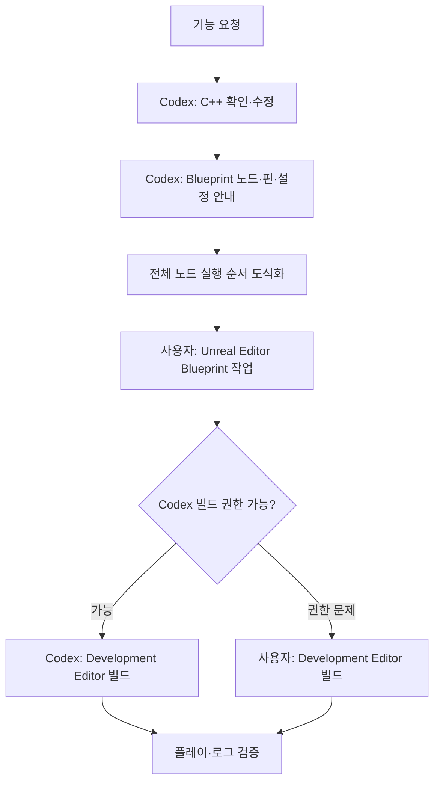
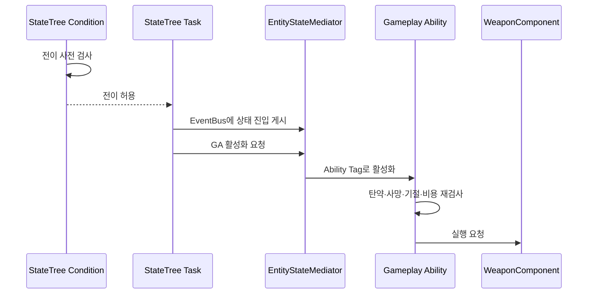
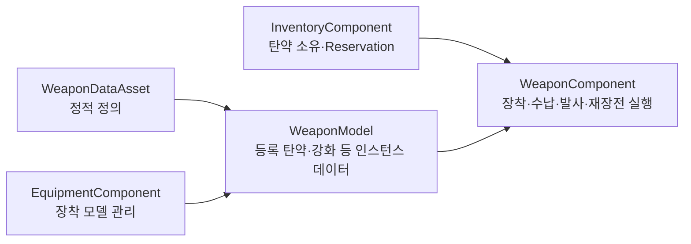

# 작업 규칙

## 설계 의도

텍스트로 안전하게 검토할 수 있는 C++ 변경과 Unreal Editor에서 사용자가 직접 확인해야 하는 콘텐츠 작업을 분리한다. Blueprint 안내는 일부 노드만 제시하지 않고 실행·실패·취소 경로 전체를 재현할 수 있는 형태로 제공한다.

## 작업 분담

- Unreal Editor의 Blueprint 작업은 사용자가 직접 수행한다.
- Codex는 C++ 코드 확인·수정과 정확한 Blueprint 연결 방법을 제공한다.
- Blueprint 설명 마지막에는 분기·실패·취소 경로를 포함한 전체 노드 실행 순서를 빠짐없이 도식화한다.
- Unreal 빌드에서 권한 문제가 발생하면 사용자가 직접 빌드한다. Codex는 빌드 Target과 검증 항목을 제공하고, 사용자가 공유한 첫 오류와 로그를 기준으로 후속 수정을 진행한다.

## StateTree와 Gameplay Ability 책임

- StateTree Condition은 전이 사전 검사를 담당한다.
- StateTree Task는 상태의 진입·실행·종료와 Gameplay Ability 활성화 요청을 담당한다.
- Condition이 통과했더라도 GA는 활성화 시점에 탄약·사망·기절·비용을 다시 검사한다.
- Condition 검사는 전이 후보 선택을 위한 것이고, GA 검사는 실제 실행 권한을 보장하기 위한 것이므로 의도적인 이중 검사다.

## 통신과 바인딩

- StateTree 간 직접 참조를 피하고 `EntityStateMediator`와 `EventBus`를 사용한다.
- StateTree Task는 상태 진입 사실을 EventBus에 게시한다.
- EntityStateMediator는 교차 StateTree 정책을 적용하고 다른 StateTree 또는 GAS에 명령을 라우팅한다.
- STC/STT는 가능하면 `Actor + EntityContext`만 바인딩한다.
- EntityContext에는 참조만 두고 판단·전이·실행 로직을 넣지 않는다.

## 무기 데이터 소유권

- `WeaponDataAsset`은 Mesh, Socket, 피해, 사거리, 반동, Montage 등 정적 정의를 소유한다.
- `WeaponModel`은 등록 탄종·등록 탄수와 향후 강화·내구도·부착물 등 개별 무기의 인스턴스 데이터를 소유한다.
- `EquipmentComponent`는 장착 슬롯과 현재 WeaponModel을 관리한다.
- `InventoryComponent`는 Ammunition Item과 탄약 Reservation을 소유한다.
- `WeaponComponent`는 현재 WeaponModel을 참조하고 장착·수납·발사·재장전 실행을 조율한다.

---

## 상위 페이지

- [[03_시스템 설계]]

## 관련

- [[개발 규칙|개발 규칙]]
- [[StateTree와 GAS|StateTree와 Gameplay Ability System]]
- [[무기 시스템|무기 시스템]]
- [[Editor 작업 절차|Unreal Editor 작업 절차]]
- [[시스템 아키텍처]]
- [[StateTree와 GAS]]
